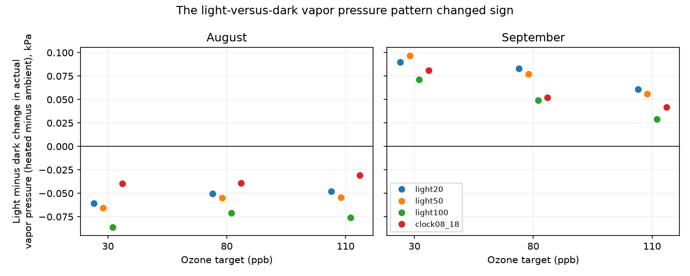

# Light-minus-dark vapor pressure contrasts changed sign between August and September in a North Wales experiment in 2021

The recorded air conditions did not show a stable daily vapor pressure pattern. Heated minus ambient actual vapor pressure was lower in light hours than in dark hours in August. This contrast was higher in September. The sign change occurred in all three heated domes under four definitions of light hours. It remained after removal of any one day. Assumed independent reading errors of up to 0.2 C and one relative humidity percentage point allowed both signs in every test. Thus the record shows a stable descriptive contrast within each month, but does not establish a physical drying mechanism.



## Question and new contribution

Can one daily pattern of actual vapor pressure explain the conditions in a public ozone and warming experiment across two complete months? This is a limited exposure test that can help plan studies of climate, pollution and floral resources. Actual vapor pressure differs from relative humidity. Heating alone can lower relative humidity at constant actual vapor pressure. A change in actual vapor pressure can add to, or offset, the change in vapor pressure deficit (VPD).

We searched the campaign for phenology, pollution biodiversity, climate birds, ozone, Ryalls, harebell, solardome and stomatal records. We read the strongest records for this source. SCI sha256:1ceb6dc11fbe44a507f581f0653d16455b0d051fabcbb9cb417d554762e20584 tested harebell width. SCI sha256:1450109aa182d4ae33d13253ad49b9d1946045e1d7226e082f1c1e55dd9a11cf tested missing visit dates. SCI sha256:2e833e35b40dd4089a8f961789bc4ef0f370769b26f6ef9030eda2da07099351 found higher VPD in heated domes and reported a pooled saturation/actual vapor decomposition. SCI sha256:51e63bdcebf6d84f9bdbb679bca8fa4358b41128b862f9ee6588cb023b30f2fa tested whether ozone and VPD overlap exceeded a time schedule reference.

SCI sha256:2d3dc93dbf4e109604eecf2e09dec02f10925c4a457682bbe8be9ec1bbff42fb also tested reading-error bounds for joint ozone and VPD events. Its method is relevant to our error check, but its outcome differs.

This study uses the same raw experiment. It adds a test of the light-versus-dark actual vapor pressure contrast in each complete month, checks day weights and day deletion, and tests reading-error limits. It does not repeat the pooled VPD result as a new finding. It is an exploratory analysis, with no independent biological validation. We wrote new code and used no prior derived records.

VPD and ozone can be linked through plant gas exchange. Kavassalis and Murphy (2017, DOI 10.1002/2016GL071791) examined this link in US observations. Their result motivates care in exposure description. It does not show that the chamber contrasts here measure ozone uptake or flower damage.

## Data and observation bias

Hayes and Sharps (2023), *Flower number and flower size of UK wildflowers following ozone and warming treatments, 2021*, NERC EDS Environmental Information Data Centre, DOI 10.5285/a33d5ee3-d201-4feb-83b9-765ee5b2c25e, released the data. Five wildflower species grew in pots at Abergwyngregyn, North Wales. Ozone followed a repeated weekly profile. The heating target was ambient plus 4 C. The tested ozone labels, 30, 80 and 110 ppb, are target profile peaks, not constant concentrations.

We use heated domes 6, 2 and 4, in that target order. All comparisons use ambient weather from dome 7, as specified by the source. Light also comes from one shared series. Current weather differences between ambient domes cannot be measured. There is one dome per treatment cell. The three contrasts share ambient readings, light classification and site weather. They are not independent treatment replicates.

The source reports quality control and possible gap filling, but gives no hourly flags for filled data or sensor accuracy. One row has no valid hour label; we exclude it. August has 744 complete hours and September has 720. All tested temperature, humidity and light channels are present in these months. Date-hour grids are complete and unique. We do not interpolate. Early weather coverage was poor in prior work. We therefore do not extrapolate this test to June or July, nor to October after flower visits ended. Complete coverage controls missing-hour selection within the tested months; it does not remove sensor error, common-reference error or gap-fill effects.

The flower table and source document were inspected for context. No flower measurement enters this analysis. The two months have separate hours but share chambers, sensors and season. They are temporal checks within one site-year, not independent geographic or experimental validation.

## Calculation and checks

For temperature T in C and relative humidity R in percent, use the FAO-56 equation:

`es(T) = 0.6108 exp(17.27 T / (T + 237.3))` kPa.

Actual vapor pressure is `e = es(T) R/100`. For each hour define `d = e_heated - e_ambient`. Define `C = mean(d | light) - mean(d | dark)` separately by month and dome. Negative C means a larger heated-minus-ambient vapor pressure reduction in light hours. Positive C does not require actual vapor pressure to be greater in heated air. It can mean a smaller reduction in light hours.

The primary rule is shared recorded light at least 20 micromoles per square metre per second. Other rules use 50, 100, and recorded hours 08 through 17 inclusive. These rules are diagnostic choices, not plant response thresholds. The clock rule is not a claim about sunrise, sunset, time zone or biological day. We selected these comparisons after the broad data inspection and report all of them. This is not a registered hypothesis test.

The primary calculation weights hours equally within light and dark groups. A second calculation first takes each day's light-minus-dark contrast and then weights days equally. Day removal recomputes the original hourly contrast after omitting each full date in turn. These checks test weight and single-day dependence, not sampling uncertainty. No p value treats the hours as independent treatment units.

For an error check, each reading can differ independently by up to 0.2 C and one humidity percentage point. These are illustrative allowances, not source sensor specifications. Light labels stay fixed. Set the lower bound on d to `es(Th-0.2) clip(Rh-1)/100 - es(Ta+0.2) clip(Ra+1)/100`, with humidity clipped to 0-100. The upper bound reverses these signs. Saturation pressure increases with temperature on the tested range. All factors are nonnegative. Thus these are endpoint bounds. The lower bound on C is mean(lower d in light) minus mean(upper d in dark); the upper bound is the reverse. The bounds are sharp under the stated independent-reading model. This model allows time-varying errors and does not represent a constant sensor offset model. They are not confidence intervals.

The code checks monthly grids, unique hours, complete channels, the exact identity `VPDh - VPDa = es(Th) - es(Ta) - d`, and bound containment. An independent standard-library program recomputes all 24 contrasts, day weights, hour counts and error limits. All checks passed.

## Results

The primary light rule gives the following values in kPa:

| Month | Ozone target | Mean d, light | Mean d, dark | C | C with equal day weights | Range after one day is removed |
| --- | ---: | ---: | ---: | ---: | ---: | ---: |
| August | 30 | -0.06781 | -0.00696 | -0.06085 | -0.06308 | -0.07114 to -0.03563 |
| August | 80 | -0.06581 | -0.01543 | -0.05038 | -0.05461 | -0.05750 to -0.02893 |
| August | 110 | -0.03796 | +0.01020 | -0.04816 | -0.05086 | -0.06077 to -0.02484 |
| September | 30 | -0.04103 | -0.13099 | +0.08996 | +0.05594 | +0.07796 to +0.09965 |
| September | 80 | -0.03910 | -0.12190 | +0.08280 | +0.04583 | +0.07134 to +0.09574 |
| September | 110 | -0.06272 | -0.12357 | +0.06086 | +0.02433 | +0.04884 to +0.07227 |

August has 432 light hours; September has 362. Under the four rules, all August contrasts were negative (-0.08600 to -0.03089), and all September contrasts were positive (+0.02897 to +0.09668). Equal day weights and all individual day deletions kept those monthly signs in all 24 tests. This consistency describes the record, not a regional pattern.

Day-level contrasts were less consistent. For the primary rule, only 14, 14 and 13 of 31 August days had a positive contrast at the three ozone targets. September had 19, 19 and 17 positive days out of 30. The monthly contrast is not a claim that every day had the same sign.

Every error interval for the six primary tests includes zero. Their limits range from -0.26257 to +0.29091 kPa. All 24 sensitivity-test intervals also include zero. The full results are in files/contrasts.csv. The small monthly phase contrasts need calibration evidence before they can establish physical differences.

## Interpretation, limits and next test

A single pooled vapor pressure summary hides a daily pattern that changed between months. The record does not support one stable light-versus-dark actual vapor pressure contrast. This temporal failure is useful when planning exposure controls. The prior error audit found that several joint ozone and VPD event contrasts survived larger assumed errors. Our smaller actual-vapor phase term is more sensitive under a different error path. This comparison does not rank sensor accuracy or compare identical outcomes. It does not refute the prior finding of higher VPD in heated domes: VPD also includes a large saturation pressure term.

Ventilation, plant water release, watering, sensor bias, weather or source gap filling could change d. None was isolated here. We did not control measured ozone within the light groups, fit a deposition model, measure leaf temperature or stomatal conductance, or test which mechanism caused the reversal. The target labels identify chambers; they do not establish an ozone dose response in this contrast. No flower loss, change in biodiversity, timing shift, species distribution, natural extreme event or climate trend is inferred.

A next test should keep calibrated humidity and temperature sensors in each ambient and heated dome, measure leaf gas exchange and soil water, and record ventilation and watering. It should repeat the treatment with independent domes, sites and years. The present code can audit the light-versus-dark exposure structure before a biological model is fitted. Independent regions and years remain untested.

## Rights and reproduction

Contains data supplied by UK Centre for Ecology & Hydrology.

The source is under the Open Government Licence v3. Its files, extracted source records and daily derived records remain external. This baseline package contains our code, narrative, figure, provenance and aggregate analytical contrasts. External terms and attribution are recorded separately in files/EXTERNAL_DATA_NOTICE.md. We do not replace the external source license.

The exact shared input is `/mnt/dell-data/shared_datasets/ukceh-wildflower-ozone-warming-2021-a33d5ee3/data.zip`. Source URL, release and resolved path are in files/provenance.json. Archive SHA-256 is `d45d41b83dd1b8f147d90eba0c9cba3d12d05f9dd979f02378d631e8a8273d3a`. Member hashes and software versions are in files/audit.json. The archive wrapper can change on retrieval; the retrieval code checks the three stable source members. No new shared download was needed.

Use Python 3.12 and the packages in files/requirements.txt. From an extracted publication, write all outputs to external scratch:

```sh
python files/retrieve.py /tmp/vapor_external_new
python files/analyze.py --archive /tmp/vapor_external_new/data.zip --out /tmp/vapor_analysis_new
python files/validate.py --archive /tmp/vapor_external_new/data.zip --results /tmp/vapor_analysis_new
```

Alternatively pass the shared input path directly. Compare contrasts.csv and numerical audit values with bundled files. Image bytes can vary by library version. The generated daily_external.csv is an external derived table and is not part of the signed package. No random seed or parallel computation is needed.

Campaign 11_07_2026. Job sci-1107-dell-climate-pollution-biodiversity-efeca4c5da6a. Topic climate-pollution-biodiversity. Machine dell. Account codex-olen. Model gpt-6.1-sol with high reasoning effort. Analysis date 2026-11-11. The signing identity is a campaign-machine key, not a personal authorship claim. No private key is included.
