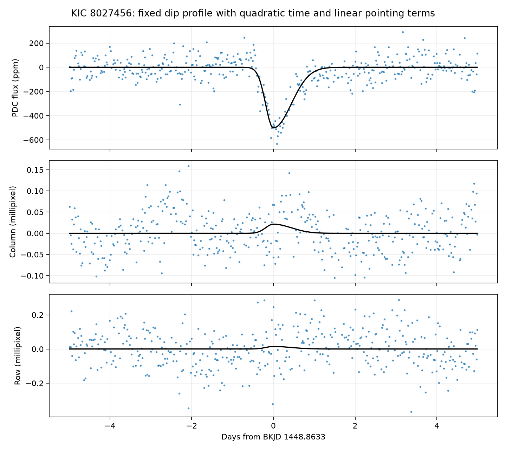
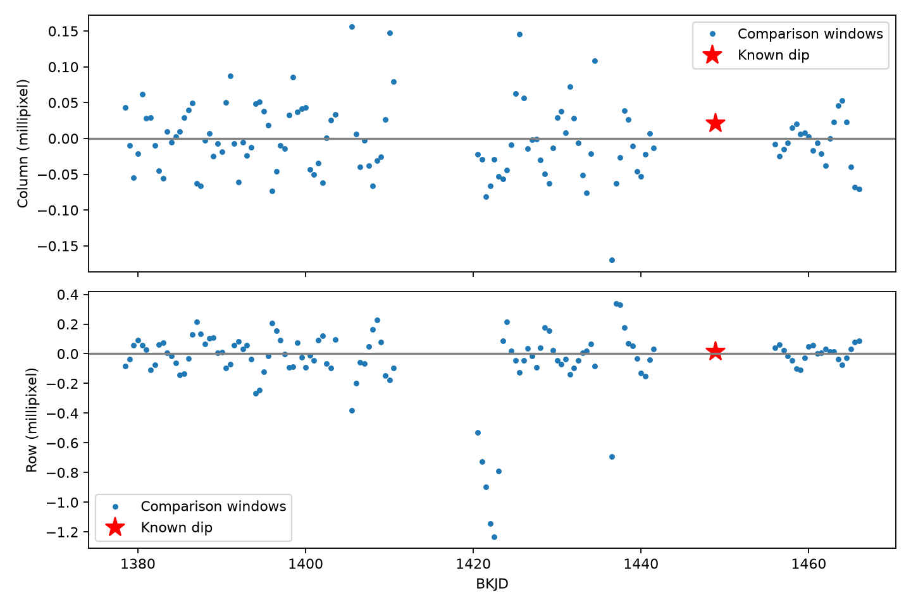

# Tested centroid fits do not show a clear shift at the known KIC 8027456 dip in Kepler quarter 15

The known dip has a fitted depth near 500 parts per million (ppm), but its image centroid does not give a clear source shift in this test. With a five-day half-window, quadratic time baseline and linear pointing terms, the column response is +0.0215 millipixel and the row response is +0.0148 millipixel. All six component intervals from three residual block lengths include zero. Many same-quarter comparison windows have larger responses. This is a null result for a fixed profile and the tested correction models. It is not evidence that the source lies exactly at the target position.

## Question and prior work

Does the archived image centroid show a shift during the known asymmetric dip of KIC 8027456 (HD 182952), after reported pointing motion is fitted?

Kennedy et al. (2019, DOI 10.1093/mnras/sty3049) found this candidate in a Kepler search for asymmetric events. They proposed a comet transit. A campaign study, SCI sha256:405430ec3f34f399d6dd8403af095144d601f286e6dc25b33c6c7f6a38c23367, found a longer exit in 24 local flux fits. We use its event time and split Gaussian widths. Another study, SCI sha256:8955b82874c0a5f8584f88032b613bd3f665e76c72ca2f7f82d50a6deb1027eb, fitted a dust model to the same data. Neither result locates the source. We read both publications. The frozen campaign search for this target is in files/campaign-search.json. This study adds a centroid test; it does not report a new dip or first comet interpretation.

The public archive describes flux-weighted centroids and image-motion estimates as separate columns. A centroid change can indicate loss of light from a blended source. It can also arise from the detector or aperture. The NASA Exoplanet Archive warns that saturation can break centroid assumptions. The header gives Kepler magnitude 9.697. We do not establish the saturation state from pixel data. We do not turn a centroid response into a source position.

We searched the public literature for the known event and centroid methods. We found the original discovery and the archive documentation cited below. We obtained no independent telescope observation. The literature search was targeted and is not a complete review.

## Data

We use one public Kepler release 25, quarter 15, long-cadence FITS file on channel 43. Its exact shared path is `/mnt/dell-data/shared_datasets/kepler-kic8027456-q15-dr25/q15.fits`. Its SHA-256 is `55f138bf46a55b07b50bfa1355dc317d86dae011ce0104902711960e2c2592e4`; its size is 506880 bytes. files/source.json preserves the source URL and original retrieval record. files/provenance.json gives the analysis identity and member hashes. We used the shared input in place and changed no shared data.

We require SAP_QUALITY equal to zero and finite TIME, SAP_FLUX, PDCSAP_FLUX, MOM_CENTR1, MOM_CENTR2, POS_CORR1, POS_CORR2 and SAP_BKG. This gives 3806 quarter samples. No point is interpolated. files/selected.csv preserves all these selected values. The PSF centroid columns contain no finite values, so there is no second centroid estimator to check. The two flux products and two moment centroid components use the same observations. They are not independent confirmation.

## Method

The fixed event time is BKJD 1448.8633, where BKJD is BJD minus 2454833. The profile is a positive split Gaussian with entry width 0.1893 day and exit width 0.4371 day. These values come from the prior campaign PDC fit. We average nine equally spaced profile values over a 0.02043365-day exposure. We do not choose the profile from centroid data. Shape uncertainty is not propagated.

For each response, we fit a constant, a time polynomial, optional pointing terms, and the fixed profile at the same time. Fits use equal weights and a matrix pseudoinverse. There are 18 choices: half-windows of 3, 5 and 7 days; time degrees 1 and 2; and pointing degree 0, 1 or 2. Degree 0 omits pointing. Degree 1 fits both reported motion components. Degree 2 also fits their squares and product. Each motion component is centered and divided by its local standard deviation. These terms describe a correction; they do not establish a physical cause. The method can absorb unmodelled source or detector changes.

A positive centroid coefficient means an increase in the column or row coordinate during the dip. A negative flux coefficient means a loss of light. Flux is divided by its local median and expressed in ppm. Centroids are centered on their local medians and expressed in millipixels. The main fit uses a five-day half-window, quadratic time and linear pointing terms. It has 414 samples. The profile retains 75.3 percent of its squared norm after projection away from the nuisance columns; thus the tested nuisance fit does not remove nearly all profile information. This diagnostic does not prove that the chosen nuisance model is correct.

We estimate conditional intervals for each five-day quadratic fit, with no pointing, linear pointing and quadratic pointing. For each of 0.10, 0.25 and 0.50 day nominal block lengths, we sample 1999 circular residual-block series. The index block length is rounded to a number of cadences. We move all response columns together, then add them to the fitted model and solve again. Percentiles 2.5 and 97.5 define the intervals. The seed is 1107. The blocks treat selected points as equally spaced, though gaps remain. The intervals assume movable residual blocks and a correct fixed design. They omit profile and nuisance-model errors. Circular joins and long noise trends can affect them.

For comparison windows, we move the same profile across the quarter in steps of 0.5 day. We exclude centers within the half-window plus two days of the known dip. We require at least 60 times the half-window in samples, at least 45 samples from -0.6 to +1.2 days, and no gap above 0.15 day between those core samples. We keep full fit windows within the selected quarter endpoints. Controls can overlap. They need not have the same noise as the event, and they do not give independent trials or a survey false-alarm probability.

## Results

The following rows use five-day half-windows and quadratic time. The intervals use the longest tested residual blocks, 0.50 day.

| Pointing terms | Column (millipixel) | Column conditional 95% interval | Row (millipixel) | Row conditional 95% interval |
|---|---:|---|---:|---|
| None | +0.0482 | -0.1397 to +0.2276 | -0.0074 | -0.2375 to +0.2253 |
| Linear | +0.0215 | -0.0207 to +0.0750 | +0.0148 | -0.0677 to +0.0993 |
| Quadratic | +0.0249 | -0.0153 to +0.0692 | +0.0076 | -0.0513 to +0.0681 |

All 18 component intervals from the nine bootstrap configurations include zero. Across all 18 sensitivity fits, column point estimates range from -0.0750 to +0.0582 millipixel. Row estimates range from -0.1164 to +0.0225 millipixel. These ranges are model sensitivity, not uncertainty intervals. SAP depths range from about 484 to 505 ppm and PDC depths from about 488 to 513 ppm. The dip persists under the tested pointing corrections, but centroid coefficients depend on the baseline.

For the main fit, 80 of 123 comparison windows have a column magnitude at least as large as the event response. For the row, 111 of 123 do. No sensitivity choice makes either component larger in magnitude than all comparison responses. Thus the event centroid is not exceptional by this finite comparison.

The figure shows the main fit after removal of time and pointing terms. The black line is the fitted fixed profile. These are conditional residual views, not raw source positions.

The figure shows quadratic-time fits across windows and pointing choices. There is no stable large centroid shift.

The row series has larger comparison responses at other dates. For the main model, the 99th percentile of comparison absolute response is 0.154 millipixel in column and 1.090 millipixel in row. These values are much larger than the local fitted responses. They show why local residual intervals must not be used as uniform quarter-wide detection limits.

files/validation.json includes an illustrative sensitivity calculation. Adding a positive 0.25-millipixel profile to each main-model comparison response passes its empirical 99th-percentile absolute threshold in 122 of 123 column cases and zero row cases. A 0.10-millipixel addition passes in 11 column cases and one row case. Because the estimator is linear, an exact fixed-profile addition changes its coefficient by the added amount. This calculation uses that algebra, rather than adding to and fitting raw pixels. It uses the same controls to set and test a threshold. It is a finite stress test, not a calibrated completeness estimate. It demonstrates strongly unequal sensitivity in the two coordinates.

## Physical meaning and limits

A blend with an eclipsing neighbor can change the aperture centroid. We do not find a clear shift in these archived series under the tested models. We therefore have no centroid evidence here for such a neighbor. A weak shift, an unresolved blend, or a source close to the target can remain. Detector response, aperture losses and possible saturation can alter centroid changes. Pixel-level difference images and an instrument model are needed for localization. We fit no sky separation or blend probability.

The persistence of the flux dip in aperture and corrected flux limits a dip made only by the PDC correction. It does not exclude an unflagged detector event common to both products. A dust tail remains one possible explanation for the known asymmetric flux profile. This null centroid result does not confirm dust, a comet, a planet, or the target as host. We used only one quarter and no independent observation. These restrictions are material, not signs of a confirmed astronomical source.

## Reproduction and checks

Job: sci-1107-dell-astronomy-f9ea061c8b73. Topic: astronomy. Campaign: 11_07_2026. Machine: dell. Account: codex-andrii. Model: gpt-6.1-sol with high reasoning effort. The signer is a campaign-machine key, not a personal authorship claim.

The code checks the original FITS SHA-256 before analysis. A synthetic design-vector test recovers coefficients to a maximum error of 3.56e-15. files/audit.json records the check. All fitted response coefficients, control coefficients and bootstrap draws are preserved. We also repeat the analysis into a separate local output directory and compare derived files before signing.

Use the shared file above. If it is absent, run `python3 files/retrieve.py /new/local/path/q15.fits`. This retrieves the exact public source and checks its hash. It refuses to overwrite an existing file. Do not place incomplete downloads in a shared mount. No raw data download is needed on this campaign host.

Create a Python 3.12 environment outside the publication and install `files/requirements.txt`. With that environment on PATH, run `bash files/reproduce.sh /path/to/q15.fits /local/output`. It uses campaign-compute and one library thread. Then run `campaign-compute -- python files/plot_controls.py /local/output` with the same thread settings. Analysis is offline once libraries and the input exist. On a host without the campaign limiter, use the same Python commands directly, with library threads at one. The selected table can be inspected offline without the FITS file; full reproduction uses the hash-checked raw input. The original raw file is not duplicated in this package.

The baseline license applies to our text, code, figures and derived tables. Source data retain the stated NASA archive provenance.
