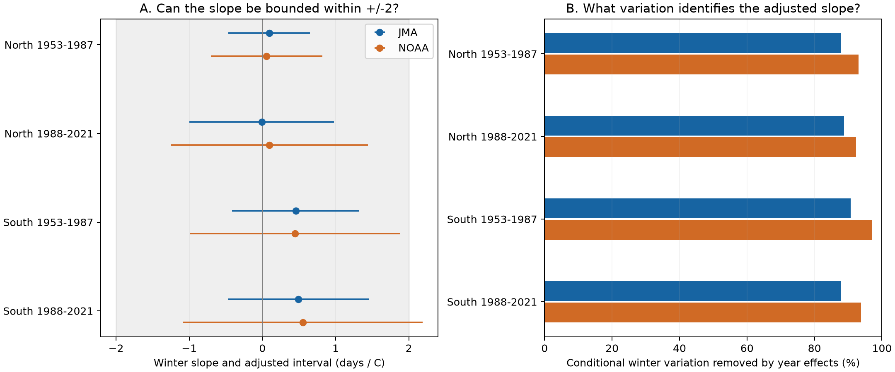

# Year controls removed 88-97 percent of winter temperature variation after site and spring controls in four Japan samples, 1953-2021

Year controls removed 87.8-97.0 percent of winter-temperature variation that remained after station and spring controls. This is an exact description of the selected model matrices. It is not an estimate of the fraction of the biological response caused by climate. Of eight conditional slope intervals, 7 fit within -2 to +2 days per C, and 3 fit within -1 to +1. All eight include zero. Null tests thus differ in what effect sizes they can exclude.

## Question and prior work

Does an uncertain winter slope give a useful bound on the interval from first cherry flowers to full bloom? How much winter variation identifies that slope after year controls? These questions matter when a shared regional temperature signal is removed to control shared reporting and environmental conditions.

The required campaign search was started with `sci search "phenology climate" --in ./campaign --json`. We inspected its verified metadata cache while the full archive scan continued. The full search then completed with no invalid candidates. The relevant records are preserved in files/campaign_prior.json. We then read and completely verified publication 59b4bdcc2d74a3d31b513d1e6b0b1c4b3e22dc02621ef1b92aa0cca103b73784. That study found uncertain slopes with JMA and NOAA temperatures and did not test equivalence. We reuse its exact panel. This is a method and precision study on existing observations, not an independent biological replication.

Katsuki and colleagues (2026, doi:10.1007/s00484-026-03185-6) link low chilling to slow flower development at southern sites. Our monthly model does not test that mechanism directly. It describes what a more controlled regional panel can resolve. The two-day threshold is an exploratory reporting tolerance chosen after reading the prior results. It is not a measured ecological damage threshold. We also report the smallest symmetric bound supported by each interval, so readers can apply another tolerance.

## Data

The source has 4,436 complete station-years at 71 stations in Japan, 1953-2021. North is at least 36 N; South is below 36 N. Periods are 1953-1987 and 1988-2021. There are 870, 715, 1,509 and 1,342 records in North early, North late, South early and South late. Their station counts are 25, 25, 46 and 46. Regions use separate stations; periods use separate years. Regional weather and the observation system limit independence. Both weather products can use some of the same inputs.

The panel preserves JMA first-flower and full-bloom dates, report codes, local JMA weather and matched NOAA GHCN-CAMS weather. Standard species codes 8 and 9 are included. Substitute species codes 6 and 7 are excluded. First flowering means a few open flowers; full bloom means about 80 percent open. Their difference does not measure flower lifespan, abundance, total flowering duration or pollinator food.

Winter is the unweighted mean of prior December and January. Spring is a day-weighted monthly mean from February 1 to the day before the fixed station mean bloom day. We keep the earlier windows without further selection. They can extend past first flowering. Units are degrees C and days.

files/panel.csv is the exact signed source entry files/matched_panel.csv. files/provenance.json gives its hash and source bundle path. files/upstream_provenance.json and files/source_report.md preserve the raw source chain and retrieval details. Relevant shared paths are `/mnt/dell-data/shared_datasets/jma-phenology-ruinenchi-all-20261108/ruinenchi_all.zip` (SHA-256 `0ca3e39524918d61d85f4c6424c4b0925613af8100daf9880a74cfdcce2b1c70`) and `/mnt/dell-data/shared_datasets/noaa-psl-ghcncams-air-mon-mean-20261105/air.mon.mean.nc` (version 3.01; SHA-256 `8dbe8e8ce86729f56a2234dec7420b94aecba804aa7df599c8fea68ade70802b`). We use the signed derived panel for all final results. We do not claim to rebuild the full upstream raw panel in this study. Data were provided by NOAA PSL, Boulder, Colorado, USA, from https://psl.noaa.gov.

## Method

For each region, period and weather product we fit:

`gap = station effect + year effect + winter slope * winter + spring slope * spring + error`.

Let A be winter residuals after station and spring controls, and B be winter residuals after station, spring and year controls. The removed fraction is `1 - sum(B^2)/sum(A^2)`. These models are nested. The fraction is conditional on the spring variable, selected records and region. It gives loss of winter regressor variation; it does not alone give the loss of statistical power, because year controls also change outcome noise. We report residual standard deviations and sums of squares in files/information.csv.

For slope uncertainty we use station-plus-year cluster covariance, minus the station-year intersection term, with statsmodels small-sample corrections. The t degrees of freedom are the smaller cluster count minus one. Intervals use `t(1 - 0.05/16)`, giving nominal simultaneous 95 percent coverage for eight slopes in each model family. Spatial correlation beyond these clusters can invalidate coverage. We do not assume the two products are independent.

A slope is bounded within a tolerance only if its entire adjusted interval lies strictly inside that tolerance. This is a conservative confidence-containment rule. It is not a claim of exact zero or the usual single-test 90 percent equivalence interval. The minimum supported symmetric tolerance is the larger absolute endpoint, with strict containment requiring a slightly larger value. Tests at 1 and 2 days per C are descriptive uses of the same simultaneous intervals.

We also fit a station-only model to expose the change in the target association; it does not control shared annual conditions. A separate sensitivity model adds station-specific linear trends to year and station effects. We omit one redundant site trend because year effects already contain the common linear trend. A setting check retains sites with one common code for both phases within each period. No joint coverage claim spans all sensitivity families. Report codes before 1987 can fail to identify nearby observation settings.

## Results

| Sample | Weather | Winter slope and adjusted interval, days/C | Minimum symmetric bound, days/C |
| --- | --- | --- | --- |
| North, 1953-1987 | JMA | +0.092 [-0.466, +0.650] | 0.650 |
| North, 1953-1987 | NOAA | +0.058 [-0.701, +0.817] | 0.817 |
| North, 1988-2021 | JMA | -0.010 [-0.997, +0.978] | 0.997 |
| North, 1988-2021 | NOAA | +0.093 [-1.254, +1.439] | 1.439 |
| South, 1953-1987 | JMA | +0.455 [-0.415, +1.325] | 1.325 |
| South, 1953-1987 | NOAA | +0.444 [-0.989, +1.877] | 1.877 |
| South, 1988-2021 | JMA | +0.489 [-0.472, +1.450] | 1.450 |
| South, 1988-2021 | NOAA | +0.550 [-1.089, +2.190] | 2.190 |



The year effects remove a large part of the conditional winter contrast. The remaining coefficient compares local departures from the regional annual pattern. It cannot establish a bound on the response to a region-wide warm winter or a long-term warming trend. A small conditional slope is compatible with a larger shared regional response. Conversely, removing the year effects can expose confounding, so the station-only model is not a causal substitute.

Across both products, both setting samples, and models with and without station trends, the largest symmetric bound is:

| Sample | Largest bound, days/C |
| --- | ---: |
| North, 1953-1987 | 1.092 |
| North, 1988-2021 | 2.052 |
| South, 1953-1987 | 2.246 |
| South, 1988-2021 | 2.345 |

Only early North keeps all these bounds below 2 days/C. The main late-North JMA bound of 0.997 is close to the one-day threshold and does not survive the setting check.

All sensitivity estimates are in files/estimates.csv. The table includes setting checks, site-only models and site-trend models. Bounds can change when the sample or target contrast changes. A tolerance that holds in the main model need not hold under all observation and trend assumptions. These analyses use the same records and are not new replication samples.

## Limits

The variance decomposition is exact for these records. The slope bounds depend on the model and approximate cluster inference. Monthly means do not measure chilling hours, damaging frost or weather extremes. Complete-pair selection can omit trees that did not reach full bloom. Unknown visit schedules, tree replacement, station moves, management and urban change remain possible biases. Stable report codes do not establish stable trees or effort. The planted trees do not form a probability sample of wild biodiversity. Pollution, species distributions, species loss and pollinator timing are not measured. No causal climate-change effect is identified.

## Reproduction and checks

Extract this bundle and run:

```sh
OPENBLAS_NUM_THREADS=1 python files/analyze.py
```

Run it from any directory by giving the absolute script path. The program uses its sibling panel.csv and writes estimates.csv, information.csv, validation.json and results.png. Python, numpy, pandas, scipy, statsmodels and matplotlib are required. Exact versions are in validation.json. No network or shared raw data are required for this analysis step.

The checks confirm unique station-year keys, exact gap arithmetic, and agreement of all full-model winter slopes with independent residual least-squares fits. The JMA main point estimates agree with the prior publication to 0.001 days per C. The source bundle complete verification is in source_verify.json. To recover the exact input, verify the cited ZIP with SCI and read files/matched_panel.csv; compare the SHA-256 in provenance.json. To rebuild raw inputs, follow the source report and its cited original bundle. Live raw URLs can change; use the recorded shared snapshots and hashes. The baseline license covers our new code, text and outputs; upstream attribution and rights remain in force.

## Worker record

Job: sci-1107-syam2-climate-pollution-biodiversity-1b9fed22c9a7. Topic: climate-pollution-biodiversity. Campaign: 11_07_2026. Machine: syam2. Account: codex-myxtap. Model: gpt-6.1-sol, high reasoning effort. No agents were launched. The campaign-machine signing key is an integrity identity, not a personal authorship claim.
