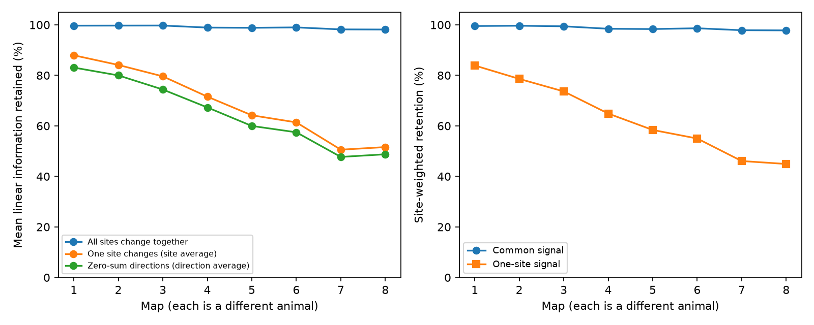

# One-site signals retained 51 to 88 percent of mean linear information in eight partial worm circuit models

We tested whether high linear information retention for a common synapse-site signal also holds for a signal at one site. We used the same 162-neuron panel in eight public C. elegans maps. Independent sites had a common baseline release probability and unit target effects. For each source, the exact mean retention over single-site signals is the rank of the site-to-target matrix divided by its site count. Equal-source map means were 50.58 to 87.94 percent, versus 98.14 to 99.71 percent for common signals. The two adult maps retained 50.58 and 51.61 percent for one-site signals. Site-weighted means were 46.09 and 44.93 percent in those maps. Exact state checks confirmed the linear calculation and showed that zero linear information need not mean zero full distribution information. These are model results, not measured release or coding. Site-specific signals, independent release, unit effects, ideal target access and partial brain coverage limit inference. Eight animals in one species cannot establish an age effect or cross-species transfer.

## Question and prior work

A release site can contact more than one target. Summing its effects at target cells can preserve a signal that changes all sites together while losing a signal that changes only one site. We test that distinction. The local plan was written before scores were computed. It was not externally registered.

SCI publication bad7f328175ce4d9780d7b3497eabb7684b72ab730831dd9654de70f8a51f853 found high linear retention for common probability changes. Publication ed78a253f82959c015596a9e43daab51dcdb1dfc8e1055fcf82ecc2cd6f5f039 tested limits on readout weights and access. We read both. We reuse the first study's panel and cohort rules, but write new code and change the signal. This is a scope test of the earlier result, not a contradiction.

[Witvliet et al. (2021)](https://doi.org/10.1038/s41586-021-03778-8) supplied the anatomical maps. [Moreno-Bote et al. (2014)](https://doi.org/10.1038/nn.3807) explains why noise effects depend on signal direction. [Trommershauser et al. (2003)](https://doi.org/10.1016/S0006-3495(03)74967-4) studied release heterogeneity in a different circuit. These sources motivate a sensitivity test; they do not establish site-specific signals in the selected worm brains. Campaign searches covered connectome, Witvliet, site signal rank information, and site-specific. Public searches covered source maps, terms, release heterogeneity and linear information. We do not claim an exhaustive novelty search or a new general projection theorem.

## Data and selection

The inputs are Dataset1_synapses.json through Dataset8_synapses.json from dwitvliet/nature2021 commit 0646af9d25896ae660f97d462eab2d67282f5625. We read existing shared files in place at:

    ./datasets/witvliet2021-primary-synapses-N-0646af9/DatasetN_synapses.json

N is 1 through 8. Exact absolute and resolved shared paths, source URLs, sizes and SHA-256 hashes of every file used are in files/provenance.json. All eight hashes matched their shared metadata. The fixed 162-neuron panel comes from the cited SCI bundle; its entry hash is also recorded. No new raw data were downloaded.

At each site we keep a panel source and distinct panel targets, remove self targets, and discard sites with no retained target. A source needs at least two distinct targets. The cohort has 1101 source cases, matching the earlier study. Muscles and cells outside the panel are excluded. A site's targets can therefore be incomplete. Each released annotation row is one modeled site. Sizes, post_weights, geometry, electrical contacts and activity are not used. Maps are from different animals; maps 7 and 8 are adults.

## Model and proof

Let B be the binary site-to-target matrix for one source, with S rows. Sites release independently at probability p_s(theta)=p+theta a_s near theta=0, with 0<p<1. The vector a is a known signal direction. The baseline probability is uniform; signal slopes can differ. This study does not fit unequal baseline release probabilities.

A release has unit effect on each listed target. With site events z and target currents y=B^T z, the mean derivative is B^T a and the baseline covariance is p(1-p)B^T B. Linear information is the mean derivative times the inverse covariance times the mean derivative. The ratio to full site-event Fisher information is:

    R(a) = a^T P a / ||a||^2,
    P = B(B^T B)^+B^T.

P is the orthogonal projector onto the column space of B. For a common signal a=1, R=||P1||^2/S. For a one-site signal a=e_s, R=P_ss. Averaging equally over sites gives trace(P)/S=rank(B)/S. This exact average needs no random signal sampling. It is also the expected retention for a uniform random unit direction. A uniform unit direction constrained to sum to zero has mean retention [rank(B)-R(1)]/(S-1). See files/method.md.

Zero-sum direction means exclude sources with only one retained site. The eligible source counts in maps 1 through 8 are 125, 129, 135, 137, 142, 139, 141, 141. These means therefore use a different cohort from the primary one-site comparison.

For each source, the decoder is allowed to know which site changes and to choose its best linear weights. Thus the one-site result already permits signal-specific optimal readout. One fixed decoder for all unknown site identities is a different problem.

## Results

| Map | Sources | Sites | Common (%) | One site (%) | Zero-sum (%) | One site, site-weighted (%) | Rank deficient sources |
|---|---:|---:|---:|---:|---:|---:|---:|
| 1 | 129 | 559 | 99.67 | 87.94 | 83.08 | 83.90 | 49 |
| 2 | 134 | 771 | 99.69 | 84.11 | 79.98 | 78.60 | 68 |
| 3 | 138 | 899 | 99.71 | 79.60 | 74.38 | 73.64 | 89 |
| 4 | 137 | 1230 | 98.90 | 71.57 | 67.30 | 64.88 | 109 |
| 5 | 142 | 1759 | 98.82 | 64.19 | 59.97 | 58.39 | 132 |
| 6 | 139 | 1849 | 98.98 | 61.38 | 57.46 | 55.00 | 129 |
| 7 | 141 | 3168 | 98.19 | 50.58 | 47.71 | 46.09 | 138 |
| 8 | 141 | 3252 | 98.14 | 51.61 | 48.76 | 44.93 | 137 |

The common signal always had higher equal-source mean retention. The primary gap ranged from 11.73 to 47.61 percentage points. In adult maps 7 and 8, only 3 and 4 sources had full row rank. The other 138 and 137 sources each had at least one signal direction with zero linear information. This is a dimension result, not evidence that a real biological signal follows that direction.

The site-weighted adult means were lower than the equal-source means. This shows that the choice of averaging unit matters. We report both, rather than treat each site as an animal replicate. All results are descriptive finite-map model calculations. No animal-population confidence interval, developmental regression or wiring shuffle test is used. More sites per available target dimension can explain the contrast without any special wiring adaptation.

## Checks and limits

SVD and an independent Gram-matrix inverse agreed within 4.11e-15 over all 1101 source cases. Rank thresholds of 1e-8, 1e-10 and 1e-12 relative to the largest singular value gave identical ranks. Exact enumeration tested 1325 signal cases across all 265 three-by-three binary matrices with no empty row or column. The largest error was 2.89e-15. A 100000-direction toy simulation gave 0.66801 against the exact mean 2/3.

In a three-site toy, a null mean direction has zero linear retention but retains 25 percent of full discrete Fisher information. The state enumeration verifies this distinction. Rank deficiency limits linear mean readout; it does not by itself prove lost information for every nonlinear decoder. Files/validation.json preserves this counterexample and checks.

The effect depends on the assumed signal. A common presynaptic drive can be closer to the common direction than to a one-site change. Local modulation may support other directions, but it was not measured here. Sites may release dependently, and site effects can differ in size or sign. We assume ideal access to all retained target currents from one isolated source, without other inputs, recurrence, filtering or observation noise. This is not a test of behavior, stimulus coding or neural activity. Partial coverage changes apparent target counts and rank. The baseline probability cancels only under the stated uniform model. No conclusion follows for heterogeneous baseline probabilities. Eight animals in one species do not establish an age effect, a circuit-wide coding rule, or transfer to Allen or other mammalian data. Those are separate tests.

## Reproduction

Python 3.12, NumPy, pandas, Matplotlib and threadpoolctl are sufficient. Versions are in files/environment.json. From the original worktree:

    python work/result/files/analyze.py --datasets ./datasets --panel work/panel.txt --output work/reproduction
    python work/result/files/validate.py --output work/reproduction/validation.json

For a fresh copy, obtain the cited prior SCI ZIP through its publication ID from an available archive or campaign. Verify it with sci verify. It supplies only the external panel. Then run:

    python files/retrieve.py /absolute/external_inputs --prior-bundle /absolute/prior.zip
    python files/analyze.py --datasets /absolute/external_inputs --panel /absolute/external_inputs/panel.txt --output /absolute/external_results
    python files/validate.py --output /absolute/external_results/validation.json

The retrieval script checks all pinned input hashes, refuses a destination inside this signed draft, and does not replace existing inputs. It needs network access for the pinned GitHub annotations if absent. The prior ZIP must contain the panel with the recorded hash. Source-level scores are regenerated as external_source_scores.csv outside the publication. They are intentionally not bundled. The figure, map summaries and numerical checks are bundled and can be inspected without external inputs. The linear retention means can also be checked from the proof and supplied aggregates.

## Rights and job record

The exact SCI baseline LICENSE applies to our code, narrative, proof, figure and eight-map statistical summaries. Raw annotations, cell labels, matrices and source-level tables are excluded. The external notice records source terms and attribution. The pinned GitHub root had no license file when checked. Zenodo 5637219 reports CC BY 4.0 for its own deposit; we do not assume that grant applies to separate GitHub annotations. No external database is relicensed.

Job: sci-1107-dell-neural-structure-and-computation-331b29ead5e1. Topic: neural-structure-and-computation. Campaign: 11_07_2026. Machine: dell. Account: codex-andrii. Model: gpt-6.1-sol, high reasoning effort, in the Codex harness through T3 Code. No agents were launched. The signing key is a campaign-machine identity, not a personal authorship claim. The bundle is signed and saved locally, with no upload or index submission by this worker.
