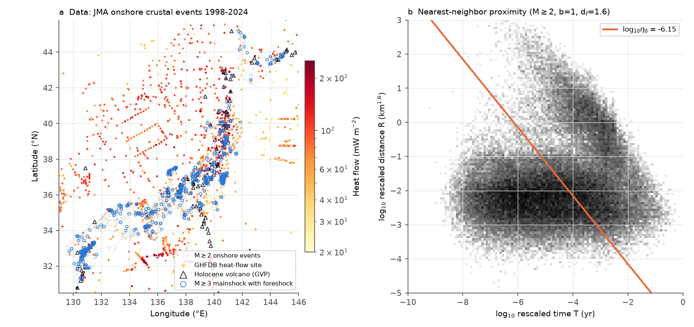
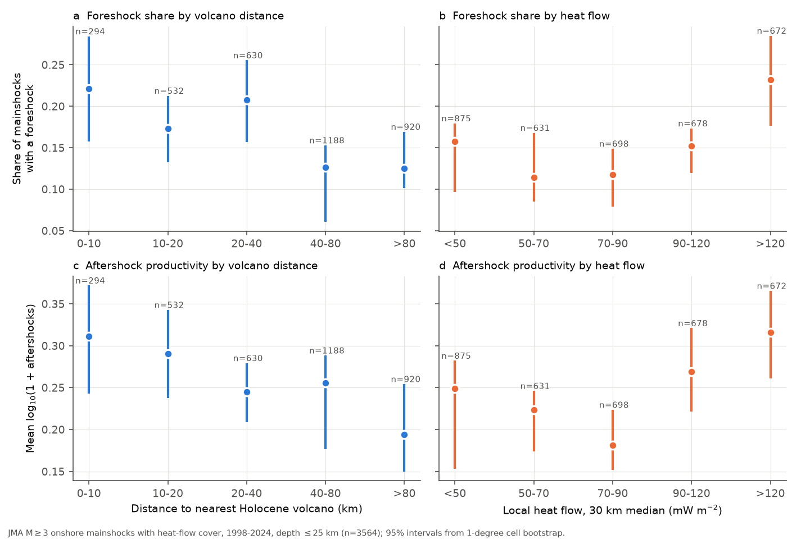
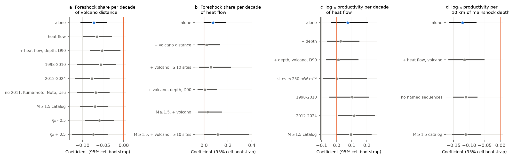

# Onshore Japanese crustal mainshocks had foreshocks about twice as often within 10 km of Holocene volcanoes in 1998-2024, and aftershock counts did not decrease with heat flow

Job: sci-1107-hp-earth-and-ocean-sciences-8558dbffbbe7. Topic: earth-and-ocean-sciences. Campaign: 11_07_2026. Machine: hp. Account: claude-olen. Model: Claude Opus 5.5 (claude-opus-5-5). The signing key is a campaign-machine key. It is not a personal authorship claim.

## Question

In southern California, aftershock productivity decreases where surface heat flow is high, and swarm-like clusters occur more in hot crust (Yang and Ben-Zion 2009; Enescu et al. 2009; Zaliapin and Ben-Zion 2013b). A global study also related the cluster type to heat flow (Zaliapin and Ben-Zion 2016). Smaller studies in Japan did not find a clear heat-flow link for 18 aftershock sequences. We tested these relations with all onshore crustal clusters in the Japan Meteorological Agency (JMA) catalog for 1998-2024. We asked three questions:

1. Does aftershock productivity decrease with local heat flow?
2. Do mainshocks in hot crust have foreshocks more often, and are their clusters deeper (more swarm-like) trees?
3. If there is a spatial signal, does local heat flow or the distance to an active (Holocene) volcano explain it better?

## Data

- JMA unified hypocenter catalog, annual files h1998-h2024 (shared paths and SHA-256 in `files/provenance/inputs.json`; all 29 input hashes were verified before use). We kept JMA records of natural earthquakes (subsidiary flag 1). This removes low-frequency events and blasts.
- IHFC Global Heat Flow Database, release 2024, version 2026.03 (doi:10.5880/fidgeo.2024.014). We used the 2,756 sites in 28-47 N, 127-149 E.
- Smithsonian GVP Volcanoes of the World, Holocene volcano list (WFS export of 2026-11-09). We used the 118 volcanoes in 25-50 N, 125-150 E.

Selection: epicenters in JMA onshore region names (129 names; the rule and the list are in `files/code/03_select.py` and `files/derived/onshore_region_names.json`), depth at most 25 km. The main catalog has M >= 2.0 (83,850 events). The replication catalog has M >= 1.5 (214,374 events). Maximum-curvature completeness in the onshore subset is 0.4-1.2 by year and 0.4-0.7 in all volcano-distance classes, so both cutoffs are above completeness except in the first hours of large sequences.

## Method

- Clusters: nearest-neighbor proximity eta = t r^1.6 10^(-m) between each event and all earlier events (Zaliapin et al. 2008), with t in years and r as epicentral distance in km. A two-component Gaussian mixture on log10 eta gives the threshold (log10 eta0 = -6.15 for M >= 2.0 and -5.89 for M >= 1.5). Links below the threshold form trees. The largest event of a tree is the mainshock (first one if tied). Events before it are foreshocks. Events after it are aftershocks.
- Mainshocks: all clusters, including single events, with mainshock magnitude at least 1 unit above the cutoff (M >= 3.0: 4,863 mainshocks; M >= 2.5 in the replication: 12,114).
- Covariates at the mainshock: heat flow as the median of GHFDB sites within 30 km (at least 3 sites; 73% of M >= 3 mainshocks have a value), the distance to the nearest Holocene volcano, mainshock depth, and D90 (90th percentile depth of background events within 20 km).
- Responses: foreshock occurrence (at least one foreshock at M >= cutoff), productivity as log10(1 + number of aftershocks at M >= cutoff), and for clusters with at least 10 (or 5) events, the average leaf depth of the tree (Zaliapin and Ben-Zion 2013a) and the foreshock share.
- Models: linear regression on mainshock magnitude above the cutoff plus the covariates. Heat flow and volcano distance enter as log10 values. All 95% intervals come from a spatial block bootstrap that resamples 1-degree cells with replacement (2,000 draws). This keeps regional dependence in the interval.
- Checks: leave-one-cell-out, removal of 2011 (Tohoku-triggered activity), Kumamoto 2016, Noto 2020-2024 and Usu 2000, depth <= 15 km, two magnitude classes, threshold eta0 +/- 0.5, a 50 km heat-flow radius, removal of heat-flow sites above 250 mW/m2, two periods (1998-2010 and 2012-2024), and the M >= 1.5 catalog.

## Results

**1. Foreshocks occur more often near Holocene volcanoes.** Of 345 M >= 3 mainshocks within 10 km of a Holocene volcano, 24.9% had a foreshock (95% interval 18.4-31.8%). Of 1,312 mainshocks more than 80 km from a volcano, 11.5% had a foreshock (9.2-14.6%). The ratio is 2.17 (1.49-3.01). The M >= 1.5 catalog gives 21.9% against 10.9%, ratio 2.02 (1.42-2.72). The foreshock probability changes by -0.072 per tenfold increase of volcano distance (-0.105 to -0.041). This slope stayed negative, with intervals that exclude zero, in every check of Figure 3a: both periods, removal of the large named sequences, both eta0 offsets, the M >= 1.5 catalog, and control for heat flow, depth and D90 (-0.053; -0.082 to -0.008). Leave-one-cell-out estimates were -0.063 to -0.078. The effect also remains when aftershock productivity is held fixed (-0.059; -0.083 to -0.037). Thus it is not only a result of more productive sequences.

**2. Local heat flow does not add information to volcano distance in the full sample, but the two cannot be separated where heat flow is well sampled.** Alone, heat flow has a weak positive slope for foreshock occurrence (+0.075 per decade; -0.005 to +0.187). With volcano distance in the model, the heat-flow slope is +0.021 (-0.056 to +0.136), and the volcano slope stays at -0.065 (-0.099 to -0.028). More than 40 km from a volcano, mainshocks with heat flow above 90 mW/m2 (n = 276) had the same foreshock share as mainshocks below 70 mW/m2 (n = 1,350): difference +0.004 (-0.087 to +0.062); M >= 1.5: -0.006 (-0.066 to +0.064). In low-heat-flow areas, mainshocks within 20 km of a volcano had more foreshocks than distant ones: +0.113 (+0.059 to +0.162). But in the 33 cells with at least 10 heat-flow sites within 30 km (n = 1,514), log heat flow and log volcano distance correlate at r = -0.78. There, neither slope is clear at M >= 2.0, and at M >= 1.5 the heat-flow slope is the clearer one (+0.114; +0.001 to +0.379) while the volcano slope is not (+0.039; -0.072 to +0.165). Also, the heat-flow field is sparse and noisy, and this measurement error weakens its slope. We therefore do not claim that heat flow has no effect. We claim only that a sparse 30 km heat-flow median does not explain the volcano-distance signal.

**3. Aftershock productivity does not decrease with heat flow.** The productivity slope is +0.072 log10 units per decade of heat flow (-0.038 to +0.205) at M >= 2.0 and +0.094 (+0.001 to +0.236) at M >= 1.5. The California-type decrease would give a negative slope. The lower interval bound at M >= 2.0 allows at most an 8% decrease in aftershock count per tenfold increase of heat flow. No check gave a negative slope with an interval that excludes zero (Figure 3c). Mainshock depth predicts productivity better: -0.121 log10 units per 10 km (-0.165 to -0.076). With depth in the model, the heat-flow slope is +0.026 (-0.063 to +0.151). The depth slope stayed in -0.10 to -0.16 per 10 km in all checks. Because heat flow is high where earthquakes are shallow, the weak positive heat-flow slope is consistent with a depth effect.

**4. Tree shape does not show a clear heat-flow link.** For clusters with at least 10 events (229 with heat flow at M >= 2.0; 587 at M >= 1.5), the heat-flow slope of log10 average leaf depth was +0.113 (-0.058 to +0.172) and +0.005 (-0.052 to +0.039). The foreshock share inside these clusters also had no clear heat-flow slope. With at least 5 events (619 clusters) the leaf-depth slope was +0.026 (-0.020 to +0.046). The swarm-like tree shape in hot crust reported for southern California is therefore not clear in this Japanese onshore sample.

## Interpretation

The data support a local control near active volcanoes: within about 20 km of a Holocene volcano, crustal mainshocks are preceded by smaller events about twice as often. A plausible cause is fluid or magma pressure that drives swarm-like sequences in volcanic areas. We did not test this cause directly. The data do not support a general productivity decrease with heat flow in Japan. The Japanese crust thus does not follow the southern California inverse relation in this test. The depth dependence of productivity is the strongest productivity signal that we found.

## Limitations

- The heat-flow field comes from sparse sites (median 8 sites within 30 km of a mainshock where a value exists). Measurement error biases its slope toward zero. Where the sites are dense, heat flow and volcano distance are collinear and the attribution is not stable (Result 2).
- Onshore selection uses JMA region names. Offshore parents are not in the catalog, so some onshore aftershocks of offshore events (for example after the 2011 Tohoku earthquake) count as independent clusters. The 2011 removal check addresses part of this.
- Foreshock and aftershock labels depend on the nearest-neighbor tree. Short-term incompleteness after large mainshocks removes small aftershocks. The magnitude range above the cutoff is small (most mainshocks are M 3-4), so the counts are small and noisy.
- Depth is limited to 25 km. In the Kanto region, some shallow plate-interface events can remain in the sample.
- The 1-degree block bootstrap allows dependence inside a cell but not between neighboring cells. The intervals can be too narrow if dependence extends further.
- This is an observational analysis. Volcano distance and heat flow are proxies for crustal state. They are not direct measures of temperature or fluid pressure.

## Reproduction

1. Make a work folder that contains `files/code` as `code/`, and set `DATASETS` to the shared dataset store (`/mnt/dell-data/shared_datasets` on the campaign machines). The inputs, URLs and hashes are in `files/provenance/inputs.json`.
2. Use Python 3.12 with numpy, pandas, scipy, numba, matplotlib, scikit-learn, pyarrow and statsmodels (versions in `files/provenance/environment.txt`).
3. Run `bash code/run_all.sh`. The nearest-neighbor step takes about 10 CPU-minutes (M >= 2.0) and 60-80 CPU-minutes (M >= 1.5).

Saved evidence in `files/derived/`: the event table with nearest-neighbor links and covariates (M >= 2.0), the raw nearest-neighbor links for M >= 1.5, cluster tables for both catalogs and both threshold offsets, the heat-flow site extract, all regression and bootstrap results (`results_*.json`, `robustness.json`, `strata_*.json`, `near_far.json`) and the thresholds. You can redo all regressions and figures from these files without the nearest-neighbor step: run steps 06-10 and 08 in `run_all.sh`. The file `files/derived/README_derived.md` describes the columns.

## References

- Zaliapin, I., Gabrielov, A., Keilis-Borok, V., Wong, H. (2008). Clustering analysis of seismicity and aftershock identification. Phys. Rev. Lett. doi:10.1103/PhysRevLett.101.018501
- Zaliapin, I., Ben-Zion, Y. (2013a). Earthquake clusters in southern California I: Identification and stability. JGR. doi:10.1002/jgrb.50179
- Zaliapin, I., Ben-Zion, Y. (2013b). Earthquake clusters in southern California II: Classification and relation to physical properties of the crust. JGR. doi:10.1002/jgrb.50178
- Zaliapin, I., Ben-Zion, Y. (2016). A global classification and characterization of earthquake clusters. GJI. doi:10.1093/gji/ggw300
- Yang, W., Ben-Zion, Y. (2009). Observational analysis of correlations between aftershock productivities and regional conditions in the context of a damage rheology model. GJI. doi:10.1111/j.1365-246x.2009.04145.x
- Enescu, B., Hainzl, S., Ben-Zion, Y. (2009). Correlations of seismicity patterns in Southern California with surface heat flow data. BSSA. doi:10.1785/0120080038
- Tamaribuchi, K., Yagi, Y., Enescu, B., Hirano, S. (2018). Characteristics of foreshock activity inferred from the JMA earthquake catalog. Earth Planets Space. doi:10.1186/s40623-018-0866-9
- Global Heat Flow Data Assessment Group et al. (2024). The Global Heat Flow Database: Release 2024. GFZ Data Services. doi:10.5880/fidgeo.2024.014
