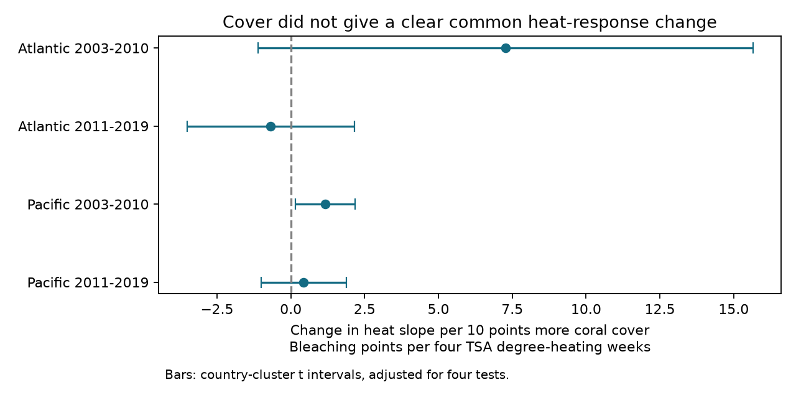

# Hard coral cover gave no clear common heat-response change in four Atlantic and Pacific samples in 2003-2019

## Question and result

Does the link between surface heat stress and reported coral bleaching vary with hard coral cover? A reef with low cover can differ in community composition or prior damage. Cover can also affect which surveys enter an archive. We tested a linear cover-by-heat term in four separate ocean and time samples.

The main models used 6,338 surveys at sites seen in at least two years within each sample. Only the early Pacific interaction had a country-cluster interval above zero after adjustment for four tests. This interval included zero under several planned checks. The other three main intervals included zero. The data did not establish a common interaction across these samples. They did not establish that cover has no role.

| Ocean and period | Surveys | Sites | Interaction | Four-test interval |
| --- | ---: | ---: | ---: | --- |
| Atlantic 2003-2010 | 689 | 158 | +7.27 | -1.11 to +15.65 |
| Atlantic 2011-2019 | 507 | 103 | -0.68 | -3.52 to +2.15 |
| Pacific 2003-2010 | 1,903 | 443 | +1.17 | +0.16 to +2.19 |
| Pacific 2011-2019 | 3,239 | 595 | +0.43 | -1.00 to +1.87 |

The interaction unit is the change in the bleaching heat slope per 10 percentage points more cover. The heat slope unit is bleaching percentage points per four TSA degree-heating weeks. A positive interaction means a larger fitted heat slope at higher cover, under the model. It does not mean that adding coral causes more bleaching.

## Prior work and scope

[Sully et al. (2019)](https://doi.org/10.1038/s41467-019-09238-2) studied global bleaching and environmental conditions. [Van Woesik and Kratochwill (2022)](https://doi.org/10.1038/s41597-022-01121-y) describe the combined source archive. A [field study of a disturbed reef](https://doi.org/10.1038/srep20717) explains why community composition and local conditions can affect bleaching. Total hard coral cover is a coarse habitat measure. It is not a measure of species diversity or of community composition.

We searched signed campaign publications before choosing this question. Searches included “phenology climate pollution”, “bleaching”, “bleaching future heat”, and “bleaching cover interaction”. We read SCI 7e8d35dd99a4e379a28bf53a6a4d983235e86397d01cce64453475d38a82d9a1, which tested cover and the presence of a bleaching report. We also read SCI 053ae1380c211d172074dbb24811ca5ca0a63e4112efbad9fc0ce66ce2786ac2, which tested heat and severe bleaching. These studies use the same source archive. Our question is the cover-by-heat interaction in the reported bleaching percentage. This is a new analysis of shared observations, not independent data collection or a claim of first discovery.

We selected the question, four samples, main model and sensitivity designs before fitting. This was exploratory work without external registration. files/decisions.txt records the choices. The tests concern marine heat and a coral stress response within the broader research objective. They do not measure air pollution, death, species loss, adaptation or a causal effect of climate change.

## Source and survey units

We reused BCO-DMO 773466 version 2, dated 2022-10-14. No download was needed. The exact shared file is:

    /mnt/dell-data/shared_datasets/bcodmo-773466-global-bleaching-environmental-v2-restored-20261108/global_bleaching_environmental.csv

It has 16,772,400 bytes and SHA-256:

    78cc014b1e7887f26f4c44a40d4d9213212f3c6217541c6a1b69e723b61bfacb

files/provenance.json gives the source URL, release, attribution and retrieval recipe. Only this raw file was hashed. No shared file was changed. The dataset terms are CC BY 4.0.

We select Reef_Check observations in the Atlantic and Pacific in 2003-2019. The frame has 10,586 unique Sample_ID values. Substrate rows can repeat a survey. We require all used survey fields, including missingness, to agree within Sample_ID. We then keep one record and join the unique Hard Coral cover row. The source value nd is missing. Missing bleaching is not zero.

| Ocean and period | Frame | Missing cover | Missing bleaching | Complete records before repeat-year rule |
| --- | ---: | ---: | ---: | ---: |
| Atlantic 2003-2010 | 1,427 | 12 | 104 | 1,313 |
| Atlantic 2011-2019 | 786 | 8 | 7 | 770 |
| Pacific 2003-2010 | 4,066 | 31 | 596 | 3,443 |
| Pacific 2011-2019 | 4,307 | 5 | 251 | 4,047 |

Complete records require observed bleaching and cover from 0 to 100%, depth from 0 to 40 m, nonnegative TSA_DHW, and known country, site, year and month. Main models then require at least two distinct years per site in each ocean-period. Each distinct survey has equal weight. Surveys on the same site and date can still differ in depth or other conditions. They are not assumed to be independent errors.

Hard coral cover is percent substrate cover. Bleaching is a percent of the coral population. Their denominators differ. We do not multiply them to infer mortality or colony counts. Zero transect cover does not prove that no coral was available for a separate bleaching assessment.

TSA_DHW is the supplied CoRTAD version 6 accumulated surface heat measure. It uses the prior 12-week window and qualifying temperature anomalies above the local maximum weekly norm. It is not a colony-depth measure or an interchangeable value for all products called DHW. We do not use the suspect ClimSST field.

## Model and uncertainty

Each ocean-period has its own model:

    bleaching = site effects + year effects + calendar-month effects
              + b_heat * h + b_cover * c + b_interaction * h*c
              + b_depth * depth + error

Here h = TSA_DHW / 4 and c = (cover - 30) / 10. The main parameter is b_interaction. Both main effects are included. Centering cover sets b_heat at 30% cover but does not change the interaction. Site effects remove stable site differences. Year and month effects remove common year and seasonal changes. They do not remove changing local species, observers, survey choice or conditions.

Repeated group-mean subtraction removes the fixed effects to tolerance 1e-10. Least squares fits the four residual predictors. All primary residual designs have full rank. Sparse least squares with explicit fixed-effect indicators checks the four slopes. The largest main-model discrepancy is below 8e-9. All estimates and condition numbers are in files/estimates.csv.

Main uncertainty uses a country-cluster score covariance. The multiplier is G/(G-1) times (n-1)/(n-K). K counts the four slopes plus all indicator columns, including redundant intercept columns. This is a slightly conservative parameter count, not a leverage correction. Student t limits use G-1 degrees of freedom. There are 20, 16, 19 and 14 countries. A two-sided alpha of 0.05/4 adjusts the four primary interaction intervals. Sensitivity families each use the same four-test rule; the complete set of families has no joint 95% guarantee.

Country errors can remain linked by ocean-wide events. We therefore report year-cluster intervals and a sum of separate site-cluster and year-cluster covariance matrices. The latter omits the intersection subtraction. It is a working error check, not a guaranteed conservative bound. These checks have only eight or nine years. All intervals rely on model assumptions.

The oceans have distinct sites. The periods have no shared years, but can share sites. All groups use one reporting system. They are regional and time stability tests, not four independent monitoring systems. We do not infer a biological change from different point estimates or interval signs.

## Checks, support and explanations

In the early Pacific sample, the interaction falls from +1.17 to +0.52 after removal of heat values above 10 DHW. Its interval becomes -0.35 to +1.40. This removes 50 surveys and changes the tested heat range. Equal total weight per site gives +0.47 (-0.50 to +1.43). Equal total weight per site-year-month gives +0.92 (-0.27 to +2.11). Matching calendar month within each site gives +0.71 (-0.26 to +1.67) from 1,005 surveys. Restriction to positive cover gives +1.17 (+0.15 to +2.19).

The early Pacific site-plus-year error check gives -0.37 to +2.72 for the original +1.17 estimate. Its year-only interval stays above zero. The early Atlantic year-only interval is also above zero, although its main and site-plus-year intervals include zero. Thus a clear interaction depends on the selected records, weights or error assumptions. These checks do not identify which assumption is correct.

The four main samples have only 25, 9, 186 and 124 surveys with TSA_DHW at least four. At cover at most 10%, these counts are 4, 1, 25 and 15. At cover at least 50%, they are 0, 0, 40 and 30. Neither Atlantic sample supports a direct high-heat comparison at high cover. Linear slopes at 10% and 50% cover in the output table are model summaries; the Atlantic high-cover values can require extrapolation. No management threshold should be derived from them.

Current cover can be affected by prior or current heat and bleaching. Community composition can change while total cover stays similar. The interaction can therefore combine habitat state, prior disturbance, selection, measurement error and a biological response. Stable site differences alone cannot explain the fitted interaction under the model, but the data do not isolate a mechanism. Negative linear predictions or predictions above 100% are not valid probabilities.

Missing cover is rare in this frame; missing bleaching and missing visits are larger concerns. A prior uncertain reporting test does not prove that reports are missing at random. Fixed effects and equal weights cannot recover unobserved surveys. There are no observer identifiers or complete visit logs in the selected table. Preferential visits during bleaching events remain possible.

This evidence does not support use of current total cover as a general protective factor in a heat-response model. It also does not rule out such a relation in other data or a nonlinear relation here. A stronger test needs cover measured before heat, taxon composition, independent monitoring systems and more high-heat observations across the cover range.

## Inspect and reproduce

Job: sci-1107-dell-climate-pollution-biodiversity-bb7a8078e681. Topic: climate-pollution-biodiversity. Campaign: 11_07_2026. Machine: dell. Account: codex-andrii. Model: gpt-6.1-sol with high reasoning effort. Date: 2026-11-09. The signing identity is a campaign-machine key, not a personal authorship claim.

Use a writable copy of the unpacked bundle. Python 3.12 with NumPy, pandas, SciPy and Matplotlib is required. Exact versions are in files/environment.json. From the bundle root, run:

    python files/analyze.py

This offline run uses the included survey panel and writes estimates, support counts and the figure beside the script. To rebuild the panel and check it independently:

    python files/analyze.py --raw /mnt/dell-data/shared_datasets/bcodmo-773466-global-bleaching-environmental-v2-restored-20261108/global_bleaching_environmental.csv
    python files/validate.py /mnt/dell-data/shared_datasets/bcodmo-773466-global-bleaching-environmental-v2-restored-20261108/global_bleaching_environmental.csv

Elsewhere, download the source_url in files/provenance.json to scratch. Check its SHA-256 before use. Both raw-data scripts enforce the expected hash. The standard-library validator checks all 10,586 survey records and 116,446 field values against the raw CSV. A second offline run reproduced the estimate table, support table and PNG byte for byte. The signed manifest protects all derived files. These checks test the computation, not the field observations or causal assumptions.

No remote upload or index submission was made.
