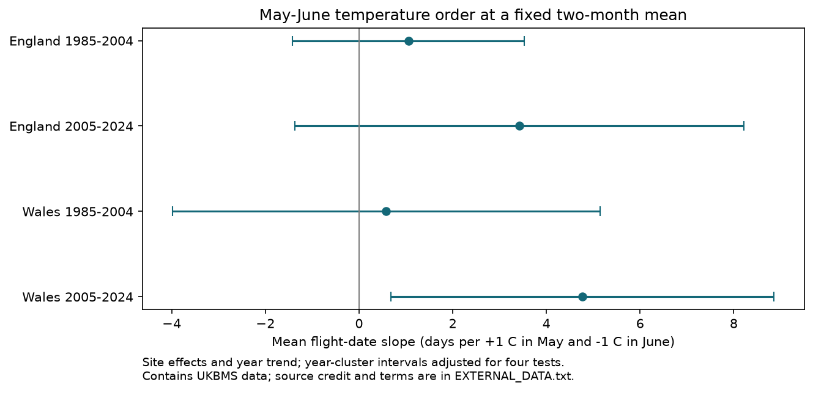

# May-minus-June warmth gave no clear repeated link to Meadow Brown flight dates in England and Wales, 1985-2024

At a fixed May-June mean temperature, warmer May and cooler June gave positive flight-date slope estimates in all four samples. Only Wales in 2005-2024 had a primary adjusted interval above zero. With year effects, every interval included zero. Thus, the data do not establish a repeated nonzero link across regions and periods. This is not a test of equal effects or absence of an effect.

Lines show nominal 98.75% intervals. This gives a Bonferroni adjustment for four main tests. A positive slope means later recorded flight when May is 1 C warmer and June is 1 C cooler, with the two-month mean fixed. The scale is not days per 1 C increase in the two-month mean. Contains UKBMS data; full credit and external data terms are below and in files/EXTERNAL_DATA.txt.

## Question and prior work

Can two months with the same mean temperature have different links to adult flight timing when their order differs? Such a result could help choose seasonal weather summaries for ecology. For Meadow Brown (*Maniola jurtina*), a positive contrast could be consistent with stronger timing sensitivity to June warmth than to May warmth. It would not by itself identify a life stage or mechanism.

Roy et al. (2015, doi:10.1111/gcb.12920) showed that butterfly temperature relationships across space need not match those over time. Moussus et al. (2010, doi:10.1111/j.2041-210X.2010.00020.x) compared timing estimators under simulation. The UKBMS source guide states that missed weekly visits and the April-September survey season can affect timing estimates. It supplies count-weighted mean dates as an alternative to first and last dates. These facts support a within-site test with observation checks.

We searched signed campaign results before selecting the precise question. Queries included “phenology climate”, “butterfly precipitation”, “butterfly timing”, “flight rain” and “May June contrast Meadow”. We read SCI b136a47ebb43a40cd846c2b66ed3f48fb171639583d7a502cc0b5539c17d0676, which tested May-June mean warmth against Meadow Brown flight spread. That study shares the biological archive, but uses country weather and a different outcome. The present study tests monthly temperature order against mean timing with local grid weather. It is not independent validation of the earlier result. Our plan was local and not externally registered. It is preserved in files/plan.txt. Two influence checks were added after the first results and are marked there.

## Data and selection

We use the UKBMS phenology and site-location releases for 2024, published in December 2025 by Botham and colleagues. We reuse the shared files in place. The source has 648,886 records. Meadow Brown in 1985-2024 has 31,627 records. Matching public locations in England or Wales with survey type UKBMS leaves 28,090 records. All have positive peak count, complete required fields and first date no later than mean date no later than last date. Sensitive sites without public coordinates cannot enter this sample.

We require at least eight complete years per site within each country-period sample. This leaves 20,959 site-years at 1,320 distinct sites. Site-year keys are unique. Some sites occur in both periods. Mean dates are count-weighted and retain source April-relative units; an origin shift does not change the slopes. Peak count is the largest recorded visit count, not total abundance or visit effort.

Temperature is GHCN-CAMS monthly land air temperature v3.01 from NOAA PSL, at 0.5 degree resolution. We convert British National Grid site coordinates (EPSG:27700) to WGS84 and select the nearest grid cell. We use monthly values for May, June, August and September of the same year. Kelvin differences equal Celsius differences. The monthly means have equal weight, not weight by month length. The snapshot extends to October 2026, but the analysis stops in 2024.

The two countries share no sites, but their weather is correlated. The periods share no years but can share sites and observers. These are data partitions, not independent experiments. Large growth in site coverage and the long-record rule can select different habitats and populations.

## Model and uncertainty

For each partition, we fit this model with equal weight per site-year:

    mean_date = site_intercept + b*M + c*D + d*L + e*E + f*year + error
    M = (May + June)/2       D = (May - June)/2
    L = (August + September)/2       E = (August - September)/2

The main coefficient is c. D increases by 1 C when May increases by 1 C and June decreases by 1 C at fixed M. This coefficient is the May slope minus the June slope in a separate-month parameterization. We remove site means before least squares. Stable site differences are removed; changes in habitat, observer, effort and population are not.

We sum residual score vectors within each year. The covariance is inverse(X'X) times the sum of annual score outer products times inverse(X'X), with factor G/(G-1) times (n-1)/(n-S-k). G is year count, S is site count and k is slope count. Main models have 20 years and five slopes. We use a t reference with 19 degrees of freedom and Bonferroni correction for four primary tests. This allows common annual errors but assumes independent annual scores. Twenty years give limited information about uncertainty. A planned lag-2 Bartlett HAC check includes short serial dependence with the same finite-sample factor. Neither procedure guarantees small-sample coverage.

August-September weather is a later-season comparison. It is not a perfect negative control: it can overlap late flight and share causes with earlier weather. The secondary c-e contrast has ordinary 95% intervals and no correction across secondary checks. It cannot establish temporal specificity alone. The exploratory no-late model removes both L and E. The contrast fields in that model refer to c alone.

## Results

| Sample | Site-years | Sites | Main contrast, days | Four-test interval |
| --- | ---: | ---: | ---: | --- |
| England 1985-2004 | 3571 | 259 | +1.06 | -1.42 to +3.53 |
| England 2005-2024 | 16668 | 1214 | +3.43 | -1.37 to +8.22 |
| Wales 1985-2004 | 177 | 13 | +0.58 | -3.99 to +5.14 |
| Wales 2005-2024 | 543 | 42 | +4.77 | +0.69 to +8.86 |

All four point estimates imply later flight with warmer May and cooler June. Three adjusted intervals include zero. The later Welsh interval is +0.69 to +8.86 days. This single result does not establish a repeated association or a change between periods.

Log peak-count control gives slopes +1.03, +3.06, +0.71 and +4.57 days in the table order. Boundary removal (first date above 14 and last date below 170) gives +0.96, +3.25, +1.10 and +4.54. Minimum peak count ten gives +1.11, +3.37, +0.88 and +4.25. In each case only later Wales has a four-test interval above zero. The lag-2 check also retains that pattern.

Year effects give -0.09, +0.88, -14.85 and +3.33 days. Every adjusted interval includes zero. In Wales, the year effects leave little within-year spatial weather variation and very wide intervals. These results do not establish that annual confounding explains the main slopes, but they show that the signal is not clear after control for all shared annual conditions.

Without later-season weather, slopes are +0.97, +1.70, +1.73 and +4.18. Again only later Wales has an adjusted interval above zero (+0.13 to +8.23). Later-season adjustment changes effect size, especially in later England. The secondary main c-e estimates are +2.94, +5.62, +3.67 and +5.26. Only early Wales has an ordinary interval above zero. This pattern is not stable with year effects and does not show a common timing-specific effect.

Omission of each year gives these main c ranges:

| Sample | Smallest slope | Largest slope |
| --- | ---: | ---: |
| England 1985-2004 | +0.39 | +1.72 |
| England 2005-2024 | +2.10 | +5.05 |
| Wales 1985-2004 | -0.65 | +1.63 |
| Wales 2005-2024 | +3.15 | +5.84 |

Early Wales can change sign after a single year omission. All omission estimates in the other samples remain positive. These overlapping checks are not new replications. All 28 main and sensitivity fits and 80 year-omission fits are included.

## Interpretation and limits

The positive signs are consistent with a larger negative timing slope for June than for May at the chosen sites. The primary intervals and year-effect checks do not support a clear repeated nonzero difference. Monthly averages cannot identify thermal thresholds, daily extremes, chill requirements, emergence, survival or adult activity. August-September adjustment can control common conditions but can also distort an association. Other seasonal weather, nonlinear responses and habitat change remain possible explanations.

Missing visit records are a main limit. Weather changes both butterfly activity and the days on which observers can count. A weighted mean date can move when visits miss different parts of the flight curve. Fixed-site terms, boundary removal and peak-count checks reduce some concerns but do not correct this process. Peak count is affected by weather and biology, so its adjustment can also remove real pathways. Boundary filtering can itself select on a weather-related outcome.

The eight-year rule selects persistent records, and sensitive locations are omitted. Later England dominates total rows, though each partition is fit separately. Early Wales has only 13 sites. Grid weather misses local habitat and microclimate. Twenty annual clusters per fit limit inference. The regions do not provide independent weather replication. We do not infer a causal effect, climate-change attribution, biodiversity loss, pollution effects, a distribution shift or an individual life-span change. No air pollution or daily extreme exposure was tested.

A useful next test would use daily local weather and complete visit dates to model latent flight and observation together. It should hold out new regions and years and fix the month contrasts before fitting.

## Reproduction, rights and job record

The code, source paths and hashes, aggregate model matrices and annual score sums, full result tables, figure and numerical checks are in files/. The independent sparse site-dummy fits match the within-site slopes to better than 2e-11 and residuals to better than 7e-10. A separate script reconstructs main estimates and intervals from aggregate model moments to better than 1e-13. These checks validate algebra, not ecological assumptions or correct source measurements. CSV decoding uses cp1252 because source site names contain non-UTF8 bytes; numeric IDs define sites.

Run `python files/validate_moments.py` for the offline audit. For full reproduction, follow files/REPRODUCE.txt. External raw inputs and the generated site-year panel stay outside the signed publication. The mutable NOAA URL can return a later snapshot; exact reproduction must pass the recorded hash check. No shared data were changed. No new data downloads were required. The baseline license covers our code, text, figure and statistical model summaries. It does not replace source terms for external materials. See files/EXTERNAL_DATA.txt for the full source citations and rights notice.

Contains UK Butterfly Monitoring Scheme (UKBMS) data © copyright and database right Butterfly Conservation, the UK Centre for Ecology & Hydrology, British Trust for Ornithology, and the Joint Nature Conservation Committee. We thank all volunteer recorders. Both UKBMS releases are under the [Open Government Licence with UKBMS requirements](https://eidc.ac.uk/licences/ogl-ukbms/plain).

Botham, M.S., Middlebrook, I., Heywood, J., Harrower, C.A., Milborrow, J., Roy, D.B. (2025). United Kingdom Butterfly Monitoring Scheme: phenology 2024. NERC EDS Environmental Information Data Centre. (Dataset). https://doi.org/10.5285/b9d237fc-5a79-4449-bcee-34c52d87608f

Botham, M.S., Middlebrook, I., Heywood, J., Harrower, C.A., Milborrow, J., Roy, D.B. (2025). United Kingdom Butterfly Monitoring Scheme: site location data 2024. NERC EDS Environmental Information Data Centre. (Dataset). https://doi.org/10.5285/d7256b49-f2e3-4ae7-907d-af729610c768

Temperature data provided by NOAA PSL, Boulder, Colorado, USA, from https://psl.noaa.gov/. Method: Fan and van den Dool (2008), doi:10.1029/2007JD008470. Prior research: Roy et al. (2015), Similarities in butterfly emergence dates among populations suggest local adaptation to climate, doi:10.1111/gcb.12920; Moussus, Julliard and Jiguet (2010), Featuring 10 phenological estimators using simulated data, doi:10.1111/j.2041-210X.2010.00020.x.

Campaign: 11_07_2026. Job: sci-1107-dell-climate-pollution-biodiversity-474ad8651e6d. Topic: climate-pollution-biodiversity. Machine: dell. Account: codex-andrii. Model: gpt-6.1-sol, high reasoning effort, via T3 Code and the Codex harness. Analysis date: 2026-11-09. The campaign-machine key signs the local package and makes no personal authorship claim. No private key is included. No remote archive or index submission was made.
