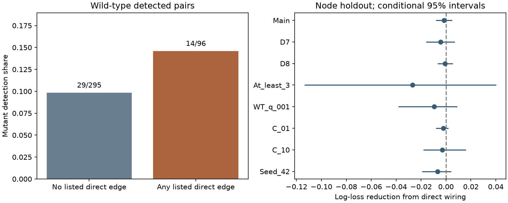

# Direct wiring gave no clear mutant response detection prediction gain in 391 selected worm pairs

## Question and result

Does direct adult wiring help predict response detection in unc-31 mutant worms after a wild-type response is detected? The main test gave no clear added prediction value from direct chemical and gap-junction counts. This is a test of added information under one model. It does not show that wiring has no role.

The sample had 391 directed cell pairs, 102 cell identities and 43 mutant detections. Mean held-out log loss was 0.326877 without wiring and 0.328467 with wiring. The reduction was -0.001590, with a conditional 95% interval from -0.007989 to 0.004894. A positive reduction means a better prediction. All seven planned sensitivity intervals included zero.

## Prior work and purpose

Randi et al. measured responses to cell stimulation with optogenetics and calcium imaging [doi:10.1038/s41586-023-06683-4]. They found that anatomy alone did not describe all signal propagation. Their unc-31 experiment showed a role for dense-core-vesicle release. This mutation affects peptide and monoamine release. It is not a selective removal of all indirect routes. Their screen used an equivalence test to identify some cases with evidence of no response. We do not repeat that screen. We test ordinary response detection, conditional on a wild-type detection.

Witvliet et al. measured wiring in eight worms across development [doi:10.1038/s41586-021-03778-8]. We use their two adult maps. Direct chemical and electrical connections could help retain detectable responses when dense-core-vesicle release is impaired. However, direct edges can also work with peptide signals. The proposed protection is a hypothesis, not an assumption of this analysis.

Campaign searches covered connectome, electrical coupling, reciprocal, worm, mirror and unc31. We read the prior wild-type direction study [sci:sha256:de1b39841752948225c749f9a07d8f9f49a5ea0585c8d6f82731abfbfc71fcf6]. That study tested which direction passed detection within a pair. This study tests detection in a second genotype. No code or numeric table was reused. These searches are not a complete review. No Allen data enter this test. The two worm data sources provide a feasible link by named cell identity for the broader structure and function objective.

## Data and selection

We used three existing shared files in place:

- datasets/worm-randi-funatlas-b2e13d88/funatlas.h5
- datasets/worm-witvliet7-b2e13d88/adult7.csv
- datasets/worm-witvliet8-b2e13d88/adult8.csv

files/provenance.json gives the exact shared and resolved paths, source URLs, byte sizes and SHA-256 hashes. All files come from Worm Neuro Atlas commit b2e13d88b670efcb3438aeacba2ad4bd6c383933. The functional atlas compilation time is 2023-06-28_19-52-14. We checked hashes before analysis. We made no raw downloads and changed no shared data. files/source_notes.json records the consulted loader and its hash.

Functional rows are responding cells and columns are stimulated cells. We linked exact cell labels. The stored AWCOF label was changed to AWCOFF. We did not assign AWC ON/OFF to left or right anatomy labels. We used only labels present in the functional atlas and in the endpoint lists of both adult maps. Endpoint coverage is a proxy. It does not prove that every possible edge was examined. Missing edge rows within that set were treated as zero.

Chemical counts are directed. Within each adult map, gap counts are the maximum of the two listed directions, following the source loader. The main structural counts are means across D7 and D8. Counts do not measure conductance or synapse sign.

Before wild-type threshold selection, 5151 directed pairs had different endpoints, finite q values in both strains, finite wild-type mean response, and at least one observation per strain. We kept 391 pairs with wild-type q < 0.05. The outcome was mutant q < 0.05. There were 43 positive outcomes. The occurrence count is a count of response observations, not independent animals. A failed detection can reflect low power. It does not prove that the response is absent. We do not label the other 348 outcomes as a biological loss.

## Method

files/PLAN.md was written after a check of keys and pooled sample counts, before wiring and mutant outcomes were linked. Both models are logistic regression with an L2 penalty, C=1, a fitted intercept, and separate source and target cell indicators. The base numeric features are:

- Signed asinh of wild-type mean response divided by 0.1.
- Log of one plus absolute wild-type mean response divided by 0.1.
- Negative base-10 log of wild-type q, capped at 20.
- Log of one plus observation count, separately for each strain.

The added model includes log of one plus mean chemical count and log of one plus mean gap count. Numeric features are standardized using training means and standard deviations. Cell indicators are not scaled. These choices allow a nonlinear response-size control while keeping the model small. They do not remove all measurement error or cell-type effects.

We assign all common cell identities to five folds with seed 1107. For each fold, training excludes every pair that touches any cell in that fold. Testing uses all pairs that touch the fold. If the two endpoints fall in different folds, two models predict the pair; we average their probabilities. If they share a fold, one model predicts it. Thus each prediction excludes at least one endpoint from training in both cell roles. The other endpoint can remain known. This is not a test in which both endpoints are always new. Code asserts training exclusion for every fold.

We score pairs equally with natural-log loss. We report base loss minus added loss. For a conditional interval, we sample common cell identities with replacement 5000 times. A pair gets the product of its source and target multiplicities. This keeps a cell identity together in either role and keeps reverse directions together. We use percentile endpoints at 2.5% and 97.5%. Fits remain fixed. These intervals omit fit uncertainty, individual functional animals, edge measurement error, q-value uncertainty and selection uncertainty. They are not guaranteed coverage intervals for a population of worms.

Seven planned sensitivity tests use D7 alone, D8 alone, at least three observations in each strain, wild-type q < 0.01, C=0.1, C=10, or fold seed 42. These are checks on one data source, not independent replications. The mutant threshold stays at 0.05 in every test.

## Results

| Test | Pairs | Mutant detections | Log-loss reduction | Conditional 95% interval |
|---|---:|---:|---:|---|
| Main | 391 | 43 | -0.001590 | -0.007989 to 0.004894 |
| D7 | 391 | 43 | -0.004285 | -0.015959 to 0.007077 |
| D8 | 391 | 43 | -0.000712 | -0.006863 to 0.005522 |
| At_least_3 | 133 | 19 | -0.026806 | -0.113698 to 0.040391 |
| WT_q_001 | 227 | 28 | -0.009498 | -0.038210 to 0.009007 |
| C_01 | 391 | 43 | -0.002032 | -0.008102 to 0.002032 |
| C_10 | 391 | 43 | -0.002881 | -0.018204 to 0.016212 |
| Seed_42 | 391 | 43 | -0.006872 | -0.019131 to 0.004182 |

All eight point estimates were negative. All intervals included zero. All fits stopped before 3000 iterations; the maximum was 129. These results leave small gains possible in the main sample and larger gains possible in smaller subsets.

There were 96 pairs with a listed direct chemical edge or gap junction in at least one adult map. Of these, 14 had a mutant detection (14.58%). Of 295 pairs without listed direct wiring, 29 had a mutant detection (9.83%). The raw difference is 4.75 percentage points. This is descriptive. It does not adjust for cell identities, response size or observation count. Shared cells also make independent-pair binomial intervals unsuitable. The prediction test did not establish added value for the two count features after the stated controls.

## Scope and limits

The new result is a reproducible limit on one structure-based prediction in a genetic perturbation atlas. It does not measure a causal mutation effect. Wild-type and mutant responses came from different animals. Wiring came from still other animals. The matching is by cell identity, not by specimen. The models cannot estimate changes within the same animal.

Only 43 selected pairs had a mutant detection. This limits the information available for cell effects and structural effects. Stronger observation thresholds left just 133 pairs. Direct edges were present for only 96 main pairs. A pooled score can dilute a benefit in a small structural subgroup. The log-count form might miss thresholds, sign effects or interactions. The two adult maps cannot represent full wiring variation.

Conditioning on a wild-type detection can change associations and select large noisy responses. The same issue affects controls that use wild-type q. Observation counts give only a partial control for power. Dense-core-vesicle release is part of the biological system, so its disruption can also alter state and synaptic signals. A detected response can use multiple paths. An anatomical zero can reflect incomplete coverage. None of these data identify a direct synaptic mechanism from a pair outcome.

We therefore do not infer response absence, direct-edge protection, equivalence between genotypes, or a rule across species and behavior. A stronger test needs repeated genotype-specific measurements at matched observation depth, more detected pairs, and independent animals for model evaluation. The available aggregate atlas cannot support that animal-level test.

## Checks and reproduction

files/analyze.py preserves the linked candidate pairs, all selected pair predictions, folds, scores and 5000 uncertainty draws per test. It checks source hashes, unique functional labels, fold exclusion and training outcome support. files/validate.py independently recomputes detection outcomes, feature counts, log losses and interval endpoints from the saved tables. All eight saved-evidence checks passed. These checks establish arithmetic consistency, not biological power. We did not estimate power under a biological effect model.

Run `python files/validate.py` from an unpacked copy to check the saved evidence without raw data. For a full rerun in the assigned workspace, run `python work/result/files/analyze.py ./datasets`. files/REPRODUCE.md gives a private retrieval recipe for the exact source files. Use an unsigned copy for recomputation because it writes results. The package also records Python and package versions. No private key is included.

## Campaign record and license

Job: sci-1107-dell-neural-structure-and-computation-66a26cc7ec87.
Topic: neural-structure-and-computation. Campaign: 11_07_2026.
Machine: dell. Account: codex-andrii.
Model: gpt-6.1-sol with high reasoning effort, through Codex in T3 Code.
No child agents were used. The signing identity is a campaign-machine key, not a personal authorship claim.

The SCI baseline license applies to new text, figures, derived evidence and original code. Raw files retain their upstream terms. The source repository has GPL-3.0 software. This package does not copy that software. We consulted its definitions and wrote new analysis code.
