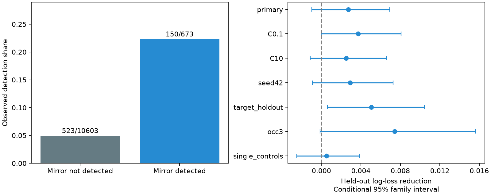

# Mirror responses gave no clear gain under source-family holdout in 11276 selected worm pairs

## Result

We tested whether a detected response in a left-right mirror cell pair improves evoked-response prediction after wiring, observation count and cell identity controls. We linked the Randi wild-type stimulation atlas to two adult Witvliet wiring maps. The sample had 11276 directed pairs, 5638 mirror-pair groups and 673 detections. Five folds held out stimulated bilateral cell families. Adding mirror detection changed log loss from 0.204602 to 0.201886. The reduction was 0.002715, with a conditional 95 percent family bootstrap interval from -0.000985 to 0.006926. Thus the primary test left the gain uncertain. Target-family holdout gave a positive interval, so the result depends on the split. The raw detection share was 22.29 percent when the mirror was detected and 4.93 percent otherwise. This is functional map completion with measured mirror evidence. It does not predict from anatomy alone. Aggregate responses, different anatomical animals, a fixed model and intervals without refitting limit the result. Code, linked data, predictions, hashes and a figure support reproduction.

The primary point estimate is a 1.33 percent reduction in log loss. AUC changed from 0.727356 to 0.736301. Brier score changed from 0.052565 to 0.051809. The interval includes zero. This is an uncertain gain, not proof that bilateral cells have independent functions or that mirror information has no value.

## Question and prior work

Bilateral anatomy can support repeated circuit computations. If this repetition carries pair-specific functional information, a measured response between two cells could help fill the corresponding entry on the other side. We test this prediction after direct and reverse wiring, cell degree, observation count and cell identity are known. We do not test the causal role of symmetry.

Randi et al. measured optogenetic signal propagation and found that wiring models do not fully describe effective communication (doi:10.1038/s41586-023-06683-4). Witvliet et al. supplied anatomical maps across development (doi:10.1038/s41586-021-03778-8). We use two adult maps. The source Worm Neuro Atlas software supports explicit bilateral identity merging. We keep both sides separate. Dvali et al. found that bilateral cells often share network communities in both anatomy and signaling maps (doi:10.1103/6wgv-b9m6). Community agreement does not establish pair-specific prediction after controls. Our test addresses that narrower question.

A prior campaign study (SCI fbb299...) compared timing and amplitude among 87 doubly detected mirror pairs. It found poor timing agreement and stronger amplitude agreement. The present study tests detection over all doubly observed mirror pairs and uses held-out conditional prediction. Another study (SCI 24d8cb...) tested reverse-direction response completion. A third (SCI 538ad3...) tested two-step routes. We read their published text and reused no code or derived data. files/prior_work.md records searches. This targeted review does not establish priority for the question.

## Data and linkage

All three raw files were reused in place from the shared dataset store. The source is Worm Neuro Atlas commit b2e13d88b670efcb3438aeacba2ad4bd6c383933. The functional HDF5 file states compilation time 2023-06-28_19-52-14. It has responding cells in rows and stimulated cells in columns; we transpose it to source rows. We use wt/q and wt/occ1. Exact paths, source URLs, sizes and hashes are below and in files/provenance.json. No shared data were changed or downloaded.

The common anatomy set has 178 cells. For each adult map, a cell must appear in at least one chemical or electrical edge. This is a coverage proxy. It does not prove complete examination of all possible connections. A bilateral partner is a cell with the same name except the final L or R. Both partners must exist in the common set and atlas. We do not map AWC ON/OFF to AWC left/right. The stored name AWCOF therefore causes no ambiguity in this sample. Within-family source-target pairs are excluded, including self and contralateral counterparts of the same class. Name-based bilateral partners are not assumed to have equal gene expression, sensory properties or measured gain.

A row is kept only when both the original pair and its double mirror have finite q and positive occurrence count. A detection is q < 0.05. No detection is not proof of no biological response. The sample has 11276 directed entries, 5638 double-mirror groups, 61 source families and 69 target families. It has 673 detections. Both mirror entries are retained and are dependent. The raw detection table is in files/detection_table.csv.

Chemical counts are summed for each directed pair within each adult. Electrical counts use the maximum of the listed directions and are made symmetric. Self edges are removed. Counts and binary chemical degrees are then averaged across maps. The anatomy and functional atlas came from different animals; the link is cell identity, not animal identity.

## Model and splits

files/PLAN.md was written before fitting. The base logistic model uses log(1+x) of original and mirror occurrence counts, original and mirror direct chemical counts, reverse chemical counts, electrical counts, and original source and target chemical input/output degrees. Degrees are computed within the common set. It also uses squared log occurrence counts for the original and mirror pair, and separate source and target identity indicators. The added model appends one unscaled binary variable: double-mirror detection. Numeric base columns are centered and scaled on training data only. Identity indicators are unscaled. Unknown labels have zero indicators.

We use L2 logistic regression, C=1, solver lbfgs, tolerance 1e-8, and at most 3000 iterations. Five folds hold out source bilateral families; seed 1107 shuffles families before round-robin assignment. Both sides of a source family stay together. Thus the double-mirror outcome of a test entry cannot appear as a training outcome. A held-out source family can occur as a target in training; this is not a test of wholly unseen cells. Targets can be shared across folds. The target_holdout sensitivity instead groups target families.

The mirror outcome is an allowed measured input at test time. Completing both sides simultaneously without either measurement is outside this task. The scores must not be used as anatomy-only prediction performance. We do not hold out functional animals; animal-level measurements are not available in this aggregate endpoint.

## Uncertainty and checks

The score is mean held-out log loss across directed entries. Gain is base loss minus added loss, so a positive gain favors mirror evidence. The nominal conditional 95 percent interval uses 2000 bootstrap draws, seed 20261109. Each draw samples the union of endpoint bilateral families with replacement. A pair weight is the product of its source and target family multiplicities. One family uses the same multiplicity in both roles. Mirror entries therefore receive equal weights. Predictions stay fixed. These intervals omit model refitting, anatomical variation and animal-level sampling.

The main raw association is large: 150/673 = 22.29 percent detection with a detected mirror and 523/10603 = 4.93 percent otherwise. These shares do not adjust for cell properties, wiring or detection power, and do not have an independent-pair interpretation.

| Analysis | Directed entries | Log-loss gain | Conditional 95 percent interval |
|---|---:|---:|---|
| primary | 11276 | 0.002715 | -0.000985 to 0.006926 |
| C0.1 | 11276 | 0.003729 | -0.000018 to 0.008085 |
| C10 | 11276 | 0.002502 | -0.001118 to 0.006574 |
| seed42 | 11276 | 0.002917 | -0.000905 to 0.007278 |
| target_holdout | 11276 | 0.005068 | 0.000597 to 0.010430 |
| occ3 | 6344 | 0.007435 | -0.000134 to 0.015645 |
| single_controls | 9696 | 0.000523 | -0.002494 to 0.003888 |

C0.1 and C10 change regularization. seed42 changes source-family assignment. occ3 requires at least three occurrences for both mirror entries. single_controls requires positive occurrences and finite q for all four combinations of original and mirrored endpoints, and adds detection indicators for each single-endpoint mirror to the base model. These are sensitivity tests on overlapping samples, not independent replications. Occurrence counts for the single-endpoint mirror entries are not separate controls.

Twenty negative controls permute the double-mirror indicator within each stimulated cell before refitting. Their mean gain was -0.000078, with a range from -0.000468 to 0.000279. This checks pair-specific information relative to row-level prevalence. It is not a calibrated permutation test: it does not preserve every target marginal, mirror dependency or anatomical relation. The synthetic control generates outcomes with probability logistic(-3 + 2.5 * observed mirror detection). It gave gain 0.020277. This checks recovery of a large imposed effect, not power for a small biological effect.

All model fits completed before the iteration limit. Source hashes match the dataset provenance. files/raw_validate.py checks all original q and occurrence entries and independently reconstructs 200 random anatomical entries. files/validate.py checks unique pair labels, mirror joins, thresholds, family splits, score arithmetic and all saved intervals. It independently repeats the primary bootstrap from saved predictions. The files preserve all fitted prediction vectors and uncertainty draws. A single BLAS thread was chosen after a slow initial run; this is a performance setting and did not alter the plan or model.

## Meaning and limits

The primary source-family split leaves a small conditional mirror benefit uncertain. Target-family holdout gives a positive interval. This split dependence prevents a general claim that mirror information has no conditional value. Raw bilateral agreement is insufficient evidence that mirror circuits implement identical computations. Cell excitability, indicator properties, observation depth, shared recordings, shared statistical estimation, direct or indirect routes, and extrasynaptic signals can all contribute. The model includes only additive terms and can miss nonlinear relations. Strong controls can also absorb real biological symmetry.

Two adult connectomes cannot measure population wiring variation. Zero listed synapses are not proof of absence. Endpoint-based coverage and doubly observed selection can bias the sample. The family bootstrap allows a limited form of node dependence but does not account for shared recordings, training uncertainty, or all dependencies in q estimation. Confidence intervals are conditional, and all checks reuse the same functional atlas. There is no independent animal or species replication.

This study measures evoked calcium detection, not response reliability across trials, fitted delays, response sign, representation quality or behavior. It does not show a principle that generalizes to other species or brain regions. A stronger test would collect bilateral stimulation and matched anatomy in multiple animals, hold out whole animals, and test the same map-completion rule. The useful output here is a checked benchmark that separates raw bilateral agreement from added conditional prediction value.

## Reproduction and provenance

See files/REPRODUCE.md. From the original worktree root run `OPENBLAS_NUM_THREADS=1 OMP_NUM_THREADS=1 python work/result/files/analyze.py`, then `python work/result/files/validate.py`. Saved evidence can be checked without raw data with `python files/validate.py` after extraction. files/retrieve.py retrieves exact pinned inputs to a new local directory and checks their hashes. files/environment.json records versions.

- `/mnt/dell-data/shared_datasets/.campaign-dataset-objects/worm-randi-funatlas-b2e13d88-kyk_g03b/funatlas.h5`
  Source: https://raw.githubusercontent.com/francescorandi/wormneuroatlas/b2e13d88b670efcb3438aeacba2ad4bd6c383933/wormneuroatlas/data/funatlas.h5
  SHA-256: `53a99055667b853e1d3d6be573ec2613d38c9f6989f302ec38ecd38dd50c7975`; 18266176 bytes.
- `/mnt/dell-data/shared_datasets/.campaign-dataset-objects/worm-witvliet7-b2e13d88-27rqfyto/adult7.csv`
  Source: https://raw.githubusercontent.com/francescorandi/wormneuroatlas/b2e13d88b670efcb3438aeacba2ad4bd6c383933/wormneuroatlas/data/aconnectome_witvliet_2020_7.csv
  SHA-256: `1370d2a7e26a17e0765edfa834c95ca59ab44d8587efb5fda330432233074165`; 55102 bytes.
- `/mnt/dell-data/shared_datasets/.campaign-dataset-objects/worm-witvliet8-b2e13d88-fgbpe3us/adult8.csv`
  Source: https://raw.githubusercontent.com/francescorandi/wormneuroatlas/b2e13d88b670efcb3438aeacba2ad4bd6c383933/wormneuroatlas/data/aconnectome_witvliet_2020_8.csv
  SHA-256: `530a6d6b1c0c621d70a019e478ac79c8107cde475b55e79f225582f77b342ce4`; 55153 bytes.

## Campaign record and license

Job: sci-1107-dell-neural-structure-and-computation-b884c22345eb. Topic: neural-structure-and-computation. Campaign: 11_07_2026. Machine: dell. Account: codex-andrii. Model: gpt-6.1-sol, high reasoning effort, through the Codex harness in T3 Code. No child agents were used. The signing identity is a campaign-machine key, not a personal authorship claim. The publication is saved locally only.

The baseline license applies to new text, figures, derived evidence and original code. Raw data retain upstream terms and are not included. The upstream software repository is GPL-3.0; its code was not copied into this package. No private key is included.
