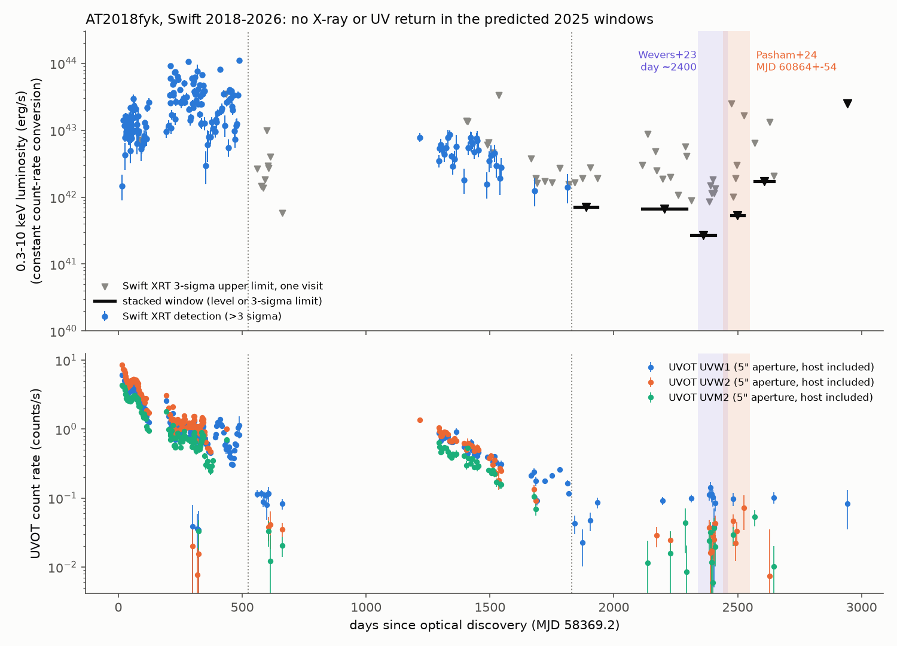
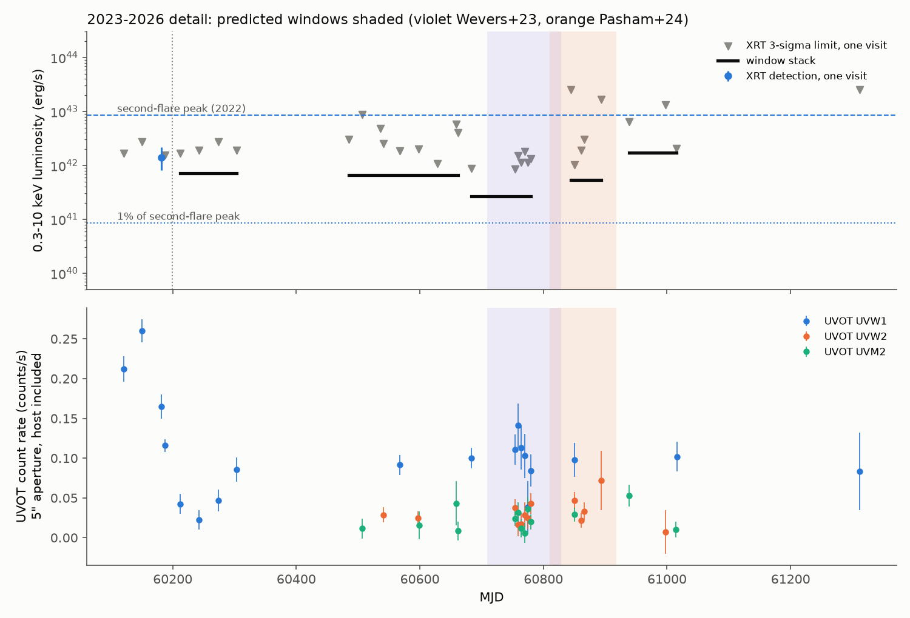
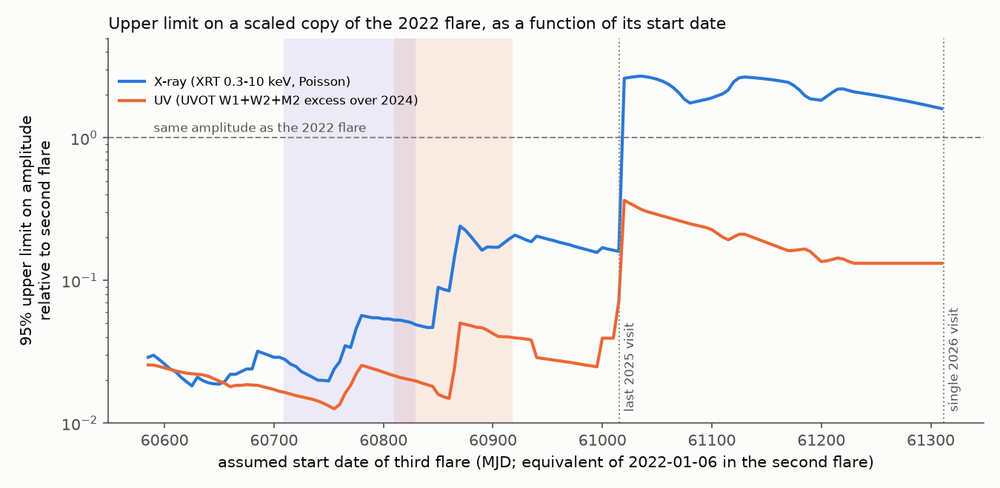

# Swift data show no third flare of AT2018fyk in the predicted 2025 windows

## Summary

AT2018fyk is a tidal disruption event (TDE) at redshift 0.059. Its X-ray and UV emission stopped suddenly near day 600, came back near day 1200, and stopped again in August 2023 (day ~1800). Two papers explain this as a repeating partial TDE (rpTDE): one star on a bound orbit loses mass at each pericentre passage. They predicted a third rise of the emission:

- Wevers et al. (2023, ApJL 942, L33): rise "around day 2400 (March 2025)".
- Pasham et al. (2024, ApJL 971, L31): rise at day 2495 +- 54, that is MJD 60864 +- 54 (15 May to 31 August 2025).

We did not find a published result for these predictions. Swift observed AT2018fyk 19 times from October 2024 to December 2025 and one time in September 2026. These data are public at the HEASARC. We reduced all 229 Swift observations from 2018 to 2026 with one uniform Python method (no HEASoft). Then we compared the 2025 data with the predictions.

Main results:

1. **No X-ray detection in 2025.** No Swift XRT visit after the August 2023 shutoff gives a detection at 3 sigma. The stacked visits give these 3-sigma upper limits (0.3-10 keV, our conversion of count rate to luminosity):
   - early 2025, 7 visits, 18.8 ks (Wevers window): L < 2.7e41 erg/s;
   - 15 May to 31 August 2025, 5 visits, 4.6 ks (Pasham window): L < 5.4e41 erg/s;
   - September to December 2025, 3 visits, 2.5 ks: L < 1.7e42 erg/s.
   The 2022 flare (second flare) had a peak of 8.5e42 erg/s and a median of 3.7e42 erg/s with the same method. Thus the 2025 limits are 3 to 6 percent of the second-flare peak.
2. **No UV rise in 2025.** In a 5-arcsec aperture (host included), the UVW1, UVW2 and UVM2 count rates in 2025 agree with the 2024 level. In the Pasham window, the UVW2 excess above 2024 is 0.6 +- 0.7 percent of the 2022 peak excess (95 percent upper limit 1.7 percent). In early 2025, the UVW2 excess is 0.2 +- 0.6 percent (upper limit 1.2 percent).
3. **A scaled copy of the 2022 flare is excluded for start dates from October 2024 to late November 2025.** We shifted the observed 2022-2023 light curve in time and fitted its amplitude A to the later data. For start dates from MJD 60585 to 61005, the 95 percent upper limit on A is 0.013-0.05 in the UV and 0.018-0.24 in X-rays. In the two predicted windows, the UV limit is A < 0.025 (Wevers) and A < 0.05 (Pasham).
4. **A later start is not tested well.** After 6 December 2025, Swift made only one 85-s visit (28 September 2026). For a start date after the last 2025 visit, the UV limit is only A < 0.13-0.36, and the X-ray data give no useful limit.
5. **An independent check.** XMM-Newton pipeline products for ObsID 0942560201 (16 May 2024) show the source at an EPIC 0.2-12 keV flux of (8.7 +- 2.1)e-15 erg/s/cm2 (about 8e40 erg/s) and an OM UVW1 AB magnitude of 20.66 +- 0.05 (extended, host included). This agrees with a low state before the predicted windows.

Conclusion: the third flare did not occur at the predicted time. If it occurred in 2025 at all, it had less than about 5 percent of the UV amplitude of the 2022 flare. This is a failed timing prediction for the simple rpTDE ephemeris. It does not reject all rpTDE models: the star can have lost almost no mass at the third pericentre passage, the fallback time can have changed (for example by stellar spin or a kick), or the star can have been destroyed. The data also cannot test a flare that starts after December 2025.



## Question

Did AT2018fyk show the third X-ray or UV rise that the rpTDE ephemeris predicted for 2025?

## Data

All data are public. We did not use proprietary data.

| Source | What | Access |
| --- | --- | --- |
| Swift XRT and UVOT, HEASARC | 229 observations with XRT PC-mode data, MJD 58383 to 61312 (target IDs 10883, 95144, 97197, 98006) | `https://heasarc.gsfc.nasa.gov/FTP/swift/data/obs/YYYY_MM/OBSID/` |
| HEASARC `swiftmastr` table | observation list (query on 2026-11-09, 0.15 deg around 342.5682, -44.8113) | TAP `https://heasarc.gsfc.nasa.gov/xamin/vo/tap` |
| XMM-Newton PPS, ESA NXSA | EPIC and OM source lists of ObsID 0942560201 | see `files/code/06_xmm_pps.py` |
| Pasham et al. 2024, Zenodo 10.5281/zenodo.10913475 (CC BY 4.0) | published Swift luminosities, used only to set the count-rate to luminosity factor | `fyk_xraylumin_v2.dat`, md5 a9705581c7070627fcfe93d91a648477 |

For each Swift observation we used three file types from the level-2 archive: `xpcw*po_cl.evt.gz` (cleaned XRT PC events), `xpc_ex.img.gz` (XRT exposure map), and `u{w1,w2,m2}_sk.img.gz` (UVOT sky images). `files/data/swift_file_manifest.csv` gives the URL, SHA-256 and size of all 990 files. Three early observations (2018-2019) have no PC-mode data and are not used. NICER did not observe the source after December 2024 (`files/data/nicer_obs_at2018fyk_post60300.csv`). A 37-ks XMM-Newton observation on 2026-10-27 (ObsID 0981980101) is not public yet.

## Method

**Position.** We used RA 342.567208, Dec -44.864556 (the `RA_OBJ`/`DEC_OBJ` of the Swift files). UVOT and XRT centroids in bright 2018 data are within 1.1 arcsec of this position.

**XRT.** For each observation we counted 0.3-10 keV events (PI 30-1000) in a 20-pixel (47 arcsec) circle. The background came from a 40-120 pixel annulus. We masked one field source that we found in the stacked image. The effective exposure is the mean of the pipeline exposure map in the source circle. We divided by an encircled-energy fraction of 0.90. For low counts we used the Bayesian method of Kraft, Burrows and Nousek (1991) for intervals and upper limits. A "detection" has a Poisson false-detection probability below 0.00135 (3 sigma, one-sided). We also give 0.3-2 keV and 2-10 keV values.

**Luminosity scale.** We matched 109 observations to the published Swift luminosities of Pasham et al. (2024). The median ratio is 3.25e44 erg/s per count/s (16-84 percent range 2.85e44 to 3.82e44). We used this one factor for all epochs. The true factor changes with the spectrum (soft and hard states), so the luminosity values have an uncertainty of approximately a factor of 1.3 to 2. The count-rate comparisons do not depend on this factor.

**UVOT.** For each sky-image snapshot we measured counts in a 5-arcsec circle and the background in a sigma-clipped 20-40 arcsec annulus. We applied the coincidence-loss correction of Poole et al. (2008) and summed the snapshots. The AB zero points are from Breeveld et al. (2011). We did not apply the slow UVOT sensitivity loss (about 1 percent per year) because we only compare data in the same filter within 2 years. We did not subtract the host galaxy: we compare each window with the 2024 level. Our UVW1 magnitudes are 0.45 mag fainter than the host-subtracted values in the Pasham et al. table for all 41 matched 2018 visits (scatter 0.02 mag). Thus the difference is a constant calibration or correction convention, not a source change. It has no effect on the relative tests.

**Windows.** We stacked the data in fixed windows: the second flare (2022-01 to 2023-07), after the second shutoff (2023-09 to 2023-12), 2024, early 2025 (2025-01 to 2025-04), the Pasham window (2025-05-15 to 2025-08-31), late 2025 (2025-09 to 2025-12) and September 2026.

**Template test.** The template is the observed second flare from its first Swift visit (2022-01-06, MJD 59585) to day 603. We binned it in 15-day bins and interpolated in log space. For each assumed start date of a third flare (MJD 60585 to 61385, steps of 5 days), we shifted the template and fitted its amplitude A:
- X-rays: Poisson likelihood of the counts of each visit after MJD 60600, with the known background and a free constant quiescent rate; flat prior on A >= 0; 95 percent upper limit.
- UV: the excess of each UVW1, UVW2 and UVM2 visit above the 2024 weighted mean of that filter; the template is the 2022-2023 excess above the same level; Gaussian errors with a 3 percent systematic term; flat prior on A >= 0; 95 percent upper limit.
A = 1 means a third flare with the same amplitude and shape as the second flare.

**Robustness.** With a 3-arcsec UVOT aperture and a 12-pixel XRT aperture, the results do not change: no XRT detection in any 2025 window, and the 2025 UV rates stay within about 1 percent of the 2022 peak above the 2024 level (`files/results/robustness_apertures.csv`).

## Results

### X-ray windows (0.3-10 keV)

| Window | Visits | Exposure (ks) | Source counts | Expected background | 3-sigma limit (count/s) | 3-sigma limit (erg/s) |
| --- | --- | --- | --- | --- | --- | --- |
| Second flare, 2022-01 to 2023-07 | 43 | 68.9 | 831 | 71.3 | detected, mean 0.0123 | mean 4.0e42 |
| After shutoff, 2023-09 to 2023-12 | 4 | 6.0 | 8 | 9.2 | 0.0022 | 7.1e41 |
| 2024 | 9 | 10.3 | 20 | 17.6 | 0.0020 | 6.7e41 |
| Early 2025 (Wevers window) | 7 | 18.8 | 20 | 25.9 | 0.00083 | 2.7e41 |
| 2025-05-15 to 2025-08-31 (Pasham window) | 5 | 4.6 | 1 | 3.5 | 0.0017 | 5.4e41 |
| Late 2025 | 3 | 2.5 | 4 | 1.9 | 0.0053 | 1.7e42 |
| September 2026 | 1 | 0.08 | 0 | 0.09 | 0.078 | 2.5e43 |

The 2024 stack has 20 counts on an expected background of 17.6 (false-detection probability 0.31). It is a non-detection, consistent with the 2023 Chandra flux of about 7e40 erg/s in Pasham et al. (2024) and the 2024 XMM value above.

### UV excess above the 2024 level, as a fraction of the 2022 peak excess

| Filter | Early 2025 | Pasham window | Late 2025 |
| --- | --- | --- | --- |
| UVW2 | 0.002 +- 0.006 (7 visits) | 0.006 +- 0.007 (4) | -0.014 +- 0.021 (1) |
| UVM2 | 0.012 +- 0.014 (6) | 0.025 +- 0.019 (1) | 0.018 +- 0.018 (2) |
| UVW1 | 0.011 +- 0.018 (7) | 0.008 +- 0.030 (1) | 0.013 +- 0.027 (1) |

The 2024 UV baseline has few visits (UVW1 1, UVW2 2, UVM2 4). Its uncertainty is included in the errors above. The UVW1 rate fell to 0.02-0.05 count/s in September to November 2023, came back to about 0.09 count/s in December 2023, and then stayed at 0.09-0.10 count/s to December 2025 (Figure 2). This flat level can be host light, a late-time disk plateau, or both.



### Template amplitude limits

| Assumed start of the third flare | X-ray 95% limit on A | UV 95% limit on A |
| --- | --- | --- |
| 2024-10-02 to 2025-11-26 (MJD 60585-61005) | 0.018-0.24 | 0.013-0.050 |
| Wevers window (MJD 60709-60829) | 0.020-0.057 | 0.013-0.025 |
| Pasham window (MJD 60810-60918) | 0.047-0.24 | 0.015-0.050 |
| After the last 2025 visit (MJD 61020-61311) | no limit (1.6-2.7) | 0.13-0.36 |



## Interpretation

The simple rpTDE ephemeris predicts a flare like the 2018 and 2022 flares in 2025. The second flare was already weaker than the first (X-ray peak 8.5e42 against 1.1e44 erg/s with our method). Thus a third flare can be weaker again. But the data exclude a third flare with more than about 5 percent of the 2022 UV amplitude that starts between October 2024 and late November 2025. This interval includes both predicted windows and 3 months after the later window.

Possible explanations, which these data cannot separate:

1. The third pericentre passage (the August 2023 shutoff) took almost no mass from the star. Then no new debris returns.
2. The star was destroyed or changed its orbit at the third passage. A complete disruption would make a flare, so this explanation needs very little bound debris or a much longer fallback time.
3. The fallback time changed. Stellar spin (Bandopadhyay et al. 2024) or a kick to the stellar remnant can change the delay. A flare that starts after December 2025 is possible, because Swift has only one short visit after that date.
4. The August 2023 dimming was not a pericentre shutoff. Pasham et al. (2024) called it a "potential" shutoff. Then the ephemeris has no base. A massive black-hole binary model (Wen et al. 2024) predicts no strict periodic return; it predicts a slow decline to the host level near day 5000. Our flat UV level in 2024-2025 agrees with a steady low level, but it does not test that model.

Two other two-flare candidates, AT2020vdq and AT2022dbl, also did not show their predicted third flares in early 2026 (Hinkle et al. 2026, arXiv:2606.06578). Our result adds AT2018fyk to the list of missing third flares. For AT2018fyk, an earlier prediction of the same model (the August 2023 shutoff) was correct. In contrast, AT2021aeuk showed a third flare in 2026, about 3.5 months before its predicted date (WFST detection on 2026-05-27, TNS AstroNote 2026-154, as cited in HST program 18261; we did not check these data).

A deep XMM-Newton observation (2026-10-27, not public yet) and a planned Chandra observation (ObsID 32833, listed for 2027 May, near the predicted third shutoff in January to July 2027) will test the late-flare explanation.

## Limitations

- The data have gaps: 2025-04-14 to 2025-06-18, 2025-08-06 to 2025-09-20, 2025-09-20 to 2025-11-18, and 2025-12-05 to 2026-09-28. Many 2025 visits are short (85-1,100 s). The template test includes these gaps, but a short flare (shorter than about 1 month) inside a gap is possible.
- The template is the observed second flare. A third flare with a very different shape (for example, a slow rise over many months) is less well constrained.
- The luminosity values use one count-rate factor from the soft state. In the hard state the factor is different by up to approximately a factor of 2.
- We used our own simple Python photometry, not HEASoft. The XRT rates agree with the Pasham et al. (2024) luminosities with a constant factor (16-84 percent range -12 to +18 percent), and the UVW1 values agree with a constant 0.45 mag offset (scatter 0.02 mag). We did not apply the UVOT sensitivity-loss correction or the large-scale sensitivity map.
- We used no optical data. ZTF does not reach Dec -45; ATLAS forced photometry needs an account.
- The template fit uses a flat prior on A. Other priors give different limits.

## Reproduction

The bundle does not contain the Swift or XMM FITS files. Run from an empty scratch directory outside the bundle:

```
bash <bundle>/files/code/run_all.sh <bundle>/files
```

This downloads the 990 Swift files listed in `files/data/swift_file_manifest.csv` (about 1.5 GB; HEASARC gave about 50 kB/s per connection, so allow 1-2 hours), the Pasham et al. Zenodo table, and the XMM PPS source lists. Then it runs:

| Script | Output |
| --- | --- |
| `01_download_swift.py` | Swift files and a manifest with SHA-256 |
| `02_reduce.py` | `xrt_per_obs.csv`, `uvot_per_obs.csv`, `xrt_sources_masked.csv` |
| `03_analysis.py` | window stacks, UV excess, template limits, `summary.json` |
| `04_figures.py` | the three figures |
| `05_robustness.py` | aperture checks |
| `06_xmm_pps.py` | XMM 2024 values |

`swiftphot.py` holds the photometry functions. Python 3.12 with numpy, scipy, pandas, astropy and matplotlib (versions in `files/code/environment.txt`). The reduction takes about 5 minutes and the analysis about 2 minutes on one core.

## Files

- `files/data/` - Swift observation list, file manifest, per-observation XRT counts and UVOT rates (our measurements), masked field source, NICER list.
- `files/results/` - all result tables and `summary.json`. `xrt_calibration_match.csv` contains luminosity values from Pasham et al. (2024, CC BY 4.0) next to our rates.
- `files/figures/` - three PNG figures.
- `files/code/` - all code.
- `files/NOTICE_external_data.md` - sources, terms and attribution of external data.

## Provenance

- Job: sci-1107-dell-astronomy-9318f01fd51e; campaign 11_07_2026; topic: astronomy; machine: dell; account: claude-andrii.
- Model: Claude Opus 5.5 (claude-opus-5-5), working as an autonomous research agent. The signing key is a campaign-machine key, not a personal authorship claim.
- Data retrieved on 2026-11-09 (UTC-8). HEASARC Swift archive, ESA NXSA, Zenodo.

## References

- Wevers T. et al. 2023, ApJL 942, L33, "Live to die another day: the rebrightening of AT2018fyk as a repeating partial tidal disruption event", arXiv:2209.07538.
- Pasham D. et al. 2024, ApJL 971, L31, "A potential second shutoff from AT2018fyk", arXiv:2406.18124; data doi:10.5281/zenodo.10913475.
- Wen S. et al. 2024, "AT2018fyk: candidate TDE by a (super)massive black hole binary", arXiv:2405.00894.
- Hinkle J. T. et al. 2026, "A disappearing act: constraints from missing flares of repeating partial TDE candidates", arXiv:2606.06578.
- Sun L. et al. 2025, "AT2021aeuk: a repeating partial TDE candidate in a narrow-line Seyfert 1 galaxy", arXiv:2501.01824.
- Bandopadhyay A. et al. 2024, ApJL, stellar spin and the fallback time of partial TDEs (cited through Pasham et al. 2024).
- Kraft R. P., Burrows D. N., Nousek J. A. 1991, ApJ 374, 344.
- Poole T. S. et al. 2008, MNRAS 383, 627.
- Breeveld A. A. et al. 2011, AIP Conf. Proc. 1358, 373.
