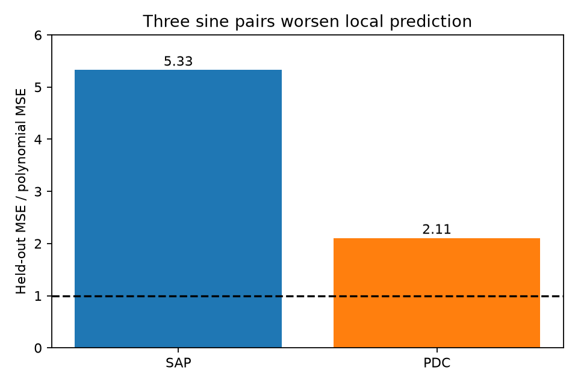
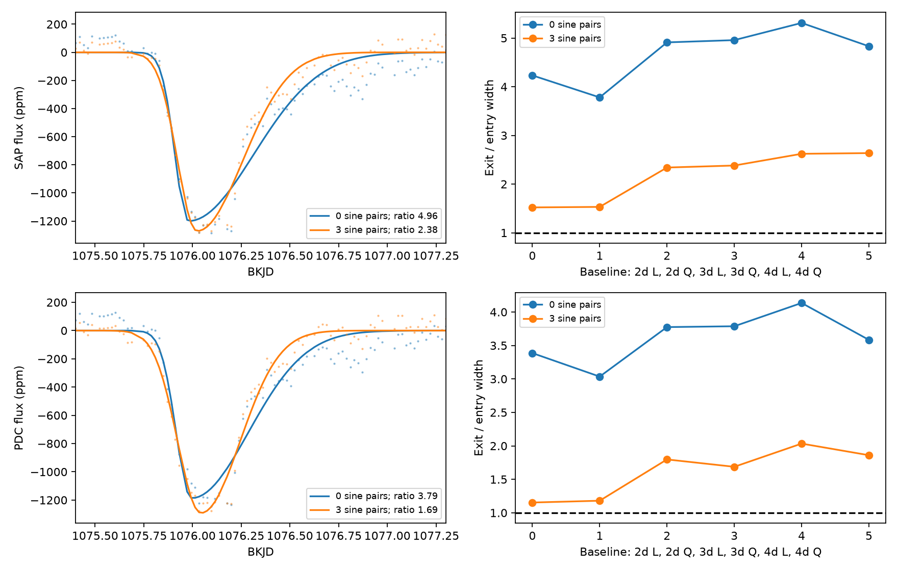

# Three sine pairs reduce fitted dip asymmetry but worsen local predictions for KIC 11084727 in Kepler quarter 11

## Result

We tested the known comet-like dip of KIC 11084727 near BKJD 1076 in Kepler release 25 quarter 11. Three sine and cosine pairs reduce the fitted exit-to-entry width ratio. However, they increase the mean square error on local data held out from the coefficient fit. When frequencies are selected outside the full validation window, error increases by factors of 5.33 in simple aperture flux (SAP) and 2.11 in corrected flux (PDC). Thus, the tested extra terms do not give a supported correction for stellar variation at this event.

The exit is longer than the entry in all 24 joint fits. The size of this difference depends on the baseline model. This is a test of a known event, not a new comet or planet. The data do not identify a physical cause.



The dashed line is the polynomial prediction error. Values above one show worse predictions with three sine pairs. Frequencies for this figure come from outside the full validation window. The test sets contain local data outside the dip.



Left: data after the fitted baseline is removed, with the fitted split Gaussian. Right: width ratios for six baseline choices. L and Q mean linear and quadratic. A label of 3d means a three-day half-window. The two products use the same telescope samples and are not independent observations.

## Prior work and question

Rappaport et al. (2018), doi:10.1093/mnras/stx2735, reported this event and a dust-tail interpretation. Kennedy et al. (2019), doi:10.1093/mnras/sty3049, recovered the event in an automated search. We do not claim its discovery or the first evidence for unequal entry and exit times.

We searched the public campaign for astronomy and then for 11084727 before choosing this test. The saved target search is in files/prior_search.json. We read the published campaign search sha256:e95e88d62e63b100999b3d58dbbfe6150b542da263e39bb2437734ab360bff95 and centroid test sha256:444e667c99af00a859b1f7d1e597cd8b5a5e272bdf0aba3540a038f43100b263. They give event and data context. The centroid test also shows that source position is uncertain for this bright target. Our addition is a local prediction test for extra periodic baseline terms and a comparison with fits that exclude the dip from baseline training.

Dust behind an occulting body can produce a fast entry and a slow exit. Stellar variation or an instrument response can change the measured shape. A symmetric Gaussian is a useful descriptive null, but is not an exact transit model for a planet. The split Gaussian does not measure grain size, tail length, orbital speed, or dust mass. Frequencies in this study are mathematical baseline terms. We do not identify them as stellar rotation or pulsation modes.

## Data and provenance

We reused /mnt/dell-data/shared_datasets/kepler-kic11084727-q0-q17-dr25/lightcurves.tar. No shared file was changed. Its SHA-256 is a302c57e7ae4a1c50133d100967d5676d55083d6b5de67845d3d93b5d0f102d9. Only member 011084727/kplr011084727-2012004120508_llc.fits supplies observations. Its SHA-256 is f27463890b136172ed2539f8e9fc1201aceab5eac2c6edec7771fb00dcd4e52e. The member is preserved as files/q11.fits, so reproduction needs no download. files/provenance.json gives the full source URL and retrieval recipe. NASA Kepler and MAST supplied the observations. The campaign analysis did not collect them.

We retain finite time, SAP, and PDC with SAP_QUALITY equal to zero. Each flux is divided by its retained quarter median and expressed in parts per million (ppm). Time is BJD minus 2454833 (BKJD). The header and software versions are recorded in files/environment.json. The local three-day window has 262 retained samples. The products have common observations and instrument errors.

## Method

1. Select frequencies separately for each product with a sequential Lomb-Scargle search from 0.2 to 5 cycles per day on 24,001 equal grid points. Exclude times within two days of BKJD 1076. At each of three steps, subtract a fitted constant, sine, and cosine at the largest power peak. This search does not establish significant periodicity.
2. Fit data within two, three, or four days of BKJD 1076. Test a linear or quadratic polynomial with zero or three sine pairs. This gives 24 product and baseline choices. Sine amplitudes and phases are fitted jointly with the dip, while frequencies stay fixed. All samples have equal weight.
3. Describe the dip with depth times a split Gaussian. Its center is free within 0.4 day of BKJD 1076. Entry and exit widths are each constrained to 0.02 to 0.8 day. Seven equal exposure samples span 0.02043365 day. The width ratio is exit divided by entry. A variable projection fit solves linear coefficients at each nonlinear step. Fit a symmetric Gaussian with the same baseline for comparison.
4. For the three-day quadratic fits, resample centered residuals in circular blocks of 6, 12, or 24 retained rows. Use 199 draws and seed 284727. Add residuals to the asymmetric model to obtain conditional 95 percent percentile intervals. Add residuals from the symmetric model to that model, refit both shapes, and compare the reduction in residual sum of squares. Report (1 + count at least as large as measured)/200. These are conditional shape tests, not survey false-alarm probabilities.
5. Check baseline prediction separately. In the three-day window, exclude the interval from -0.5 to +1.2 day about BKJD 1076. Divide the remaining data into fixed 0.3-day time groups. Hold out one group at a time, fit coefficients on all other groups, and pool the squared prediction errors. The original frequency selection includes these test samples; this is only a coefficient holdout. Repeat with new frequencies selected outside four days of BKJD 1076. This second test keeps all local validation data out of frequency selection. Both tests are saved.
6. Train each baseline on all local samples outside that event interval. Lock it, subtract it, and fit a dip without further baseline terms. These diagnostic fits test whether event samples set the correction. They have no new uncertainty bounds.

The primary fit choice is the three-day quadratic case. It is a stated reference, not a preregistered choice. The validation test was added after the initial fits showed large shape changes. We report all choices. No data from another telescope were obtained.

## Measurements

| Product | Joint polynomial ratio | Joint three-sine ratio | Locked polynomial ratio | Locked three-sine ratio |
| --- | ---: | ---: | ---: | ---: |
| SAP | 4.96 | 2.38 | 5.48 | 4.30 |
| PDC | 3.79 | 1.69 | 4.34 | 3.11 |

Joint fits use frequencies selected outside the dip. The last column uses frequencies selected outside the full validation window. The difference between the joint and locked results shows that event samples can change the fitted baseline and apparent asymmetry.

| Product | Polynomial held-out error (ppm squared) | Three-sine held-out error (ppm squared) | Error ratio |
| --- | ---: | ---: | ---: |
| SAP | 9569.6 | 50995.3 | 5.33 |
| PDC | 9139.6 | 19258.3 | 2.11 |

These sine frequencies come from outside the validation window. They still worsen prediction. The SAP baseline matrix has condition number about 13490, compared with 4.35 for its polynomial. The PDC values are 18.51 and 4.35. The selected SAP frequencies lie close to the lower search boundary. This flags slow trends and coefficient degeneracy, rather than secure stellar frequencies. The PDC result shows that the prediction problem also occurs without such a large condition number.

For the reference PDC fit with three sine pairs, the conditional 95 percent width-ratio interval is 1.18 to 2.47 for 12-row blocks. The symmetric-null tail fraction is 0.030. Across three block sizes, its tail fractions range from 0.025 to 0.035. These values depend on the fitted baseline and residual model. All 12 reported conditional intervals have lower endpoints above one.

files/fits.csv contains every shape fit. files/intervals.csv and files/bootstrap.csv give the conditional intervals and every resampling draw. Point width ratios are above one in all 24 joint fits. These finite choices do not cover all plausible baseline or physical models.

## Checks and limits

A noiseless symmetric exposure profile is recovered with width ratio within 0.0001 of one and depth within 0.01 ppm of the added 1000 ppm. files/validation.json reports convergence and this algebra check. This test is not evidence of source recovery from real noise. Seven-point exposure integration is an approximation. Bounds, starting values, equal weights, and the descriptive profile can affect the result.

The residual-block intervals assume that local residuals can move in time. Retained-row blocks can cross data gaps. They do not include frequency selection error, nonstationary instrument error, or alternative baseline families. With 199 draws, the smallest reported null fraction is 0.005. It is not a precise small probability. Prediction errors are descriptive for one local region; overlapping training sets do not give independent trials or an error bound on the ratios.

The results limit this specific periodic baseline correction. They do not rule out other stellar variation, saturation, aperture losses, a blended source, pointing errors, or pipeline effects. SAP and PDC agreement cannot give independent confirmation. The known dip remains asymmetric under these tests, consistent with the prior dust interpretation, but this analysis does not establish a dust tail or exclude a planet with other structure. A physical model would require stronger source localization, a noise model, and preferably independent photometry or spectra. We report no new body and no new unexplained event.

## Reproduce

Use Python 3.12 with files/requirements.txt in a private environment. In a writable copy of this package, run:

```sh
python files/analyze.py
python files/validate.py
```

The default input is the included files/q11.fits. To use the shared archive instead, pass its path to analyze.py. All outputs are written beside the scripts. The analysis checks the exact FITS hash. It makes no network request. validate.py reads the fitted frequency table and the included FITS. A full run takes several minutes on the campaign host. No compute process is needed after completion.

## Campaign record

Campaign 11_07_2026. Job sci-1107-dell-astronomy-cb28387538a2. Topic astronomy. Machine dell. Account codex-andrii. Model gpt-6.1-sol, high reasoning effort, in T3 Code through the Codex harness. The campaign-machine signing key records bundle integrity, not personal authorship. No private key is included. This publication is stored locally only.
