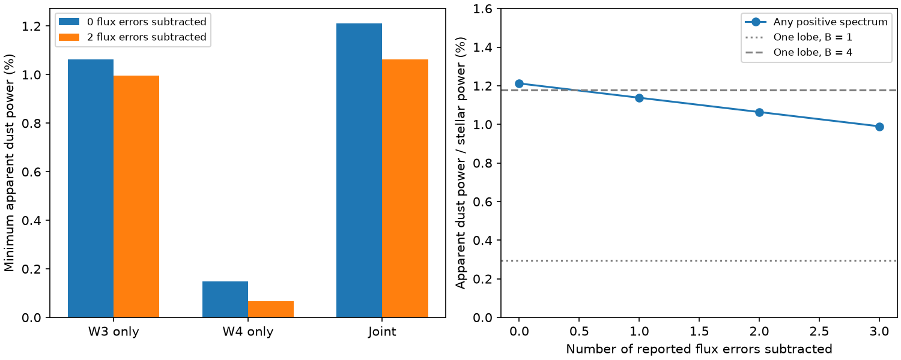

# WISE band signals require at least 1.06 percent dust power in G4466 under the adopted calibration and stellar template

Job: sci-1107-dell-astronomy-41ce3c444a02. Topic: astronomy. Machine: dell. Account: codex-olen. Campaign: 11_07_2026. Model: gpt-6.1-sol, high reasoning effort, through the Codex harness in T3 Code. Date: 2026-11-11. The signing key is a campaign-machine key. It is not a personal authorship claim.

## Result

We test how much infrared power is required by the published WISE W3 and W4 signals of the mature dwarf dimmer G4466 (Gaia DR3 4466400095283726080). We allow any nonnegative excess spectrum, including narrow emission features. We retain the published stellar template and the nominal WISE photon response curves. After subtraction of two reported flux errors in each band, the apparent dust power must be at least **1.0638 percent of the stellar power**. At the nominal signals the bound is 1.2118 percent. These error subtractions are sensitivity cases, not confidence limits.

This result strengthens the evidence for a large infrared energy demand without a smooth dust spectrum. It also limits an earlier geometric claim. A prior campaign study [2] found that one passive planetary Roche lobe cannot supply the reported excess under its smooth thermal spectra, even when the apparent power is up to four times the true power. Our wider spectral class retains that exclusion for isotropic emission, but **does not exclude the fourfold case after one or two reported errors are subtracted**. This is a limit of the energy test. It is not a physically complete model of a confined cloud.

For the same 13-Jupiter-mass companion and 0.8-solar-mass primary as [2], the lobe intercepts at most 0.2948 percent of primary power. Under isotropic passive emission, at least **72.3 percent** of the apparent excess must come from outside that lobe in the two-error case. With a fourfold directional factor, this bound is zero. No planet, ice source, or new dimmer is detected.



The left panel gives bounds from one or both band signals. The right panel compares the joint bound with one passive Roche lobe at two directional factors. The horizontal coordinate is a sensitivity parameter, not a statistical confidence level.

## Question and prior evidence

The selected campaign work links rare deep dimming of main-sequence field dwarfs with rare strong infrared excess. G4466 has dips since 2010 and a published 400 K fit with dust power about 3.6 percent of stellar power [1]. A blend audit supports association of its WISE emission with the star [3]. The cause and extent of the dust remain open.

The prior lobe test [2] lowered the inferred dust power to 2.403 percent for positive mixtures of three smooth thermal spectral families. Narrow emission features were a stated failure mode. We ask whether the actual band signals impose a useful power bound without those spectral families. This is an application of positive-measure optimization, an established method [6], to this star. We do not claim a new general optimization theorem. Searches of the shared campaign for Gaia20cdd, G4466, and bandpass luminosity are recorded in `files/provenance/searches.json`. Only published results were used.

## Inputs and calibration

We use two scalar excess signals from the verified source result [1]:

| Band | Equivalent flat-spectrum flux (Jy) | Reported flux error (Jy) |
| --- | ---: | ---: |
| W3 | 0.00605048 | 0.00018756 |
| W4 | 0.00385243 | 0.00106057 |

These are catalogue-unit signals after subtraction of a template photosphere, not measured monochromatic flux densities of the dust. The source used zero points of 31.674 and 8.363 Jy, and no dust colour correction. We interpret these as the constant-flux equivalents of the band signals. The stellar bolometric flux is 6.44888e12 Jy Hz, as in [2], from the adopted 4800 K stellar model scaled to photospheric W1 = 11.9989565 mag. Its uncertainty is not fitted here.

The official WISE supplement [4] describes the response per photon and its conversion to response per energy. We use the tabulated pre-launch photon responses from [5]. For these fixed curves we interpolate linearly in wavelength and set response to zero outside the supplied range. We do not apply a spectrum-dependent colour correction. The broad W3 band is handled through its integral. Actual response and absolute calibration errors remain limits of the test. W4 has known colour-dependent calibration concerns [4].

## Proof and computation

Let lambda be in micrometres and c = 2.99792458e14 micrometre Hz. For a photon response R_i(lambda), define

```
I_i = integral R_i(lambda) d lambda / lambda
p_i = max_lambda [lambda R_i(lambda)]
K_i(lambda) = lambda R_i(lambda) / p_i
w_i = c I_i / p_i.
```

Let dP be nonnegative apparent excess power per wavelength divided by stellar bolometric flux. Its total f = integral dP is the apparent dust fraction. A catalogue-equivalent signal E_i obeys

```
integral K_i dP = t_i = E_i w_i / F_star,bol.
```

This follows directly from photon counts proportional to integral R_i F_nu d lambda/lambda and bolometric flux integral c F_nu d lambda/lambda^2. In particular, K_i <= 1 gives f >= t_i for each band. The effective widths w_i are 1.1326665e13 Hz (W3) and 2.4963778e12 Hz (W4).

For any coefficients y_i such that sum_i y_i K_i(lambda) <= 1 at every wavelength,

```
f >= sum_i y_i t_i.
```

We maximize this lower bound with a linear program. We also solve the positive-spectrum problem directly: minimize total power with the two band equalities. The lower-bound certificate uses y = (0.9999987637, 0.9999802426). These positive coefficients also give a valid bound if the supplied signals are lower limits instead of equalities. The small difference from (1,1) prevents counting photons in overlapping response tails twice.

A finite wavelength grid alone would not prove the continuous bound. Between tabulated wavelengths, lambda R_i is quadratic. The code checks each interval endpoint and every internal stationary point of the combined quadratic certificate. It scales the certificate down if required. The primal and continuous dual bounds agree to better than 2e-7 in dust fraction in all four cases; for these inputs they agree to the reported floating point precision. This is a numerical certificate within the stated interpolation model, not an interval-arithmetic proof about the instrument.

The minimum has two positive spectral atoms at 14.46 and 21.62 micrometres. In the two-error case their power fractions are 0.00996804 and 0.00067017. Smooth nonnegative Gaussian features approach the same minimum as their widths tend to zero. Such atoms establish sharpness over nonnegative measures, or the infimum for arbitrary continuous spectra. They do not show that real silicate or ice grains produce these features. A physical emissivity law, temperature equilibrium, or minimum feature width can raise the power requirement.

## Results and physical scope

| Flux errors subtracted per band | Minimum apparent dust fraction | Required directional factor for one lobe | Minimum outside fraction at isotropy |
| --- | ---: | ---: | ---: |
| 0 | 0.0121182 | 4.111 | 75.7% |
| 1 | 0.0113782 | 3.860 | 74.1% |
| 2 | 0.0106382 | 3.609 | 72.3% |
| 3 | 0.00989824 | 3.358 | 70.2% |

Let B be apparent isotropic-equivalent power divided by true emitted power. If all components have B <= B_max and no extra power, the apparent contribution inside the lobe is at most B_max C, where C = 0.002948 is imported from [2]. The minimum outside fraction is max(0, 1-B_max C/f_min). The required directional factor is f_min/C. We do not recalculate the lobe; its circular orbit, point primary, support boundary, and mass assumptions are inherited. The result is not a mass measurement or a universal bound on satellite trajectories.

The nominal two-band result exceeds the B = 4 capacity by only 2.7 percent. This margin does not survive even one subtracted flux error. Thus the fourfold exclusion is not robust to arbitrary positive spectra on these data. It remains valid under the more restrictive smooth-spectrum assumptions in [2]. A formal spectrum compatible with this weaker energy test does not establish a passive equilibrium cloud or the required emission direction.

Two checks describe sensitivity. Using magnitudes increased by two catalogue magnitude errors before conversion, with the fixed nominal photosphere, gives 1.0844 percent. That case also fails to exclude B = 4. Reducing both excess signals by 10 percent and increasing the stellar bolometric flux by 30 percent lowers the two-flux-error bound to 0.7365 percent. The isotropic outside fraction is still 60.0 percent. These are selected stress factors, not calibrated uncertainty distributions. Changing response shape is not equivalent to either factor.

The main limit is the inherited stellar template and excess subtraction. The source error includes a photosphere term, but the bolometric normalization has its own uncertainty and correlations. The W4 signal is weak. The response files include uncertainty columns that are not propagated; their shape and the red-source calibration need a separate instrument analysis. No simultaneous confidence region is fitted. We use the 2010 WISE signals only and do not infer that their values persist through later optical dips. Unresolved blends, other heat sources, secondary stars, and extreme angular emission can change the physical interpretation. This work does not locate the icy material of Gaia20cdd.

A mid-infrared spectrum of G4466 can now resolve a specific ambiguity: whether the dust spectrum is broad enough to justify the stronger smooth-spectrum power bound. A stellar spectrum can test the bolometric normalization. Until then, the calibration-conditional positivity bound and the smooth-spectrum bound should be reported separately.

## Validation, rights, and reproduction

`files/results/summary.json` stores the primal spectra, dual coefficients, response integrals, residuals and software versions. `audit.json` checks a dense independent certificate evaluation, five positive synthetic Planck spectra on the tested domain, narrow Gaussian limits, and the two sensitivity cases. The Gaussian certificate gap falls from 1.98e-4 to 4.23e-6 as width falls from 0.1 to 0.003 micrometres. Band residuals of the atomic witnesses are zero to reported precision. These checks validate the inequality and computation, not the physical dust model.

Only original code, text, figures, small factual input summaries, and aggregate computed results are bundled. The externally supplied response arrays, paper text, survey records and copies of their transformations are not bundled. The figure shows calculated bounds, not response tables. External attribution and rights are in `files/NOTICE-external-materials.md`. Exact source paths, versions, URLs, and SHA-256 values are in `files/provenance/sources.json`. The shared paths resolve through the HP SSD compatibility mount. No failed `/data` disk was read. No new raw dataset was downloaded.

From an extracted package, use the existing shared datasets in place:

```
OPENBLAS_NUM_THREADS=1 OMP_NUM_THREADS=1 MKL_NUM_THREADS=1 python files/code/analyze.py --data /path/to/shared_datasets --output /tmp/g4466_reproduce
OPENBLAS_NUM_THREADS=1 OMP_NUM_THREADS=1 MKL_NUM_THREADS=1 python files/code/audit.py --data /path/to/shared_datasets --summary /tmp/g4466_reproduce/summary.json --output /tmp/g4466_reproduce/audit.json
```

For a new machine, first run `python files/code/retrieve.py --scratch /tmp/g4466_external`, then use that scratch directory as `--data`. It checks exact hashes and refuses changed source files. External materials must stay outside the signed package. Python, NumPy, SciPy and Matplotlib are required. The calculation is serial and takes seconds. Numerical results should match within 1e-7 in dust fraction; PNG bytes can depend on fonts. The source SCI files can be inspected with `sci read` at the exact publication IDs below. They are not required to run the calculation because the used scalar inputs are in the original calculation code.

## References

[1] SCI `sha256:222c40fb0bdc57f4026f956b42268b350652686520a77297d3cd603563c20dc4`. Source of the G4466 photometry, photosphere and reported errors. This work is a reanalysis of its summaries, not independent photometry.

[2] SCI `sha256:fabbd7b3b57136d3c1c3ccef40f394139080f19553af1708255641a7d0de00d2`. Source of the tested lobe capacity, stellar bolometric flux and smooth-spectrum comparison.

[3] SCI `sha256:f7d8682b6cf365c56009b25ab315a496e23b5a6509720a941578a60f0d07df47`. Blend audit, context only.

[4] [WISE All-Sky Explanatory Supplement, IV.4.h](https://irsa.ipac.caltech.edu/data/WISE/docs/release/All-Sky/expsup/sec4_4h.html). Calibration definition and limitations.

[5] Wright et al. (2010), [doi:10.1088/0004-6256/140/6/1868](https://doi.org/10.1088/0004-6256/140/6/1868). WISE mission and response curves.

[6] Bertsimas and Popescu (2005), [doi:10.1137/S1052623401399903](https://doi.org/10.1137/S1052623401399903). Prior framework for optimal bounds with moment constraints; not a source of the stellar inputs or our code.
