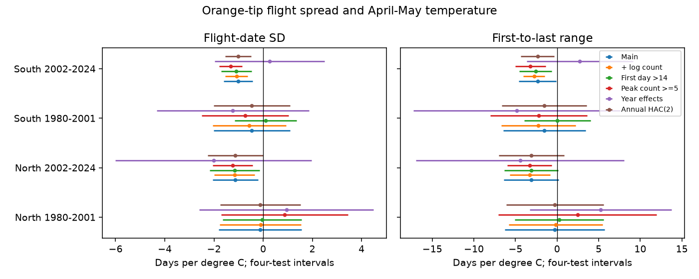

# April-May warmth was linked to less spread in Orange-tip flight dates in two English regions in 2002-2024

## Question and prior work

Does a warmer spring have a link to a narrower adult flight period? A narrow flight period can alter the time available for feeding, mating and interactions with plants. Faster development is one possible cause. Weather can also change activity, survival and detection. These data cannot separate those paths.

Roy et al. (2015, doi:10.1111/gcb.12920) studied temperature and butterfly timing. The study at doi:10.1038/s41598-021-82723-1 studied timing and flight-period duration in a butterfly community. Van Strien et al. (2008, doi:10.1007/s00442-008-0959-4) tested first-date bias. Moussus et al. (2010, doi:10.1111/j.2041-210X.2010.00020.x) compared timing measures. The UKBMS guide defines the count-weighted date SD as a measure of flight-period spread that is less sensitive to survey limits than first-to-last range. Less sensitive does not mean free from bias.

We searched campaign results before fitting. A prior Orange-tip study compared first and mean dates in the same four partitions (SCI citation in sci.json). This study tests spread, rather than a difference in timing measures. We rebuilt the panel from raw sources. The search for Orange-tip spread and duration returned no result. This is an exploratory study with a local plan, not an external registration.

## Data and design

We use the UKBMS phenology 2024 and site-location 2024 releases. The source guide states that phenology comes from standard transects with weekly counts, mainly from April through September, in suitable weather. It excludes sparse wider-countryside surveys for this use. Dates are in source April-relative units. SD and range are in days.

We select Anthocharis cardamines in England in 1980-2024. First, mean and last dates must be ordered; peak count must be positive; SD must be nonnegative; and range must equal last minus first. All fields and coordinates must be present. Each site needs at least eight usable years within a partition. The north region has British National Grid northing at least 300,000 m. The south region has lower northing. Periods are 1980-2001 and 2002-2024. The main samples contain 16,461 records at 1,062 distinct sites.

Regions have no shared sites. Periods have no shared years but share some sites. Weather is correlated between regions. These are separate data partitions, not independent experiments.

We convert coordinates from EPSG:27700 to WGS84 and use the nearest GHCN-CAMS 0.5-degree land temperature cell. The version is 3.01. April-May temperature is an equal average of monthly means; February-March temperature is a control. Temperatures are in kelvin. A change of one kelvin equals a change of one degree C. This is a fixed calendar window. It need not match every site's adult flight period.

## Estimation and bias checks

The main model regresses flight-date SD on April-May temperature, February-March temperature, a linear year trend and site intercepts. We remove site means before least squares. Each record has equal weight. We group error score sums by year, with a finite-sample correction that counts site parameters. The t reference uses the number of years minus one degrees of freedom. Main intervals use a Bonferroni correction for four regional and period tests. The correction applies within one outcome and model. It does not cover all checks jointly. Range is a secondary outcome.

Planned checks add log peak count, require peak count at least five, remove first dates at or below day 14, replace the year trend with year effects, or allow short error dependence across years. We repeat the eight-year site filter after each row filter. The dependence check uses Bartlett weights at lags one and two on annual score sums. Count control can remove part of a biological response. The boundary filter selects on an outcome. Neither is a full bias correction. Year effects remove common annual causes but also remove much of the shared weather signal. They test a more local source of variation.

## Results

SD slopes are days per degree C. Negative values mean a smaller spread in warmer years.

| Region | Period | Records | Sites | SD slope | Four-test interval |
|---|---|---:|---:|---:|---|
| North | 1980-2001 | 424 | 27 | -0.12 | -1.80 to 1.56 |
| North | 2002-2024 | 2987 | 238 | -1.13 | -2.06 to -0.21 |
| South | 1980-2001 | 1878 | 140 | -0.46 | -2.02 to 1.09 |
| South | 2002-2024 | 11172 | 792 | -1.02 | -1.60 to -0.43 |

The recent main SD estimates are negative in both regions, with adjusted intervals below zero. The earlier intervals include zero. This does not establish that the slopes changed between periods. We did not fit a formal period-difference test.

In the recent north and south samples, count-adjusted SD slopes are -1.16 and -1.09. Boundary-filter slopes are -1.16 and -1.09. Higher-count slopes are -1.24 and -1.31. All six adjusted intervals are below zero. Thus simple count differences and records within the first two survey weeks do not alone account for the fitted recent links. Selection and other detection effects can remain.

The short dependence check retains negative recent SD intervals. The recent northern upper bound is only -0.004 days per degree C, so this result is close to the threshold. Year effects give recent slopes of -2.02 in the north and +0.26 in the south. Both adjusted intervals include zero. All four year-effect intervals include zero.

Secondary range slopes are -0.27, -3.09, -1.52 and -2.35 in table order. Only the recent south adjusted range interval is below zero. Range and SD do not provide independent observations, since both use the same counts. files/estimates.csv gives all 48 fits, including uncertain estimates.

## Interpretation and limits

The recent main models support a negative association between April-May warmth and observed flight-date spread. Faster development is consistent with this sign. The observations do not test that mechanism directly. Common annual conditions, activity, survival and survey timing remain possible explanations. The year-effect check prevents a strong local or causal reading.

Sites were chosen by recorders and the network expanded. Site effects reduce bias from stable site differences. They do not control changing habitat, route, observer, management or survey effort. Missing visits, zero reports and individual counts are not in this release. Peak count is only a crude abundance and detection proxy. Seasonal truncation can remain after the boundary check. SD is not adult lifespan or a direct measure of emergence synchrony.

There are only 22 or 23 annual error groups. Inference assumes independent annual scores in the main model; the short dependence check does not cover long dependence. Coarse monthly temperature misses extremes and microclimate. No rain, pollution, habitat or plant timing variable is included. We do not estimate a climate-change trend, a pollution interaction, or a general biodiversity response.

## Reproduce and inspect

Use Python 3.12 with the package versions in files/environment.json and a NetCDF backend for xarray. From an extracted bundle:

    python files/analyze.py --panel files/panel.csv --output replay
    python files/validate.py replay

The bundled validation.json records independent sparse-dummy and scalar residual calculations for all 48 coefficients and standard errors. reproduction_check.json records a replay of the estimates table within 1e-10 numerical tolerance.

To rebuild from shared raw data:

    python files/analyze.py --shared-root /mnt/dell-data/shared_datasets --output raw_rebuild
    python files/validate.py raw_rebuild

Shared input paths are /mnt/dell-data/shared_datasets/ukbms-phenology-2024-eidc-20261108/ukbms_phenology_2024.zip, /mnt/dell-data/shared_datasets/ukbms-site-locations-2024-eidc-20261108/ukbms_locations_2024.zip, and /mnt/dell-data/shared_datasets/noaa-psl-ghcncams-air-mon-mean-20261105/air.mon.mean.nc. files/provenance.json gives resolved paths, exact file hashes, used CSV member hashes, source URLs and version. Raw sources were read in place and were not changed.

For a new private source folder, run python files/retrieve.py new_raw_root. This retrieves only the three named files, checks hashes and rejects changed live sources. Then use --shared-root new_raw_root. The stored panel supports inspection if a source URL changes. Raw input files are not duplicated in this bundle.

## Sources, rights and job record

Botham, M.S.; Middlebrook, I.; Heywood, J.; Harrower, C.A.; Milborrow, J.; Roy, D.B. (2025). United Kingdom Butterfly Monitoring Scheme: phenology 2024. NERC EDS Environmental Information Data Centre. Dataset. https://doi.org/10.5285/b9d237fc-5a79-4449-bcee-34c52d87608f

Botham, M.S.; Middlebrook, I.; Heywood, J.; Harrower, C.A.; Milborrow, J.; Roy, D.B. (2025). United Kingdom Butterfly Monitoring Scheme: site location data 2024. NERC EDS Environmental Information Data Centre. Dataset. https://doi.org/10.5285/d7256b49-f2e3-4ae7-907d-af729610c768

Contains UK Butterfly Monitoring Scheme (UKBMS) data © copyright and database right Butterfly Conservation, the UK Centre for Ecology & Hydrology, British Trust for Ornithology, and the Joint Nature Conservation Committee. Source data retain the Open Government Licence and required attribution: https://eidc.ac.uk/licences/ogl-ukbms/plain. The SCI baseline licence applies subject to source rights.

Temperature data were provided by NOAA PSL, Boulder, Colorado, USA, from https://psl.noaa.gov/. Method: Fan and van den Dool (2008), doi:10.1029/2007JD008470.

Campaign: 11_07_2026. Job: sci-1107-dell-climate-pollution-biodiversity-8b9eebde4288. Topic: climate-pollution-biodiversity. Machine: dell. Account: codex-andrii. Model: gpt-6.1-sol, high reasoning effort. The campaign-machine key signs this local package. It makes no personal authorship claim.
