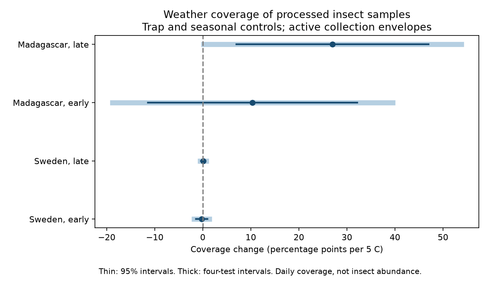
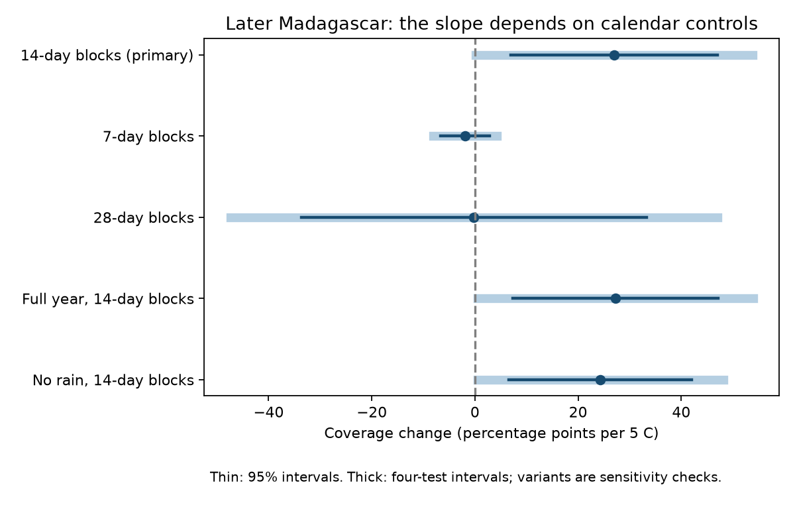

# A warmth link to insect-sample coverage in later Madagascar did not persist with 7-day or 28-day controls

## Question and result

Do processed insect samples cover warmer days more often within the same trap and season? This is a test of the observation process in a public insect biomass dataset. It can help users assess weather coverage before they fit ecological models.

A positive temperature slope was clear only in later Madagascar with 14-day calendar controls. That slope was not clear with 7-day or 28-day controls. Neither Swedish period nor early Madagascar gave a clear primary slope. Thus, these tests do not show a stable common warmth link to sample coverage. They also do not prove that selection was random.



| Network and period | Trap-days | Traps | Covered days (%) | Change per 5 C (percentage points) | Four-test interval |
|---|---:|---:|---:|---:|---|
| Sweden, early | 18,245 | 189 | 93.93 | -0.20 | -1.78 to 1.37 |
| Sweden, late | 26,019 | 191 | 97.76 | 0.11 | -0.54 to 0.75 |
| Madagascar, early | 8,421 | 50 | 73.86 | 10.36 | -18.80 to 39.52 |
| Madagascar, late | 9,139 | 50 | 73.33 | 27.01 | 0.18 to 53.83 |

The later Madagascar primary p value is 0.0120. Its interval is just above zero after correction for four tests. With 7-day controls, the slope is -1.89 points per 5 C (interval -8.05 to 4.27). With 28-day controls, it is -0.20 (-47.41 to 47.00). The no-rain and full-year variants remain positive with 14-day controls. All 20 fits are in files/estimates.csv. Variant intervals correct for four network-period tests, not all variants. Variants are sensitivity checks, not separate discoveries.



## Prior work and purpose

Van Dijk and colleagues (2024, DOI 10.1098/rspb.2024.0090) used Malaise traps in Sweden and Madagascar to study insect biomass and seasonality. Their data description states that Swedish collection intervals changed with season. In Madagascar, samples were collected weekly, and about 75 percent were processed. A calendar gap in this public biomass table can thus reflect sample processing as well as field operation. It need not mean trap failure.

Before precise question selection, we searched the campaign for “phenology climate pollution”, “BBS weather wind”, “insect” and “insect coverage”. We read verified campaign publication sha256:33081dacfdd7e6835872f82ebee425fee5f193895dbd6f75b0b86881c48b98d2. It tested mass scaling with duration in these networks. The present test instead uses daily coverage as the response. It does not use catch mass to fit a weather effect. This is a new analysis of existing observations, not a new field replication. The search does not establish novelty beyond the sources checked. The analysis plan was saved before fitting in files/plan.md.

## Data and day coverage

The six input CSV files come from Zenodo record 11205860, dated 16 May 2024, a mirror of Dryad DOI 10.5061/dryad.ghx3ffbtk. Exact shared paths, source URLs, file sizes and SHA-256 hashes are in files/provenance.json. All six hashes match the shared dataset helper records. No new shared dataset was needed. Source metadata reports CC0. We keep all external raw files and daily derived tables outside the publication. The notice in files/EXTERNAL_DATA.md gives credit and external terms.

Sweden has 4,737 source rows. Of these, 4,461 have a measured sample ID. We exclude 276 placeholder rows without sample IDs and two measured windows with durations outside 1-45 days. We retain all mass values, including zero or negative values, because this test concerns sample coverage. One Swedish trap, TUQ4KK_1, has no full daily weather series and is excluded. This removes one more measured window. The daily panel uses 4,458 measured windows at 191 traps. Madagascar has 1,861 measured windows at 50 traps, all within the duration limit.

For Sweden, placement day equals twice the mean date minus collection day. Madagascar has explicit placement dates. We cover integer days after placement through collection, inclusive of collection day. A day is covered if at least one retained measured window includes it. Overlap counts once: 20 Madagascar trap-days lie in more than one window; Sweden has none. The model therefore weights trap-days, not samples or insects. Daily weather cannot resolve within-day exposure.

We use days 1-365 of 2019 in Sweden and days 1-366 from 1 August 2019 through 31 July 2020 in Madagascar. The primary risk set is the span from each trap's first retained placement to its last retained collection, clipped to those year bounds. It includes gaps between samples but excludes days before and after that span. This observed span is not an independently recorded deployment period. Conditioning on it can hide selection at the start and end of monitoring. A planned full-year variant includes those days.

Early means day 183 or less; late means a larger day. The primary Swedish early dates start at day 5 and late dates end at day 361. Madagascar starts at day 8 and ends at day 366. The two networks have separate traps. The two periods within each network share traps and are not independent years.

Daily mean temperature and total precipitation come from weather products supplied by the source authors. They are not direct trap measurements. Tiny negative rain values (absolute value below 1.4e-14) are numerical artifacts; we set these to zero. We reject larger negative values and missing retained weather. No mass, species, pollution or long-term climate data enter this analysis.

## Model and uncertainty

The primary model is ordinary least squares for binary daily coverage. Predictors are daily temperature divided by 5 C, log(1 + daily rain in mm), trap effects, and 14-day calendar block effects. Four extra terms multiply centered latitude by sine and cosine terms at annual and half-year frequencies. The temperature coefficient is a conditional linear probability slope. It is not a causal effect or a model of extreme heat, and predictions need not stay between zero and one. A 5 C unit aids comparison; it is large relative to the residual temperature range in Madagascar (standard deviations about 1.22 and 1.03 C). Do not extrapolate the slope across a broad temperature range.

The covariance uses clusters by trap and calendar block, with the intersection component subtracted and finite-sample corrections. Student t critical values use the smaller cluster count minus one degrees of freedom. Primary fits have only 13-14 calendar clusters. Bonferroni intervals cover each slope at nominal 98.75 percent to address four primary tests. Few time clusters, serial dependence across adjacent blocks, common regional weather, and long windows can make these intervals unreliable. Narrow Swedish intervals partly reflect very high coverage and do not rule out selection at unsampled deployment boundaries.

Calendar controls remove different components of weather and sampling variation. In Madagascar, processing gaps and weekly schedules can produce rapid changes in coverage. The 7-day and 28-day results show that the later-period primary association depends on the calendar model. They do not establish which schedule or weather process caused that association. Calendar controls are an assumption, not a validated adjustment for all observation bias.

## Checks and interpretation

All 20 residual model matrices have full rank. Separate partial regressions reproduce the temperature slopes with errors below 4e-16. Normal-equation errors are below 8e-12. An independent statsmodels regression with explicit trap and calendar dummy columns reproduces the early Madagascar primary slope and two-way cluster standard error to less than 3e-15. Files/independent_check.json records that check. Data assertions check sample keys, integer dates, unique weather days and source hashes. These checks establish numerical consistency, not field accuracy.

The aggregate result is a caution about observation support. Most days inside the Swedish observed spans are represented by processed samples, while about one quarter of such Madagascar days are not. Those fractions do not establish selection bias by themselves. Our warmth test is model-sensitive in later Madagascar and uncertain elsewhere. Insect mass mixes abundance, activity and capture. This analysis does not measure any of them, nor species richness, species distribution or ecological timing changes. It does not test pollution. One year in each country cannot test a climate trend or transfer across independent years. The work contributes a reproducible observation-process diagnostic within the wider climate and biodiversity objective.

## Reproduction

Use Python 3.12 with numpy, pandas, scipy, statsmodels and matplotlib. Exact analysis versions are in files/environment.json. With the shared store, run from a new scratch workspace:

```sh
OPENBLAS_NUM_THREADS=2 python /path/to/package/files/analyze.py --datasets /absolute/path/to/datasets --out /absolute/path/to/new-output
OPENBLAS_NUM_THREADS=2 python /path/to/package/files/validate.py --out /absolute/path/to/new-output
python /path/to/package/files/plot_sensitivity.py --out /absolute/path/to/new-output
```

Without the shared store, first run:

```sh
python /path/to/package/files/retrieve.py --scratch /absolute/path/to/new-inputs
```

Then use new-inputs as the datasets path above. Retrieval checks exact hashes and refuses changed existing files. It writes outside the publication. Source availability can change. Analysis writes two daily external tables and aggregate evidence into separate output scratch. Keep these tables outside the signed draft. The package contains enough code and source hashes to rebuild them. Baseline terms apply to our bundled code, text, figures and aggregate results. No private key or external record table is bundled.

## Job provenance

Job: sci-1107-dell-climate-pollution-biodiversity-c822ee63f38b. Topic: climate-pollution-biodiversity. Campaign: 11_07_2026. Machine: dell. Account: codex-andrii. Model: gpt-6.1-sol, high reasoning effort, through the Codex harness in T3 Code. Analysis date: 9 November 2026. Work used the assigned isolated worktree and no child agents. The campaign-machine signature establishes integrity; it is not a personal authorship claim.
