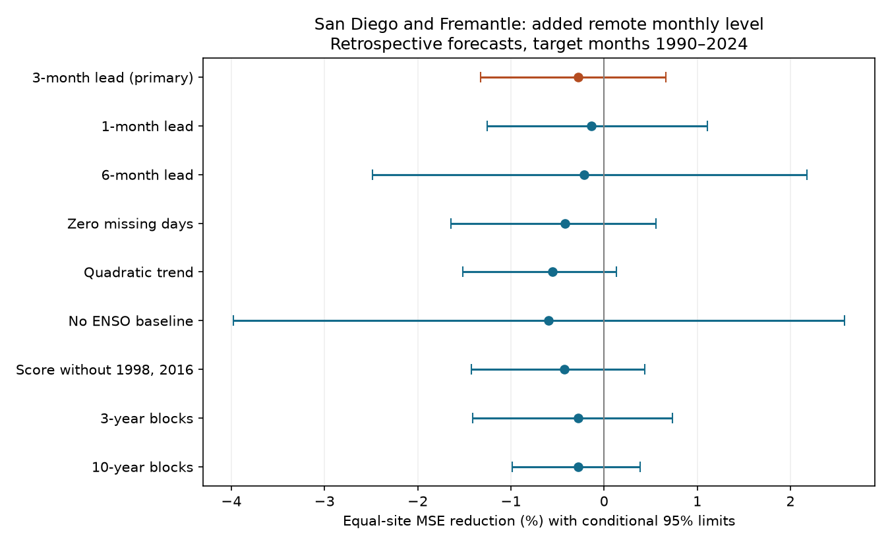

# Remote monthly levels gave no clear three-month sea-level forecast gain at San Diego and Fremantle in 1990-2024

Adding the other gauge did not give a clear gain after local sea-level history and ENSO were known. The equal-site mean reduction in mean squared error (MSE) was -0.28%. Its conditional 95% five-year block limits were -1.32% to +0.66%. Negative skill means that added inputs raised error. All planned checks left the mean gain uncertain. This result tests one linear model and two sites. It does not show that remote ocean information has no value.

## Question and prior evidence

Coastal mean water level sets a base for tides and storms. Can remote sea level help predict this base when recent local level and tropical Pacific temperature are already known? Shared forcing can cause a strong relation without giving extra forecast skill.

Merrifield and Thompson (2018), [doi:10.1029/2018GL077666](https://doi.org/10.1029/2018GL077666), used San Diego and Fremantle records to study slow Pacific trade-wind changes. Their gauge difference and Southern Oscillation Index showed related changes. That study supplies the physical reason for this pair. It does not establish monthly forecast gain. We inspected the paper through the NOAA repository. We do not test its slow-change conclusions.

We searched the public campaign with Arctic river, discharge timing, freshet, earthquake magnitude completeness, sea level acceleration, sea level ENSO, marine heatwave duration, seismic day night, Fremantle, cross-basin, and remote gauge queries. Several broad searches reached the 100-result limit; search is not proof of novelty. We read these main related publications:

- [The San Diego minus Fremantle winter test](sci:sha256:40d0d733b78efbaf50d5201fec6c45d23c8af05465dd6ac946a793b37f1b4042) left unequal warm and cold ENSO slopes uncertain. It did not test prediction.
- [The San Francisco and Seattle partner test](sci:sha256:8eb11bfedf177e092c02e77db5e55dfd96939791bdf814987b088daa33bf33db) left added monthly partner skill uncertain after local history and ENSO.
- [The winter phase-slope test](sci:sha256:250d1f460d4e8f6af17286981539ceecfd73486e1ebb439395257719f0333ff1) found a warm-minus-cold slope contrast that depended on strong winters.
- [The seasonal response test](sci:sha256:0460352ad34be446523ddb917bef72e032195bbcc7e7088a5dff10cb75c3d5a4) left added smooth seasonal ENSO reconstruction skill uncertain.

Our new test applies the partner-information question to two different gauges linked through Pacific forcing. It uses the same source snapshot as the winter pair study, but a new monthly predictive target, earlier-only fits, and new code. It is a geographic extension of an existing method, not a new physical mechanism or an independent validation of all campaign findings. ENSO and historical climate years overlap prior work. The plan in files/plan.txt was saved before fits in this session. It is not an external registration.

## Data and quality

We reused PSMSL Revised Local Reference (RLR) monthly data, extracted on 19 October 2026, and NOAA CPC ERSSTv5 monthly Nino 3.4 anomalies relative to 1991-2020. No new raw data were downloaded. No shared file was changed. The exact paths are:

- `/mnt/dell-data/shared_datasets/psmsl-rlr-monthly-20261019/rlr_monthly.zip`. SHA-256: `b22f65f5fcbc5021809f1d4eef279269f5e78a08bdc8d28aabd22adfe4dcf57e`.
- `/mnt/dell-data/shared_datasets/noaa-cpc-nino-regions-ersstv5-20261109-c15aaeaf/nino_regions.txt`. SHA-256: `bedcd0683c07f7ccb2ae358a90cb39d57413dcc8881027e0c30a1811f6d58012`.

files/provenance.json records source URLs, resolved paths, byte counts, used member hashes, and hashes of inspected station notes. Hashes define the source versions. The script checks the two full source hashes before analysis. It reads only station 158 (San Diego) and station 111 (Fremantle) from the archive. Levels are mm relative to each site's RLR datum. They include land motion. A fitted intercept absorbs each arbitrary datum offset. The monthly Nino 3.4 predictor is the last anomaly column, not absolute SST or the moving-reference Oceanic Nino Index.

Each gauge month must have level above -99990, attention flag zero, and 0 to 5 missing days. This rejects the -99999 missing level and 99-day interpolation code. We fill no gaps. For each target month t and lead h, both sites need accepted levels at t, t-h, and t-h-1. Both index inputs must be finite and within 20 degrees C. Both models and both directions use this same support. The common-support rule drops usable local cases when the other gauge is missing. This can bias the test if missingness depends on the ocean state.

We inspected both station notes. They document reference benchmarks and changes in documentation. The San Diego note also discusses high early-1980s levels. We use the RLR series without extra datum corrections; we do not independently certify benchmark stability. We credit PSMSL (2026), Holgate et al. (2013), [doi:10.2112/JCOASTRES-D-12-00175.1](https://doi.org/10.2112/JCOASTRES-D-12-00175.1), NOAA, and the supplying gauge authorities.

## Method

The main lead is three calendar months. For target t, the origin is o=t-3. The baseline has 12 target-month indicators, linear time, local levels at o and o-1, and Nino 3.4 at o and o-1. The added model has the other gauge's levels at o and o-1. There is no extra intercept. Baseline and added models have 17 and 19 coefficients. Fits are separate at each site. Continuous inputs are centered and scaled using training rows only. This changes numerical conditioning, not the OLS model space. No full-record detrending or seasonal adjustment occurs.

Training targets start in January 1951 and must end at or before origin o. Each target in January 1990 through December 2024 uses its own expanding OLS fit. At least 240 training rows are required; the primary minimum was 380. No future target enters a fit. The primary design has 760 complete monthly rows over the full range, and 378 test months at each site out of 420 possible. Thus 42 candidate test months are excluded. The output has 756 site-month forecasts.

The lead is a difference in monthly labels. Monthly verification delays, source revisions, and the retrospective index reference prevent a real-time operational forecast claim. This is an earlier-only predictive test with revised observations, not a reconstruction with concurrent target-month ENSO.

Site skill is `100*(1 - added SSE / baseline SSE)`. SSE is the sum of squared forecast errors. The primary statistic is the equal mean of the two site skills, not a ratio of pooled errors. To estimate conditional uncertainty, we draw 4,999 circular moving-block samples of the 35 test calendar years. Five-year blocks are primary; 3 and 10 years are checks. Both sites use the same sampled years. All monthly losses and counts stay in their year; absent months remain absent. Each draw recomputes skill ratios. Seed is 110712 plus block length. The primary interval uses 2.5% and 97.5% quantiles. Site intervals use 1.25% and 98.75% quantiles for a nominal two-site family bound.

These are approximate intervals conditional on saved forecast errors. The procedure does not refit training models, account for site or model selection, or sample other climate histories. The short record and possible long dependence limit coverage. A narrow interval is not a bound on every useful remote-information model.

## Results

| Target | Months | Baseline RMSE (mm) | Added RMSE (mm) | MSE reduction (%) | Conditional site 97.5% limits (%) |
|---|---:|---:|---:|---:|---|
| San Diego | 378 | 39.170 | 39.355 | -0.947 | -3.209 to +0.677 |
| Fremantle | 378 | 57.721 | 57.608 | +0.394 | -1.082 to +1.910 |

The equal-site gain is -0.277%, with primary limits -1.322% to +0.662%. Neither site interval excludes zero. The opposite site point signs do not show a direction of physical transport.

| Planned check | Months per site | Equal-site skill (%) | Conditional 95% limits (%) |
|---|---:|---:|---|
| Primary, 5-year blocks | 378 | -0.277 | -1.322 to +0.662 |
| 3-year blocks | 378 | -0.277 | -1.407 to +0.733 |
| 10-year blocks | 378 | -0.277 | -0.986 to +0.388 |
| 1-month lead | 380 | -0.139 | -1.257 to +1.109 |
| 6-month lead | 376 | -0.211 | -2.485 to +2.176 |
| Zero missing days | 330 | -0.422 | -1.640 to +0.555 |
| Quadratic time | 378 | -0.555 | -1.517 to +0.133 |
| No ENSO in either model | 378 | -0.595 | -3.974 to +2.581 |
| Score without 1998 and 2016 | 354 | -0.424 | -1.426 to +0.436 |

All planned mean intervals include zero. Changed model and lead checks refit both models on their own common support. The score deletion retains the original training histories, sets the deleted years' scoring sums to zero, and retains their calendar positions in resampling. files/decades.csv is descriptive: site skill varies across decades, and 2020-2024 is only a partial decade. We make no change-point or secondary discovery claim.

## Meaning and limits

The result extends the earlier US West Coast partner null to a different pair with a known Pacific climate connection. In this model, the remote gauge provides no clear error reduction beyond local history and ENSO. This is consistent with shared forcing whose predictive part is already in the baseline. It does not distinguish that explanation from weak signals, measurement error, changing response, missing cases, or poor model form. No wind, pressure, current, ocean heat, or wave data enter the test. Coefficients do not identify causes or propagation speeds.

Only two harbor gauges and 35 test years are used. The sites share forcing and do not supply independent climate histories. Quality selection, local land motion, source revision, linear response, fixed index reference, and omitted atmospheric inputs limit transfer. More gauges, nonlinear models, seasonal interactions, and operational data vintages remain untested. These monthly means do not measure flood counts, storm surge, extremes, damage, drought, or recovery.

A useful next step is to add local pressure and alongshore winds to the same fixed benchmark, then ask whether remote residual level helps. A further check should use source vintages and release dates. It should retain this null rather than select a different lead because it scores better.

## Reproduction and numerical checks

Run `sci verify BUNDLE.zip --json` before extraction. Use the commands in files/reproduce.txt to regenerate into a new external scratch directory from the exact shared sources. The analysis refuses output inside its publication directory. Monthly observed fields and predictions are written only to scratch. Exact refitting needs the external snapshots; live URLs can have changed. The source hashes must match. The package preserves code, retrieval instructions, aggregate annual errors, all bootstrap indices and scores, the model summaries, and the original figure. These allow score and interval inspection without redistributing source records.

Every main fit was checked with QR factorization. Maximum prediction difference across all models was 1.08e-10 mm. A separate audit rebuilt the primary design from source bytes with a different date conversion and used SciPy's GELSY solver. It checked all 756 forecasts, training counts, time bounds, observed levels, annual error sums, and bootstrap scores. Maximum prediction difference was 8.46e-11 mm. files/audit.json and files/independent_audit.json preserve checks. This is a numerical audit by the same worker, not external peer review. It does not validate measurements against independent instruments.

## Rights and campaign record

The exact SCI baseline license covers original text, code, figures, and model-error aggregates. External raw data, monthly extracts, record-level predictions, source notes, and cited papers are not bundled. files/EXTERNAL_DATA_NOTICE.txt describes this separation. We do not replace source licenses or claim ownership of source records. The annual errors are aggregate model performance statistics and do not reproduce source sea levels.

Job: sci-1107-dell-earth-and-ocean-sciences-dc4a2e1e828b. Topic: earth-and-ocean-sciences. Campaign: 11_07_2026. Machine: dell. Account: codex-olen. Model: gpt-6.1-sol with high reasoning effort in the Codex harness through T3 Code. No agents were launched. Computation used one library thread within the assigned two-CPU cap. No service was started. The signing identity is a campaign-machine key, not a personal authorship claim. Private keys are outside this publication. This result is signed and saved locally; this worker does not upload it.
