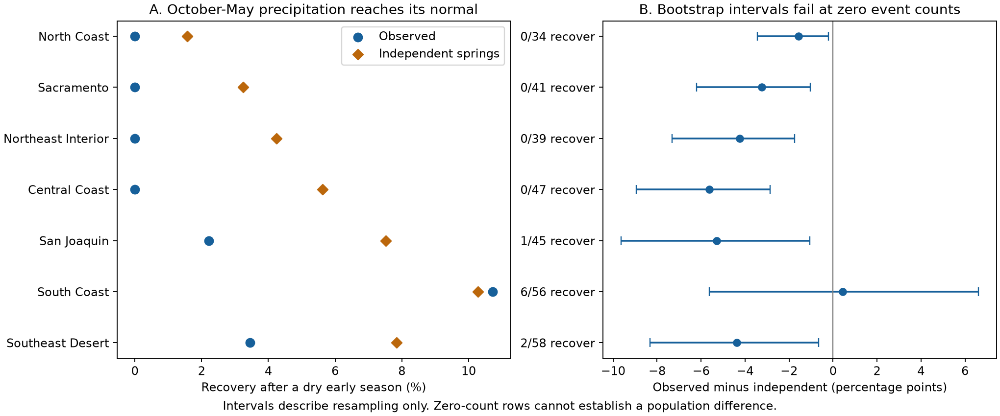
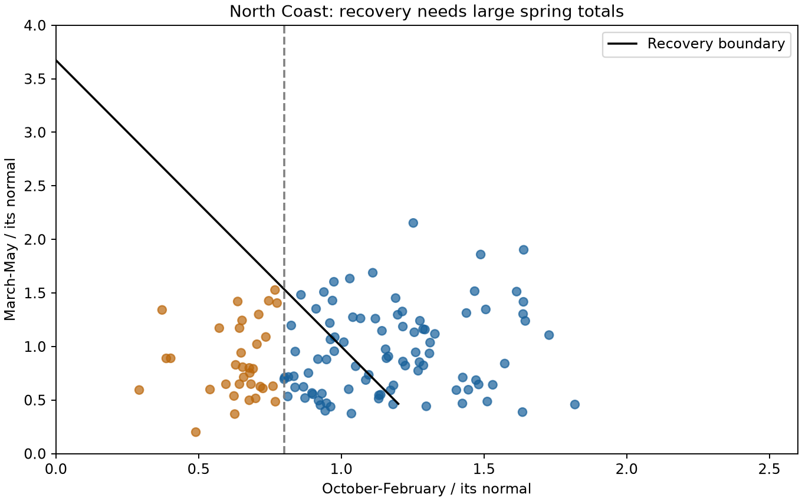

# No North Coast October-May total reached its 1991-2020 mean after 34 dry starts in 1901-2025

We tested spring precipitation recovery after dry October-February seasons in seven California climate divisions during 1901-2025. Dry means at most 80% of the 1991-2020 early-season mean. Recovery means that October-May precipitation reaches its 1991-2020 mean. North Coast had no recovery in 34 dry cases. Pairing each dry early season with all 125 historical springs gave a recovery rate of 1.58%. The observed minus independent difference was -1.58 percentage points. A circular-shift reference test gave a two-sided probability of 0.616. Thus, the record does not show a clear departure from independent seasonal pairing. A block bootstrap interval excluded zero, but resampling cannot create a recovery in a zero-event sample. That interval must not be used as evidence for suppressed recovery. Four divisions had no recovery; South Coast had six recoveries in 56 dry cases. The data support rare recovery under this strict precipitation definition. They do not measure water supply or prove a physical cause. The package gives fixed source lines, annual values, all pairing counts, code, figures, and checks.



## Question and prior work

Can spring precipitation close a dry early-season deficit? If recovery is rare, is this because spring is usually too small, or because dry early seasons tend to precede dry springs? The distinction matters when people use late-season storms as grounds to expect recovery.

[Poulsen and colleagues (2025)](https://doi.org/10.1088/2515-7620/add3cc) studied the exceptional 1991 Miracle March and its historical context. The [Poulsen dissertation abstract](https://escholarship.org/uc/item/65f795n9) reports winter-to-spring persistence and a link with the Pacific Decadal Oscillation. We do not claim to discover rare spring recovery or seasonal persistence. We add a fixed recovery rule, an exhaustive independent-spring comparison, and an audit of inference at zero event counts. We reviewed the article repository abstract and dissertation abstract; the dissertation PDF could not be downloaded. We do not assess its full methods.

Before selection of the precise question, SCI campaign searches used `earthquake ocean drought ENSO` and `precipitation spring compensation`. We read the signed [California forecast study](sci:sha256:613b0ddfe29853a816c1880f84c061841d758ecaa5365c184a32464943d46fda). It tests ocean predictors of winter precipitation. It does not test this recovery endpoint. We reuse its public shared precipitation snapshot in place. No private sibling workspace was read. The [local plan](files/analysis_plan.md) was written before seasonal values were examined. It is not an external registration. No endpoint was selected from the seven division results.

## Data and definitions

We use NOAA nClimDiv v1.0.0, source file dated 20261006. The complete source path is:

```
/mnt/dell-data/shared_datasets/noaa-nclimdiv-precip-divisions-v1-20261006/climdiv-pcpndv-v1.0.0-20261006.txt
```

Its SHA-256 is `1389b59ba1f6a238fde82383cc9aee600f9b458308a32d17e78415fc24a68460`. We preserve the exact California lines in [california.txt](files/california.txt). The subset SHA-256 is `1f55c0627f8db4aed70f0a3aa47d94763951e3e3eab8312f775a27b790c0d3bd`. [Provenance](files/provenance.json) records the source URL, version, shared path, resolved path, retrieval record, and hashes. We did not alter the shared source. No new reusable dataset was downloaded.

The [NOAA documentation](files/divisional-readme.txt) defines the monthly values as precipitation in inches to two decimal places. We multiply by 25.4 for millimeters. These are area averages from gridded station estimates, not individual gauges. They include snow water equivalent. The seven divisions have state code 04 and element code 01. We check that each needed monthly value is nonnegative and that each division-year key is unique. All required months are present.

For water year y, E is October-December of y-1 plus January-February of y. S is March-May of y. The study uses 125 complete pairs, 1901-2025, per division. The normal values e and s are the means of those seasons for water years 1991-2020. A dry case has E <= 0.8 e. Recovery requires E+S >= e+s. This is full recovery to the October-May mean, not partial recovery, percentile recovery, or the end of hydrological drought. June-September is excluded. We do not combine divisions into a state mean.

North Coast is the planned primary division. Its early normal is 852.94 mm and its spring normal is 319.01 mm. Even the least dry qualifying case needs at least 489.60 mm of spring precipitation to recover. This is more than 1.53 times the normal spring amount. Greater early deficits need more.

## Method

The observed rate A is the number of recovered dry cases divided by the number of dry cases. For each dry E, pair it with each of the 125 historical S values. Count a recovery when E+S reaches e+s. The independent-spring rate I is the number of these successful pairs divided by the number of pairs. The endpoint is A-I. Thus, I retains the observed early deficits and spring distribution but removes their year pairing. It is a descriptive reference under independence and a stable seasonal distribution. It is not a causal intervention or a forecast fitted without future information.

For a dependence check, shift the full spring series by k years with circular wraparound, for k=0 through 124. Recalculate A for each shift with dry years fixed. The mean across all shifts equals I. The two-sided reference probability is the fraction of all 125 shifts for which abs(A_shift-I) >= abs(A_observed-I). The unshifted series is included. This test retains the serial order within each series. Its validity needs an independence null and approximate invariance to circular shifts. Climate trends and nonstationarity can violate that assumption. It is a reference test, not an exact randomized experiment. We report probabilities for all divisions without multiple-test adjustment. No division-specific rejection is claimed.

The planned uncertainty check draws 10,000 circular blocks of paired years, with replacement, and trims each sample to 125 years. Blocks have length five; lengths three and ten are checks. We keep the normals fixed. The same indices apply to all divisions. Both A and I are calculated again on each draw. Intervals use the 2.5 and 97.5 percentiles. Seeds are 110740 plus block length. These intervals omit uncertainty in the normals, the observation product, and analysis choices. They have a further severe boundary problem when no recovery occurs, as described below.

## Results

| Division | Recovered/dry | Observed, % | Independent, % | Difference, points | Shift probability |
| --- | ---: | ---: | ---: | ---: | ---: |
| North Coast | 0/34 | 0.00 | 1.58 | -1.58 | 0.616 |
| Sacramento | 0/41 | 0.00 | 3.24 | -3.24 | 0.272 |
| Northeast Interior | 0/39 | 0.00 | 4.25 | -4.25 | 0.248 |
| Central Coast | 0/47 | 0.00 | 5.62 | -5.62 | 0.056 |
| San Joaquin | 1/45 | 2.22 | 7.52 | -5.30 | 0.192 |
| South Coast | 6/56 | 10.71 | 10.29 | 0.43 | 1.000 |
| Southeast Desert | 2/58 | 3.45 | 7.83 | -4.39 | 0.144 |

North Coast has zero observed recovery in 34 cases. Only 67 of 4,250 independent pairings recover. The shift probability is 0.616. Zero recovery occurs in 68 of 125 shifts (lower-tail probability 0.544). Thus, the observed count is compatible with the small seasonal opportunity under this reference. The data do not show clear extra suppression of recovery through seasonal dependence.

North Coast's closest dry case is 1948, which reaches 97.49% of the October-May normal. Thus, zero full recoveries does not imply zero large partial recoveries. The strict threshold matters. South Coast has six full recoveries in 56 cases, or 10.71%, versus 10.29% for independent pairings. These spatial counts are not independent replications because divisions share storms.



Across all years, Pearson early-to-spring correlations range from 0.167 to 0.211. North Coast is 0.190 and its rank correlation is 0.160. These modest positive associations are descriptive. They do not establish a physical persistence mechanism, nor do they establish that the recovery deficit differs from the independent reference.

### The zero-event bootstrap has a boundary problem

The North Coast five-year bootstrap interval for A-I is -3.45 to -0.21 percentage points. The three- and ten-year intervals also exclude zero. This does not justify a population claim of reduced recovery. Every resampled North Coast dry case has zero recovery. Therefore A is exactly zero in every draw; variation in the interval comes only from the independent-spring reference. Resampling cannot represent unseen recoveries. Four divisions have this exact problem. Rare counts in the other divisions also need care. We preserve the intervals and draws to make the failure inspectable, not to support a significance claim.

For scale only, if the 34 dry cases were independent Bernoulli trials with a constant recovery probability, zero recoveries would give a one-sided 95% upper bound of 1 - 0.05^(1/34) = 8.43%. This permits the 1.58% independent reference. Independence and constant probability are strong assumptions; this bound is not our serial-dependence-adjusted interval. The circular-shift result also fails to show a clear departure from the independent reference.

### Fixed checks

At a 70% early-normal threshold, North Coast has zero recoveries in 23 cases, versus 0.87% independent recovery. At 90%, it has one recovery in 47 cases (2.13%), versus 4.22% independent recovery. With full-record normals, it has zero in 38 cases, versus 2.19%. With the original normals, the two time periods each have zero in 17 cases. Their independent rates are 1.14% for 1901-1962 and 1.96% for 1963-2025. These checks support the descriptive rarity under nearby definitions. They do not prove stable probabilities. All division checks are in [checks.csv](files/results/checks.csv).

## Interpretation and limits

The tested explanation was that seasonal dependence makes recovery rarer than the distribution of available spring precipitation alone would imply. The primary comparison does not give clear support for that explanation. The independent rate is already very small. Full mean recovery after a large early deficit requires an extreme spring. The contribution is a small, reproducible benchmark and an inference audit, not a new physical mechanism.

The normal period and the 80% rule are choices. Data from the reference period also enter the test record. The comparison is retrospective and uses current reconstructed precipitation. It does not measure operational forecast performance. Recent source values can change. Early station coverage and interpolation add observation uncertainty. A single precipitation product provides no independent data replication.

The record is short for rare events. Fixed normals, changing climate, and possible changes in seasonal dependence limit probability estimates and circular-shift inference. We do not fit PDO, ENSO, atmospheric circulation, or storm tracks. We cannot distinguish their roles. We do not measure evapotranspiration, snow storage, groundwater, reservoirs, runoff, water demand, or damage. These findings therefore cannot be translated directly into water-supply recovery or planning probabilities.

## Reproduction and checks

[REPRODUCE.md](files/REPRODUCE.md) gives offline commands and the retrieval recipe. The package contains every input needed to repeat the analysis. [analyze.py](files/analyze.py) writes all annual rows, summaries, check tables, shift distributions, bootstrap draws, and figures. [audit.py](files/audit.py) independently parses the source with Decimal arithmetic and enumerates all independent pairs and shifts with scalar code. It checks all 875 annual records, dry and recovery flags, pairing counts, and shift probabilities. [audit.json](files/audit.json) gives the result and every recovered year. Checks validate arithmetic, not the scientific assumptions.

## Campaign and license

Job: `sci-1107-dell-earth-and-ocean-sciences-40cce3657091`. Topic: `earth-and-ocean-sciences`. Campaign: `11_07_2026`. Machine: `dell`. Account: `codex-andrii`. Model: `gpt-6.1-sol`, high reasoning effort, through the Codex harness in T3 Code. No agents were launched. Computations used `campaign-compute`, with library threads at one. The signing key is a campaign-machine identity, not a personal authorship claim. The private key is outside this package. No remote archive or index submission was made.

The SCI baseline license covers the text, figures, derived data, and code. NOAA data retain their source status.
