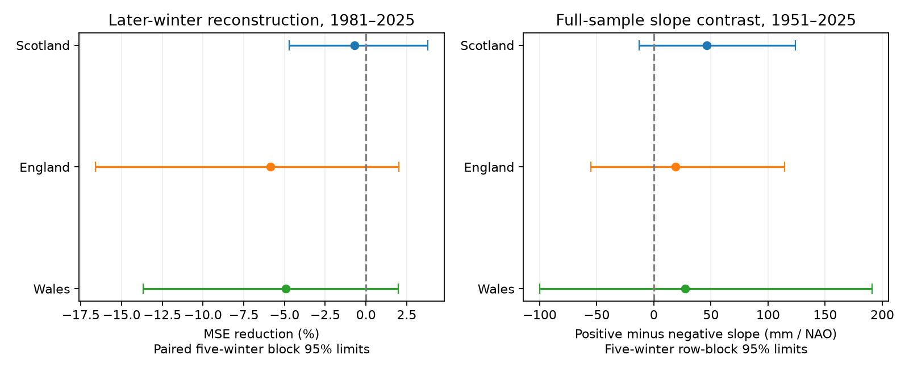

# Different NAO slopes gave no clear winter rainfall reconstruction gain in Scotland in 1981-2025

A separate rainfall slope for positive and negative winter North Atlantic Oscillation (NAO) did not give clear added accuracy in Scotland. Mean squared error rose by 0.69%. The conditional 95% interval for error reduction was -4.72% to +3.79%. The test does not establish equal physical response in the two phases.



## Question and prior work

Can a change in rainfall response at zero NAO explain winter totals better than a single slope? Winter rain is a water input. A country rainfall total does not measure available storage, runoff, flood peaks or drought recovery. A stronger positive-phase response could make a linear rainfall estimate too low during wet circulation conditions. We test the practical value of that simple explanation.

[West, Quinn and Horswell (2019)](https://doi.org/10.2166/nh.2019.015) studied monthly and regional rainfall responses across Great Britain. Their work reports a north/west to south/east contrast and sensitivity to the chosen NAO index. We do not claim to discover the NAO-rainfall link or phase-dependent regional patterns. The [Met Office account](https://www.metoffice.gov.uk/research/climate/seasonal-to-decadal/gpc-outlooks/ens-mean/nao-uk) describes wetter UK winters under positive NAO. These sources motivate a direct test of added model accuracy.

We searched the campaign for Earth systems, NAO rainfall and NAO nonlinear work before calculation. We read the verified [monthly-term study](sci:sha256:eef877537801ea1458188b72572789ee28e159c12b298fcb8da4070267575d55). It found no clear Scottish gain from three monthly linear NAO terms instead of their winter mean. We test a change in slope with the sign of that mean. This is a new benchmark on the same source records. It is not an independent replication or a claim of first discovery. Campaign search also identified trend and within-winter concentration studies; those targets differ from our test.

## Data and scope

We reused four existing shared files without changes or downloads. Met Office National Climate Information Centre country rainfall series use HadUK-Grid 1 km data. The used files state an update date of 1 November 2026. Monthly precipitation totals are in mm. NOAA CPC supplies the monthly NAO index; the used snapshot was saved on 8 November 2026. [Provider documentation](https://www.cpc.ncep.noaa.gov/products/precip/CWlink/pna/nao.shtml) describes the index and notes monthly variation in its pattern. We use the arithmetic mean of December, January and February indices. This is an index unit, not a pressure unit.

Exact shared paths, resolved paths, URLs, byte counts, original download metadata and SHA-256 hashes are in [provenance.json](files/provenance.json). Paths below are relative to the shared datasets directory.

| Source | Shared file | SHA-256 |
| --- | --- | --- |
| Scotland | metoffice-scotland-rainfall-monthly-20261109-bca1/Scotland_Rainfall.txt | 8b0b2bcbdb099ae83b59c889127d7b47a89fb7187d8a09d626e37f33e85b6144 |
| England | metoffice-england-rainfall-monthly-20261109-dell/England_Rainfall.txt | bbf218ff375b64b50b1e5a1a518865e2818775cfd26721f59a464518eb36c918 |
| Wales | metoffice-wales-rainfall-monthly-20261109-dell/Wales_Rainfall.txt | fd2bf28a6ab51e655d254c2941ff045335438fd1ccfef0b4001241bb262e369f |
| NAO | noaa-cpc-nao-monthly-b5001-20261108/norm.nao.monthly.b5001.current.ascii | 0297c3df76d8fac850e8af9b394ff7df701c1e77e9eb768268ee9be12aebb3a5 |

Winter year is January's year. We sum December of the previous year and January-February of the named year. The fixed scope is 75 complete winters in 1951-2025. Winter 2026 is outside that scope. There are no missing or filled inputs in this period. Monthly sums agree with provider winter totals to 0.1 mm, consistent with rounding. Raw sources and per-winter derivative tables are external to this publication.

## Method

[plan.txt](files/plan.txt) was written before model outcomes. It is an internal analysis plan, not an external registration. Scotland is the primary test. England and Wales are secondary checks.

Let M be mean winter NAO and T = (year - 1988)/10. The baseline is `rain = a + b*T + c*M`. The added model is `rain = a + b*T + c*M + d*abs(M)`. Both models are continuous at zero. The negative-side slope is c-d, the positive-side slope is c+d, and their difference is 2d. The added model has four fitted terms; the baseline has three. A zero knot was specified from the physical phase convention, not estimated from rainfall.

For each test winter in 1981-2025, ordinary least squares uses only earlier winters, starting in 1951. There are at least 30 training winters, at least 11 training winters on each side of zero, and 45 scored winters. The target winter's observed NAO is used. Thus this is a retrospective reconstruction from circulation, not an advance forecast. Revised historical sources also prevent a strict real-time test. Target rainfall never enters the predictors.

The score is `100*(1 - MSE_added/MSE_baseline)`. Positive values mean lower error. For the main uncertainty interval we resample paired squared-error rows in circular blocks of five consecutive winters. We use 9,999 draws, NumPy default_rng seed 110795, and percentile 2.5% and 97.5% limits. The same index draws apply across countries. Intervals are conditional on the fitted prediction sequences. They do not refit training models or measure source error. Their validity depends on whether local time dependence represents the test sequence. We do not interpret them as causal intervals.

Planned checks use block lengths 1 and 10; omit time; restrict training to the latest 30 winters; omit winter 2010 from training and scoring; split scores at 2002/2003; and remove each scored winter in turn. The 2010 check asks whether an unusual negative-NAO winter controls the result. All models are reported; no model was selected by score. Full-period slopes use all 75 winters and a separate five-winter circular row bootstrap with 9,999 draws and seed 110796. This slope analysis is descriptive. Country and check intervals are marginal, with no correction for multiple tests.

## Results

| Country | Baseline RMSE (mm) | Added RMSE (mm) | MSE reduction (%) | Conditional 95% limits (%) |
| --- | ---: | ---: | ---: | ---: |
| Scotland, primary | 92.11 | 92.43 | -0.69 | -4.72 to 3.79 |
| England | 67.58 | 69.53 | -5.86 | -16.60 to 2.01 |
| Wales | 127.32 | 130.41 | -4.91 | -13.69 to 1.98 |

All three point gains are negative. All primary five-winter intervals include zero. Shared weather means that the countries are not independent replications.

| Scottish check | MSE reduction (%) | Conditional 95% limits (%) |
| --- | ---: | ---: |
| One-winter blocks | -0.69 | -8.29 to 6.35 |
| Ten-winter blocks | -0.69 | -3.38 to 2.94 |
| No time term | 0.21 | -3.70 to 4.61 |
| Latest 30 training winters | 1.67 | -3.82 to 8.01 |
| Omit winter 2010 | -1.07 | -5.21 to 3.52 |

Scottish half-period scores were -2.35% in 1981-2002 and +0.09% in 2003-2025. Removing one scored winter gave -1.92% to +0.93%; this is an influence range, not an interval. Small positive or negative scores are therefore sensitive to specification and individual winters. England and Wales remained negative in all full-test model forms. Their ten-winter block intervals were below zero (-13.12% to -0.29% and -11.06% to -0.41%), unlike their one- and five-winter intervals. This block sensitivity does not support a general accuracy gain. [scores.csv](files/scores.csv) gives every model, period and block check.

The full-sample Scottish negative-side slope was 89.05 mm per NAO unit and the positive-side slope was 135.48 mm per unit. Their difference was +46.43 mm per unit, with row-block 95% limits -12.81 to +123.83. The differences in England and Wales were +19.00 (-54.98 to +114.49) and +27.62 (-99.82 to +191.15). All contrast intervals include zero. [coefficients.csv](files/coefficients.csv) gives slope estimates and limits. These results leave a stronger positive-side response uncertain. An apparent full-sample slope contrast need not improve later-winter estimates.

## Interpretation and limits

The proposed sign-dependent response does not give clear added Scottish accuracy in this model and period. Estimation noise, a weak change in slope, an unsuitable zero-knot form or a changing physical response could produce this outcome. We do not distinguish these explanations. The result gives a reproducible limit on one simple method. It does not reject the established NAO-rainfall link or prove symmetry.

There are only 45 test winters, one NAO index and one revised rainfall product. Country means hide local terrain and extremes. Storm tracks, moisture supply and other circulation patterns can affect rainfall. The winter mean also hides monthly and daily NAO changes. We did not test nonlinear monthly response, independent products, actual stored water or a causal mechanism. These limits prevent a broad claim about water availability or future climate.

## Reproduce

Use Python, NumPy, pandas, SciPy and Matplotlib. Exact used versions are in environment.json. From an extracted publication root, run:

```sh
python files/analyze.py --shared /absolute/path/to/datasets --out /tmp/nao-sign-results --scratch /tmp/nao-sign-external
python files/audit.py --scratch /tmp/nao-sign-external --out /tmp/nao-sign-audit.json
```

Choose fresh directories outside the publication. The first command checks the four source hashes, recreates winter records in external scratch, and writes aggregate results and a figure to the output directory. The second fits an equivalent model with `min(M,0)` and `max(M,0)` using a different numerical solver. It checks each added-model reconstruction. Maximum discrepancy was below 2e-12 mm; the aggregate scores agreed. The production script also checks its solver against SciPy. A full second run gave byte-identical scores, coefficients, audit and PNG. See independent_audit.json and repeat_check.json. These checks test computation, not the data or uncertainty assumptions.

On another machine, `python files/retrieve.py --dest /tmp/nao-sign-sources` retrieves the four provider URLs into a separate local directory. Use that directory as `--shared`. Retrieval fails on a hash change. Exact repetition then requires the cited historical snapshot; permanent provider access to old versions is not guaranteed. Do not write source files or record-level derivatives into the signed publication.

## Job and rights

Campaign: 11_07_2026. Job: sci-1107-dell-earth-and-ocean-sciences-5f9bb4ae53ab. Topic: earth-and-ocean-sciences. Machine: dell. Account: codex-andrii. Model: gpt-6.1-sol with high reasoning effort, through T3 Code and the Codex harness. No child agents were used. The campaign-machine signing key does not assert personal authorship.

This bundle contains original code, text, a figure, numerical checks and aggregate model results. It contains no third-party raw files, record-level extracts or derivative source database. Those remain in shared data or external scratch. See [EXTERNAL_DATA.md](files/EXTERNAL_DATA.md) for credit and source terms. The SCI baseline license applies to the bundled original materials. Only a local signed campaign bundle is requested; this worker does not submit it to a remote service.
