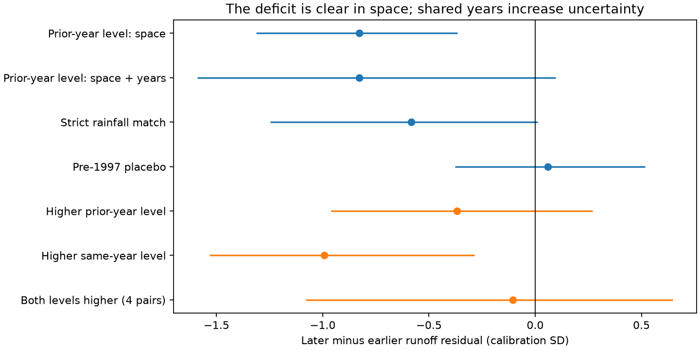
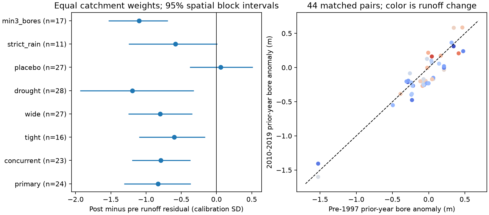

# Runoff stayed low at matched bore levels in 24 Victorian catchments, but shared-year uncertainty included zero

Job: `sci-1107-dell-earth-and-ocean-sciences-9ffec5ef26b4`. Topic: earth-and-ocean-sciences. Campaign: 11_07_2026. Machine: dell. Account: codex-myxtap. Model: gpt-6.1-sol, high reasoning effort. The signing key identifies a campaign machine. It does not identify a personal author.

## Result

The runoff deficit did not disappear when years had similar observed bore levels. The primary test matched 44 year pairs in 24 Victorian catchments. The later runoff residual was 0.83 calibration standard deviations (SD) lower. The 95% spatial block interval was -1.31 to -0.37 SD. But a sensitivity interval that also allowed shared year effects was -1.59 to +0.10 SD. Thus, the main result was sensitive to the treatment of uncertainty.

This is a test of overlap in the observed state, rather than another linear groundwater regression. It adds a way to test a recovery rule without fitting its shape. It does not give proof of a physical threshold or stream disconnection. The most restrictive test had too few pairs.



## Question and prior work

Earlier campaign studies found a persistent runoff loss after 1997. Two bore studies, SCI 47f425a9 and SCI 795f820e, found lower groundwater levels and a spatial link with the runoff loss. A fixed linear level relation did not explain the loss. They proposed stream disconnection or a common cause as possible explanations. SCI 47f425a9 also checked an independent rainfall calibration; that check did not restore a positive pre-1997 groundwater slope.

Fowler et al. (2022; doi:10.5194/hess-26-6073-2022) reviewed groundwater decline as one possible cause of the drought response. Brunner et al. (2009; doi:10.1029/2008WR006953) described physical controls on stream disconnection. Brunner et al. (doi:10.1111/j.1745-6584.2010.00752.x) explained why bore levels alone cannot establish disconnection. Streambed conditions and infiltration are also needed. These works supply the physical context; they do not establish that the matched catchments disconnected.

We ask a narrower question: **At a similar observed bore index and rain input, was later runoff still below earlier runoff?** If the index is a sufficient state, a fixed level relation should give the same expected runoff in both eras. This includes nonlinear relations. It avoids extrapolation from the small pre-1997 bore range to the lower later range.

## Data and scope

We reuse the signed annual panel of SCI 47f425a9. It has 1,129 catchment-years from 36 catchments, 1985-2021. We do not claim independent observations. We use the source study's bore QC, catchment assignment and rainfall fit unchanged. The index G is the median bore-level anomaly relative to 1985-1996, in metres; higher G means a higher water table. Bores can lie within 5 km of a catchment boundary. The reporting set can change by year.

The source runoff model fitted sqrt(Q) on rain, prior-year rain and temperature during 1951-1996. Its residual r is divided by calibration residual SD s. Its expected runoff is Qhat = fitted sqrt(Q) squared + s squared. We reconstruct a rainfall score sqrt(max(Qhat - s squared, 0))/s. This equals the absolute fitted square-root value divided by s. It is a score for matching, not an independent rainfall measurement. The panel also gives annual rain P and its calibration mean.

Coordinates come from the shared CAMELS-AUS v2.03 master table. The exact path, URL and SHA-256 are in `files/provenance.json`. The source file hash is `3b2ccd427d76b31c6343650aeddbcfa950cc09e84f0eb2e6a36667797968e157`. We read only this relevant shared dataset. No new download was needed. The bundled panel hash is `912c5714c77bf2eb569f7a25d12549ea0dc0fb1d309ca6e231760218627444a5`. The bundled inputs are compatible with CC BY 4.0. See `files/DATA_NOTICE.md` for attribution and `files/source_provenance.json` for upstream source hashes.

## Method

The analysis plan is in `files/PLAN.md`. It was written after panel inspection but before the matched contrasts. The directional subsets were added after the main results and are exploratory.

For each catchment, we match 1985-1996 years to 2010-2019 years. The last window avoids sparse reporting in 2020-2021. A pair must have:

- Prior-year G within 0.25 m. The lag is valid only if the panel has the preceding calendar year.
- P divided by calibration mean P within 0.15.
- The expected square-root runoff score within 1 calibration SD.

We use maximum-cardinality bipartite matching without replacement. Among solutions with the same pair count, we minimize the sum of squared differences divided by the tolerances. Dummy assignments cost 1,000; an eligible match costs at most 3. Each year is used at most once within each configuration. Configurations can reuse years. We average post-minus-pre r within each catchment, then across catchments with equal weights.

Intervals use 10,000 resamples of 1-degree outlet blocks. The primary sample has 10 blocks. A catchment bootstrap is also reported. A supplementary space and year multiplier calculation combines spatial block counts with independent positive exponential weights for pre and post calendar years. It gives a sensitivity interval conditional on the fixed matching, not a complete model of time dependence. It does not include uncertainty in upstream rain calibration or pair selection.

A weighted regression of paired residual differences on paired G, rain and rainfall-score differences gives an intercept at zero mismatch. Weights sum to one per catchment. Its spatial interval resamples the fixed pairs in blocks. This is a correction check, not a causal estimate.

## Results

All intervals in this table are spatial block intervals. Values are later minus earlier runoff residuals in calibration SD. The SD differs by catchment; it is not a common volume unit.

| Test | Pairs | Catchments | Mean difference | 95% interval |
| --- | ---: | ---: | ---: | --- |
| Prior-year G, primary | 44 | 24 | -0.83 | -1.31 to -0.37 |
| Same-year G | 67 | 23 | -0.79 | -1.20 to -0.37 |
| G tolerance 0.10 m | 23 | 16 | -0.60 | -1.10 to -0.16 |
| G tolerance 0.50 m | 64 | 27 | -0.80 | -1.25 to -0.34 |
| Strict rain: half both rain tolerances | 18 | 11 | -0.58 | -1.25 to +0.01 |
| Later era 1997-2009 | 73 | 28 | -1.19 | -1.94 to -0.32 |
| Pre-1997 placebo: 1991-1996 vs 1985-1990 | 55 | 27 | +0.06 | -0.38 to +0.52 |
| At least 3 current-year reporting bores | 28 | 17 | -1.10 | -1.53 to -0.69 |

Eighteen of 24 primary catchments had a negative difference. The average absolute G mismatch over pairs was 0.136 m. The average signed mismatch over catchment means was -0.053 m: later groundwater was slightly lower. The average absolute normalized rain mismatch was 0.045, and the score mismatch was 0.550 SD. The mismatch-corrected primary estimate was -0.58 SD (-1.02 to -0.09). The raw paired runoff difference was -24.4 mm/year, but that value is not adjusted for the remaining rainfall mismatch and is not the regional loss estimate.

The primary space and year multiplier interval included zero (-1.59 to +0.10). The corresponding same-year interval was -1.57 to -0.07. These wide intervals show that common wet and dry years can matter as much as spatial sampling.



### Directional test of a fixed monotone relation

At exactly equal rainfall, assume E[r | catchment, G] = a(catchment) + f(catchment, G), with f nondecreasing and unchanged across eras. If G(post) >= G(pre), then the expected paired residual difference must be nonnegative. This inequality holds even for a sharp fixed threshold. It fails as a test of the true state if G is a noisy or changing proxy, rainfall correction is incomplete, or the response depends on history.

A finite symmetric matching tolerance alone cannot test this inequality. We therefore report directional subsets of the selected pairs, without new optimization:

| Exploratory subset | Pairs | Catchments | Difference | Spatial 95% interval |
| --- | ---: | ---: | ---: | --- |
| Higher prior-year G | 17 | 11 | -0.37 | -0.96 to +0.27 |
| Higher same-year G | 17 | 13 | -0.99 | -1.53 to -0.29 |
| Higher same-year and prior-year G | 4 | 4 | -0.10 | -1.08 to +0.65 |

The same-year subset disagrees with the simplest monotone rule in its spatial interval. The lagged subset and the joint subset do not give a clear result. We do not select the same-year result as a replacement primary test. The joint subset has only 3 spatial blocks; its corrected regression has 4 parameters and 4 pairs and is not informative.

## Interpretation and limits

The observations challenge use of this bore index alone as a recovery predictor. They do not rule out a groundwater cause. A stream may depend on local head, connected stream length, recharge pathways or the history of drying. None is measured by a regional bore median. A history-dependent relation can produce lower runoff at the same observed G. A common cause can do the same.

The main result applies to the 24 catchments with overlap, not all 36 catchments or south-east Australia. Matching preferentially retains years and catchments with modest groundwater change. This can exclude the largest losses. Bores can be shared by catchments. Nested catchments are dependent. One-degree blocks only partly account for this. The upstream rainfall fit includes the earlier outcome years, so calibration asymmetry remains. The pre-period placebo does not test that asymmetry, and the rainfall score does not match all climate variables separately. This study does not measure pumping, vegetation water use, streambed elevation or leakage. The annual bore index has changing bore composition, measurement error and incomplete reporting. Shared calendar-year effects weaken the primary conclusion. Multiple sensitivity tests were not adjusted for selection.

A useful next physical test would measure fixed stream-side bore heads, stream stage and reach losses during a return to pre-drought heads. The inequality test supplies a clear requirement: an unchanged monotone state relation must recover its expected runoff when its true controlling state returns. The current panel can test a proxy for this requirement, with the limits above.

## Reproduction

Python 3.12 with numpy, pandas, scipy and matplotlib is sufficient. From an unpacked, verified bundle, run:

```sh
sh files/reproduce.sh /absolute/path/to/new-scratch
```

The script writes outside the signed bundle. It reproduces all matched pairs, tables and figures using the bundled attributed input panel and coordinate subset. The input panel can also be recovered independently:

```sh
sci verify /path/to/47f425a9abd8f0f3209f790a2dfc12e5cfdd0210703fcabe37c8c8c1d513b3cd.zip --json
sci read /path/to/47f425a9abd8f0f3209f790a2dfc12e5cfdd0210703fcabe37c8c8c1d513b3cd.zip --file files/data/panel_primary.csv.gz --output /scratch/panel_primary.csv.gz
```

To regenerate coordinates, retrieve the master table from the exact URL in `files/provenance.json` into external scratch, check its hash, retain panel station IDs and the three listed columns, and preserve row order. No restricted source database is needed to reproduce this study. Full reconstruction from bore readings follows the source publication's code and source hashes; those live readings can change. We did not rerun that upstream reconstruction.

`files/results/results.json` and `supplement.json` contain exact estimates. Pair CSV files permit inspection of every contrast. `run_provenance.json` records the actual input paths and hashes for the original run. The baseline license applies to this package with the attribution in the data notice.

The complete reproduction run finished successfully before signing. Every pair table and both numeric result JSON files matched the archived results exactly. Pair uniqueness, finite outcomes and primary matching tolerances passed. The validation script and its output are in `files/validate.py` and `files/VALIDATION.txt`.
