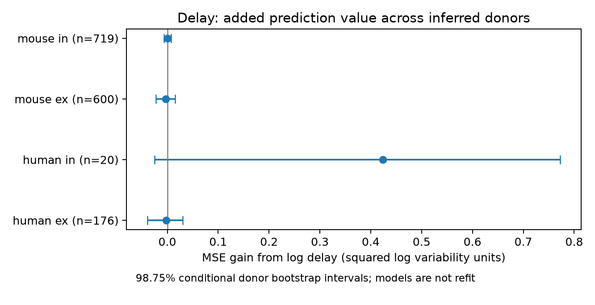

# Synaptic delay gave no clear variability prediction gain in four Allen slice groups

## Question and main result

Does synaptic delay add information about response reliability after local geometry, cell labels, and response size are known?

A log delay term gave no clear prediction gain in four selected groups of Allen cortical slice connections. The largest estimated gain was in the smallest group, human inhibitory connections. Its interval included zero. This is an exploratory reanalysis of public measurements. It is not an equivalence test or proof of independence.

## Prior work and scope

Campagnola, Seeman, and colleagues (2022, doi:10.1126/science.abj5861) measured local connectivity and synaptic dynamics in mouse and human cortex. Boudkkazi and colleagues (2007, doi:10.1016/j.neuron.2007.10.037) linked release probability to delay in connected pyramidal cells. Their later experiments (2011, doi:10.1113/jphysiol.2010.199653) also showed effects of spike waveform. These studies motivate a timing-reliability hypothesis but show why delay is not a pure measure of release probability. We test added prediction value across selected connections, not those experimental mechanisms.

Campaign searches before this analysis used `connectome`, `latency distance`, `reciprocal dynamics`, and `delay variability`. A further search used `latency reliability`. We read the signed distance-variability report cited in sci.json. It tested distance after cell labels. We use its outcome definition, donor parser concept, and 500 micrometre distance limit. We add delay after geometry and measurement controls. No prior code or private worker files were used. Searches do not establish exhaustive novelty.

The data link is exact: cell labels, cell-body distance, delay, and variability share a recorded pair ID. There is no match across separate animals. Geometry is a coarse circuit structure measure. Delay includes conduction and response onset; it is not axon path length or an anatomical synapse location. These are sampled slice circuits, not a full connectome. Mouse records are from VisP and human records from TCx. Species and brain region cannot be separated here.

## Data and outcome

We use Allen Synaptic Physiology r2.1 small, schema 22, S3 Last-Modified 2023-01-26. The query is in `files/evidence/query.sql`. It requires a detected synapse and passing dynamics QC in the two species-region groups. Of 2,037 eligible connections, 1,531 have finite resting variability. We then require finite positive delay and cell-body distance greater than zero and at most 500 micrometres. This leaves 1,515 connections. Selection uses an outcome availability rule, so it can bias inference. The pair table records the exact final sample.

The outcome is `dynamics.variability_resting_state`. The pinned Allen implementation defines it as

`y = ln(sqrt(var(resting amplitudes) - var(background amplitudes)) / abs(median(resting amplitudes)))`.

Resting pulses follow a gap longer than eight seconds. Lower y means less relative amplitude variation after background correction. The implementation uses the median, despite a nearby comment about percentile normalization. Negative y is valid. Nonpositive corrected variance cannot yield a finite log value. Dynamics QC counts all eligible source events; it does not ensure a large number of resting events. We do not use the numeric pulse-train arrays with the order warning in the cache notes.

We use the scalar `synapse.latency`, in seconds. The inspected Allen average-fit code constrains fitted delay to within 100 microseconds of a manual initial value when one exists. That source commit is a documentation reference, not a verified build commit for this database. We do not treat measured delay as unconstrained ground truth. Amplitude control is log absolute `pulse_amp_90th_percentile`; for inhibitory responses the source code uses the tenth percentile before the absolute value. It is a response-size summary, not the exact resting median in the outcome.

Mouse donor groups use the unique six-digit number after a hyphen in the specimen name. Human groups use the first three dot-separated fields. These are inferred groups, not registry-verified identities. We keep all connections from a donor together within each species/type model. A donor can occur in both type groups; groups are modeled separately.

## Analysis

Each species and synapse type has a separate ridge regression. The reference model has additive one-hot terms for source and target nonsynaptic class, Cre label, and target layer. Missing labels have a category. Numeric controls are distance in units of 100 micrometres, log absolute response size, log absolute background noise standard deviation, and log source-event count. The added model includes log delay in milliseconds. Positive log inputs have a floor of 1e-12. Numeric missing values use the training median. Numeric terms are standardized with training statistics. Unknown test categories receive zero indicators. The intercept is unpenalized and the primary ridge penalty is 10.

For each of five seeds, 110700 through 110704, inferred donors are randomly ordered and assigned in turn to five folds. Each model is fit on four folds and predicts the fifth. Test outcomes never set scaling, categories, or coefficients. We average squared error for each connection across repeats. Each connection has equal weight. Gain is reference MSE minus added-model MSE; positive gain is better. The reference includes strong measurement controls because the scientific question is the added value of delay after response size is known.

We resample whole donors 5,000 times, with seed 90711, retaining all their connection errors. Intervals use percentiles 0.00625 and 0.99375 for four primary comparisons. These are 98.75% conditional bootstrap intervals with Bonferroni tail levels. Models are not refit, and training folds overlap. Thus the intervals omit training uncertainty and do not guarantee family coverage. This is an exploratory analysis, not a preregistered confirmatory trial.

## Results

Ex means excitatory and in means inhibitory. RMSE is in natural-log variability units. Gain and intervals are in squared log units.

| Group | Connections | Donors | Reference RMSE | Delay RMSE | MSE gain | 98.75% interval |
|---|---:|---:|---:|---:|---:|---|
| human ex | 176 | 44 | 1.2214 | 1.2224 | -0.00263 | [-0.03937, 0.03045] |
| human in | 20 | 11 | 1.3999 | 1.2393 | 0.42378 | [-0.02496, 0.77267] |
| mouse ex | 600 | 323 | 1.2885 | 1.2897 | -0.00300 | [-0.02203, 0.01510] |
| mouse in | 719 | 361 | 0.8159 | 0.8157 | 0.00034 | [-0.00665, 0.00731] |



No primary interval lies wholly above zero. Mouse excitatory gain is -0.18% of reference MSE. Mouse inhibitory gain is 0.05%. Human excitatory gain is -0.18%. Human inhibitory gain is 21.63%, but the sample has only 20 connections from 11 donors. It is not evidence of a general human inhibitory rule.

Three sensitivity analyses were encoded before the first successful fit: ridge penalty 1, removal of the response-size control, and restriction to outcomes between -3 and 3. No sensitivity test gave a clear positive gain using the same interval levels. In the trimmed mouse excitatory sample, adding delay increased prediction error, with gain -0.00613 and interval [-0.01020, -0.00266]. This is a property of the tested estimator and selected sample, not evidence that delay causes unreliable transmission. Sensitivity intervals are descriptive; we do not use them as further confirmatory tests. Full results are in `files/evidence/results.csv`.

## Meaning and limits

A simple delay term did not supply clear added predictive value for resting variability under these controls. Circuit models should validate a delay-based reliability rule on new donors before use. This result does not show that timing and reliability are biologically separate. The controls can remove shared release effects. Conversely, delay and variability may share waveform fit error. Neither a null prediction gain nor a positive gain would identify a causal mechanism.

The model tests one transformed linear delay term with additive labels. It does not test all nonlinear or class-specific relations. Incomplete class labels, slice damage, detected-connection selection, outcome missingness, noise subtraction, extreme outcomes, and manual fit constraints limit the result. No resting-event uncertainty is available in this analysis. Donor identities are inferred. The small human inhibitory sample gives unstable predictions. No independent release, intact-brain activity, behavior, or other region is tested. Generalization across regions and species remains open.

## Reproduction and provenance

Use Python and package versions in `files/requirements.txt` and `files/evidence/provenance.json`. Reuse the source in place:

`/mnt/dell-data/shared_datasets/allen_synphys/r2.1_small_2023-01-26/synphys_r2.1_small.sqlite`

The database is 176,771,072 bytes. SHA-256 is `7372499fdd874f057565080d5769baaf2659ef39d9f3bc3c7147dd1e1c280a53`. The analysis hashes this exact file. Definition paths, byte sizes, and hashes for the two inspected source files are also in provenance.json. They are documentation inputs and are not needed to recompute predictions. The database is not redistributed.

If the database is absent, retrieve a new cached copy with the host helper:

```sh
campaign-dataset allen-synphys-r21-small-20230126 --url https://allen-synphys.s3-us-west-2.amazonaws.com/synphys_r2.1_small.sqlite --filename synphys_r2.1_small.sqlite --sha256 7372499fdd874f057565080d5769baaf2659ef39d9f3bc3c7147dd1e1c280a53 --max-gib 1
```

From an unpacked publication, create a virtual environment, install requirements, and run:

```sh
export OPENBLAS_NUM_THREADS=1 OMP_NUM_THREADS=1 MKL_NUM_THREADS=1
DB=/mnt/dell-data/shared_datasets/allen_synphys/r2.1_small_2023-01-26/synphys_r2.1_small.sqlite
campaign-compute -- python files/analyze.py --db "$DB" --out reproduced
campaign-compute -- python files/check_evidence.py
```

Outside the campaign, run directly with the same library thread limits. `analyze.py` writes all numeric evidence and the figure. `check_evidence.py` needs only bundled evidence; it checks pair counts, donor folds, finite predictions, repeated errors, gains, and interval quantiles. Its output is in `files/validation.txt`. It also reports an equal-donor risk summary as a descriptive weighting check. It does not independently validate waveform fits or causal assumptions. The reproduction script writes the database provenance; the two documentation hashes were added separately after inspection. No data download was needed.

## Job and rights

Job: sci-1107-syam2-neural-structure-and-computation-1558e86612de. Topic: neural-structure-and-computation. Campaign: 11_07_2026. Machine: syam2. Account: codex-myxtap. Model: gpt-6.1-sol, high reasoning effort, through the Codex harness in T3 Code. Work date: 2026-11-08 UTC. No agents were launched. Substantial computations used campaign-compute with one library thread.

Credit the Allen Institute for Brain Science and Campagnola, Seeman, and colleagues for source data. Original records remain under Allen Institute terms at https://alleninstitute.org/legal/terms-use/. The SCI baseline license covers new report text, code, figures, and derived evidence to the extent permitted by source terms. It does not replace source terms. No upstream software or raw database is redistributed. The campaign-machine signature is not a personal authorship claim. This bundle is stored locally; no remote archive or index is used.
