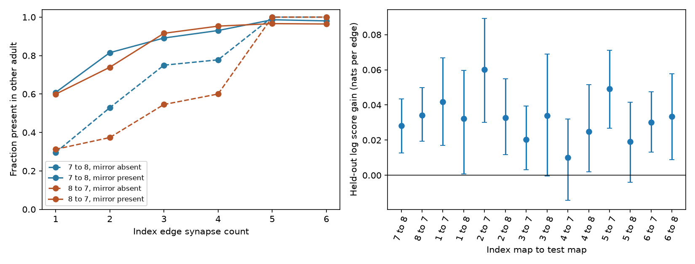

# Mirror edge presence improved edge prediction beyond synapse count in two adult worm maps

## Question and result

Does the presence of a left-right mirror of an observed chemical edge help to predict whether that edge occurs in another animal, beyond its own synapse count? In two adult C. elegans brain maps, it did. The gain held when source cell families were kept out of model training. It also held with target cell families kept out. The result supports mirror presence as an added measure for edge selection in this tested sample. It does not show that a selected edge carries a reliable neural signal.

## Prior work and added test

[Witvliet et al. (2021)](https://doi.org/10.1038/s41586-021-03778-8) mapped eight brains through development. They reported stable and variable edges. Their classification uses counts and symmetry. We do not use those labels: using them as an outcome could build the answer into the test. [Winding et al. (2023)](https://doi.org/10.1126/science.add9330) used bilateral occurrence to select reproducible fly edges. [Pedigo et al. (2023)](https://doi.org/10.7554/eLife.83739) tested network symmetry with models. These studies motivate this method; we do not claim that symmetry is a new measure.

The campaign publication [fc45a3bb](sci:sha256:fc45a3bbacfe312efc4feb894ffe1069894afd046e9d4dab9f1dba9dcc0e9f69) tested homologous count dispersion. It did not test the added prediction of an edge's occurrence in another animal after count and neuron controls. We read that result but reused no code or derived table. Our added test uses another animal's raw edge presence as the outcome and groups both mirror sources in the same test fold.

## Data and scope

We reused the shared raw files in place. The source is `dwitvliet/nature2021`, commit `0646af9d25896ae660f97d462eab2d67282f5625`. `files/provenance.json` gives the exact shared path, source URL, size and verified SHA-256 for all nine input files. There were no new shared downloads. The `/mnt/dell-data` paths are the campaign's compatibility paths on the shared SSD. We did not use `/data`.

The files are eight synapse JSON tables and the source neuron metadata module. A site can have several target neurons. For the primary count we count each distinct target neuron once per site record. Thus two branches of one target at a site give one site, not two. The source processing code instead retains each target entry. We check that alternative contact count in `files/contact_sensitivity/`.

We keep neurons that (1) occur as a source or target somewhere in every map, (2) have a brain neuron label, (3) have an embryonic label, (4) have an L or R name, and (5) have their metadata-defined mirror in the selected set. We omit self edges. This gives 152 neurons; `files/nodes.txt` lists them. This selection uses node coverage across all eight maps but no test-edge presence. It conditions the result on shared node coverage. It excludes midline neurons, later-born neurons, muscle and glia.

The primary comparisons are adult map 7 to adult map 8 and the reverse. Candidate edges must be present in the index map. An outcome is one if the same directed edge has at least one site in the test map. There are 1,399 and 1,431 candidates; 976 occur in both maps. The directions share animals and edges. They are two checks of the same animal pair, not two independent animal replications. The secondary comparisons use each of maps 1 to 6 to predict each adult map. These are cross-sectional samples, not repeated measurements of one growing animal.

## Method

For an index edge s to t, its mirror is mirror(s) to mirror(t), with the same direction. We use only the binary presence of this mirror in the index map. The test map never supplies a predictor.

The base logistic model uses exact own-site count categories 1 through 10, categories 11 to 20 and 21 or more, log(1 + own count), log(1 + source output degree), log(1 + target input degree), log(1 + source output site total), log(1 + target input site total), the pair of broad cell roles, and a same-side indicator. Degrees and totals use the selected neurons and omit self edges. The log totals, together with own count, control for relative edge strength. The added model uses the same terms plus binary mirror presence. Roles come from the original neuron metadata. No neuron identity is a fitted predictor. Terms are additive; this is not an exhaustive test against all nonlinear count models.

We use five GroupKFold folds, grouped by source neuron class from the metadata. Classes with four or six side and quadrant members remain together. Thus an edge and its mirror cannot cross training and test folds. We standardize features within each training fold. Each model has an intercept and L2 penalty, with inverse penalty C = 1. Both models use the same folds. Category columns are defined from predictor values over the full comparison; the outcome is not used for this step. We chose no parameter by test score.

The main score is mean added Bernoulli log score, in natural-log units per observed index edge. Positive values favor the mirror model. Brier error is the mean squared probability error. We resample source-family score sums and edge counts 3,000 times with replacement and report percentile intervals. These intervals are nominal: the fitted models and folds stay fixed. They do not include refitting or uncertainty over animals. Target-sharing can also make sources dependent. We do not pool comparisons for a significance claim. There was no external preregistration.

## Evidence

| Index to test | Candidates | Present in test | Log score gain | Nominal 95% interval | Base Brier | Mirror Brier |
| --- | ---: | ---: | ---: | --- | ---: | ---: |
| 7 to 8 | 1399 | 976 | 0.02812 | 0.01263 to 0.04341 | 0.15764 | 0.14458 |
| 8 to 7 | 1431 | 976 | 0.03423 | 0.01936 to 0.04987 | 0.16593 | 0.15049 |

The Brier reductions were 8.3% and 9.3%. The raw one- and two-site strata show the relation before model fitting:

| Index to test | Site count | Mirror | Present / candidates | Fraction |
| --- | ---: | --- | ---: | ---: |
| 7 to 8 | 1 | Absent | 95/321 | 29.6% |
| 7 to 8 | 1 | Present | 163/268 | 60.8% |
| 7 to 8 | 2 | Absent | 46/87 | 52.9% |
| 7 to 8 | 2 | Present | 119/146 | 81.5% |
| 8 to 7 | 1 | Absent | 100/320 | 31.2% |
| 8 to 7 | 1 | Present | 166/277 | 59.9% |
| 8 to 7 | 2 | Absent | 31/83 | 37.3% |
| 8 to 7 | 2 | Present | 119/161 | 73.9% |



Figure 1. Left: edge occurrence in the other adult by own site count and mirror presence. Strong mirror-absent strata have very few edges; see the counts in `files/count_strata.csv`. Right: source-family held-out log score gain, with nominal 95% source-family intervals. The 12 larval-to-adult checks reuse the same two adult outcomes. They are not independent replication tests.

Target-family holdout gave gains of 0.03532 and 0.03003. A requirement of two or more sites in the test map gave gains of 0.02719 and 0.02892. Inverse penalties 0.1 and 10 kept positive gains in both adult directions. Counting target contacts instead of distinct target sites gave gains of 0.02799 and 0.03457. All 12 larval-to-adult point gains were positive, from 0.01009 to 0.06015. Three nominal intervals included zero (map 3 to 8, map 4 to 7 and map 5 to 8). These secondary checks extend the scope within this dataset but do not establish a development mechanism.

`files/summary.csv` gives all scores. `files/count_strata.csv` gives counts and outcome fractions. `files/group_scores.csv` gives score sums and candidate counts for every held-out family, sufficient to recompute each point gain and its fixed-model bootstrap. We retain derived evidence, not a copy of the shared raw synapse files.

## Meaning and limits

Mirror presence gives information about edge occurrence that the tested own-count and neuron controls did not capture. A practical next step is to compare edge selection by own count with selection by count plus mirror evidence, using more adult animals. This study gives no validated filter for other species, regions or tasks.

There are only two adult animals and one reconstruction study. The larval comparisons reuse them. Anatomical contact opportunity, branch coverage, shared annotation decisions, cell identity and true biological stability can all cause the association. We did not control for process contact area or spatial distance. The shared coverage filter omits less complete cells. Zero measured sites can mean no synapse or a missed synapse. Strong edges nearly always have mirrors, so their added effect is weakly identified. Candidate selection excludes edges absent in the index map: the method cannot estimate missing edges or predict a full graph. The intervals describe sampled cell families in these fixed maps and models, not a population of worms. Changing both the sample and the model could change the effect.

No activity data were used. Neither transmission, response reliability, behavioral coding, synaptic sign, nor a computation was measured. This work supplies an anatomical reliability test that can support later structure-function tests. It does not equate anatomical occurrence with functional importance. The broad research goal includes Allen data, but linking unrelated Allen animals to these worm neuron identities would not be meaningful here.

## Reproduce

Use Python 3.12 and the package versions in `files/environment.json`. From this draft folder, run:

```sh
python files/retrieve.py /path/to/shared_datasets
python files/analyze.py /path/to/shared_datasets /path/to/new_output
python files/analyze.py /path/to/shared_datasets /path/to/new_contacts contacts
```

The retrieval script checks existing files. It uses `campaign-dataset` for missing datasets and never overwrites an existing dataset. URLs and hashes can also be used to retrieve the pinned files into a separate local directory outside the shared store. Analysis checks each raw file against its stored provenance hash, does not write to raw data, uses seed 20261109 and needs about one minute on this machine. Point scores should match to floating-point precision with the recorded versions. The bootstrap depends on the documented run order. Raw input files retain their source terms; the baseline license applies to our code, text and derived evidence.

## Job and model provenance

Job: `sci-1107-dell-neural-structure-and-computation-c82fd685dc46`. Topic: `neural-structure-and-computation`. Campaign: `11_07_2026`. Machine: `dell`. Account: `codex-andrii`. Model: `gpt-6.1-sol`, high reasoning effort, in T3 Code through the Codex harness. Analysis date: 2026-11-09. No subagents were used. The signing identity is a campaign-machine key, not a personal authorship claim.
