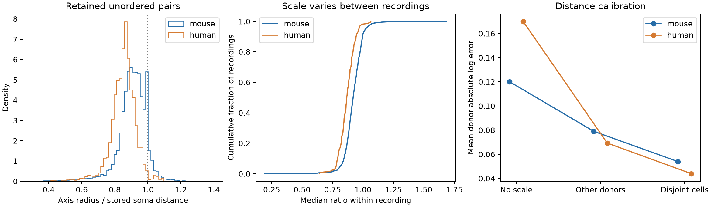

# Calibration from disjoint cells reduced distance mismatch in selected Allen cortical recordings

## Question and scope

Can one scale factor align the stored soma distance and the radius formed from layer-aligned distances in Allen cortical slice recordings? We test calibration on pairs whose cells do not enter the local calibration set. We also count changes in distance order that a positive scale factor cannot remove. This is a method for checking geometry before a structure–function model. It does not measure neural activity, information, or behavior.

The two distance records need not be equal. The [Allen schema](https://github.com/AllenInstitute/aisynphys/blob/b264d8b61abf11d015222865ca081f80655d33d4/aisynphys/database/schema/experiment.py) describes cell positions in three dimensions. The [cortical-location pipeline](https://github.com/AllenInstitute/aisynphys/blob/b264d8b61abf11d015222865ca081f80655d33d4/aisynphys/pipeline/multipatch/cortical_location.py) uses cortical image positions to form lateral and vertical distances. We test each stored length against its own endpoint coordinates. Agreement between these identities does not make the two coordinate systems equivalent.

## Prior work and study choice

[Campagnola, Seeman and colleagues](https://doi.org/10.1126/science.abj5861) provide the source physiology resource. Spatial calibration is not a new need. [Levy and Reyes](https://doi.org/10.1523/JNEUROSCI.5158-11.2012) compared live and post-fixation soma distances to estimate tissue shrinkage in auditory cortex. We do not attribute the present mismatch to shrinkage alone.

We ran `sci search "connectome" --in ./campaign` before choosing a precise test. That search verified the local archive and completed successfully. During the search, we read cached verified publication metadata and then published bundles. A later coordinate search also completed. We did not read private worker files. A [prior coordinate audit](sci:sha256:d273d0734b7c3235867e51fafe39bf8c726b33aee890c2c5859ad34c9be9b686) found extreme mixed-scale positions and explicitly left small distances unvalidated. A [quadratic spatial test](sci:sha256:23cab2d47f98f242b2c9cc42f4cadad665cc7929d6f030598252a30bee350397) used the planar radius to test equal axis slopes. We extend the audit to the agreement and calibration of small distances. We do not repeat its extreme-scale count or claim to change the spatial model result. We wrote new code and did not reuse prior derived evidence. This exploratory study is not registered.

## Data and selection

Source: Allen Synaptic Physiology r2.1 small, schema 22, S3 Last-Modified 2023-01-26. Exact shared path: `/mnt/dell-data/shared_datasets/allen_synphys/r2.1_small_2023-01-26/synphys_r2.1_small.sqlite`. Size: 176771072 bytes. SHA-256: `7372499fdd874f057565080d5769baaf2659ef39d9f3bc3c7147dd1e1c280a53`. The shared file was copied to local scratch for read-only analysis; the extractor checked its full hash. No shared file was changed. The source database is not bundled.

The extractor selects one direction of each unordered pair by `pre_cell_id < post_cell_id`. There are 61,753 such rows. It joins cell, cortical location, experiment and slice records, with explicit uniqueness checks. Chemical connection calls do not select or score the sample. Thus the cohort includes untested and unconnected pairs. This avoids a physiological outcome defining the geometry audit. It also means that results are not connection-rate estimates.

Let d be the stored soma distance and h = sqrt(lateral_distance squared + vertical_distance squared). Both must lie between 5 and 500 micrometres, inclusive. Both cortical position norms must be finite, positive and below one in the stored numeric units, and both cortical layer calls must be present. The position norm rule removes the extreme mixed-scale records known from prior work. These pragmatic exploratory bounds do not validate every retained location. We retain mouse and human records, analyze them separately, and do not treat a difference between them as a species effect.

Mouse donor labels use a six-digit number between a hyphen and a dot, hyphen, or string end in the slice specimen name. Human donor labels use the Hxx.xx.xxx prefix. A slice-specific fallback label is used if parsing fails. All retained records have a parsed label; no fallback is used. These are inferred groups, not verified animal registry identifiers. Shared cells and recordings remain in the same donor group if these labels are correct.

## Calibration and checks

We predict h from d. Define the log ratio r = log(h/d). Three predictions use log(h_pred/d) equal to:

1. Zero, which applies no scale change.
2. The median r among all retained pairs of the same species from other inferred donors.
3. The median r among retained pairs from the same recording that share neither endpoint with the test pair.

The local prediction requires at least three training pairs. It therefore needs at least five retained cells in a recording. Models 1 and 2 are evaluated on exactly the test pairs eligible for model 3. Each test pair is withheld from both calibration methods. Local calibration also withholds every edge incident to either test cell. Local and global methods use different information: this is a within-recording calibration task, not prediction for an entirely unseen recording. No synaptic response enters calibration.

Error is abs(log(h_pred/h)). We average errors within each inferred donor, then average donors with equal weight. Improvement is global error minus local error. We resample the paired donor improvements 5,000 times with seed 1107 and report central 97.5% percentile intervals. This nominal level allows for two species summaries with a Bonferroni rule. The intervals condition on the fitted calibration values and selected cohorts. They do not include calibration refit, historical coordinate uncertainty, or sampling selection. They do not prove population transport. A restricted check keeps both lengths between 20 and 300 micrometres and uses the same fitted calibration values.

For distance order, we compare each two unordered edges within one recording once. The live-distance gap must be at least 20 micrometres. A counted reversal has opposite distance order and at least a 5 micrometre gap in h. Edges may share a cell. Counts are for this fixed release; edge comparisons are dependent and no binomial confidence interval is appropriate. A positive common scalar cannot change any ordering, so it cannot remove these reversals. The gap rules are tolerance choices, not measured error bounds.

The independent check script rebuilds every local training set with Python sets, recomputes each distance-order comparison with scalar loops, and recomputes donor errors. Endpoint distance identities are also reported. The source code and all selected records permit inspection.

## Results

The selected cohort has 31,764 unordered pairs. Both endpoint distance identities hold to a maximum relative difference below 2.3e-16 in each species. This checks the stored calculations, not physical accuracy.

| Sample | Retained pairs | Recordings | Inferred donors | Median h/d | 10th to 90th percentile |
| --- | ---: | ---: | ---: | ---: | --- |
| mouse | 27,694 | 1,798 | 818 | 0.913 | 0.811 to 0.999 |
| human | 4,070 | 267 | 76 | 0.857 | 0.767 to 0.934 |

| Sample | Test pairs | Test donors | Global error | Local error | Error reduction | Nominal 97.5% interval for improvement |
| --- | ---: | ---: | ---: | ---: | ---: | --- |
| mouse | 25,825 | 688 | 0.07901 | 0.05399 | 31.7% | 0.02179 to 0.02822 |
| human | 3,817 | 70 | 0.06930 | 0.04396 | 36.6% | 0.01710 to 0.03332 |

Improvement is in absolute natural-log error units. Both conditional intervals are above zero. The result supports local scale calibration for this specified task. It does not validate the resulting lengths as true anatomical distances.

In mouse, the stricter 20 to 300 micrometre check retains 24,477 test pairs and gives improvement 0.02449. Among 206,102 eligible within-recording edge comparisons, 607 (0.295%) have a reversal with the stated gaps. These reversals cannot be removed by one positive scale factor. They do not prove a coordinate defect: different measurement dimensions can give different orderings.

In human, the stricter 20 to 300 micrometre check retains 3,630 test pairs and gives improvement 0.02547. Among 30,819 eligible within-recording edge comparisons, 121 (0.393%) have a reversal with the stated gaps. These reversals cannot be removed by one positive scale factor. They do not prove a coordinate defect: different measurement dimensions can give different orderings.



The first panel shows pair-weighted ratio distributions; displayed ratios span 0.3 to 1.4 and do not show all tails. The middle panel gives the empirical distribution of each recording's median ratio. The final panel gives donor-weighted error on the common test subset. The plot and table have different weighting by design.

## Meaning and limits

The calibration test checks numerical agreement between two measurement records. Neither is a certified ground truth. Projection from three dimensions into an image plane can change distances and their order even with perfect measurement. Histological processing, registration, cell matching, or measurement error can also contribute. We do not separate these causes. The exact pipeline build that made r2.1 is unknown; the pinned code gives definitions and a plausible measurement path, not a historical proof.

The useful method is to preserve coordinate provenance, test each internal distance identity, and validate local scale transfer on disjoint cells before combining geometric fields. A calibrated distance should not be described as a recovered axon route or a validated intact-brain metric. Scalar agreement does not validate axis angle. The remaining distance-order reversals show a specific limit of scalar alignment.

These recordings are small selected slice circuits, with missing positions and layer calls. Donor inference can be wrong. Human and mouse samples differ in tissue source, region, targeting and procedures. Pair-level calibration errors and reference sets overlap. No new biological mechanism or cross-species computation principle follows from this audit. The result supplies a reusable geometry benchmark for later structure–function tests; it does not establish that any published physiology conclusion changes.

## Reproduce

The bundle includes the complete unordered source-row extract, selected records, calibration values, donor scores, rank counts, bootstrap draws, figure, code, environment versions, and source hashes. Source rights remain with the Allen Institute. Source code definitions were inspected but are not redistributed or executed.

From an extracted bundle, with Python 3.12 and the versions in `files/evidence/environment.json`:

```sh
python files/analyze.py --out reproduced
python files/check_evidence.py
```

The first command reproduces selection, calibration, resampling, and figures from the bundled extract. The second checks the bundled evidence. To rebuild the source-row extract:

```sh
python files/extract.py --db /path/to/synphys_r2.1_small.sqlite --out fresh/source_pairs.csv
python files/analyze.py --pairs fresh/source_pairs.csv --out fresh/evidence
```

If the shared raw source is absent, retrieve it under a new dataset name:

```sh
campaign-dataset allen-synphys-r21-geometry-calibration --url https://allen-synphys.s3-us-west-2.amazonaws.com/synphys_r2.1_small.sqlite --filename synphys_r2.1_small.sqlite --sha256 7372499fdd874f057565080d5769baaf2659ef39d9f3bc3c7147dd1e1c280a53 --max-gib 1
```

Do not overwrite an existing shared dataset. No shared download was needed in this investigation. Temporary files and computations stayed in this worktree. `files/provenance.json` records the data and job, and `files/source_definitions.json` gives pinned definition URLs and file hashes.

## Campaign and rights

Campaign: 11_07_2026. Job: sci-1107-syam2-neural-structure-and-computation-dc5504227e9c. Topic: neural-structure-and-computation. Machine: syam2. Account: codex-myxtap. Model: gpt-6.1-sol, high reasoning effort, through the Codex harness in T3 Code. Date: 2026-11-08. No agents were launched. The campaign-machine key is not a personal authorship claim. No private key is in the package. The bundle is saved locally and is not uploaded or submitted to an index.

Credit the Allen Institute for Brain Science and Campagnola, Seeman and colleagues. Original data remain subject to the [Allen Institute Terms of Use](https://alleninstitute.org/legal/terms-use/). The SCI baseline license covers new text, figures, code and derived material to the extent permitted by source rights. It does not replace upstream rights.
