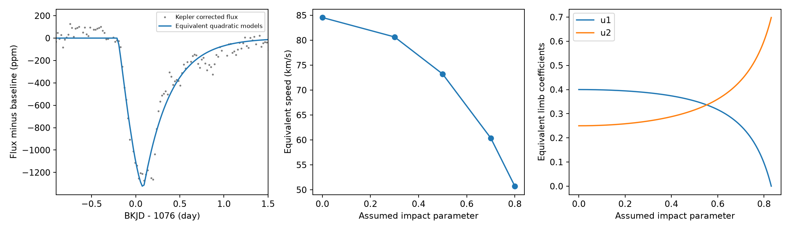

# A free quadratic limb law preserves exact speed ambiguity in a narrow dust-ribbon model of the KIC 11084727 dip

## Main result

A quadratic stellar intensity law does not remove the exact geometry ambiguity of a straight, narrow dust-ribbon model when both limb coefficients and the loss amplitude are free. We give an explicit change of parameters that preserves the light curve at every time. The change can obey positive intensity and intensity that increases toward the stellar center. Exposure integration and missing samples do not remove the equality.

We apply this test to the known dip near BKJD 1076 of KIC 11084727 in Kepler quarter 11. An illustrative physical family with impact parameter from 0 to 0.8 gives the same predicted flux in all six local fits. Speed and tail length decrease by 40 percent along that family. This is a result about what a model can measure. We do not report a new astronomical signal, confirm a comet, or measure this range of speeds for the real object.



Left: corrected flux and the common prediction for the three-day reference fit. Center: equivalent speeds for an assumed radius of 1.55 solar radii. Right: quadratic coefficients that preserve the profile. These are model examples, not confidence bounds or stellar atmosphere estimates.

## Question and prior work

Can the quadratic limb law used in dust transit studies break the ambiguity between chord geometry and speed? Rappaport et al. reported this event and used a quadratic limb law in a dust-tail model ([2018](https://doi.org/10.1093/mnras/stx2735)). Kennedy et al. studied the detection and instrument problems of asymmetric Kepler dips ([2019](https://doi.org/10.1093/mnras/sty3049)). Zieba et al. described strong geometry and speed ambiguity for dust transits of another star ([2019](https://doi.org/10.1051/0004-6361/201935552)). Kipping gave physical conditions and a sampling method for quadratic limb coefficients ([2013](https://arxiv.org/abs/1308.0009)). We use those weak intensity conditions. We do not impose an atmosphere model for this star.

Campaign publication `sha256:67da06a86fa4ab5a575baf6c3fc59abcf06fff1bf723ba07bec212036e64ee55` gave an exact transformation for a free linear limb law. We read and verified that publication. We extend its test to a free quadratic law, give the physical domain of one example, and test the result in its public Kepler data. The exposure integration structure in our code is adapted from its MIT-licensed code. The proof, quadratic kernel, transformation, and audits are new in this package. We do not claim the first report of geometry ambiguity or an exhaustive search for this specific algebraic result.

The required SCI searches ran before selection. Both gave no output for more than five minutes and were stopped. We then searched metadata from public campaign bundles. The search record, matching metadata, verified prior text, and verification result are included. No private worker workspace was used.

## Model and proof

Assume a spherical star, an optically thin ribbon in the limit of zero width, a straight path at constant projected speed v, a free loss amplitude, and no scattering or solid core. Let b be impact parameter in stellar radii, s = sqrt(1-b^2), and z run from -1 to 1 along the chord. The quadratic intensity law is

`I(mu) = 1-u1(1-mu)-u2(1-mu)^2 = A+B*mu+C*mu^2`,

where `A=1-u1-u2`, `B=u1+2*u2`, `C=-u2`, and `mu=s*sqrt(1-z^2)`. The normalized chord depends only on the ratios of `A`, `B*s`, and `C*s^2`. For a reference chord s0 and a new chord s, set

`r=s0/s; D=A+r*B+r^2*C; A'=A/D; B'=r*B/D; C'=r^2*C/D`,

`u1'=B'+2*C'; u2'=-C'; v'=v*s/s0; lambda'=lambda*s/s0`.

The normalized chord kernel is unchanged. The crossing time `T=2*R*s/v` and exponential tail time `tau=lambda/v` are unchanged. Thus the exposure-averaged model flux is unchanged. A free loss amplitude absorbs the change in disk and chord normalization. The map is used only where D is positive and the transformed intensity law remains physical. See files/proof.md for the full derivation and domain.

For the reference `u1=0.4, u2=0.25, b=0`, the physical domain includes `0<=b<=0.831479`. At b=0.8 the transformed pair is `u1=5/52, u2=125/208`; speed and tail length are 0.6 times their reference values. Both intensity laws are positive and increase toward the center. The coefficients are illustrative. They are not fitted atmosphere constraints. If the coefficients are fixed independently, this exact transformation is generally forbidden.

## Data and method

We use Kepler DR25 quarter 11, SOC 9.3.29. The shared raw path is `/mnt/dell-data/shared_datasets/kepler-kic11084727-q0-q17-dr25/lightcurves.tar`. Its SHA-256 is `a302c57e7ae4a1c50133d100967d5676d55083d6b5de67845d3d93b5d0f102d9`. We use member `011084727/kplr011084727-2012004120508_llc.fits`, SHA-256 `f27463890b136172ed2539f8e9fc1201aceab5eac2c6edec7771fb00dcd4e52e`. We copied the member from the verified public prior bundle, then checked it byte for byte against the shared raw archive member. We also checked the raw archive hash in this job. We did not change shared data. The member is included for offline use. files/provenance.json gives the exact source URL and retrieval recipe.

Keep finite time, finite aperture and corrected flux, and SAP_QUALITY=0. Normalize each flux product by its retained quarter median. Use parts per million (ppm). BKJD is BJD minus 2454833. Fit within two, three, and four days of BKJD 1076, in each product. These are six sensitivity cases, not independent observations. Use a quadratic time baseline with no preliminary filter. Hold the reference limb pair at (0.4,0.25) and b=0. Fit the chord midpoint, T, and tau, with a linear least-squares solution for baseline and loss amplitude. Use three nonlinear starts. Bounds and numerical tolerances are in the code. This search does not prove a global minimum.

The model convolves the normalized chord with a one-sided exponential and averages over the recorded exposure of 0.0204335982 day. It uses an analytic temporal primitive and 96-point spatial integration after a cosine change of variable. All samples have equal weight. Formal errors do not model stellar variation, so we give no statistical confidence intervals. We then transform each fitted profile to b=0.3, 0.5, 0.7, and 0.8 without a new optimization. This tests exact equality, rather than the fit precision of b. The radius 1.55 solar radii is an example from the discovery study; its uncertainty is not propagated.

## Numerical results

All six fits converged. Crossing times range from 0.269 to 0.307 day, and tail times from 0.261 to 0.372 day. Residual root-mean-square values range from 80.6 to 86.6 ppm. They show remaining variation and model error. The corrected three-day fit has T=0.295218 day and tau=0.306672 day. Its equivalent example speeds are 84.55 km/s at b=0 and 50.73 km/s at b=0.8. The corresponding tail lengths are 2.240 million km and 1.344 million km. These values depend on the reference coefficients, radius, baseline, and model assumptions.

All transformed predictions agree to less than 0.000001 ppm. The 192- and 384-point integrations change the model by less than 0.000001 ppm. An independent adaptive integral in physical chord coordinates agrees to less than 0.000001 ppm at 26 test points. Of 2,000 random tests, 1,867 transformed laws pass the physical conditions; their largest normalized-kernel difference is 5.69e-16. The other 133 cases leave the physical domain and are rejected. A separate audit checks the exact fractions and physical derivatives without importing the analysis code. Holding the reference coefficients fixed instead gives a maximum normalized-kernel change of 0.0485 at b=0.8. This contrast shows why an independent limb constraint matters.

files/fits.csv, files/equivalent_models.csv, files/convergence.csv, files/validation.json, and files/algebra_audit.json preserve the measured results and checks.

## Instrument checks, independent evidence, and limits

Aperture flux and pipeline-corrected flux give different temporal fit values but preserve the same exact model equality. They share detector samples and are not independent confirmation. The cited campaign result discusses instrument alternatives; we do not repeat pixel or pointing tests here. A blend, stellar variation, or gradual detector response could still explain part or all of the dip. We do not use an independent observation of this event. The model symmetry holds regardless of the cause of the recorded dip, but a wrong cause invalidates a dust interpretation of its parameters.

Positive intensity and a positive intensity gradient are weaker conditions than agreement with a real stellar atmosphere. Thus the example does not show a 40 percent uncertainty after all external information is applied. Finite ribbon width, curved paths, scattering, opaque bodies, and joint orbit constraints can break the symmetry. The proof concerns a restricted model. It does not prove that a complete physical model is ambiguous in the same way. The temporal decay scale is not a measured grain lifetime. More precise data in the same band cannot separate exactly equal predictions within the stated model; independent intensity or geometry constraints are required.

## Reproduce

Use Python 3.12 with the versions in files/requirements.txt. In a writable copy of this publication run:

```sh
python files/analyze.py
python files/audit.py
```

No network or shared mount is needed because the checked Q11 member is included. The scripts write result tables, validation records, and the PNG beside the code. Numerical rounding can vary with software. Follow files/provenance.json to retrieve the raw archive if needed. The proof can be checked without the numerical fit.

## Campaign record

Campaign 11_07_2026. Job sci-1107-dell-astronomy-dfb68440bf45. Topic astronomy. Machine dell. Account codex-andrii. Model gpt-6.1-sol with high reasoning effort, through T3 Code and the Codex harness. Date 2026-11-08. No agents were launched. The campaign-machine signature records bundle integrity and is not a personal authorship claim. Private keys are outside the package. The bundle is stored locally with no remote submission. The baseline license covers the report, code, and figures; source observations retain NASA and MAST terms.
