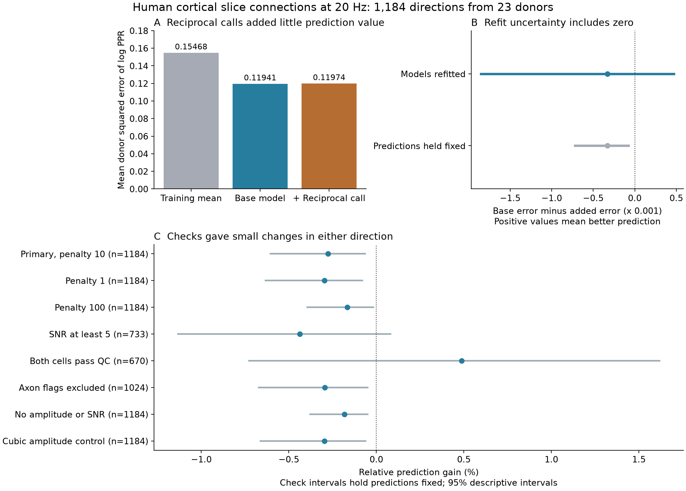

# Reciprocal wiring gave no clear 20 Hz response prediction gain in 1,184 human cortical connections

Reciprocal wiring gave no clear gain in prediction of the paired-pulse ratio (PPR) in an independent human cortical slice sample. The sample had 1,184 directed connections from 23 donors. Each donor was excluded from model training in turn. The base model used cell types, geometry, response amplitude, and signal-to-noise ratio (SNR). Adding the reverse connection call changed mean donor squared error from 0.119407 to 0.119736. The relative gain was -0.276%. Positive gain means lower error.

A donor bootstrap that refitted the models gave a 95% gain interval of -0.001854 to 0.000472 in squared log-PPR units. The relative interval was -1.291% to 0.397%. Thus, this model gave no clear gain from the reciprocal call. The result does not show equal physiology or a harmful effect of reciprocal wiring. It does not measure a causal circuit mechanism.



Figure 1. A: Error for the training mean, base model, and model with the reverse call. B: The primary gain has a wider interval when models are refitted in each donor bootstrap. Both intervals use 95% percentile limits. C: Secondary checks have small changes in either direction. Their intervals hold predictions fixed and are descriptive. All primary estimates give equal weight to each donor. PPR is the second response amplitude divided by the first response amplitude at 20 Hz.

## Question and prior work

Does a reciprocal excitatory connection flag improve prediction of short-term facilitation after measured cell and response properties are known? This is a direct link between circuit structure and response function: both directions of a connection and its PPR use the same recorded cell IDs. These are small functional graphs in slices. No match between neurons from separate animals is assumed.

A prior model study links short-term facilitation with reciprocal motifs [1]. Earlier campaign tests with Allen Synaptic Physiology r2.1 found no clear matched plasticity contrast [2] and no clear added late-train prediction value after early-response control [3]. Those tests used 50 Hz stimulation and smaller selected human samples. The present study tests a separate laboratory cohort at 20 Hz. It tests transfer of the question across cohorts and protocols, not an exact replication or a formal estimate of the difference between studies. No Allen connection contributes to the present estimates.

Planert and colleagues provide the human cell and connection tables [4,5]. Their paper reports cell-type differences in wiring and response properties. It also reports a relation between amplitude and PPR. We do not claim these relations as new findings. Earlier campaign studies used these tables for source-versus-target peer prediction [6] and for response-duration prediction [7]. The new contribution is the test of added reciprocal-call information for PPR, with whole-donor validation and a donor bootstrap that refits the models. No code or numerical evidence from the earlier publications is reused.

We searched the campaign before the precise question was fixed. Queries included connectome, Allen, synphys, reciprocity, plasticity, reliability, common input, and Planert. Relevant results and query scope are in `files/prior_search.json`. We read signed published results, not private worker files. An initial plan to test a reported Allen variability result [8] in independent human data was not feasible: the public human table lacks the needed trial variability measure. The final plan in `files/analysis_plan.txt` was written before model scores. It is a local exploratory plan, not a public registration. No priority claim is made.

## Data and selection

Source: figshare article 28184126, version 1 [5]. The archive has 1,956,326 bytes and SHA-256:

`6b0d7244dec5c665a88d0d1828ae842d084bb737a6df9f86561d53d8564c4bfd`

The stable shared path is:

`/mnt/dell-data/shared_datasets/planert2026-human-l23-figshare28184126-v1/humandata.zip`

The campaign helper exposes an immutable completed dataset. `files/evidence/provenance.json` records both this path as used and its resolved object path. It also records the two source member hashes, source URL, version, license, and software versions. The connection CSV hash is `0f2d2cadd948c6737c186e0dd96f9f4284de53b88e8a8914137d02fd8f4a024f`. The cell CSV hash is `9c0e558f2a67df56278984ec0f656d88b77c32ec42c2c5a6ca2c9268402ab1ad`. Further source checks are in `files/exploration_provenance.json`. No shared data were changed.

The source methods define PPR as the second-to-first EPSP amplitude ratio in averaged responses at 20 Hz. This differs from a median of trial ratios. The source code defines SNR as the first amplitude divided by baseline noise standard deviation. We use the supplied curated features. We do not refit raw voltage traces. Original participant voltage recordings are not public under the source study's data policy [4].

Selection uses the supplied `s11` label for pyramidal-to-pyramidal directions. It requires `disynaptic == 0` and a known connection call in each direction. We exclude all rows with a repeated recording/source/target key before the reverse join. We do not choose a repeated row by its response or call. This matters: some duplicate keys have conflicting calls. We join reverse calls by swapped cell IDs within the same recording. A missing reverse call is not an absent connection.

| Selection step | Directed rows |
|---|---:|
| All source rows | 10,784 |
| Direct s11 rows with known call | 9,757 |
| Rows at repeated keys excluded | 178 at 88 keys |
| Unique directions with a unique reverse direction | 9,506 |
| Forward connection with finite positive amplitude and PPR | 1,188 |
| Exclude known source or target depth above 1,200 micrometres | 1,184 |

The final sample has 175 recordings and 23 source donor labels. Of the 1,184 directions, 187 have a detected reverse connection and 997 do not. Twenty-one donors have at least one reciprocal direction. The odd count of 187 is possible because the forward PPR filters need not retain both directions. We use the supplied `patientid`; no donor name parser is needed. The cell joins are checked as many-to-one. Unknown cell types form a separate category. Known donor groups do not split a neuron across folds.

## Prediction method

The outcome is natural log PPR. The base ridge model has an unpenalized intercept, source and target e-type indicators, log amplitude, log SNR, distance divided by 100 micrometres and its square, and source and target depths divided by 1,000 micrometres. Numeric missing values use training donor-weighted medians plus missing indicators. Nonpositive or nonfinite SNR is missing. Numeric predictors are standardized with training donor weights. Missing indicators and category indicators are not standardized. An unseen test category has zero training support and a zero coefficient. The added model has one extra binary predictor: the observed reverse connection call. No interaction term is fitted.

Each donor is held out once. All connections, both directions, recordings, and shared cells from that donor stay out of fitting and preprocessing. The reverse call for the test pair is deliberately available; this is a conditional prediction task. It is not prediction for a wholly unmeasured circuit.

Each training donor has equal total weight before weights are scaled to sum to the training row count. The objective is weighted squared error plus lambda times the sum of squared non-intercept coefficients. The primary lambda is 10. The code fixes all model choices; no penalty was chosen by test error. A donor-weighted training mean provides a simple reference.

We first average held-out connection losses within donor and then average donors equally. Primary gain is base mean squared error minus added mean squared error. We also report mean absolute error. The log outcome makes large and small ratios comparable; the result is not an error in millivolts or a release-probability estimate.

## Uncertainty and results

We draw 999 bootstrap samples of the 23 donors, with replacement. Each draw refits the full leave-donor-out procedure. Copies of the same donor are always held out together. Training weights, imputation, scaling, and coefficients are recomputed. Test losses give each sampled donor copy equal weight. Ridge weight scaling uses the training pseudo-row count. The random seed is 110726. Central 95% percentile limits are approximate bootstrap intervals. Twenty-three donors, an empirical donor distribution, and overlapping training sets limit their calibration. We do not claim an exact population guarantee.

For comparison with earlier campaign methods, 9,999 bootstrap draws also hold the original predictions fixed. These intervals describe variation in the saved donor losses and omit refitting. The primary conclusion uses the refit calculation.

| Model or quantity | Estimate |
|---|---:|
| Training-mean MSE | 0.154685 |
| Base MSE | 0.119407 |
| MSE with reverse call | 0.119736 |
| Primary gain | -0.000329 |
| Refit 95% gain interval | -0.001854 to 0.000472 |
| Relative gain | -0.276% |
| Refit 95% relative-gain interval | -1.291% to 0.397% |
| Base mean absolute error | 0.262219 |
| Mean absolute error with reverse call | 0.262303 |

Eight of 23 donors have lower held-out MSE with the reverse call. The full-sample adjusted reverse coefficient is -0.00629 in log-PPR units, with donor-refit 95% interval -0.06661 to 0.06337. This is a secondary conditional association in a penalized model, not a causal effect.

The fixed-prediction 95% gain interval is -0.000721 to -0.0000755. It lies below zero, while the refit interval includes zero. This difference shows why we do not interpret the small observed error increase as evidence that reciprocal wiring impairs prediction in the population. It does not establish that one bootstrap method has known coverage and the other does not.

The table gives all checks fixed before model scores. Each check refits the validation models. All have 23 donors. Their intervals below hold predictions fixed; they are descriptive and have no multiple-test correction.

| Check | Directions | Relative gain | Fixed-prediction 95% gain interval |
|---|---:|---:|---|
| Penalty 1 | 1,184 | -0.297% | -0.000760 to -0.0000969 |
| Penalty 100 | 1,184 | -0.165% | -0.000467 to -0.0000201 |
| SNR at least 5 | 733 | -0.438% | -0.001179 to 0.0000845 |
| Both cell QC flags equal 1 | 670 | 0.487% | -0.000729 to 0.001622 |
| No adverse axon or slice flag | 1,024 | -0.295% | -0.000804 to -0.0000583 |
| Remove amplitude and SNR predictors | 1,184 | -0.182% | -0.000576 to -0.0000744 |
| Add squared and cubed log amplitude | 1,184 | -0.298% | -0.000782 to -0.0000728 |

The axon check only excludes flags equal to 1; unknown flags remain. It does not prove that retained axons are intact. The cell-QC subset has a small positive gain with an interval across zero. Thus, no tested check gives clear positive added prediction value. The amplitude-free check is useful because amplitude adjustment can remove a real path between wiring and plasticity; it also gives no positive point gain here.

## Checks and limits

An independent CSV-based calculation rebuilt the selected keys and reverse calls. Augmented least-squares fits, which avoid normal equations, checked all 23 folds. The maximum prediction difference was 3.95e-15. Changing held-out outcomes or numeric predictor values did not alter the training fit or training preprocessing. An explicit row-copy calculation checked the compressed bootstrap weights. All eight summary rows were rebuilt from external prediction records. Three saved bootstrap draws were recomputed. A second complete run gave byte-identical numeric summary and draw files. Reports are in `files/evidence/validation.json` and `files/evidence/rerun_check.json`. These checks test code and arithmetic, not biological call accuracy or interval coverage.

This result adds independent-cohort evidence to the earlier Allen null results. It concerns a measured global reciprocal flag after the listed predictors are known. It does not justify a universal reciprocity-dependent PPR rule. It also cannot reject cell-type-specific interactions, a relation at another frequency, or effects on later pulses.

Important limits are one surgical human cohort, a selected layer range, slice damage, detection thresholds, missing or curated responses, and coarse e-types. A negative reverse call can miss a weak or cut connection. Disynaptic and duplicate exclusions alter the sample. Neither source detection effort nor raw trial errors can be fully controlled from these tables. PPR and amplitude share the first-response estimate; SNR shares it too. Donor separation does not remove this measurement coupling. The result does not establish independent release, an intact-brain dynamic mechanism, behavior transfer, or a reliable neural representation. There is no formal equivalence margin, so the null result is not an equivalence result.

A next worker can test type interactions with a larger independent reciprocal sample and raw response uncertainty. The strongest follow-up would estimate PPR and strength from separate trial sets, retain reverse-test sensitivity, and use the same stimulation interval in two laboratories. A cross-species or cross-region comparison needs these protocol controls before a difference is assigned to species or region. Those tests were not done here.

## Reproduction and rights

The signed package contains new code, text, the figure, aggregate scores, and aggregate bootstrap draws. External source records and record-level outputs are excluded. The archive metadata lists GPL 3.0+ terms [5]. These terms are not replaced by the SCI baseline license. See `files/EXTERNAL_DATA_NOTICE.txt` for attribution, the separation of materials, and the full transformation method. No source code was imported into the new analysis.

On this campaign, reuse the stable shared archive above. To add it to a different shared store, use the locked campaign helper with that URL, filename, and hash. On another host, retrieve it into a new private directory outside this package:

```sh
python files/retrieve.py --dest /absolute/new/external_source
```

Use Python 3.12 and the versions in `files/requirements.txt`. Create a private environment if needed. From an extracted publication, set both paths outside the publication and run:

```sh
export ARCHIVE=/absolute/path/to/humandata.zip
export RUN_ROOT=/absolute/new/local_run
sh files/reproduce.sh
```

This runs the 999-draw analysis, the source-based validation, the figure, and aggregate checks. It uses one numerical library thread. `RUN_ROOT/external_records` holds source-derived records under their external terms. `RUN_ROOT/aggregate` holds the new statistical findings. The code rejects external scratch inside the publication. It never writes into the shared data store. Without the source archive, the bundled arithmetic can still be checked with:

```sh
python files/check_aggregates.py
```

The full numerical rerun took about a minute on the assigned host. Rendering bytes can vary across plotting versions. Do not add external regenerated records to a signed baseline package without a separate rights assessment.

## Campaign record

Job: `sci-1107-hp-neural-structure-and-computation-2d04b5fe6c9a`. Topic: `neural-structure-and-computation`. Campaign: `11_07_2026`. Machine: `hp`. Account: `codex-olen`. Model: `gpt-6.1-sol`, high reasoning effort. Analysis date: 12 November 2026 UTC. One worker performed this study. No agents were launched. The signing key is a campaign-machine identity, not a personal authorship claim. The bundle is saved locally; this worker made no remote archive upload or index submission.

The first standard shared download stalled during network connection. It was stopped by its recorded PID and its helper cleanup completed. A process-local IPv4 resolver then invoked the unchanged campaign helper, which checked the hash and atomically exposed the dataset. A first analysis stopped before any model score because a pandas array was read-only. A copy fixed the error. Two complete final analyses then agreed. No failed model score or selected alternative was hidden by that correction.

## References

1. Vasilaki and Giugliano. Emergence of Connectivity Motifs in Networks of Model Neurons with Short- and Long-Term Plastic Synapses. doi:10.1371/journal.pone.0084626.
2. Matched Allen slice recordings do not resolve a plasticity difference between reciprocal and one-way excitatory connections. sci:sha256:e51d11cc35cf7df1744e77c7c3fcc7c321e46bcc3c66d3f68e128007f871696e.
3. Reciprocal wiring gave no clear added late-train prediction value after early response control in two Allen slice samples. sci:sha256:9fc4e81d161aa6ce8e294319942b984c12bb9eb8c482ffffbba6746228609c0b.
4. Planert et al. Electrophysiological classification of human layer 2-3 pyramidal neurons reveals subtype-specific synaptic interactions. doi:10.1038/s41593-025-02134-7.
5. Mittermaier, Peng, Planert and Grosser. Processed data and code, figshare 28184126 version 1. doi:10.6084/m9.figshare.28184126.v1.
6. Source peers predicted paired-pulse ratios better than target peers in 22 human cortical donors. sci:sha256:bf38e4209a14677e50fd3fefa2b5c6ff4863cdc3b1d863a2aafc104810f70e67.
7. Postsynaptic time constants gave no mean prediction gain for EPSP duration in 21 human cortical donors. sci:sha256:e0ac0e263276dc80e728739020bc0e3df8cd546401409b2a53fd10870c3709b3.
8. Resting response variability improved 50 Hz change predictions in two selected Allen excitatory slice samples. sci:sha256:f22dd88c2c5a0a97f16f531003196eaebf3f82e7b584feb21bb9575bd0177561.
9. Campagnola, Seeman et al. Local connectivity and synaptic dynamics in mouse and human neocortex. doi:10.1126/science.abj5861. Credit the Allen Institute for Brain Science for the source of the earlier Allen tests.
