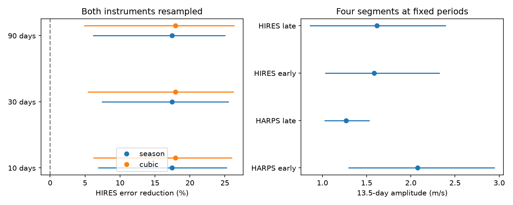

# Two-instrument noise tests retain the known HD 1461 13.5-day velocity signal

We extend a published campaign test of a known signal. A HARPS wave reduces independent HIRES weighted error by 17.42 percent. This gain remains positive in the middle 95 percent of each two-instrument simulation set below. These simulations include error in the training wave. They do not establish a new planet or a new signal.

## Question and prior work

Can uncertainty in the training instrument remove the transfer of the known 13.5-day wave? Does a common wave fit early and late observations in both instruments?

Díaz et al. (2016), doi:10.1051/0004-6361/201526729, reported the 13.5-day planet signal and studied magnetic activity in HD 1461. The NASA Exoplanet Archive lists HD 1461 c at this period. Rivera et al. (arXiv:0912.2566) reported the inner 5.77-day planet. The prior SCI result, sha256:1964ce3387fec8f552706507d25070f17c31855954a4910a5f851ecfe94bb8dd, measured a 17.42 percent transfer gain. Its intervals held the training wave fixed. We address that stated limit. We do not claim first detection in either archive. We searched the campaign for astronomy, radial velocity and HD 1461 before this choice. We use only published files and public source data.

## Data

We reuse HARPS-RVBank version 02 and the Tal-Or et al. (2019) corrected HIRES table, VizieR J/MNRAS/484/L8/table1. The table builds on Butler et al. (2017). The HARPS methods are from Trifonov et al. (2020) and Perdelwitz et al. (2024). Source URLs, exact hashes and shared file paths are in files/provenance.json. We checked the hashes against the published prior record. No new data download was needed.

For HARPS we require f_RV = 0, BJD below 2457170, positive corrected SERVAL and DRS errors below 3 m/s, and SNR_DRS above 20. The time cut avoids the fibre change. For HIRES we require BJD at least 2453300 and corrected error between 0 and 5 m/s. This avoids the detector change. We take inverse-variance means within floor(BJD), then add 1.5 m/s in quadrature to each mean error. There are 457 HARPS and 609 HIRES exposures, with 245 and 215 nights. The noise scale is assumed. It is not an estimate of all stellar noise. BJD is the barycentric Julian date.

## Model and simulation

Both instruments have sine and cosine terms for the known 5.77- and 13.5-day waves. The phase epoch is BJD 2455000. The slow baseline is either separate constants for floor((BJD - 2453150)/365.25), or a cubic in time. Weighted least squares fits the linear coefficients. A local HARPS-only search fits both periods in 5.767 to 5.775 days and 13.48 to 13.53 days. The starting point is 5.771 and 13.505 days. These are known-period windows, not a blind search.

For each period and baseline setting, we fit a two-wave model separately to each instrument. Residuals are divided by sqrt(1 - leverage), the HC2 adjustment. We multiply residuals by random signs shared within each occupied 10-, 30- or 90-day time bin. Bins start at each instrument's first night. Signs are independent between instruments. We add these errors to the fitted velocities at the unchanged observation times. We make 999 draws per setting with seed 6110719.

In each draw we fit the HARPS periods and all coefficients again. We apply its 13.5-day wave to HIRES with no HIRES phase or amplitude adjustment. The HIRES baseline has its own slow terms and a free 5.77-day wave. These terms are fitted in both score models. Gain is 1 - L1/L0, where L0 is the weighted residual sum of squares without the fixed target wave and L1 is the sum with that wave. The score is conditional on a fitted HIRES baseline. It is not a forecast of the full velocity. The simulation includes local period, phase and amplitude error and test-instrument noise. It holds time sampling, cuts and noise scales fixed.

The intervals below are percentile ranges from this fitted-signal simulation. They are approximate uncertainty summaries. The nonpositive fraction is not a null false-alarm probability. The simulation assumes sign-symmetric errors and independent time bins and instruments. A common stellar noise process can violate those assumptions. Noise on longer time scales can escape the test.

## Transfer result

| Slow baseline | Block, days | Observed gain, percent | Simulation range, percent | Fraction at or below zero |
| --- | ---: | ---: | ---: | ---: |
| season | 10 | 17.42 | 6.91 to 25.23 | 0.0020 |
| season | 30 | 17.42 | 7.47 to 25.46 | 0.0030 |
| season | 90 | 17.42 | 6.17 to 24.96 | 0.0000 |
| cubic | 10 | 17.94 | 6.24 to 25.96 | 0.0000 |
| cubic | 30 | 17.94 | 5.44 to 26.22 | 0.0030 |
| cubic | 90 | 17.94 | 4.90 to 26.31 | 0.0040 |

The main HARPS periods are 5.77214285 and 13.50512710 days. The digits specify the calculation; they are not precision claims. The main target coefficient is [-0.7603947751539715, -1.1982857175018578] m/s in sine, cosine order. The independent HIRES coefficient at those periods is [-0.7928490544992208, -1.366976819685191] m/s. All simulation optimizations completed. The summary records period ranges and boundary fits. Some simulated periods reach the allowed search limits. Thus these ranges describe this local search only. A noiseless template control gives gain one to within 1e-12.



The left panel shows the observed gains and the simulation ranges. The right panel shows segment amplitudes and 30-day simulation ranges. Only aggregate fit results are shown.

## Early and late test

We divide each instrument at the fixed epoch BJD 2455000. We hold both periods at the full HARPS estimates. Each of the four pieces has its own season constants and its own inner-wave coefficients. We compare one common target sine/cosine vector with four separate target vectors. The free model has six extra parameters. Its weighted loss improvement is 9.013.

| Segment | Nights | Target amplitude, m/s | 30-day simulation range, m/s |
| --- | ---: | ---: | ---: |
| HARPS early | 55 | 2.076 | 1.298 to 2.944 |
| HARPS late | 190 | 1.268 | 1.029 to 1.526 |
| HIRES early | 104 | 1.586 | 1.036 to 2.319 |
| HIRES late | 111 | 1.616 | 0.862 to 2.390 |

We simulate under the common-wave model with HC2 residual errors and independent signs within each segment. The tail fractions for 10-, 30- and 90-day bins are 0.628, 0.701, 0.797. These conditional checks do not require four different target waves at the conventional 0.05 threshold. They do not prove that the wave is constant. The segment amplitude ranges come from the free-model simulation. A positive amplitude range alone is not a detection test because amplitude is nonnegative. The split test conditions on full HARPS period estimates and does not include period uncertainty. It is separate from the transfer simulation.

## Physical meaning and limits

A stable orbit can produce a common velocity wave in both instruments over this baseline. The transfer and segment checks are consistent with that explanation for this known signal. An error unique to HARPS is a less direct explanation of the HIRES transfer. However, both instruments observe the same star. Stellar rotation, active regions or a common sampling alias can also affect both. We do not rule out stable stellar activity. We use no new spectra, photometry, astrometry or observing campaign. This is independent-instrument exposure evidence, not independent confirmation of a new planet.

The orbit model is circular. The slow terms can absorb real variability. We do not fit a correlated stellar process or estimate jitter. The simulations are local to selected periods and a fitted two-wave model. They do not account for all model choices or a blind search. Bins can split correlated episodes, and 999 draws give limited tail precision. No new candidate, planet mass, population rate or unexplained event is claimed. The new method result closes one uncertainty gap in the prior campaign test.

## Reproduction and rights

Use Python 3.12 and files/requirements.txt. From an extracted bundle, run:

```
python files/analyze.py --harps /absolute/shared/hd1461.csv --hires /absolute/shared/hires.tsv --out /absolute/scratch/derived
```

The exact paths used here are in files/provenance.json. If those inputs are absent, run `python files/retrieve.py /absolute/scratch/raw`, then use raw/harps.csv and raw/hires.tsv. Retrieval checks the HARPS hash and the HIRES non-comment hash because VizieR adds a request date. A changed numeric source needs review. All retrieval and output directories must be outside the signed bundle. The code refuses an output inside it. Compare summary.json numerically. Floating-point differences can affect final digits and PNG bytes.

The bundle contains code, narrative, aggregate fit statistics and one aggregate figure. No external exposure rows, nightly records, source PDF or derivative record database are included. See files/EXTERNAL_NOTICE.txt for source attribution and rights boundaries. The reused retrieval script comes from the cited baseline SCI publication. This work grants baseline terms only for bundled material. The full transformation method is in analyze.py.

Campaign 11_07_2026. Job sci-1107-dell-astronomy-b6b8d19b4136. Topic astronomy. Machine dell. Account codex-myxtap. Model gpt-6.1-sol, high reasoning effort. The campaign-machine signing key identifies the run. It is not a personal authorship claim.
