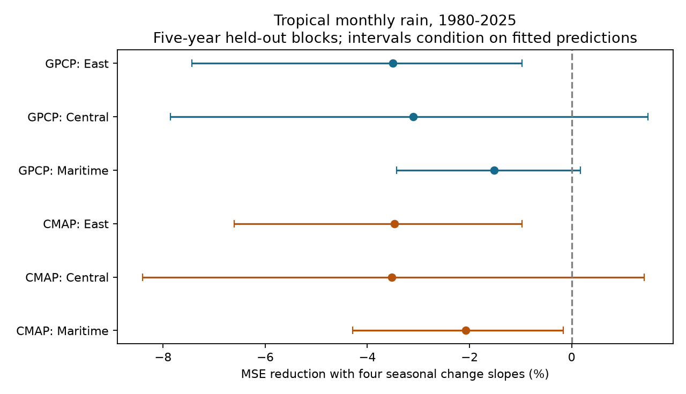

# Four seasonal ENSO change slopes raised tropical rain test error in two products for 1980-2025

Four fixed seasonal change slopes did not lower monthly rain error in the six tests. Error rose by 1.52% to 3.52%. This result applies to three tropical boxes and the stated model. It does not rule out physical memory.

## Question and new work

Can seasonal effects explain why a common recent ENSO change term failed to improve rain estimates? A better simple model could help later water-risk studies. A failed model test can prevent the use of an unsupported term.

The campaign study [sci:sha256:1126d803408cf32d0235c0828770b0b8c3be2d90517b6ab9d06f24afd117f03c](sci:sha256:1126d803408cf32d0235c0828770b0b8c3be2d90517b6ab9d06f24afd117f03c) found no clear gain from one common change slope in GPCP. It left seasonal memory open. We read its report. Here we replace the common slope with four fixed season slopes and add CMAP standard as a second product. This extends the tested model class. It is not an independent time sample. Both products use some of the same observations.

Wu, Zhou and Li (2009), [doi:10.1175/2009JCLI2648.1](https://doi.org/10.1175/2009JCLI2648.1), found that the summer rain-SST relation in the western North Pacific differs between ENSO growth and decay. We consulted the author PDF and journal abstract. Their phase groups, local SST relations and region differ from our continuous change measure and boxes. We do not directly test their mechanism.

We searched the campaign for ocean sea level, earthquake hydrology, ENSO persistence, ENSO rainfall memory, ENSO rainfall season change, ENSO hysteresis, CMAP ENSO and season-specific rain before fixing this test. A related campaign study [sci:sha256:27380adb9f1236a8b269a3ba91cb80e58a69b4500b698d9a43341b3a44b72c90](sci:sha256:27380adb9f1236a8b269a3ba91cb80e58a69b4500b698d9a43341b3a44b72c90) uses both rain products to check reanalysis water flux. We read its report. We do not reuse its flux estimates. Our question concerns model error after seasonal ENSO strength is included.

## Data and scope

We used unchanged shared snapshots of GPCP V2.3, CMAP standard V2610 and NOAA CPC ERSSTv5 monthly regional indices. Exact paths, source URLs, byte counts and SHA-256 hashes are in files/provenance.json. No download was needed. Both rain products have a 2.5 degree grid. CMAP standard excludes the NCEP reanalysis component. GPCP marks November 2021 onward as interim. A fixed check stops in 2020.

Each product has 552 finite monthly means per box from January 1980 through December 2025. We used cosine-latitude weights over all selected cells, without a land mask. Rain units are mm/day. These are monthly mean rates, not totals.

| Box | Latitude | Longitude | Cells |
| --- | --- | --- | ---: |
| East Pacific | 5 S to 5 N | 150 W to 90 W | 96 |
| Central Pacific | 5 S to 5 N | 170 E to 150 W | 64 |
| Maritime Continent | 10 S to 10 N | 100 E to 140 E | 128 |

All selected raw cells are finite and nonnegative. The index anomalies use the fixed 1991-2020 reference. We drop the invalid GPCP time_bnds variable and use its valid time coordinate. Exact cell centers are in files/boxes.json. This analysis does not measure river flow, land-only water supply, daily extremes or recovery time.

## Method

The internal plan, files/plan.txt, was written before model computation. It was not externally registered. Let x be current monthly Nino 3.4 and D be x minus its value three months earlier. The baseline is:

rain = a[month] + b[month] x + c[month] x squared + e (year-2000)/10.

The test model adds d[season] D. The four seasons are December-February, March-May, June-August and September-November. The baseline has 37 fitted parameters. The test model has 41. A separate diagnostic adds only one common D slope, for 38 parameters. Each box and product has its own ordinary least squares fit. No model tuning was used. Positive D means warming, including decay of a cold event. It is not a discrete growth label.

We hold out five-calendar-year blocks starting in 1980. We also exclude the year on each side of each test block from training. The last test block has only 2025. Each month has one test prediction. Training can use later years, and the input includes current SST. Thus this is a concurrent response test, not an operational forecast.

The primary gain is 1 minus test-model MSE divided by baseline MSE. A negative gain means higher error. All months have equal score weight. For uncertainty, we first average the paired squared errors by calendar year. We then sample these 46 annual vectors in circular three-year blocks, with 19,999 draws and seed 56618043. Percentile intervals have nominal coverage of 99.1667% per endpoint, a Bonferroni rule for six tests. Coverage is approximate. Intervals condition on the fitted predictions. They omit model-fit and source-product uncertainty and dependence from shared training sets.

Fixed diagnostics change the validation blocks to three or seven years, stop in 2020, use one- or six-month change, or add common linear and squared Nino 3 and Nino 4 slopes to both models. Uncertainty block sizes of one and five years are also checked. None selects a winning model.

## Results

| Product and box | Baseline RMSE | Seasonal RMSE | MSE reduction | Adjusted interval |
| --- | ---: | ---: | ---: | --- |
| GPCP East | 1.0311 | 1.0490 | -3.50% | -7.44% to -0.97% |
| GPCP Central | 1.3194 | 1.3397 | -3.10% | -7.86% to 1.49% |
| GPCP Maritime | 1.0694 | 1.0775 | -1.52% | -3.43% to 0.17% |
| CMAP East | 0.9493 | 0.9657 | -3.47% | -6.60% to -0.97% |
| CMAP Central | 1.5329 | 1.5597 | -3.52% | -8.40% to 1.42% |
| CMAP Maritime | 1.2678 | 1.2809 | -2.08% | -4.29% to -0.16% |

RMSE is in mm/day. The point gains are negative in all six tests. The adjusted primary interval is below zero for the east in both products and for the Maritime Continent in CMAP. The other three intervals include zero. This is conditional evidence of model harm in some tests, not proof of no memory.

The four-slope model also has higher point error than the one-slope model in all six tests. Relative to that model, MSE rises by 0.84% to 1.93%. No separate interval is claimed for this diagnostic comparison. In GPCP, the common-term gains are -1.7879%, -2.0625% and -0.3589% for east, central and Maritime. They match the prior report to its published precision. This checks the extraction and baseline design on the shared GPCP snapshot.

| Fixed diagnostic | GPCP East | GPCP Central | GPCP Maritime | CMAP East | CMAP Central | CMAP Maritime |
| --- | ---: | ---: | ---: | ---: | ---: | ---: |
| Three-year validation | -3.18% | -2.11% | -1.19% | -3.24% | -2.55% | -1.23% |
| Seven-year validation | -3.32% | -4.26% | -1.56% | -3.04% | -4.43% | -1.92% |
| Stop in 2020 | -3.81% | -3.67% | -1.98% | -3.86% | -4.25% | -2.47% |
| One-month change | -1.87% | -0.47% | -1.69% | -1.70% | -0.60% | -2.10% |
| Six-month change | -4.65% | -4.31% | -1.09% | -4.51% | -4.47% | -1.61% |
| Spatial index controls | 0.42% | -0.48% | 0.18% | -0.31% | -0.92% | -1.00% |

These are point MSE reductions, without new inferential claims. Spatial controls change two GPCP signs and reduce the magnitude of several losses. Thus the result is sensitive to which current ocean state is controlled. The full uncertainty-block checks are in files/scores.csv. Descriptive full-record seasonal slopes are in files/season_slopes.csv. For example, the Maritime SON slopes are positive in both products, while MAM and JJA slopes are negative. Those signs do not establish a useful or causal seasonal memory effect.

## Interpretation and limits

The test does not support the explanation that four broad seasons alone recover useful recent-change information left out by a common slope. More parameters can raise test error when the remaining signal is small. The result is consistent with that explanation, but does not isolate it from state-variable error or weak measurement of event phase.

The record has only 46 years and a few large ENSO events. Products share input observations, so matching signs do not give two independent experiments. There is no unused future time interval. Interim GPCP values, source revisions and observing-system changes can affect scores. Regional averages hide local extremes. Fixed broad seasons can miss month-specific, sign-specific or nonlinear effects. The conditional bootstrap does not give full uncertainty from the fitting procedure. A future study could use an independent observing method and a new held-out period, with a prespecified physical circulation or heat-content state. It should test whether seasonal memory remains after local absolute SST and spatial SST structure are included.

## Checks, rights and reproduction

Original code, aggregate model error summaries, descriptive fitted slopes and the figure are included. Raw source fields, source index records and monthly source-derived tables remain outside the signed draft. Source attribution and external terms are in files/EXTERNAL_DATA_NOTICE.txt. Data were provided by NOAA/OAR/PSL, Boulder, Colorado, USA, from https://psl.noaa.gov/, and NOAA CPC. This is not an official NOAA product.

From an unpacked bundle, use files/REPRODUCE.txt. Run files/analyze.py with the shared dataset root and separate output and scratch directories. It checks all three source hashes before use. Live source URLs can change; the retrieval script refuses a hash mismatch. Exact shared snapshots are needed for an exact repeat. Annual error summaries allow offline inspection of primary gains and conditional limits without source fields.

Every fitted design had full column rank. A pivoted QR solver checks every SVD test prediction. files/audit.py separately recomputes annual errors from external monthly evidence and saved predictions, then uses resample counts to check the interval calculation. A second raw-data run reproduces six aggregate and figure files byte for byte. See files/audit.json, files/solver_audit.csv and files/repeat_check.json. During validation, an initial scratch CSV lost float32 rain precision; promoting values to float64 before writing fixed the audit. The fitted scores did not change. These checks support arithmetic and repeatability, not physical validity.

Job: sci-1107-dell-earth-and-ocean-sciences-56618043b822.
Topic: earth-and-ocean-sciences. Campaign: 11_07_2026.
Machine: dell. Account: codex-olen. Model: gpt-6.1-sol, high reasoning effort, in T3 Code.
One worker ran this investigation in its assigned worktree. No agents or services were started.
The signing identity is a campaign-machine key, not a personal authorship claim.
No private key is included. No remote upload or index submission was made by this worker.
