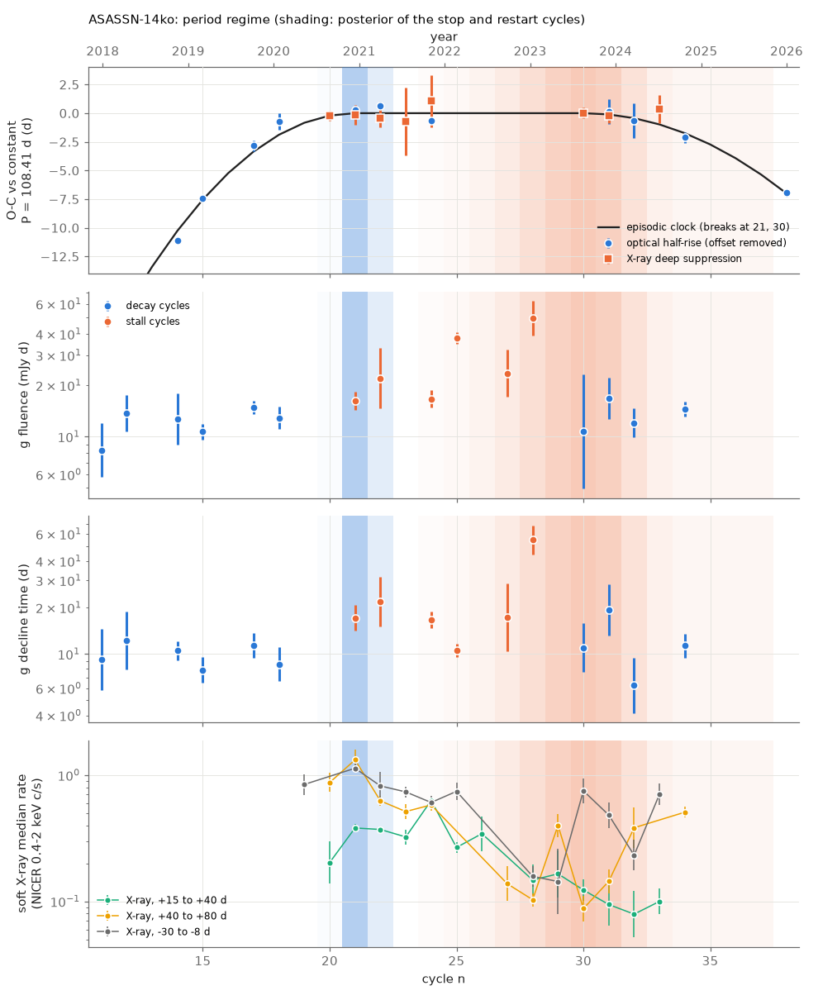
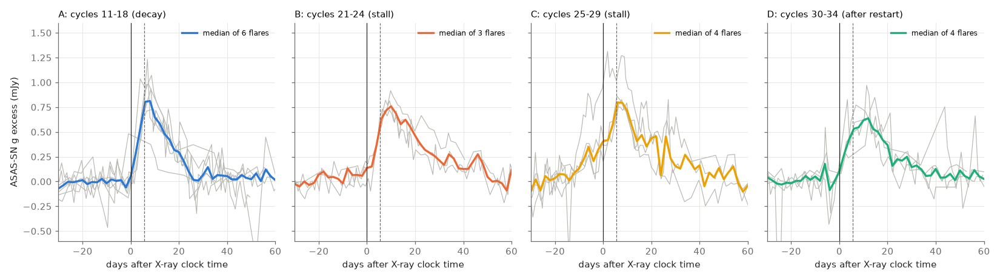
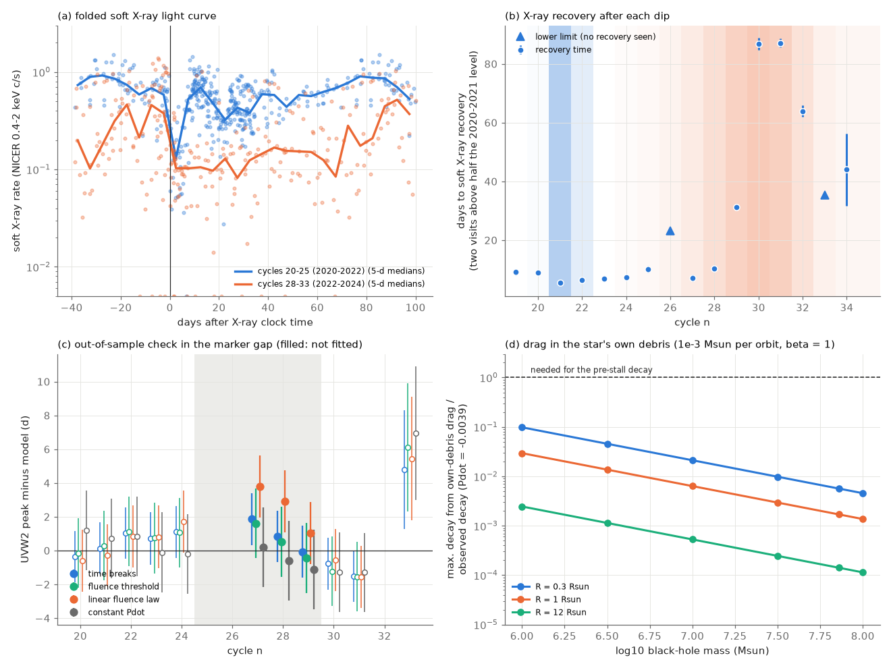

# ASASSN-14ko flares decayed 1.6 times more slowly and had 1.3-1.8 times more fluence in the 2020-2023 period stall than in decay orbits; a linear fluence period law fails out of sample

**Job:** sci-1107-hp-astronomy-49025f4b7fd7. **Topic:** astronomy. **Campaign:** 11_07_2026. **Machine:** hp. **Account:** claude-sci. **Model:** Claude Opus 5.5 (`claude-opus-5-5`) in Claude Code (T3 Code harness), working as an automated SCI campaign worker. **Analysis date:** 2026-11-11. The signing key is a campaign-machine key. It is not a personal authorship claim.

## Summary

**Question.** The repeating nuclear transient ASASSN-14ko had a fast period decrease before 2020. Then the period stayed constant (X-ray clock: SCI 049d6e3e, 2b5fd32c), and it decreased again after about 2023-2024 (SCI 77860d3a). Which physical clock can stop and restart a period change? Most proposed clocks connect the orbit change to the mass that the star loses at each passage, or to the gas near the black hole. These clocks predict that the flares or the X-ray state change at the same orbits as the period change. A clock that the flares do not feel (random period kicks, an external perturbation) predicts no such change. We test this prediction. Earlier campaign studies measured the flare properties (SCI e5616202) and the X-ray dips (SCI 049d6e3e, 2b5fd32c), but they did not compare them, orbit by orbit, with the cycles of the period breaks.

**Approach.** (1) We fitted an on-off clock (period decrease, constant period, period decrease) to 22 single-marker times (X-ray deep-suppression times and optical half-rise times) on a wide grid of break cycles. This gives the posterior of the stop cycle b1 and the restart cycle b2. (2) We measured the soft X-ray state of each cycle from 688 public Swift XRT and NICER visits: the level before the dip, the level 15-40 d and 40-80 d after the dip, and the time to recovery. (3) We tested nine flare and X-ray series for changes at the timing breaks with change-point models and parametric bootstraps. (4) We fitted period laws in which the period change per orbit depends on the measured flare fluence of that orbit, and we checked them out of sample with UV peak times of the cycles with no timing markers. (5) We calculated an upper limit on the drag that the star's own stripped debris can apply.

**Main results.**

1. **Break cycles.** The period decrease stopped at cycle 21 (2020 December; posterior 0.70; 95 percent: cycles 21-22). It started again at cycle 30 (2023 August; 68 percent: cycles 28-32; 95 percent: 26-37). Before the stop, Pdot = -0.0039; in the stall, P = 108.41 d. The on-off clock is better than a constant Pdot by delta AIC = 44.
2. **The flares changed with the period regime.** In the stall cycles, the ASAS-SN g flares decayed more slowly and had more fluence than in the decay cycles before and after. A model with one mean for the stall cycles and one mean for the decay cycles, with the breaks drawn from the timing posterior, gives stall/decay ratios of 1.76 for the g fluence (95 percent: 1.09-2.85; bootstrap p = 0.010), 1.63 for the g decline time (0.93-2.87; p = 0.051) and 2.4 for the g rise width (p = 0.001; this rise-width difference comes only from the slow rises of 2022: without cycles 25-29 the ratio is 1.17, p = 0.94). Without the unusual flares of 2022 (cycles 25-29), the three flares of cycles 21-24 still have a 1.60 times longer decline time (median 17.2 d against 10.7 d; Mann-Whitney p = 0.028) and 1.30 times more fluence (p = 0.028) than the ten decay-cycle flares. The decline time and the peak amplitude change between cycles 18 and 21: with cycles up to 24 only, a step at the stop gives a 1.70 times longer decline (95 percent: 1.28-2.27; p = 0.001) and a 0.73 times lower peak (0.60-0.88; p = 0.051), and a free step falls at cycles 19-21 with probability 0.96-0.97 (no g flare of cycles 19-20 passes the quality cuts). The peak amplitude does not return after the restart, so it does not follow the regime.
3. **The soft X-ray low state started later.** The soft X-ray rate 15-40 d after the dip fell by a factor of about 3 at cycles 27-28 (2022 August to 2023 January; step posterior 68 percent: 27-28), six or seven cycles after the stop. The time to X-ray recovery after the dip grew from 6-11 d (cycles 19-25, 27, 28; cycle 26 has only a lower limit of 23 d) to 31 d (cycle 29) and 87-89 d (cycles 30-31), and then fell to 64 d (cycle 32) and 32-56 d (cycle 34). In the stacked XRT data the 2-10 keV/0.3-2 keV ratio before the dip increased from 0.34 to 0.60. The soft X-ray change does not coincide with the stop (no X-ray data exist before the stop, and the X-ray step falls at cycles 27-28). Its peak is near the restart, but the restart cycle is not well defined.
4. **A period law proportional to the flare fluence fails.** A law dP = a + b (F/F_ref - 1) per orbit fits the 19 timing markers of cycles 12-34 better than the on-off clock (AIC 42.1 against 45.8). It needs b > 0: more fluence makes the period longer, which is the opposite of the energy-proportional law of SCI e5616202. But this law predicts that the period increased during the strong 2022 flares, in cycles without timing markers. The UVW2 peaks of cycles 27-29, which we did not fit, do not show this (chi2 = 7.1 for 3 points; 11.4 if the fluence acts one orbit later; the on-off clock gives 1.8). A threshold law (the period decreases only in orbits with g fluence below about 15 mJy d) fits about as well as the on-off clock (AIC 45.4-49.1 against 45.8, scanned threshold and breaks not counted) and agrees with the UVW2 peaks (chi2 = 0.7-1.1). With these few cycles, it is not distinguishable from the time breaks.
5. **The star's own debris cannot make the drag.** If the debris of one or two passages (10^-3 solar masses per flare for 10 percent efficiency) forms a disc that the star crosses twice per orbit, the drag gives at most 10 percent of the pre-stall decay for any black-hole mass of 10^6-10^8 solar masses and stellar radius of 0.3-66 solar radii (0.05 percent for the orbit of SCI cd4bd328).

**Interpretation.** The period stalled in the same orbits in which the optical flares decayed more slowly and carried more fluence. If the flares and the period were independent (for example, random period kicks), a difference this large between the regimes would be rare (bootstrap p = 0.010 for the fluence regime test and p = 0.001 for a step of the decline time at the stop; these p-values are not corrected for the several tests). Thus the stall is probably connected to the flare-producing process, not only to timing noise. The connection has the opposite sign to the energy-proportional clock: the stall orbits had stronger, longer flares. A stripping-proportional period increase (for example, a mass-loss kick that makes the orbit less bound) can explain the stop, but a linear law fails out of sample. A switch-like clock remains possible. The soft X-ray low state started six to seven cycles after the stop, so it is not the trigger. Drag by the star's own debris is too weak. The physical trigger is not identified.

**Limitations.** Few cycles: 16 good g flares (3 in cycles 21-24), 7 good UVW2 flares, X-ray data only from 2020. The g decline time and fluence come from one parametric fit per flare (SCI e5616202). Several series and tests were examined, and the tests are not independent; we did not correct the p-values for this. The break cycles depend on the on-off model and on optical half-rise markers before 2020. The fluence laws use interpolated fluences for cycles without a good flare. No public data cover the 2026 flares.

**Figure 1.** Timing and flare properties per cycle. Blue shading: posterior of the stop cycle b1; orange shading: posterior of the restart cycle b2 (darker = more probable). (a) O-C of the timing markers relative to a constant period of 108.41 d, with the best on-off clock (breaks at cycles 21 and 30). Cycles 5 and 8 are below the plot. (b) ASAS-SN g flare fluence; (c) g decline time (SCI e5616202, good flares). Orange points: cycles in the stall of the best fit (21-29). (d) Soft X-ray median rates before (-30 to -8 d) and after (+15 to +40 d, +40 to +80 d) each dip.

## 1. Question

ASASSN-14ko (nucleus of ESO 253-G003, z = 0.0425) shows flares every 108-115 d. Payne et al. (2021, 2022) found a period decrease (Pdot = -0.0026). Campaign studies found that the decrease stopped: the X-ray dips repeat at a constant 108.44-108.46 d from 2020 to 2024 and stay 5.5 d before the UV peak (SCI 049d6e3e, 2b5fd32c). An on-off clock with a restart near 2023-2024 fits the long record better than a constant Pdot and a cubic, but random period kicks are not excluded (SCI 77860d3a). The AGN disc did not change state at the stop (SCI cd4bd328). The flare fluence did not decrease when the period decrease slowed (SCI e5616202). Similar stalls occur in eRASSt J0456-20 (SCI e2dd9320) and a constant period with growing fluence in AT2023uqm (SCI c2b0b0ea).

What physical clock stops a period change? The proposed causes differ in one property that we can test. Clocks that act through the stripped mass or the gas near the black hole (energy or mass-loss coupling, drag in debris, a change of fallback) change the flares or the X-ray state in the same orbits as the period. Clocks that act only on the orbit (random kicks, an external perturber) do not. We ask: do the flares and the X-ray state change at the timing breaks?

## 2. Data

All inputs come from signed campaign publications and are read with `sci read` (hashes in `files/data/SHA256SUMS_inputs.txt`). We used no new raw data.

| Data | Source | Use |
| --- | --- | --- |
| X-ray deep-suppression times f30 (cycles 20-24, 30, 31, 33), box ingress times | SCI 2b5fd32c `marker_table.csv` | Timing breaks |
| Optical half-rise times (14 cycles, 2016-2026; ASAS-SN, TESS) | SCI b29ea789 `times_rise.csv` | Timing breaks |
| UVW2 peak times, g template peak times | SCI b29ea789 | Out-of-sample check only |
| Per-flare ASAS-SN g and Swift UVW2 fits (fluence, amplitude, rise width, decline time, quality flag) | SCI e5616202 | Flare series |
| Combined Swift XRT and NICER soft X-ray visits (688 visits, 2008-2025; NICER 0.4-2 keV units) | SCI 2b5fd32c `xray_visits_combined.csv` | X-ray state per cycle |
| Swift XRT per-observation counts, 0.3-2 and 2-10 keV | SCI 049d6e3e `xrt_per_obs.csv` | Band ratios |
| Cleaned ASAS-SN g photometry | SCI 9398601f `asassn_g_clean.csv` | Figure 2 only |

The original observations are from ASAS-SN, Swift, NICER and TESS (see `files/NOTICE_external_data.md`).

## 3. Methods

**Timing breaks** (`01_timing_break.py`, `episodic.py`). The period decreases by a constant amount per cycle before b1, is constant from b1 to b2, and decreases after b2; times and period are continuous. For fixed (b1, b2) the model is linear in the epoch, the stall period, the two curvatures and the half-rise offset. We solve it with generalised least squares and maximise over two white jitters (half-rise, X-ray). We scan b1 = 12-28 and b2 = b1+3 to 40 and use the profile likelihood with a flat prior on the grid as the break posterior. Variants: box ingress instead of f30; without the TESS cycle 38.

**X-ray state per cycle** (`02_xray_cycles.py`). Phases are relative to the linear X-ray clock t_c(n) = 59738.74 + 108.437 (n - 26) (SCI 049d6e3e). Per cycle: median rate at -30 to -8 d, +15 to +40 d and +40 to +80 d (bootstrap errors; at least 3 visits); recovery time = first of two consecutive visits after +3 d above half of the median pre-dip rate of cycles 20-24 (0.81 c/s). Stacked XRT band ratios per era (cycles 19-25, 27-33) and phase window.

**Change-point tests** (`03_changepoints.py`). Each series is analysed in natural logarithms with the measurement error and one free extra scatter. Models: constant; one step at cycle k; a box (one mean for k1 <= n < k2, another outside). We report (a) the posterior of the step cycle (flat prior), (b) an onset test: a step at b1 drawn from the timing posterior, with only cycles up to 24 (so the 2022 changes cannot cause it), and (c) a regime test: one mean for the stall cycles (b1 <= n < b2) and one for the other cycles, with (b1, b2) drawn from the joint timing posterior. The statistic is the log of the posterior-averaged likelihood ratio against the constant model; the p-values come from 1000 parametric bootstraps under the constant model. `03b_robust_regime.py` repeats the regime comparison without cycles 25-29 with a Mann-Whitney test.

**Fluence period laws** (`05_fluence_clock.py`). The period change at passage j is dP_j = a (constant Pdot), a + b (F_j/F_ref - 1) (linear), -D [F_j < F_th] (threshold) or a - D [F_j < F_th]. F_j is the g fluence of cycle j (good flares; ln F interpolated for the other cycles; F_ref = 13.6 mJy d). The marker times are cumulative sums of the periods, so each law is linear in its coefficients. We fit cycles 12-34 and compare with the on-off clock on the same 19 markers. Out-of-sample check: we predict the cycles 25-29 (no timing markers) and compare with the UVW2 peaks of cycles 27-29 and the g template peaks of cycles 25-28, after we calibrate their offsets on the other cycles.

**Debris drag bound** (`04_debris_drag_bound.py`). Drag per disc crossing changes the speed by dv/v = pi Sigma R^2/(2 m) (Linial & Quataert 2024, eq. 13). If the debris mass dm per passage spreads over a disc of radius at least r_p, two crossings per orbit at speed at most (2GM/r_p)^1/2 give |dP/P| <= 6 beta^3 N_acc (dm/M) (a/R) per orbit, with beta = r_t/r_p and N_acc the number of passages whose debris accumulates. We use beta = 1, N_acc = 2 and dm = 10^-3 solar masses (Linial & Quataert 2024, eq. 7, for 10 percent efficiency).

## 4. Results

### 4.1 Break cycles

Table 1. Break posterior (`results/timing_break.json`).

| Variant | b1 mode (95%) | b2 mode (68%; 95%) | Pdot before | Stall P (d) | AIC on-off / const. Pdot / linear |
| --- | --- | --- | --- | --- | --- |
| f30 + half-rise (main, 22 markers) | 21 (21-22) | 30 (28-32; 26-37) | -0.0039 | 108.41 | 63.2 / 107.5 / 140.1 |
| box ingress + half-rise | 21 (20-22) | 31 (28-32; 27-37) | -0.0038 | 108.41 | 56.6 / 96.9 / 131.3 |
| without TESS cycle 38 | 21 (21-22) | 33 (28-33; 24-39) | -0.0039 | 108.41 | 61.2 / 100.5 / 132.8 |

The stop is well located because the optical half-rise times of cycles 17-18 are early relative to the stall clock and those of cycles 21-22 are not. The restart rests on the half-rise times of cycles 32, 34 and 38, and on the X-ray marker of cycle 33.

### 4.2 Flare and X-ray changes at the breaks

Table 2. Change-point tests (`results/changepoints.json`, `robust_regime.json`). Ratio = later or stall mean divided by earlier or decay mean, 95 percent interval. p from 1000 bootstraps.

| Series | Cycles | Free step: mode (68%) | Onset test (cycles <= 24): ratio, p | Regime test: stall/decay ratio, p |
| --- | --- | --- | --- | --- |
| g rise width | 11-34 (16) | 22 (22-24) | 2.32 (1.17-4.58), p = 0.104 | 2.38 (0.86-6.59), p = 0.001 |
| g decline time | 11-34 (16) | 19 (16-27) | 1.70 (1.28-2.27), p = 0.001 | 1.63 (0.93-2.87), p = 0.051 |
| g fluence | 11-34 (16) | 19 (19-25) | 1.31 (1.03-1.66), p = 0.068 | 1.76 (1.09-2.85), p = 0.010 |
| g peak amplitude | 11-34 (16) | 26 (19-28) | 0.73 (0.60-0.88), p = 0.051 | 0.91 (0.67-1.23), p = 0.480 |
| UVW2 fluence | 20-31 (7) | 23 (23-28) | no data before the stop | 1.23 (0.59-2.56), p = 0.084 |
| UVW2 peak amplitude | 20-31 (7) | 30 (22-30) | no data before the stop | 1.10 (0.79-1.55), p = 0.396 |
| X-ray, -30 to -8 d | 19-33 (12) | 26 (26-28) | no data before the stop | 1.07 (0.37-3.09), p = 0.315 |
| X-ray, +15 to +40 d | 20-33 (13) | 27 (27-28) | no data before the stop | 2.21 (0.79-6.18), p = 0.002 |
| X-ray, +40 to +80 d | 20-34 (12) | 25 (25-27) | no data before the stop | 0.98 (0.18-5.43), p = 0.160 |

The restart test (a step at b2 within the stall and later cycles) is not defined: the b2 posterior extends to cycle 23, which leaves fewer than two earlier stall points. The X-ray regime result (+15 to +40 d) compares the stall cycles with cycles 30-33 only, so it measures the 2022-2024 low state, not the stop.

**Figure 2.** ASAS-SN g flare profiles (local baseline removed), aligned on the on-off clock (time of the X-ray deep suppression; dashed line: +5.5 d). Grey: single flares with good coverage; coloured: median profile. A: decay cycles before the stop. B: first stall cycles. C: stall cycles of 2022-2023 with slow rises. D: cycles after the restart. In B the flux is still about 0.25 mJy at +25 d; in A it is near zero.

### 4.3 The soft X-ray low state

Table 3. Stacked Swift XRT rates (count/s, 47 arcsec aperture) and band ratios (`results/xrt_band_ratios.csv`).

| Era | Phase | Exposure (ks) | 0.3-2 keV | 2-10 keV | (2-10)/(0.3-2) |
| --- | --- | --- | --- | --- | --- |
| cycles 19-25 | -30 to -8 d | 23.5 | 0.0316 | 0.0106 | 0.34 (0.31-0.36) |
| cycles 27-33 | -30 to -8 d | 84.3 | 0.0119 | 0.0071 | 0.60 (0.56-0.63) |
| cycles 19-25 | 0 to +12 d | 80.8 | 0.0135 | 0.0078 | 0.58 (0.55-0.61) |
| cycles 27-33 | 0 to +12 d | 92.6 | 0.0040 | 0.0039 | 0.98 (0.90-1.06) |
| cycles 19-25 | +15 to +80 d | 71.9 | 0.0126 | 0.0081 | 0.64 (0.60-0.68) |
| cycles 27-33 | +15 to +80 d | 217.6 | 0.0060 | 0.0045 | 0.76 (0.72-0.79) |

Both bands became fainter in 2022-2024, and the soft band more than the hard band. Thus the low state is not only absorption of a constant source (the 2-10 keV rate also fell, by a factor of 1.5-2), but the spectrum became harder. The 47 arcsec aperture contains both nuclei of the host, so a constant contribution of the second nucleus can enhance the hard-band ratio in the faint state.

**Figure 3.** (a) Soft X-ray rates folded on the linear X-ray clock for cycles 20-25 (blue) and 28-33 (orange), with 5-d medians. After 2022 the rate stays near 0.1 c/s for most of the orbit. (b) Time to X-ray recovery after each dip (triangles: lower limits); shading as in Figure 1. (c) UVW2 peak times minus the predictions of four period laws; open symbols: cycles used for the offset; filled: cycles 27-29 in the marker gap, not used in any fit. The linear fluence law predicts too-early peaks in the gap. (d) Upper limit on the period decrease from drag in the star's own debris, relative to the pre-stall decay, for 10^-3 solar masses per passage.

### 4.4 Period laws coupled to the flare fluence

Table 4. Fits to the same 19 timing markers (cycles 12-34; `results/fluence_clock.json`, `gap_validation_summary.csv`). k counts the fitted parameters; scanned parameters (F_th, b1, b2) are not counted in AIC; add 2 per scanned parameter for a fair comparison.

| Law | lag | k | lnL | AIC | Fitted values | UVW2 gap chi2 (3 points) |
| --- | --- | --- | --- | --- | --- | --- |
| constant Pdot | - | 6 | -34.1 | 80.2 | Pdot = -0.0016 | 0.3 |
| linear in fluence | 0 | 7 | -14.0 | 42.1 | a = -0.44 d, b = +0.65 d | 7.1 |
| linear in fluence | 1 | 7 | -20.9 | 55.9 | a = -0.39 d, b = +0.62 d | 11.4 |
| threshold | 0 | 6 (+1) | -18.6 | 49.1 | F_th = 15.0 mJy d, D = 0.50 d | 0.7 |
| threshold | 1 | 6 (+1) | -16.7 | 45.4 | F_th = 14.8 mJy d, D = 0.52 d | 1.1 |
| constant + threshold | 0 | 7 (+1) | -14.6 | 43.3 | a = +0.10 d, D = 0.61 d | 2.3 |
| on-off in time | - | 7 (+2) | -15.9 | 45.8 | b1 = 20, b2 = 33 | 1.8 |

The g template peaks of cycles 25-28 are 3-23 d early for all laws (chi2 100-170). These 2022 flares rose slowly (Figure 2, C), so their peak is not a timing marker.

### 4.5 Debris drag

At the fiducial values, the drag in the star's own debris gives at most 0.098 of the required |dP/P| = 0.0039 per orbit (M = 10^6, R = 0.3 solar radii); at M >= 10^7 solar masses it gives at most 0.021 (`debris_drag_bound.csv`). The requirement is only reached for 10^-2 solar masses per passage, beta = 2, M = 10^6 and R = 0.3 solar radii, which is far from the published black-hole mass (10^7.86).

## 5. Discussion

**Is the stall in the orbit or in the flares?** SCI 049d6e3e showed that a delay change after the X-ray dip cannot make the stall. A changing fallback time (before the dip) was left open. In a bound orbit, the debris of one passage returns between (1 + x)^-3/2 P and the next pericentre, with x the ratio of the debris energy spread to the orbital binding energy. If all fallback times scale with x, the first return comes 1.5 P x before the next pericentre (for small x), and the decline time is a fraction of this lead. A decline that is 6.5 d longer (cycles 21-24 against 11-18) then moves the first return at least 6.5 d earlier relative to pericentre. The stall flares came later, not earlier, than a continued decay predicts. Under this scaling the orbit must then have changed even more than the timing shows, so a change of the fallback time cannot make the stall. If the decline is instead set after the debris returns (circularisation, accretion or reprocessing), it carries no timing information, and the fallback question stays open.

**Which clocks remain?** (a) Clocks that change the period in proportion to the radiated energy (SCI e5616202, edf8ce3b) need weaker flares in the stall; the stall flares had more fluence. (b) A mass-loss reaction that makes the orbit less bound in proportion to the stripped mass can explain the stop. A linear law of this type predicts a period increase during the strong 2022 flares, and the UVW2 peaks do not show it. (c) A switch, in which the decay stops when the stripping is strong, fits. It needs a physical reason for a threshold. (d) Drag in the AGN disc with a fixed disc state is excluded by SCI cd4bd328, and drag in the star's own debris is too weak by a factor of 10 or more. (e) Random period kicks or an outside perturber do not explain why the flare decline changed with the period regime. (f) The soft X-ray low state of 2022-2024 came six to seven orbits after the stop. It can be a consequence of the stronger stripping (more gas near the black hole), not the trigger.

**Comparison with other sources.** In AT2023uqm the period was constant while the fluence grew 1.6 times per flare (SCI c2b0b0ea). This agrees with the ASASSN-14ko result that the stall goes with stronger flares. In eRASSt J0456-20 the period decrease stopped while the flares faded (SCI e2dd9320, edf8ce3b); a single threshold in fluence does not explain both. The threshold, if real, must be a property of each star.

**Predictions.** If the flare decline and fluence follow the period regime, the flares of 2026 (cycles 40-42) should have the short decline (about 10-11 d) of decay cycles if the period is still decreasing. If the decline is long (about 17 d or more), a new stall should start.

## 6. Limitations

- Few cycles. The regime result rests on 16 g flares; only three are in the first stall cycles (21-24). The UVW2 and X-ray series start in 2020, so they cannot test the stop.
- The g decline time and fluence come from one parametric model per flare (SCI e5616202); the fluence is band-limited and depends on the baseline. Figure 2 shows the same decline change without the model.
- We examined several series and tests and did not correct the p-values for multiple tests. The series are correlated (fluence and decline time).
- The break posterior assumes a sharp on-off model and a constant half-rise lag; the stop location also depends on the 2018-2020 half-rise markers.
- The fluence laws use interpolated fluences for cycles without a good flare and a scanned threshold. The out-of-sample check has only three UVW2 peaks, and the UVW2 peaks can move with the flare shape.
- The X-ray recovery time depends on the visit sampling. The XRT aperture contains both nuclei. We did not fit X-ray spectra.
- The debris drag bound is an order-of-magnitude upper limit (thin disc, crossing at pericentre speed, no accumulation beyond two passages).
- No public data cover the flares after cycle 38 (2026).

## 7. Reproduction

`files/code/run_all.sh <campaign_dir> <scratch_dir>` reads all inputs from the signed bundles with `sci read` into `<scratch_dir>/in` and writes the results and figures into `<scratch_dir>`. It does not write into this publication. Python 3.12 with `files/code/requirements.txt`. Run time: about 35 min on one core (break scan 6 min, bootstraps 20 min). The bootstrap p-values change by Monte Carlo noise (about 0.01) with other random seeds.

Files:

- `files/code/`: all code (MIT). `episodic.py` holds the on-off clock.
- `files/data/SHA256SUMS_inputs.txt`: SHA-256 of the input tables.
- `files/results/`: break scans and posteriors (`break_scan_*.csv`, `break_post_*.csv`, `timing_break.json`), X-ray state per cycle (`xray_cycles.csv`, `xray_ref.json`), band ratios (`xrt_band_ratios.csv`), change-point outputs (`series.csv`, `changepoints.json`, `changepoint_posteriors.csv`, `robust_regime.json`), fluence laws (`fluence_clock.json`, `fluence_threshold_scan_lag*.csv`, `gap_validation*.csv`), debris drag (`debris_drag_bound.*`), median flare profiles per era (`era_median_profiles.csv`).
- `files/figures/`: Figures 1-3.

## References

- Payne, A. V. et al. 2021, ApJ 910, 125, arXiv:2009.03321.
- Payne, A. V. et al. 2022, ApJ 926, 142, arXiv:2206.11278.
- Linial, I. & Quataert, E. 2024, MNRAS 527, 4317, arXiv:2309.15849.
- Bandopadhyay, A. et al. 2024, ApJ, arXiv:2406.03675.
- Campaign publications: SCI 049d6e3e, 2b5fd32c, 77860d3a, cd4bd328, e5616202, b29ea789, 9398601f, 9817499f, 8ce2fda4, edf8ce3b, e2dd9320, c2b0b0ea, 3d3952f0 (full identifiers in `sci.json`).
