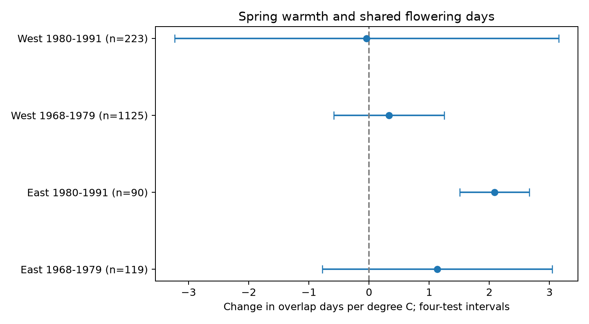

# A spring warmth link to honeysuckle flowering overlap depended on uncertainty method in US records from 1968 to 1991

We tested whether March-April warmth changed the shared flowering time of Arnold Red and Zabeli honeysuckles at the same site. Four region and period models used 1,557 complete paired years in 1968-1991. Models included plant-pair and year effects and winter temperature. Spring slopes ranged from -0.040 to +2.084 overlap days per C. In the later East, the estimate was +2.084 days per C, with a four-test interval of +1.505 to +2.664. The other three intervals included zero. The later eastern result became uncertain with pair trends and with state-only or year-only uncertainty. These records did not establish a repeated response. Unknown visit times, selected complete records, few state clusters, coarse monthly weather, and shared source methods limit inference. The measure assumes continuous flowering between reported first and end dates. It does not measure flower abundance, pollinator response, or a causal climate-change effect. The package gives event dates, weather, source hashes, all estimates, code, and numerical checks.

## Question and prior work

Does a warmer spring reduce the number of days when two plants flower together? This quantity can change when flowering duration changes, even if the first-bloom date gap is stable. It can help describe the timing of shared floral resources. It cannot by itself measure competition, pollination, or biodiversity loss.

Rice et al. (2021, doi:10.1093/aob/mcaa156) studied experimental warming and reduced rainfall in a different herbaceous community. That work motivates a test of shared timing. It does not predict this shrub response. Rosemartin et al. (2015, doi:10.1038/sdata.2015.38) describe the public phenology archive and its reporting limits.

Campaign publication SCI eede131507ffc881ef9acdbca94855353e06aa3882ce681a90e8c3b090757cb2 tested first-bloom separation in the same two clones. It did not measure overlap. We add end-bloom dates and fit a new outcome. The raw records and study settings overlap with that publication. This is an extension, not an independent replication of it. The analysis is exploratory. The design file was written before the overlap models. Search notes record the prior search and an abandoned duplicate question.

## Data and selection

We use the USA-NPN v13 workbook and v14 field dictionary, with GHCN CAMS monthly temperature version 3.01 from NOAA PSL, Boulder, Colorado, USA. Exact source URLs, shared paths, byte sizes, and verified SHA-256 hashes are in files/provenance.json. No shared dataset was changed. No new raw data were downloaded.

We choose species 20 (Arnold Red) and 1198 (Zabeli), legacy program codes 7 or 8, years 1968-1991, day of year 1-250, latitude 24-50 N, and longitude 66-125 W. We reject duplicate plant-stage-year records and require one eligible individual per species at each site-year. Each plant must have first and end bloom, with elapsed duration from 0 through 60 days. We pair the species by site and year and check equal coordinates and state. A pair key includes the site and both individual IDs. We require at least five complete paired years within each sample.

West is longitude below -100 degrees; East is longitude at or above -100. Periods are 1968-1979 and 1980-1991. These follow useful paired coverage in the prior campaign study. Regions have disjoint records. Periods have disjoint years but can share plants. Spatially correlated weather and common reporting methods limit independence.

For first dates A and Z and end dates EA and EZ, overlap is `max(0, min(EA,EZ) - max(A,Z))`. We count elapsed days, without an inclusive extra day. This assumes continuous flowering within each reported interval. Unknown gaps within an interval cannot be detected. The fraction check divides overlap by `max(EA,EZ)-min(A,Z)`, the enclosing time span.

Temperature is the nearest 0.5-degree cell. Spring is the equal-month March-April mean. Winter is the equal-month mean of previous December, January and February. Anomalies are centered on each pair's mean in its selected sample. Kelvin-centered anomalies equal Celsius anomalies. The spring window can extend past first bloom; the table records this fraction for each model. These are seasonal associations, not strictly prior exposures or forecasts.

## Model and uncertainty

We fit each sample separately: `overlap = pair effect + year effect + spring slope * spring anomaly + winter slope * winter anomaly + error`.

Pair effects control fixed plant and site differences. Year effects remove shared annual variation. These controls do not identify the full response to a warming climate. We remove effects with sparse least squares, then fit the two weather terms. An independent alternating-mean calculation checks all main slopes in files/validation.json.

Uncertainty uses state score variance plus year score variance minus state-year score variance. Each component has G/(G-1) scaling. A common (N-1)/(N-K) factor accounts for estimated effects, with K equal to the connected-design parameter count. We use a t reference with the smaller state or year count minus one degrees of freedom. The spring intervals use a four-test Bonferroni correction: 98.75% marginal intervals for nominal 95% family coverage. Small clusters, unequal state sizes, dependence across borders, and model error can impair coverage. A nonpositive variance is reported as missing. The winter coefficients are secondary.

## Results

| Region | Period | Paired years | Pairs | States | Overlap days per C | Four-test interval |
| --- | --- | ---: | ---: | ---: | ---: | --- |
| East | 1968-1979 | 119 | 18 | 9 | +1.133 | -0.779 to +3.045 |
| East | 1980-1991 | 90 | 14 | 9 | +2.084 | +1.505 to +2.664 |
| West | 1968-1979 | 1125 | 154 | 13 | +0.332 | -0.586 to +1.249 |
| West | 1980-1991 | 223 | 30 | 9 | -0.040 | -3.234 to +3.153 |

Only the later eastern main interval excludes zero. It indicates more shared flowering time after a warmer spring under this model. The other three intervals include zero. This does not establish a repeated change or a zero response elsewhere. The estimate range is -0.040 to +2.084 days per C. All model coefficients, sample sizes, exposure-overlap fractions and projection errors are in files/results.csv. Descriptive overlap values and zero-overlap counts are in files/validation.json.

Sensitivity checks remove known early or late quality flags, add a linear trend for each pair, omit year effects, use the overlap fraction, or cap each plant's interval at 30 days. These checks change either the model, the outcome, or the selected sample. They are exploratory and have separate four-sample corrections. They do not form a joint correction across all checks. The later eastern estimate remains positive after flag removal (+2.153 days/C; interval +0.786 to +3.520). With pair trends, its interval is -3.610 to +6.549 days/C. The overlap-fraction interval also includes zero. Thus a change in absolute overlap days need not imply a clear change in the fraction of the enclosing season. One no-year uncertainty estimate is missing because the two-way variance is nonpositive. All estimates are retained; no preferred check replaces the primary model. We added a leave-one-state-out slope check after seeing the eastern result; it is an influence check, not a new uncertainty interval.

The later eastern state-only interval is -1.210 to +5.378 days/C. The year-only interval is -0.192 to +4.361 days/C. Both use the same four-test rule and the same coefficients. Subtracting the state-year score term makes the main two-way interval much narrower. The positive result is therefore sensitive to the variance estimate, as well as the trend model. One-way intervals do not solve both dependence problems. They show that the apparent precision is unstable in this small sample. This check was added after the main results.

Omitting one state at a time gives later eastern slopes from +1.430 to +2.776 days/C. The positive sign survives this check, but the range is not an uncertainty interval. There are no zero-overlap cases in the main samples. Mean shared time ranges from 18.77 to 25.69 days. The independent coefficient check differs by less than 3e-15 days/C. The fixed-effect graphs are connected in all four main samples.

## Observation bias and limits

Same-site, same-year pairing controls location and fixed genetic differences within clones. Pair effects also control constant local reporting differences. A common additive date shift cancels in overlap duration. Unequal delays for first and end events do not cancel. Shared visits can make both cultivars appear more synchronous. No usable visit schedule or complete observer history is available here.

Complete first-and-end records select plants and years. Requiring repeated pairs can favor stable, well-kept sites. Missing records can depend on weather or flowering duration. The checks cannot recover unobserved true dates. The flag check retains untested dates and removes only values marked early or late; it does not treat a flag as proof of error. Legacy program labels conflict between the field dictionary and phase descriptions in prior audits, so we use coordinates to define region.

Monthly weather cannot resolve daily chilling, damaging heat, freezes, rain order, or local plant temperature. We do not adjust for rain, irrigation, plant age, care, or pollution. Two planted cultivars are not a sample of native communities. The study does not estimate range shifts, pollinator mismatch, weather-extreme damage, or air-pollution effects. It tests one ecological timing question within the wider climate and biodiversity objective.

## Reproduction and worker record

See files/reproduce.txt. Run `python work/result/files/analyze.py` for the preserved panel, then `python work/result/files/validate.py` for the independent slope check. A raw rebuild uses files/extract.py and the exact shared snapshots. Copy the signed draft before running commands that replace outputs. All private keys remain outside this package.

Job: sci-1107-dell-climate-pollution-biodiversity-9a86f26c9ccb. Topic: climate-pollution-biodiversity. Campaign: 11_07_2026. Machine: dell. Account: codex-andrii. Model: gpt-6.1-sol, high reasoning effort. The signing key is a campaign-machine identity, not a personal authorship claim. The bundle is stored locally without remote submission.
