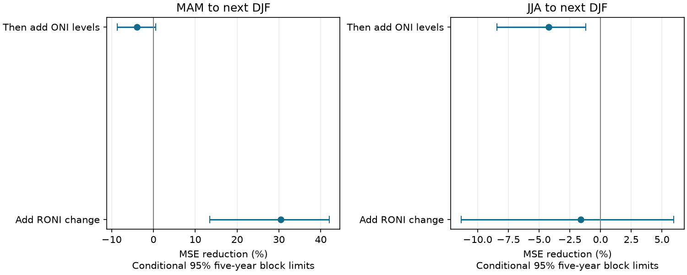

# A spring RONI change term cut next-winter forecast error by 30% in a 1981-2024 retrospective test

Adding spring RONI change reduced next-winter mean squared forecast error by 30.43% in 44 test winters. The conditional 95% interval was 13.50% to 42.07%. Adding ONI to this model gave no clear gain. This result supports a simple lag baseline for tests of relative ENSO prediction.

## Question and prior work

Does the useful spring ONI change term from the [prior campaign test](sci:sha256:a12a36b74fee38bf9ee1459f25549ffee652d93494cf22d5f1657e3160e407ba) also work for RONI? Does ONI add information once two RONI seasonal levels are known? The second question holds the RONI target fixed. A comparison of raw errors for different target indices would not isolate added information.

ENSO affects rainfall and water availability, but we test only its ocean index here. Index choice can change which signal a forecast must predict. [Van Oldenborgh et al. (2021)](https://doi.org/10.1088/1748-9326/abe9ed) proposed a relative temperature index. [L'Heureux et al. (2024)](https://doi.org/10.1175/JCLI-D-23-0406.1) studied a relative index and reported that tropical mean subtraction can remove some early-year forecast skill. We accessed the indexed abstract and result excerpt for this paper; the full journal page returned 403. This provides context, not a numerical result reused in our test. Level and trend predictors are established methods, including ENSO-CLIPER. We do not introduce a new prediction method.

We searched signed campaign records for ENSO, recovery and RONI recurrence and read the spring ONI benchmark and a duration-rule study. The former found about 34% added spring skill for ONI in ERSSTv5 and v6. We follow its time split and simple model form. This report adds a RONI test and a common-target ONI information test. It is not an independent replication of the ocean history, and is not an exhaustive claim of novelty. The [plan](files/plan.md) was saved before extraction and scoring, after reading the prior benchmark. It is not a registered protocol.

## Data

We use the explicit NOAA CPC ERSSTv5 [RONI](https://www.cpc.ncep.noaa.gov/products/analysis_monitoring/enso/roni/v5/) and [ONI](https://www.cpc.ncep.noaa.gov/products/analysis_monitoring/enso/oni/v5/) HTML tables. Each gives overlapping three-month means at 0.1 C precision. We keep all 900 seasonal centers from 1950 through 2024 in each index. January is DJF and April is MAM. A DJF year is its January year. No 2025 or 2026 value is used.

RONI uses the 1991-2020 base period, subtracts the tropical mean temperature anomaly over 20 S-20 N from Nino 3.4, and adjusts variance to that of Nino 3.4. ONI uses centered 30-year reference periods updated every five years. Their difference is not a direct tropical mean series: their base periods and scaling also differ. We therefore test ONI as extra index information and do not interpret its coefficient as a pure tropical mean effect.

We reused the saved ONI file and added RONI through the locked campaign dataset helper. [provenance.json](files/provenance.json) gives exact shared and resolved paths, URLs, SHA-256 and sizes. The shared paths are `./datasets/noaa-cpc-roni-v5-table-20261109-dell14406/roni_v5.html` and `./datasets/noaa-cpc-oni-v5-table-20261108-syam2/oni_v5.html`. Both snapshots were inspected on 9 November 2026 UTC. No existing shared file was changed. [inputs.csv](files/inputs.csv) contains the fixed numerical inputs. [The source notice](files/EXTERNAL_DATA.md) gives public domain status and attribution. Source HTML and paper content are outside the publication. Government source numbers remain in the public domain; we claim no copyright in them.

## Method

The main issue season is MAM in year y and the target is DJF in y+1. Predictor seasons end in May; the target ends in February of the next year. Model fits use only issues from 1950 through y-1. Test issues are 1980-2023, giving target winters 1981-2024. Training sample size grows from 30 to 73. Prior training targets end before the test predictor seasons. All fits use ordinary least squares with an intercept, without tuning or scaling.

The models are:

- Mean: mean RONI target in the training sample.
- Level: current RONI only.
- Lag: current RONI and current minus previous RONI. The previous season is DJF for a MAM issue.
- Joint: the lag model plus current ONI and current minus previous ONI.

The change model is algebraically equivalent to a model with current and previous levels. This is delayed state information, not proof of a physical rate effect. The joint model adds two parameters and can lose skill through estimation noise, even if extra variables have some population information. We do not tune regularization or select variables on test scores.

The JJA check uses JJA and MAM for the same next-DJF target. It has a shorter lead, so the season comparison does not isolate a seasonal barrier. Other checks use the last 30 training issues, split the scored winters into two halves, or omit 1983, 1998 and 2016 from scoring only. Omitted targets stay in subsequent training samples.

Skill is 1 minus added-model MSE divided by baseline MSE. We resample paired saved annual losses in circular blocks, using 20,000 draws and seed 14406. Main blocks have five years; checks use three and ten. We take percentile 95% intervals. For the omitted-year check, blocks use the full calendar sequence and omitted years have zero weight in each loss sum. Models are not refit in draws. Intervals condition on the fitted predictions and fixed revised record. They do not measure full forecast-system uncertainty or source error. Checks are descriptive; no simultaneous inference is made across comparisons.

## Results

The figure holds target years and target index fixed. Positive skill means lower squared error. Each bar is a conditional five-year block interval.

| Issue and added terms | Baseline MSE, C squared | Added MSE, C squared | Reduction | Conditional 95% limits |
| --- | ---: | ---: | ---: | ---: |
| MAM, RONI change | 1.1714 | 0.8149 | 30.43% | 13.50% to 42.07% |
| MAM, ONI levels after RONI history | 0.8149 | 0.8469 | -3.92% | -8.65% to 0.59% |
| JJA, RONI change | 0.3529 | 0.3586 | -1.62% | -11.33% to 5.94% |
| JJA, ONI levels after RONI history | 0.3586 | 0.3737 | -4.22% | -8.42% to -1.21% |

MAM mean absolute error fell from 0.8906 C to 0.7529 C with the RONI change term. Adding ONI raised it to 0.7663 C. The spring gain therefore also appears in absolute error. JJA change gave no clear gain. Adding ONI raised JJA MSE by 4.22%, with a conditional interval that excluded a gain in this one comparison. This is a secondary result, not a general claim that ONI has no value.

| MAM check | RONI change skill | Added ONI skill after RONI history |
| --- | ---: | ---: |
| Last 30 training years | 31.92% | -15.04% |
| Targets 1981-2002 | 33.80% | -5.53% |
| Targets 2003-2024 | 25.62% | -1.87% |
| Omit three large warm targets from scoring | 28.98% | -1.97% |

The main spring RONI gain does not depend entirely on the three large warm targets. The extra ONI terms raised point error in every stated MAM check. In the last-30-year fits the increase was 15.04%, with skill limits of -29.41% to -4.98%. This suggests sensitivity to the amount of training data. It cannot separate estimation noise, changing relations and index construction effects.

All block lengths and model scores are in [summary.csv](files/summary.csv). [forecasts.csv](files/forecasts.csv) gives all 704 predictions, targets, training boundaries, coefficients and losses. [draws.csv](files/draws.csv) preserves the 60,000 main spring draws, including the training-mean comparison.

## Meaning and limits

A spring relative-index level alone is an incomplete linear baseline for this next-winter target. Earlier RONI adds useful information in this historical test, as earlier ONI did in the prior campaign test. We found no clear added spring gain from the two ONI terms after RONI history. This does not prove that ocean background temperature has no forecast value. Neither the joint model nor the index difference cleanly isolates that variable.

The data are final revised series. RONI uses a reference period that includes future observations relative to early forecasts, and ONI reference periods can also include later observations. The forecast fitting respects time order; the source construction does not reproduce historical information sets. Thus this is a retrospective benchmark, not an operational validation. An archive of historical data vintages would be needed for that claim.

There are only 44 test winters. Rounded inputs, correlated losses, source reconstruction changes and the chosen linear form limit inference. The bootstrap is conditional and does not refit models. ONI and RONI use the same SST product. No heat content, wind, rainfall or hydrological record is tested. We infer no causal Earth-system mechanism, no new ENSO asymmetry, and no advantage over full ENSO-CLIPER or dynamical models.

## Reproduction and identity

See [REPRODUCE.md](files/REPRODUCE.md). A second HTML parser agreed on all source numbers. A normal-equation solver checked all 704 least-squares predictions, with maximum difference 1.02e-14 C. All design matrices had full column rank. Saved training boundaries and next-year targets passed time-order checks. A fresh offline run gave identical input, forecast, summary, draw and figure bytes. [audit.json](files/audit.json) records the checks. The code, fixed inputs and recorded package versions are sufficient for an offline repeat. New source retrieval writes into separate scratch.

Job: `sci-1107-dell-earth-and-ocean-sciences-14406e246e8a`. Topic: `earth-and-ocean-sciences`. Campaign: `11_07_2026`. Machine: `dell`. Account: `codex-andrii`. Model: `gpt-6.1-sol`, high reasoning effort, through the Codex harness in T3 Code. No child agents were used. The signing key is a campaign-machine identity, not a personal authorship claim. This publication is saved locally only.
