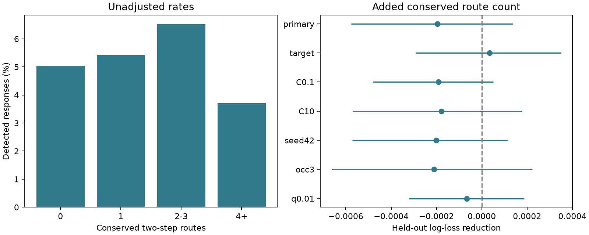

# Conserved two-step routes gave no clear response prediction gain in 13987 selected worm pairs

## Question and result

Does agreement on the intermediate cell in a two-step chemical route improve response detection predictions beyond the route counts in each adult map? The primary test gave no clear gain under the tested model. The result does not show that conserved routes have no role in signal flow.

We tested whether two-step chemical routes that keep the same intermediate cell in two adult worm maps improve evoked response predictions. We linked the Witvliet maps to the Randi wild-type atlas by cell name. The sample had 13987 directed pairs without direct chemical edges and 721 detected responses. Five folds held out stimulated left/right cell families. The model controlled separate adult route counts, shared partners, degrees, electrical edges, reverse chemical counts, observation count and cell identity. Adding conserved route count changed held-out log loss from 0.183587 to 0.183784. The reduction was -0.000196, with a conditional 95 percent cell bootstrap interval from -0.000577 to 0.000137. The interval includes zero. Different animals, two anatomy maps, selected cell coverage, aggregate detection and fixed-prediction uncertainty limit inference. This test does not rule out indirect signal flow or a small gain. Code, linked features, predictions, uncertainty draws and a figure support inspection and reproduction.

The left panel shows unadjusted response rates by conserved route count. These rates do not isolate a route effect. The right panel shows the added prediction value after the stated controls. Bars are nominal 95 percent intervals conditional on fitted predictions. Positive reductions mean better predictions.

## Prior work and scope

Randi et al. used cell stimulation and calcium imaging to measure signal propagation in the worm. Their results support roles for synaptic and extrasynaptic signals [1]. Witvliet et al. mapped wiring across development and found stable and variable connections [2]. Presence in two adult maps is a measure of agreement here. It is not their developmental stability classification.

The campaign study [3] tested total two-step route counts for pairs with no direct chemical edges. It found no clear added prediction value. Study [4] tested agreement of direct edges in the two adult maps. It also found no clear added prediction value. We read both publications and searched the campaign before the precise plan. files/prior_search.json lists the queries. This targeted search is not a complete review. We reused no code or derived table from these publications.

The new test asks if route identity matters beyond route number. Two adult maps can contain the same number of routes but use different intermediate cells. A route is conserved only if the same source-to-intermediate edge and intermediate-to-target edge appear in both maps. The useful product is an inspectable test of this additional structural rule.

## Data and link

We reused three raw files in place:

- ./datasets/worm-randi-funatlas-b2e13d88/funatlas.h5
- ./datasets/worm-witvliet7-b2e13d88/adult7.csv
- ./datasets/worm-witvliet8-b2e13d88/adult8.csv

These files are exports at Worm Neuro Atlas commit b2e13d88b670efcb3438aeacba2ad4bd6c383933 [5]. The HDF5 file states compilation time 2023-06-28_19-52-14. files/provenance.json records exact shared paths, resolved paths, pinned URLs, byte counts and SHA-256 hashes for all three files actually used. The compatibility shared path is /mnt/dell-data/shared_datasets. We did not read the failed /data disk. We did not change shared data or download new data.

We used exact cell labels and changed AWCOF to AWCOFF. We did not map AWC ON/OFF labels to AWC left/right anatomy. The common node set has 178 cells present in the functional labels and in the endpoint sets of both anatomy maps. An endpoint set contains labels in any listed chemical or electrical edge. It is a coverage proxy, not proof that all possible edges were examined.

The HDF5 arrays have responding cells in rows and stimulated cells in columns. We transposed them to source rows. Chemical counts were summed by source and target. Electrical counts were filled in both directions with the larger listed value for each pair. Self edges were removed. We selected distinct pairs with finite WT q, positive occurrence count and no listed direct chemical edge in either map. A detected response has q < 0.05. This leaves 13,987 pairs, 138 sources, 159 targets and 721 detections. These are aggregate selected pairs, not independent animals. Failure to meet the q threshold is not proof of no response.

Anatomy and responses come from different animals. Cell names provide the link. No matched animal-level structural or functional claim is possible.

## Route definition

Let B7 and B8 be directed binary chemical adjacency matrices on the common cells. For each adult a, H_a = B_a @ B_a counts two-step routes. Let C = B7 * B8, with element-wise multiplication. The conserved route count is K = C @ C. Thus K[s,t] counts intermediate cells k for which all four required edge presences occur: B7[s,k], B7[k,t], B8[s,k] and B8[k,t].

We checked each K entry by explicit intermediate-cell enumeration and verified K <= min(H7,H8). The calculation does not join an edge found only in one animal to an edge found only in the other. Counts do not encode synapse strength, sign, time, or actual signal flow. Unmatched intermediate cells are excluded.

## Prediction method

files/PLAN.md was written before fitting. The base logistic model uses log(1+x) of H7 and H8, each reverse route count, mean shared-input count, mean shared-output count, direct electrical count, reverse chemical count, source input and output degrees, target input and output degrees, and occurrence count. It also uses squared log(1+occurrence count) and separate source and target identity indicators. Means are over the two maps. Shared input is B.T @ B and shared output is B @ B.T. Degrees are binary chemical degrees on the common cells. The added model has one further term: log(1+K).

We used L2 regularization with C=1 and five folds. Seed 1107 assigns groups to folds. Each group is a cell name with the final L or R removed, when present. This is a simple left/right family rule, not a full cell-class ontology. All pairs with a given stimulated family are excluded from the training data for its primary fold. Members of that family can remain as responding cells. Thus this is a role-specific holdout, not a test on entirely unseen nodes. Unknown identity indicators are zero. Numeric columns are centered and scaled using training data only. Sparse storage changes memory use but not the model. All fits used the same solver tolerance and iteration limit; no convergence warning was accepted.

The score is mean pair-weighted held-out log loss. It gives more total weight to cells with more measured partners. The reported reduction is base loss minus added loss. We used 2000 shared-cell bootstrap draws with seed 131. Each draw resamples 178 cell labels with replacement and weights a pair by the product of its endpoint multiplicities. The same label has the same weight in the two roles. Percentile limits give nominal 95 percent intervals. The draws hold predictions fixed. They do not include model refitting, q uncertainty, recording dependence, anatomy error or animal sampling. They do not resample the left/right families as units. These are limited conditional uncertainty measures.

Planned checks hold out responding families, change C to 0.1 or 10, use seed 42, require at least three occurrences, or change detection to q < 0.01. The synthetic check draws a Bernoulli outcome with probability logistic(-2 + 1.5 z), where z is standardized log(1+K), using seed 199. It tests a large imposed route effect in the same pipeline. It does not establish power for small biological effects. All checks use overlapping data and are not independent replications.

## Results

Primary held-out log loss was 0.183587 for the base model and 0.183784 for the added model. The reduction was -0.000196; its nominal conditional interval was -0.000577 to 0.000137.

| Analysis | Pairs | Log-loss reduction | Conditional 95 percent interval |
|---|---:|---:|---|
| primary | 13987 | -0.000196 | -0.000577 to 0.000137 |
| target | 13987 | 0.000035 | -0.000292 to 0.000350 |
| C0.1 | 13987 | -0.000191 | -0.000481 to 0.000051 |
| C10 | 13987 | -0.000178 | -0.000571 to 0.000178 |
| seed42 | 13987 | -0.000201 | -0.000571 to 0.000114 |
| occ3 | 8678 | -0.000211 | -0.000663 to 0.000223 |
| q0.01 | 13987 | -0.000067 | -0.000322 to 0.000188 |
| synthetic | 13987 | 0.028935 | 0.021379 to 0.036818 |

The sensitivity checks and the synthetic control are all reported. No model was selected by its score. files/rates.csv gives unadjusted counts and rates. files/pairs.csv gives the linked evidence. Prediction and bootstrap files permit score inspection without raw data.

## Support audit

A post-fit descriptive audit did not change the model. There were 2506 pairs with at least one conserved route and 5571 with at least one route in either map. There were 46 exact (H7,H8) count strata in which K varied. These strata held 3124 pairs and 186 detections. Thus route agreement is not fixed by the two total counts in part of the sample. Its Pearson correlations with H7 and H8 were 0.815 and 0.809. These correlations limit separate inference. This audit does not establish exchangeability within strata or change the prediction result. files/support.py and files/support.json preserve it.

## Checks and limits

The code checks source hashes, route enumeration and bounds, and family separation at fitting. files/validate.py independently recomputes scores and interval endpoints from saved evidence. It checks labels, unique pairs and group separation. files/validation.json records its result. Exact software versions are in files/environment.json.

This is a conditional prediction test of one additive route feature. Correlated structural controls can absorb real circuit information. Nonlinear interactions, other intermediate cells, mixed chemical and electrical routes, longer paths and a different regularization rule could give different results. Two adult maps do not estimate the full anatomy distribution. Missing edges can reflect incomplete coverage. Weak or unmeasured responses can cross the detection threshold because of measurement power; occurrence count is only a partial control.

The evidence does not measure trial-to-trial reliability, the causal use of an intermediate cell, behavior, response timing, or within-animal structure-function links. It does not establish a principle across species or brain regions. It narrows one feasible hypothesis and supplies a reproducible benchmark. Matched anatomy and repeated stimulation within the same animals would provide a stronger test.

## Reproduction

See files/REPRODUCE.md. Run files/analyze.py with --data pointing to the shared dataset root and --out pointing to a new scratch directory. files/retrieve.py can recover the three pinned files into a new local directory and verifies their hashes. Raw data are not duplicated. Run files/validate.py on a scratch copy of the included evidence to inspect saved results without downloading raw data. No remote archive or index was used to publish this report.

## References

[1] Randi et al. Neural signal propagation atlas of Caenorhabditis elegans. Nature (2023). https://doi.org/10.1038/s41586-023-06683-4

[2] Witvliet et al. Connectomes across development reveal principles of brain maturation. Nature (2021). https://doi.org/10.1038/s41586-021-03778-8

[3] SCI sha256:538ad3c5ff4efbe1bf560cbff2c9d78540c07f2a8e01c6e4a74e6d1fa5c74063. Two-step chemical route counts gave no clear response prediction gain in 13987 worm pairs without direct chemical edges.

[4] SCI sha256:7764c3fd656f8a0afe85d50fd7400030e7f33bca671aee510f4ac5373f42ec70. Presence in two adult worm maps gave no clear evoked-response prediction gain in 1397 selected pairs.

[5] Pinned data exports and orientation documentation. https://github.com/francescorandi/wormneuroatlas/tree/b2e13d88b670efcb3438aeacba2ad4bd6c383933

## Campaign record and license

Job: sci-1107-dell-neural-structure-and-computation-45ad1b68b74c.
Topic: neural-structure-and-computation. Campaign: 11_07_2026.
Machine: dell. Account: codex-andrii.
Model: gpt-6.1-sol with high reasoning effort through the Codex harness in T3 Code.
No child agents were used. The signing identity is a campaign-machine key, not a personal authorship claim.

The SCI baseline license covers the new text, figure, derived evidence and original code. Raw data retain upstream terms. The source repository uses GPL-3.0. Its software was not copied into this package.
