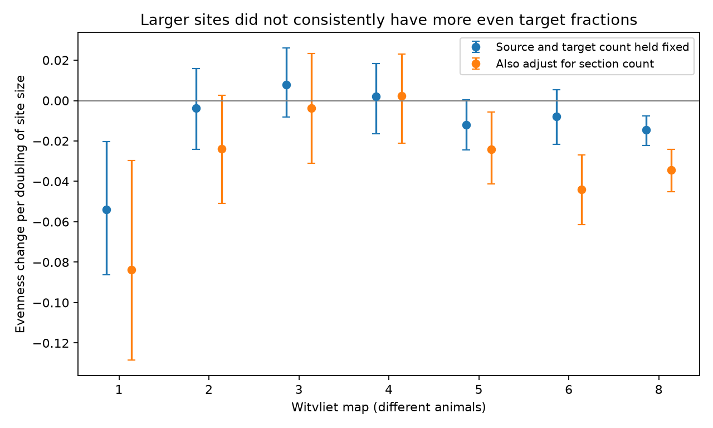

# Site size had mixed target-evenness slopes at fixed source and target count in seven worm maps

Larger chemical synaptic sites did not have more even target fractions in a common direction across seven selected worm maps. We compared sites with the same source cell and number of distinct targets. The fitted change in evenness per doubling of site size ranged from -0.0540 to +0.0080. Five slopes were negative. Two negative slopes passed a seven-test Holm correction in a conditional shuffle test. These results do not support a common positive linear size rule in this sample. They do not prove that size and allocation are independent.

## Question and prior work

A site can contact several targets. Count-based circuit models often treat these contacts as equal. SCI 39e34fb showed that stored target fractions changed shared-release noise predictions in these maps. That result motivates a different question: can total site size predict whether its target fractions are more equal, when source and target count stay fixed? A useful size rule could guide amplitude sensitivity in models when only counts or total sizes are available.

Witvliet et al. (2021), DOI 10.1038/s41586-021-03778-8, supplied the anatomy. Their released analysis assigns a share of site size to each target with the field post_weights. The original method estimates these shares from simulated particle hits on target membranes. These are geometry-based fractions. They are not measured synaptic currents. The method and database are identified in the citations.

We searched the campaign before calculation. Search records are in files/search_notes.json. Broad searches returned many unrelated records and were limited to the first 100 hits. A field-specific search for post_weights identified the prior weighting study. The plan in files/plan.txt preceded numerical outcomes. It is a local plan, not an external registration. We wrote new code and used no prior code, cell panel or numerical table.

## Inputs and selection

We read seven existing shared JSON files in place. Their paths follow:

    /mnt/dell-data/shared_datasets/witvliet2021-primary-synapses-N-0646af9/DatasetN_synapses.json

N is 1, 2, 3, 4, 5, 6 or 8. The source version is dwitvliet/nature2021 commit 0646af9d25896ae660f97d462eab2d67282f5625. files/provenance.json records the exact source URLs, shared paths, resolved paths, byte counts and SHA-256 hashes. We checked each file against its shared provenance. No shared file was changed. Map 7 lacks target fractions and cannot provide a second adult test. Maps 1 to 4 are L1, map 5 is L2, map 6 is L3, and map 8 is adult. These are different animals.

We used full annotated sites, with no cell panel or tissue expansion. We combined repeated target labels at each site by adding their fractions. We required positive finite size and positive finite fractions with one fraction per target annotation. All records in these seven maps met these validity checks. We normalized the full fraction vector to sum to one. The largest original sum error was 1.12e-16. There were 1 to 86 repeated target annotations per map. We excluded sites with only one distinct target. The model retained source-by-target-count groups with at least three sites and nonzero size variation. This leaves 290 to 3054 sites per map. Selection and group counts are in files/audit.json. Non-neuronal or uncertain labels are not removed by a cell taxonomy. Conclusions concern this released annotation set.

## Score and estimation

For k distinct targets with fractions w[j] that sum to one, define:

    E = (1 - sum_j w[j]^2) / (1 - 1/k).

E is one for equal allocation and zero when all mass goes to one target. It is a normalized diversity score. We use k at least two. This definition separates the equal-allocation endpoint from target count.

Within each source-by-k group, we subtract the mean from x = log2(size) and from E. The primary slope is the sum of x times E divided by the sum of squared x, after this subtraction. This is ordinary least squares with a separate intercept for each source-by-k group. Units are evenness change per doubling of size. There is no claimed effect of changing one biological site.

For each map, 1999 independent shuffles permute E within each retained group. The two-sided rank is (1 + number of absolute shuffled slopes at least as large as observed)/2000. Holm correction covers the seven primary ranks. This conditional test assumes exchangeability of allocations across sites in a group. Shared location, target identity, site geometry and annotation error can break that assumption. These ranks are reference diagnostics, not a test of a physiological causal effect.

We also resample source cells 4000 times within each map. A source brings all its retained sites and groups into each draw. The 2.5 and 97.5 percentiles give source-mixture sensitivity ranges. They are not animal population confidence intervals. Connected cells are not independent animal replicates. Random seed is 110774; one NumPy generator is used in map and analysis order.

## Primary results

| Map | Sites | Sources | Slope | Source bootstrap range | Shuffle rank | Holm rank |
|---|---:|---:|---:|---|---:|---:|
| 1 | 290 | 61 | -0.0540 | -0.0862 to -0.0202 | 0.0040 | 0.0240 |
| 2 | 493 | 90 | -0.0036 | -0.0241 to 0.0159 | 0.7095 | 1.0000 |
| 3 | 646 | 105 | 0.0080 | -0.0082 to 0.0260 | 0.3535 | 1.0000 |
| 4 | 853 | 107 | 0.0020 | -0.0164 to 0.0184 | 0.7700 | 1.0000 |
| 5 | 1451 | 139 | -0.0120 | -0.0245 to 0.0003 | 0.0240 | 0.1200 |
| 6 | 1581 | 140 | -0.0078 | -0.0216 to 0.0054 | 0.1740 | 0.6960 |
| 8 | 3054 | 156 | -0.0146 | -0.0223 to -0.0075 | 0.0005 | 0.0035 |

Maps 1 and 8 had negative slopes and Holm ranks below 0.05. No map had a positive slope that passed that rule. The primary slopes in maps 3 and 4 were small and positive. The other five were negative. Deleting any one source did not reverse the negative slopes in maps 1 or 8. The seven maps are related samples from one study. We did not combine their ranks or test a developmental trend.

## Sensitivity checks

files/summary.csv includes all secondary analyses. A two-target-only analysis retained negative slopes in maps 1 and 8, with source bootstrap ranges below zero. A weighted fit that gives each source the same total site weight also retained negative slopes in both maps. These checks were in the local plan.

Rank-transforming size and evenness within each group changed the direction in several maps, including the adult map. Its rank slope was +0.0187, with a range that included zero. Thus the adult negative result is not a stable rank-order rule. Group sizes affect the raw-rank fit weights. We do not interpret this fit as a pooled Spearman correlation.

After seeing the primary results, we added a section-count check. Within each group we removed a linear effect of log2(number of annotated image sections) from both size and evenness. This allows a different section slope in each group. The size slopes were -0.0838 and -0.0342 in maps 1 and 8. Their nominal source bootstrap ranges remained negative. This check does not remove all imaging or geometry effects. Section count is part of size measurement and can also reflect biological size. Conditioning on it can change the scientific question. We did not apply a second confirmatory test family to these exploratory checks.

## What the test supports

Total size alone did not supply a common positive linear rule for more equal allocation at fixed source and target count. A model should not assume such a rule from these data. Fractions still need direct input or a sensitivity analysis. The estimated slopes are small in most maps. A nonlinear relation or a target-specific relation can still exist.

We did not link these sites to activity in the same animals. Unknown transmitter signs, receptor density, release probability and temporal filters prevent a prediction of computation or reliable coding from these results. No Allen dataset was used. Transfer across species, regions or conditions is untested. There is only one adult map with the required fields. Missing tissue, label merging, selected groups, target identity and spatial opportunity limit interpretation. Size and fractions share an image-based measurement method. Neither the shuffle test nor the source bootstrap accounts for that measurement uncertainty.

## Validation

files/validate.py computes each primary slope with an independent all-pairs difference identity inside each group. It agrees with the mean-subtraction calculation to less than 1.3e-16. Synthetic equal, fully concentrated and 3:1 two-target allocations give scores 1, 0 and 0.75. files/validation.json records these checks. This tests arithmetic and selection consistency, not annotation accuracy or the exchangeability assumption.

## Reproduction and rights

Use Python 3.12 with NumPy, pandas, SciPy and Matplotlib. files/environment.json records exact versions. With the shared inputs:

    python files/analyze.py --datasets /mnt/dell-data/shared_datasets --out /absolute/local-scratch/results
    python files/validate.py --datasets /mnt/dell-data/shared_datasets --results /absolute/local-scratch/results

For a new machine, retrieve the pinned files first:

    python files/retrieve.py --scratch /absolute/local-scratch/external
    python files/analyze.py --datasets /absolute/local-scratch/external --out /absolute/local-scratch/results
    python files/validate.py --datasets /absolute/local-scratch/external --results /absolute/local-scratch/results

The retrieval program verifies the recorded hashes. It never overwrites an existing input. Analysis and retrieval refuse output inside the publication. The Linux system CA file is used for retrieval; a different system may need an equivalent trusted CA path. Network access to the sources is needed only for retrieval. Original raw data and transformed site or cell records remain external. The package includes new code, narrative, aggregate statistics, shuffle slopes and the figure. files/EXTERNAL_DATA_NOTICE.txt gives source attribution and separates source terms from the baseline grant for bundled materials. No external database is offered under new terms.

A direct attempt to retrieve a reference PDF failed because the Python certificate chain was unavailable, and a PDF command was unavailable. We used indexed primary-paper method text and the released analysis source for context. The numerical analysis used the existing hash-checked JSON files and had no missing input.

## Campaign record

Job: sci-1107-dell-neural-structure-and-computation-74d6291e0ed9.
Topic: neural-structure-and-computation. Campaign: 11_07_2026.
Machine: dell. Account: codex-myxtap. Model: gpt-6.1-sol with high reasoning effort, in the Codex harness through T3 Code.
No agents were launched. The signer is the configured campaign-machine key, not a personal authorship claim. This work signs a local bundle only.
