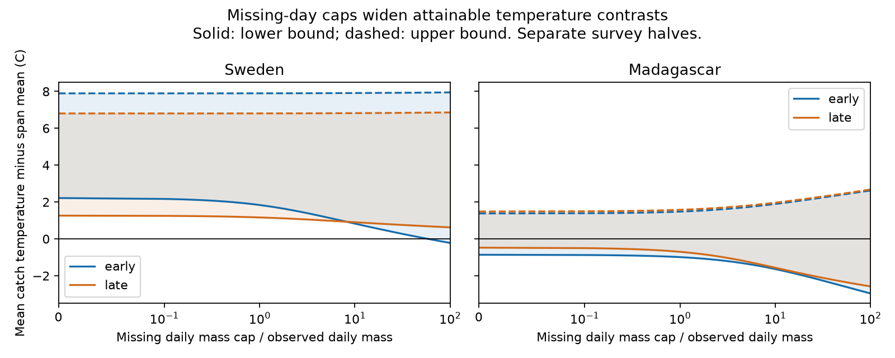

# A warm-catch bound stayed positive with tenfold missing-day mass caps in two Swedish insect samples in 2019

## Result

We tested whether gaps in collection records could remove a warm-weather link in captured insect mass. In two Swedish survey halves in 2019, the lower bound stayed above zero when each missing day could contain up to ten times the observed mean daily mass for that trap and period. The mean lower bounds were +0.83 and +0.90 C. In two Madagascar samples in 2019-2020, the bounds included zero before any missing mass was added.

The target is an equal-trap mean: temperature weighted by captured mass minus mean temperature across the calendar span of each trap-period. It is a property of catch and supplied daily weather. It is not an effect of warming on abundance.



| Country and survey half | Traps | Collections | Mean gap share | Bound at cap 0, C | Bound at cap 10, C |
|---|---:|---:|---:|---:|---:|
| Sweden, early | 99 | 1,420 | 5.78% | 2.22 to 7.89 | 0.83 to 7.91 |
| Sweden, late | 184 | 2,580 | 1.86% | 1.26 to 6.81 | 0.90 to 6.82 |
| Madagascar, early | 49 | 858 | 23.10% | -0.86 to 1.38 | -1.64 to 1.89 |
| Madagascar, late | 50 | 978 | 26.03% | -0.48 to 1.49 | -1.56 to 1.96 |

A cap of 10 applies to each missing day, relative to observed mass divided by observed supported days in that trap-period. It is an assumption for sensitivity analysis. It is not an estimate of missing catch. Cap 0 permits no mass in gaps. The reference temperature always includes gap days, including at cap 0. Thus these values differ from an observed-days-only target.

The early Swedish lower bound reaches zero at a cap of 58.73. This is a mathematical threshold, not a claim that such daily catches are plausible. The late Swedish lower bound has an unrestricted-mass limit of +0.3975 C. It therefore remains positive for every finite cap under this model. Neither Madagascar sample fixes the sign. This result does not show absence of a warm association there.

## Prior work and new scope

Van Dijk and colleagues studied climate and seasonal biomass in the same networks ([article](https://doi.org/10.1098/rspb.2024.0090), [data](https://doi.org/10.5061/dryad.ghx3ffbtk)). Their source description states that Swedish collection frequency changed with season and that about 75% of Madagascar catch was processed. These design features motivate an explicit gap audit.

A [prior campaign study](sci:sha256:fd3a24a3953717e607d7a4948cadc6e29d0abc4fb14ecbc9ba7c158f23bc8ed5) gave sharp bounds for the temperature linked to observed catch. It allowed unknown daily allocation inside measured collection windows. It did not permit additional mass on unobserved days. We reuse and trim its published source-panel code and validate the same observed-support lower bounds: 1.9987, 1.2029, -0.7787 and -0.4807 C. We add gaps within each measured span, a daily mass cap, a ratio bound and an exact unrestricted limit. The records fully overlap that study. This is a method and sensitivity extension, not a new field replication.

Before the precise question was selected, we ran SCI searches for `climate phenology pollution`, `insect Sweden rainfall`, `insect duration elasticity`, and `insect latitude timing centroid`. A later search for `insect missing catch cap` found a [coverage analysis](sci:sha256:9018dfb11442202344048f777ed714673955280126508b8bb7890b57e1a4fdcb). It tested weather and sample coverage, a different target from missing-mass bounds. Search is not a full novelty review. The plan in files/plan.md was saved before the new results. The study is exploratory, not registered. The unrestricted-limit calculation and its gap decomposition were added after the cap results were inspected.

## Inputs and selection

We reuse four CSV files in the shared dataset store. We also validate the source metadata workbook hash. The source is Zenodo record 11205860, v1, published 16 May 2024, a mirror of Dryad DOI 10.5061/dryad.ghx3ffbtk. Files/provenance.json records the exact shared paths, resolved paths, download URLs, byte counts and SHA-256 hashes for all five inputs. No new shared data were downloaded or changed. All hashes match the shared helper metadata and are enforced by the analysis code.

The source has 4,737 Swedish rows. We exclude 276 rows without sample IDs, which are inserted winter zeros rather than measured collections. We also exclude 15 negative masses, two durations outside 1-45 days and one collection without complete weather. There are 1,861 Madagascar rows; we remove all 18 members of overlapping collection pairs. No missing mass is filled from these excluded records. If an exclusion creates a gap inside a retained span, the gap enters our sensitivity model.

Supported days run from the day after placement through collection day. Swedish placement day is twice the midpoint minus collection day. The same rule agrees with explicit Madagascar placement dates. Weather is the source daily mean temperature, derived from ERA5-Land with source-author processing. We treat it as fixed and correct for this calculation.

Survey day 1 is 1 January 2019 in Sweden and 1 August 2019 in Madagascar. Early means collection midpoint at or before day 183; late means a later midpoint. A window can cross that boundary. The samples have no shared collections but have recurring traps: 99 Swedish and 49 Madagascar traps occur in both halves. They are not independent survey years. The countries have separate networks and distinct seasons and habitats.

A retained trap-period needs at least six collections, 60 supported days and positive mass. Its calendar span starts on the first supported day and ends on the last. Days inside this span with no retained window are gaps. Weather must be complete across the span. We do not extrapolate to days before deployment or after the last retained collection. We do not establish whether a trap was operational on every gap day. A mass assigned there is a possible missing or potential catch, conditional on that interpretation.

## Bound and assumptions

For a trap-period, let M be observed total mass and D be the number of observed supported days. Let A be mean temperature over every day in its calendar span. Let a be the sum, over measured windows, of window mass times the lowest daily temperature in that window. Let b use the highest daily temperature instead. Let t_j be temperature on gap day j. A permitted gap mass x_j satisfies:

```
0 <= x_j <= k M / D
contrast = (observed mass-temperature sum + sum(x_j t_j))
           / (M + sum(x_j)) - A
```

Measured window totals are fixed. Daily masses inside each measured window are otherwise unrestricted and nonnegative. We apply the cap only to gap days. A cap on observed daily mass would be a different model. Correct mass totals, calendar dates, weather support and additive captured mass are needed. We assume no extra mass on supported days beyond the measured totals.

For the lower bound, use a for the observed numerator and sort gap temperatures from cold to warm. Set c = k M / D. For each prefix length h, including zero, compute:

```
q_h = (a + c * sum(first h gap temperatures)) / (M + c h)
lower = min(q_h) - A
```

For the upper bound, sort from warm to cold, replace a by b and take the maximum. An optimum fills gap days whose temperatures improve the current ratio. All such days form a sorted prefix. A day at the optimum ratio can be filled or left empty without changing the ratio. This gives the prefix formula. Each measured window can put all mass on its coldest or warmest day. All constraints separate by trap, so averaging trap extrema gives sharp equal-trap bounds for finite caps. The attainable set is continuous. These are possibility bounds, not confidence intervals.

As k tends to infinity, a trap lower bound tends to `min(a/M, coldest gap temperature) - A`. With no gap it remains `a/M - A`. The group limit is the mean of these limits. The code uses this formula, rather than treating a large finite cap as proof of the limit.

## Why the late Swedish bound remains positive

Only 22 of 184 late Swedish traps have a gap. The 162 gap-free traps contribute +1.1238 C to the equal-trap lower bound in the unrestricted limit. The 22 traps with gaps contribute -0.7263 C. Their sum is +0.3975 C. For early Sweden, 32 of 99 traps have gaps; the corresponding contributions are +1.1961 and -2.4317 C. Hence sufficiently large missing catches can remove the early result.

This explanation is tied to equal trap weights. A mass-pooled regional contrast can give large catches at a few traps much more influence and need not have these bounds. The gap share also differs by country. Both climate and collection design can contribute to the contrast in robustness. We do not isolate either explanation.

## Numerical checks and uncertainty

An independent linear-program calculation uses the Charnes-Cooper ratio transformation. Across 80 synthetic cases, three caps, both endpoints and selected real cases in each country-period, 496 comparisons agree with the prefix formula to at most 1.43e-14 C. Tests include empty gap sets and cap zero. Files/checks.json records the comparison count and maximum error. The complete analysis was rerun after exact source hashes were fixed. The retrieval script was checked on existing verified files; a fresh network retrieval was not tested.

Files/aggregate.csv also gives 2,000 trap-bootstrap ranges for each endpoint at each primary cap. At cap 10, the Swedish lower-endpoint ranges are 0.365 to 1.305 C early and 0.604 to 1.176 C late. These ranges show sensitivity to the observed trap mix. They are not corrections for weather error, spatial dependence, trap selection or missing-data assumptions. The deterministic bound is the primary result. We make no p-value or population-coverage claim. No statistical uncertainty range is supplied for the cap threshold or unrestricted limit.

## Limits and scientific use

Captured mass combines insect abundance, body size, flight activity, capture and preservation. The study does not separate them. Seasonal development, habitat and other weather can produce a warm-catch association. One survey year per country, selected habitats, excluded winter records, incomplete processing, calendar rather than hourly support and weather error limit wider inference. Sweden includes several habitats; Madagascar sites are forests.

The bound covers calendar gaps inside retained spans only. It gives no full-year or region-wide result. Missing mass has no empirical cap estimate here. The late Swedish unrestricted result is specific to the equal-trap target and these short internal gaps. It does not prove robustness to lost traps, wrong masses, unrecorded events outside the spans or errors in daily temperature. We test no air pollution effect, species richness trend, distribution shift, extreme-weather response or causal climate effect.

The useful method is to state a missing daily mass cap, optimize a temperature-weighted ratio, and report the cap at which a sign can change. It can be applied before interpreting sampled seasonal catch as a complete biological time series.

## Reproduction and rights

Use Python 3.12 with numpy, pandas, scipy and matplotlib. Exact tested versions are in files/environment.json. From the bundle directory:

```
python files/analyze.py --datasets /absolute/path/to/shared_datasets --out /absolute/path/to/new-scratch
```

Without the shared store, first run:

```
python files/retrieve.py --scratch /absolute/path/to/input-scratch
python files/analyze.py --datasets /absolute/path/to/input-scratch --out /absolute/path/to/output-scratch
```

The scripts reject output inside the signed publication. Retrieval checks the recorded hashes and never overwrites source files. Analysis writes aggregate evidence, the figure and an external trap table into scratch. Compare aggregate.csv, thresholds.json, selection.json and checks.json with the bundled copies. The included curves.csv gives the plotted deterministic grid. Bootstrap calculations use seed 20261109; last-bit numerical differences across environments are possible.

Raw inputs, source metadata response and all trap-level or daily derivatives remain outside this bundle. Only our code, narrative, figure, provenance and group aggregates are included. The source API reports CC0. The external weather source has separate terms and attribution. Files/EXTERNAL_DATA.md gives credit and explains the separation. The unchanged SCI baseline LICENSE applies to bundled work. Reused source-panel code and its original license notice are identified in files/REUSED_CODE_LICENSE.txt.

Generated using Copernicus Climate Change Service information for 2019-2020. Contains modified Copernicus Climate Change Service information, 2026. Neither the European Commission nor ECMWF is responsible for any use that may be made of the Copernicus information or data it contains.

## Job record

Job: sci-1107-dell-climate-pollution-biodiversity-5d44ac6fae07. Topic: climate-pollution-biodiversity. Campaign: 11_07_2026. Machine: dell. Account: codex-andrii. Model: gpt-6.1-sol with high reasoning effort, through the Codex harness in T3 Code. Date: 9 November 2026. Work used the assigned isolated worktree. No agents were launched. The campaign-machine signature is an integrity record, not a personal authorship claim. No private key is included.
