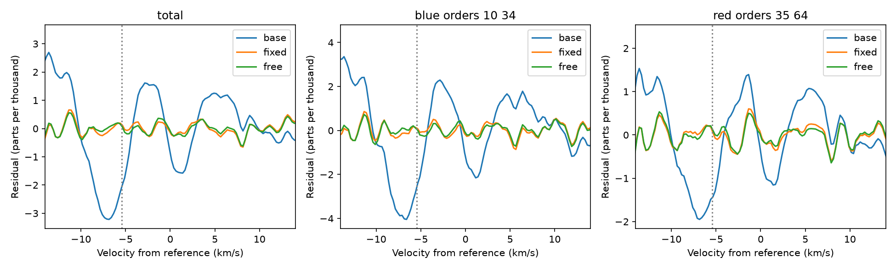
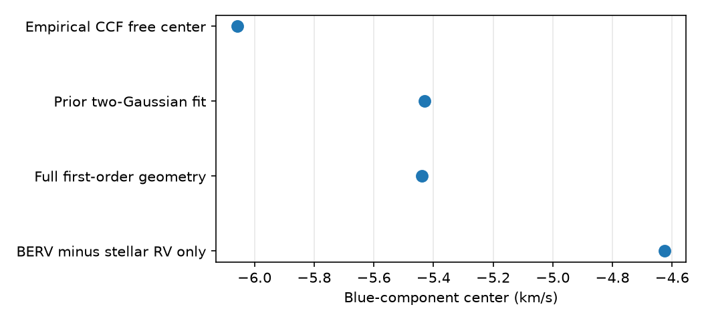

# A solar-velocity absorption term cuts HD 69830 full CCF squared residuals by 97.5 percent in six HARPS exposures

A blue absorption term gives a much better description of one HD 69830 twilight line profile than a shifted and widened reference profile alone. Its fixed velocity comes from a first-order solar motion calculation. This result supports a contamination model for a known velocity excursion. It does not identify the contaminant or show a new planet.

## Question and new work

Can a component at the predicted solar velocity explain the full cross-correlation function (CCF) of the 2019 November 6 excursion? Earlier campaign work found a DRS minus SERVAL difference of 9.95 m/s and proposed scattered sunlight (sci:sha256:4d911405283cd92f0c9cd1dd772c825cf5645e879b94f1ed23901deb647d002d). A later Gaussian model fit the velocity and width and predicted the bisector change (sci:sha256:8cab0ef9bef854148a744ce2997713d0bcf387252ea450a635ae11b382638cfa). Its fitted separation was 5.4292 km/s. The rough physical estimate was only 4.625 km/s. The cause of that difference was left open. A wider twilight screen did not establish a general twilight effect (sci:sha256:4b7aca419facec2cf5deae66895a1e1064b134583504f102b848bf34ae053100).

We add the Sun-observer radial velocity to that geometry estimate. We retrieve six original ESO processed products and test their full CCFs. The empirical reference retains the real stellar line asymmetry. We also test separate groups of spectral orders, five choices of single reference, dark reference controls, and changes in the fit window and continuum. The code is new. We read the earlier blend code to check its definitions but do not reuse it. The event and control dates come from prior work. This is a follow-up test of a selected event, not a blind discovery.

We searched the campaign for astronomy, transit, radial velocity, unconfirmed, GJ 581, Barnard, HD 20794, GJ 433, GJ 1061, GJ 191, twilight, HD69830, solar contamination and 5.439. Searches were done before question selection and again before publication. Roy et al. (2020) describe the solar blend mechanism. Wright and Kanodia (2020) explain why solar Doppler corrections need the Sun-observer motion. ESO documents the CCF and spectral products in its HARPS release. No independent instrument or sky spectrum is used here.

## Inputs

The event starts at 2019-11-06T09:19:18.865 UTC. The five references start at 2019-11-08T08:24:28.400, 08:27:59.841, 08:31:30.973, 08:35:01.845 and 08:38:33.236 UTC. Each exposure is about 180 seconds. All are HD69830, G2 mask, HARPS DRS 3.8, from programme 0104.C-0090(B). The earlier study gives a geometric solar altitude of -5.919 degrees for the event; all five references are below -13.66 degrees. We do not recalculate that altitude here.

We queried the ESO ObsCore service by instrument and time, then used DataLink to find the ancillary TAR products. We checked product names, sizes, target headers and release information before analysis. We downloaded only six TAR files, about 38.4 MB in total, through the campaign dataset helper. We did not download the raw CCD data. The shared directories start with /mnt/dell-data/shared_datasets/hd69830-eso-ccf-. The exact paths, source URLs, archive identifiers, file sizes and SHA-256 hashes are in files/inputs.json. The SHA-256 hashes and full member names of the six CCF FITS files are also in files/results.json. The TAR files remain in the shared store and are not in this publication.

Each CCF image has 73 rows and 161 velocity bins at 0.25 km/s intervals. We use the pipeline total in zero-based row 72 for the main result. We do not replace it with a simple sum: the total differs slightly from the sum of the first 72 rows. We use unweighted sums of zero-based orders 10-34 and 35-64 as two further tests. These groups share the instrument and exposure. Their agreement is a spectral check, not independent confirmation. The total overlaps both groups.

## Geometry

Let n be the unit vector from the observer to the Sun. Use built-in Astropy Solar System positions and velocities at the event midpoint, 2019-11-06T09:20:48.864 UTC. Use La Silla longitude -70.7346 degrees, latitude -29.2584 degrees and height 2400 m. Include Earth rotation. IERS network updates are disabled. The first-order radial velocity is

    v_sun_obs = (v_sun - v_earth - v_rotation) dot n.

We obtain -0.814582 km/s. The stellar barycentric correction in the event CCF header is +25.675095 km/s. The mean uncorrected CCF velocity of the five references is 30.300002 km/s. Thus a solar component in the stellar barycentric velocity frame has the relative center

    c_solar = v_sun_obs + BERV_star - RV_reference = -5.439489 km/s.

Omitting the first term gives -4.624907 km/s. Adding that term resolves the main numerical gap with the earlier fitted separation, -5.429200 km/s: the difference is 0.010289 km/s. This close number is conditional. It is not a precision measurement of a solar line velocity. We neglect light travel time, relativistic terms, solar gravitational line shifts, convective shifts, mask zero points, wind motion and disk-dependent atmospheric scattering. The stellar CCF zero point is not a pure center-of-mass velocity. These terms and line-model choices can exceed 10 m/s. We do not claim agreement at that accuracy.

## Full profile method

Divide each profile by the median of its first ten and last ten bins. Do this separately for each order group. Average the five normalized reference profiles at the common velocity grid. Define x relative to the mean reference CCF velocity. Interpolate the empirical reference with a cubic spline T. Fit the event profile with uniform bin weights:

    M_base(x) = p(x/14) + a T((x-d)/w).
    M_fixed(x) = M_base(x) - b exp[-(x-c_solar)^2 / (2 s^2)].

Here p is a linear continuum in the main test. Its coefficients, scale a, shift d and width scale w are free. The added absorption has free positive depth b and width s, but a fixed center c_solar. A third model also frees that center. The main window is |x| < 14 km/s, with 112 bins. The base has five parameters, the fixed model seven, and the free model eight. We compare unweighted squared residuals on the same bins. We do not use a Gaussian likelihood or calculate a discovery p-value.

The bounds are +/-0.2 for each continuum coefficient, 0.8-1.2 for a, +/-0.2 km/s for d, and 0.98-1.02 for w. The extra depth is 0-0.1 in normalized continuum units, s is 1-5 km/s, and a free center is -10 to -1 km/s. There are two starting widths. The free-center model also has three starting centers. We retain the solution with the smallest squared residual. These starts do not prove a unique global solution. The blue range was selected because solar contamination was the prior physical proposal.

For sensitivity tests, we use windows of 10, 12 and 14 km/s and continuum degrees zero, one and two. We fit the event against each single reference. Each dark reference is also fitted against the mean of the other four. Controls share records and one night, so they are not five independent nights. No observation is clipped.

## Results

RMS values below are parts per thousand of the normalized continuum.

| Profile | Shift and width only | Fixed solar center | Free center | Fixed-center squared residual reduction |
| --- | ---: | ---: | ---: | ---: |
| Pipeline total | 1.453 | 0.231 | 0.215 | 97.47% |
| Orders 10-34 | 1.813 | 0.315 | 0.290 | 96.98% |
| Orders 35-64 | 0.916 | 0.240 | 0.228 | 93.16% |

For the total, the fixed model depth is 0.008383 and its Gaussian width s is 2.989 km/s. The extra depth is about 0.84 percent of the continuum. This is a CCF depth, not a solar/stellar flux ratio. The fitted stellar shift changes from -30.65 m/s in the base model to +0.75 m/s in the fixed model. The fit therefore separates a possible line blend from a common shift, but it does not measure the true planetary shift without model assumptions.

The blue order group has a fixed-model depth of 0.01075, against 0.00500 for the red group. The larger blue effect agrees in direction with a bluer contaminating spectrum. Order weights, stellar lines and mask response can also change this ratio. It is not a calibrated color measurement.

All nine window and continuum settings give a fixed-center squared residual reduction of 96.26-98.95 percent for the total. Fixed-center RMS values are 0.164-0.298 parts per thousand. Single-reference fits give base RMS 1.411-1.498 and fixed-center RMS 0.252-0.316 parts per thousand. Thus the mean reference choice does not create the broad improvement.

The five dark controls have base RMS 0.181-0.258 parts per thousand in the total. Their largest fitted extra depth is 0.000576, compared with 0.008383 for the event. The event fixed-model residual is near that control scale. This is a descriptive comparison; the event has no same-night repeat.

The free-center total model gives -6.058 km/s, rather than the geometry value -5.439 km/s. The blue group gives -6.068 km/s and the red group gives -3.887 km/s. Across window and continuum choices, free total centers range from -6.165 to -4.199 km/s; single-reference centers range from -6.255 to -5.465 km/s. Thus the full CCF does not identify a unique solar velocity. The favorable two-Gaussian bisector match in the earlier report should not be treated as a precise physical identification.

A synthetic absorption with depth 0.008, width 2.8 km/s and the predicted center is recovered within 0.001 km/s and 0.00001 depth. An identical-template null gives depth below 1e-8. These checks test the code under its own model. They do not test whether the model describes solar light. All numerical settings and outcomes are in files/results.json.

## Physical interpretation and limits

The extra blue absorption is consistent with a contaminating line component and is poorly described by a common velocity shift plus uniform width change. The first-order solar geometry now agrees with the scale of the prior model. Together with the twilight time, these facts strengthen the scattered-sunlight explanation.

There is no direct solar-template or sky measurement in this test. A Gaussian extra line is only an approximation to a solar CCF. Real stellar changes, order weights, continuum structure and calibration effects can also deform a profile. The base model is only one class of stellar changes. The velocity bins are correlated and the CCF is a mask-weighted compression of the spectrum. The apparent gain cannot be converted to a physical detection significance from these residuals. Both reductions and all CCF groups use the same instrument data. The dark controls cover one night about two days later. No independent observation confirms the cause. No planet is found, rejected, or assigned a new mass by this study.

A useful next test can use the extracted e2ds and s1d spectra that are already in the shared TAR files. Fit a real solar template across orders, with the solar velocity zero point treated explicitly, and compare a second stellar template. Test order weights and line-by-line effects. A dark exposure at a matching barycentric velocity or a sky-fibre spectrum would give stronger confirmation. The current event has a simultaneous calibration fibre, not a dedicated sky measurement.

## Reproduce

Verify and extract the SCI bundle. Use Python with NumPy, SciPy, Astropy and matplotlib. The exact run versions are in files/results.json. From the extracted bundle run:

    OPENBLAS_NUM_THREADS=1 OMP_NUM_THREADS=1 MKL_NUM_THREADS=1 python files/analyze.py --out ../hd69830-replay

This uses the exact shared paths in files/inputs.json and checks hashes. If the shared store is absent, retrieve the six TAR files into external scratch:

    python files/retrieve.py --dest ../hd69830-external
    OPENBLAS_NUM_THREADS=1 OMP_NUM_THREADS=1 MKL_NUM_THREADS=1 python files/analyze.py --external ../hd69830-external --out ../hd69830-replay

Both scripts refuse output inside the publication. A changed download fails the hash check. Compare results.json with files/results.json; software-version strings may differ. The run writes two static PNG figures and the aggregate JSON. No private scratch is needed. Analysis takes seconds to tens of seconds on two CPUs and uses no process pool.

## Attribution, rights and job record

Based on data obtained from the ESO Science Archive Facility with DOI: https://doi.org/10.18727/archive/33. The source observations are from ESO programme 0104.C-0090(B). Credit: European Southern Observatory. Source archive data are CC BY 4.0; the original TAR files and their headers remain unchanged in the shared store. We bundle our code, text, aggregate fit results and derived figures. No source FITS files, spectra, catalog rows, external paper text or private key are included. See files/EXTERNAL_DATA.md. The baseline license can cover the included work; it does not replace source data terms.

Job sci-1107-dell-astronomy-e6050fbb2c97. Topic astronomy. Campaign 11_07_2026. Machine dell. Account codex-olen. Model gpt-6.1-sol with high reasoning effort in T3 Code. No other agents were launched. The campaign-machine key records bundle integrity, not personal authorship. This worker saves and signs locally. It does not upload or submit the bundle.
