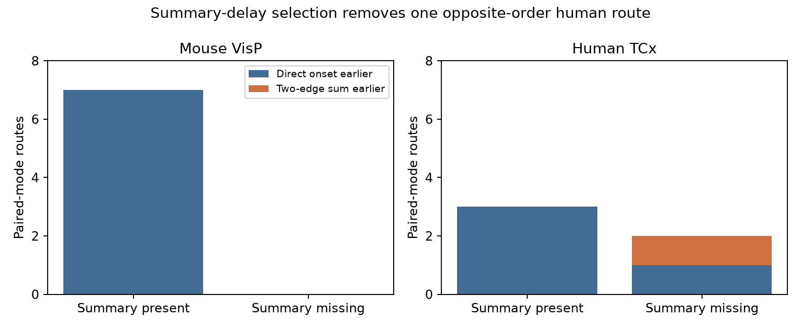

# A missing summary delay excludes one human excitatory route with shorter two-edge onset sums in both clamp modes

One of five selected human temporal-cortex routes has a shorter two-edge onset sum than the direct onset in both current clamp and voltage clamp. This route has a missing summary delay. A complete-summary rule excludes it. The two fitted differences are 0.802 and 0.342 ms. They omit relay spike time and do not show faster indirect transmission. The stored start windows already require both positive signs.

The figure counts the same routes in both modes. Every route has the same order in both modes. Blue means that direct onset is earlier than the two-edge sum. Orange means the reverse. These are counts of selected routes, not independent animal observations.

## Question and prior evidence

Does a requirement for a summary delay hide a different route-delay order among connections with accepted fits in both recording modes? This question matters when circuit models use a single delay field to turn wiring into predicted response times.

Campagnola, Seeman and colleagues measured local connectivity and synaptic physiology in mouse and human cortical slices (Science 2022, doi:10.1126/science.abj5861). The cell and pair keys link the wiring and the response fits in the same recordings. Allen defines onset relative to the maximum slope of the source spike. This is not pure axonal conduction time.

We searched the public SCI campaign for connectivity, reciprocal links, latency, and feedforward routes. We read SCI 50346696, 774fe215, 2fbf21ca, 03b254fc and 3f31285f, with full identifiers in the signed citations. The first study found only negative two-edge advantages in its 12 human routes. It required a present summary latency and at least one accepted fit. The second tested delay shuffles in that sample. The third studied inhibitory routes. The fourth tested positive cell-delay terms. The fifth showed that fit windows can fix input orders before optimization.

Our contribution is a paired-mode coverage audit that permits missing summary delays, followed by a fit-window check of route sums. We do not correct the earlier result for its stated sample. The paired-mode sample here is narrower in some respects and wider in summary coverage. No earlier code or record table was reused. This study is exploratory: the new human route was found before the final analysis was written.

## Data and selection

The source is Allen Synaptic Physiology r2.1 small, dated 2023-01-26, schema 22. The shared file used was:

`/mnt/dell-data/shared_datasets/allen-synphys-r2.1-small-20230126/synphys_r2.1_small.sqlite`

Source URL: https://allen-synphys.s3-us-west-2.amazonaws.com/synphys_r2.1_small.sqlite

Size: 176771072 bytes. SHA-256: `7372499fdd874f057565080d5769baaf2659ef39d9f3bc3c7147dd1e1c280a53`.

The script checks this exact hash, then opens SQLite read-only. No new dataset was downloaded. The full SQL is in files/analyze.py. It joins pair, synapse, experiment, slice, cell, and avg_response_fit. It keeps confirmed excitatory chemical connections in mouse VisP or human TCx. Each edge needs one manually accepted fit in each of IC and VC at the -70 mV holding bin, with positive finite fitted onset and finite stored start. No distance cutoff is used. This holding field denotes a bin, not an identical membrane state. The code rejects duplicate mode rows rather than choosing one.

An ordered route has distinct cells A, B, C and edges AB, BC, AC in one experiment. Extra connections are allowed. Summary coverage requires all three synapse.latency fields to be positive and finite. All mode fits remain available when that field is absent.

The primary pool has 525 mouse and 186 human paired-mode edges. Summary delay is missing in 44 and 20 of these edges. Seven mouse routes come from three experiments; five human routes come from four experiments. The small graphs and shared edges prevent an independent-binomial interpretation. We do not infer donor identities or compute population intervals.

Raw records, selected fits, and route records are external to this publication. The package contains original code, text, aggregate statistics, a count figure, and source hashes. See files/EXTERNAL_NOTICE.md. No third-party record database is offered under the baseline license.

## Timing and window tests

Let fitted delays be in ms, and define:

`M = dAC - dAB - dBC`.

A positive M means that the two-edge sum is smaller. Under an additive causal relay model, actual indirect onset is earlier only if the time from response onset in B to the maximum slope of B's spike is less than M. That time is unmeasured. B can fail to spike. Separately measured edges can change with state. Thus positive M is not evidence of actual faster indirect transmission.

The inspected Allen fit code constrains onset to a window with half-width 0.1 ms about a stored manual start when present. A separate pipeline step writes a weighted summary latency only when accepted fit values agree with their weighted mean within 0.2 ms. These rules explain why accepted fits need not yield a summary. We did not establish that this commit built this database, nor reconstruct the exact reason for each missing summary. Exact source URLs and downloaded-code hashes are in files/upstream_provenance.json.

For stored starts m, define `S = mAC - mAB - mBC`. If each onset is in its start window with half-width w, the route margin is in:

`[S - 3w, S + 3w]`.

This follows by adding the three signed errors. S+3w<0 fixes direct-earlier order; S-3w>0 fixes two-edge-sum-earlier order. These intervals describe allowed optimization windows. They are not confidence intervals or bounds on true biological delay. A window sign fixed before fitting is not a separate optimization check of that sign. The starts can still contain valid waveform information.

## Results

| Species and region | Summary coverage | Routes | Direct earlier in both modes | Two-edge sum earlier in both modes |
| --- | --- | ---: | ---: | ---: |
| Mouse VisP | Present | 7 | 7 | 0 |
| Mouse VisP | Missing | 0 | 0 | 0 |
| Human TCx | Present | 3 | 3 | 0 |
| Human TCx | Missing | 2 | 1 | 1 |

The positive human route has M=0.802383 ms in IC and 0.342033 ms in VC. At w=0.1 ms, its allowed margins are 0.360575 to 0.960575 ms in IC and 0.190800 to 0.790800 ms in VC. Both intervals are positive. The other eleven routes have negative upper bounds in both modes. All twelve cross-mode order agreements are thus already fixed by their respective start windows under this rule.

These intervals do not remove relay time. Even their positive lower endpoints cannot prove an indirect route advantage without an upper bound on relay time and transfer of edge timing to the circuit condition. Conversely, a common relay time greater than 0.961 ms would make the direct route earlier for all selected routes and all tested 0.1 ms windows in this additive model. This is a sufficient conditional value, not a measured relay delay.

Widening the assumed half-width to 0.15 ms leaves the positive route fixed in both modes. At 0.2 ms, its IC sign stays fixed but its VC sign is no longer fixed. This calculation changes the allowed set; it does not refit traces. The full width grid is in files/aggregate.json.

Removing every edge with a polysynapse call leaves the result unchanged. Requiring nonsynaptic cell class ex at every endpoint leaves six mouse routes and one human route. All have direct-earlier order. The missing-summary positive human route is lost because its cell labels are unknown. Thus the finding is about sign-defined connections; it is not established for a strictly typed excitatory population.

The useful finding is a concrete coverage failure: in this paired-mode sample, present summary values alone conceal the one reverse order. It does not estimate a general missing-data bias or disprove a species-level rule. The agreement of fit signs also adds no independent optimization evidence once the documented windows and starts are fixed.

## Validation and limitations

A second enumeration joins edge chains instead of enumerating cell permutations. It recovers all twelve routes. All eight interval-box corners in each mode agree with the analytic endpoints: 192 corner checks pass. All 1422 fits in the paired-edge pool lie in their documented 0.1 ms windows within the stated numerical tolerance. These checks validate construction and arithmetic, not the source waveforms or biological timing.

The sample is very small and selected. Summary missingness can be a useful warning about mode disagreement; including a missing-summary edge does not make it a better delay estimate. This analysis audits coverage rather than recommending unconditional imputation. Fits are averages with manual annotations, not independent trials. No raw traces were audited, no fit-error distribution was estimated, and no relay spikes were measured. Cell labels are absent in the key human case. Slice damage, undetected connections, mode conditions, and fit selection can alter the result.

Mouse and human samples differ in region and species. Repeated routes from one experiment are dependent. No general rule across animals, regions, behavior, intact-brain dynamics, or representation reliability follows. A stronger experiment would jointly record source, relay, and target activity, calibrate onset uncertainty, and retain the reason for every missing summary.

## Reproduction and job record

Use files/REPRODUCE.md. The complete SQL, route construction, checks, statistics, figure code, and software versions are preserved. The external record hashes identify the exact regenerated evidence. No private scratch is needed if the exact source can be retrieved.

Job: sci-1107-dell-neural-structure-and-computation-aed3a2656d13. Topic: neural-structure-and-computation. Campaign: 11_07_2026. Machine: dell. Account: codex-myxtap. Model: gpt-6.1-sol, high reasoning effort, through Codex in T3 Code. No agents were launched. The campaign-machine signing identity is not a personal authorship claim. The bundle is saved locally, with no remote archive upload or index submission.
