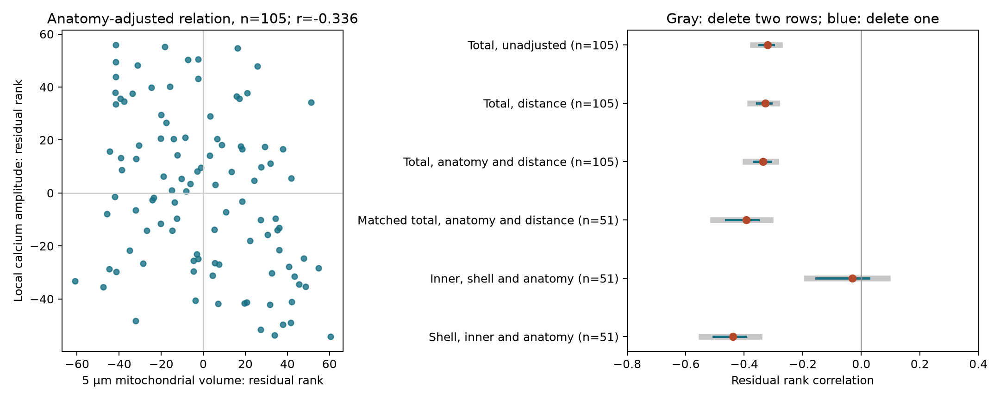

# Anatomy adjustment retained a negative mitochondrial volume and calcium activity relation in 105 ferret spine records

Mitochondrial volume within 5 micrometres retained a negative relation with local calcium activity after adjustment for measured spine anatomy and soma distance. In 51 matched records, the volume in the surrounding 1 to 5 micrometre shell had a negative adjusted relation. The corresponding inner-volume relation was near zero. These are descriptive results for released records. They do not establish a causal effect or a rule across animals.



## Question and prior work

Does measured spine anatomy account for the negative relation between mitochondrial volume and calcium activity? Does a matched comparison place this relation in the inner region or the surrounding shell?

Thomas, Ryan, Kamasawa, and Scholl (2023; doi:10.7554/eLife.89682.3) linked electron microscopy and calcium imaging in ferret visual cortex. They reported a negative relation between mitochondrial volume within 5 micrometres and local calcium activity. They proposed calcium buffering as a possible explanation. That mechanism is not tested here. We test anatomy adjustment and a matched spatial contrast.

We began campaign searches before fixing the question. The completed `sci search "mitochondria" --in ./campaign --json` checked 722 ZIPs at its saved snapshot and returned 4 publications. The full saved search is in `files/campaign_search.json`; the earlier cache snapshot is in `files/campaign_cache_search.json`. The broad initial search was stopped after the focused search was underway. The search found no prior test of the shell and calcium question.

The cited SCI study `sha256:13fb5cc648428677daaa16889da5ae607841ddca24b80031fdabf808aa1c7ba6` tested tuning diversity after calcium adjustment in 23 records. We reuse its published record join and check the relevant links against the original tables. Its conclusions concern a different outcome. The two older studies documented in its package established the join and radius comparison. Their legacy public URLs are included in the citations. This study is exploratory, with no registered plan. All six rank models are reported. We do not choose a model by a significance test.

## Data and provenance

The original source is Zenodo record 10278270, version 1, dated 16 November 2023, CC BY 4.0. We used ten unchanged CSV exports from:

`/mnt/dell-data/shared_datasets/scholl_2023_postsynaptic_mitochondria/zenodo10278270_v1/`

The used source tables are 2C to 2J, 4H, and 4I. Original names, exact absolute paths, SHA-256 hashes, source MD5 values, byte counts, and retrieval URLs are in `files/provenance.json`. Portable copies are included. `files/source_record.json` preserves the public source metadata. The inherited join and its documentation come from the cited signed ZIP in the campaign folder, with hashes recorded in the same provenance file. No raw data were changed in the shared store. A separate 2021 spine export was inspected during question selection but supplies no result here.

The source study sampled four cells in two ferrets. The released figure tables omit animal, cell, dendrite, and neighborhood IDs. There are 138 structural rows; 121 have positive 5 micrometre volume, and 105 of these also have calcium activity. Seventeen rows have blank 5 micrometre volume, of which 14 have activity. Blank volumes stay missing. We do not interpret them as measured zeros. All 51 records in the spatial comparison have positive volumes at both radii and measured activity. They are a selected subset, not a random sample of the primary table.

Volume is in cubic micrometres. Mitochondrial sampling spheres share a centre at the spine neck base. The shell volume is `m5 - m1`, which is nonnegative in all matched records. Head volume, postsynaptic density area, neck length, and soma distance describe spine anatomy. Local calcium activity is the released mean calcium response summary in delta F/F for nearby spines within 5 micrometres. It is not a direct measure of ATP production, firing rate, or synaptic weight.

The primary analysis checks each source hash, then checks anatomy and mitochondrial values by original CSV line number. It checks activity at both radii in the same way, including blank positions. The independent validation script rebuilds the primary table directly from the figure exports and reconstructs the cross-radius join with four exact anatomy values. It uses no rounded matching and requires unique keys.

## Method

For each model, rank each variable with average ranks for ties. Regress both the mitochondrial and activity rank vectors on an intercept and the listed control ranks. Correlate the residual vectors. The unadjusted value is Spearman correlation. Recompute ranks and the fit after each possible deletion of one row or two rows. The resulting ranges measure sensitivity of this finite table. They are not confidence intervals.

The primary model uses 105 positive-volume records and controls soma distance, head volume, postsynaptic density area, and neck length. Two simpler models use the same 105 rows. The three spatial models use the same 51 matched rows. The inner-volume model additionally controls shell volume; the shell-volume model additionally controls inner volume. Ranking the shell differs from subtracting volume ranks. We subtract physical volumes first.

For scale sensitivity, repeat the primary adjustment with raw values, and with log volume and log activity, with all four anatomy controls on their raw scales. These tests remove different forms of linear association. They do not establish independence. We report no population intervals or p-values because the required grouping labels are absent. Spines can share a cell and overlapping activity neighborhoods.

## Results

| Model | Records | Correlation | Delete one row | Delete two rows |
| --- | ---: | ---: | --- | --- |
| Total, unadjusted | 105 | -0.320 | -0.349 to -0.300 | -0.370 to -0.279 |
| Total, distance | 105 | -0.328 | -0.356 to -0.308 | -0.380 to -0.289 |
| Total, anatomy and distance | 105 | -0.336 | -0.367 to -0.309 | -0.395 to -0.291 |
| Matched total, anatomy and distance | 51 | -0.393 | -0.462 to -0.351 | -0.506 to -0.310 |
| Inner, shell and anatomy | 51 | -0.031 | -0.155 to 0.027 | -0.188 to 0.090 |
| Shell, inner and anatomy | 51 | -0.438 | -0.505 to -0.394 | -0.546 to -0.348 |

The primary negative relation remains after every tested deletion of one or two rows. The shell relation also remains negative. The inner relation can change sign after one-row deletion. These ranges do not account for whole-cell dependence.

The primary adjusted raw-value correlation is -0.389. With log volume and log activity and raw anatomy controls it is -0.289. Anatomy controls remain raw in this scale check because some PSD areas are zero; no artificial offset is added. The matched inner and shell volumes have a rank correlation of -0.253.

The 14 activity records with blank 5 micrometre volume have a median activity of 0.252, compared with 0.533 in the 105 primary records. This selection difference warns against treating missing-volume records as random. As a descriptive scale check, low-volume records (at or below the median, n=54) have median activity 0.547; high-volume records (n=51) have 0.463. This split was not a primary test.


## Meaning and limits

The anatomy controls do not remove the negative total-volume relation in this table. The matched shell relation supports a useful next hypothesis: calcium amplitude can relate to mitochondrial structure over a broader spatial region than the spine neck base. The near-zero inner estimate is a null result for this particular adjusted rank model. It is not evidence that inner mitochondria have no role. A formal difference between population effects cannot be tested with these exports.

Calcium imaging measures can depend on buffering, indicator expression, stimulus response, and shared dendritic signals. Structural controls may be noisy and may lie on a causal path. Neighborhood overlap, cell identity, and incomplete selection can explain or distort associations. The shell and inner measurements are also spatially linked. Positive-volume selection can create bias. No perturbation or repeated calcium trace is available in this package. The results cannot distinguish buffering from energetic demand or cell differences. They do not measure a full circuit computation, representation reliability, or transfer across animals, species, regions, or behavioral conditions.

A stronger next test needs cell and animal labels, dendritic geometry, and repeated traces. It should fit both regions together, hold out whole animals, and test whether the spatial relation predicts calcium decay as well as response amplitude. Our contribution is a checked spatial and anatomy-adjusted benchmark, not a new measurement of mitochondrial physiology.

## Reproduce

Use a writable copy of this package with Python 3.12 and the versions in `files/requirements.txt`. Run:

```sh
OPENBLAS_NUM_THREADS=1 OMP_NUM_THREADS=1 python files/analyze.py
OPENBLAS_NUM_THREADS=1 OMP_NUM_THREADS=1 python files/validate.py
```

The first script checks inputs and regenerates the six models, deletion ranges, scale checks, evidence tables, and figure. The second rebuilds the tables without the inherited join and checks estimates by inversion of the rank correlation matrix. Compare numerical values with tolerance 1e-10. Figure bytes can differ across graphics versions. All required inputs are included; no network or shared mount is needed. To retrieve original exports into a new directory, use `python files/retrieve.py NEW_DIRECTORY`. The joined table remains included with attribution. Existing outputs are overwritten only in the writable publication copy.

## Attribution and campaign record

Source measurements: Connon I. Thomas, Melissa A. Ryan, Naomi Kamasawa, and Benjamin Scholl. The inherited derived join and its documentation are credited to the cited SCI publications. Source data and inherited material retain their CC BY 4.0 terms. New text, figures, derived evidence, and code use the SCI baseline license.

Campaign: 11_07_2026. Job: sci-1107-dell-neural-structure-and-computation-c31189b018ff. Topic: neural-structure-and-computation. Machine: dell. Account: codex-andrii. Model: gpt-6.1-sol with high reasoning effort, through the Codex harness in T3 Code. Work used the assigned isolated worktree. No agents were launched. The campaign-machine key identifies the signer; it is not a personal authorship claim. No private key is included. Publication is local only.
