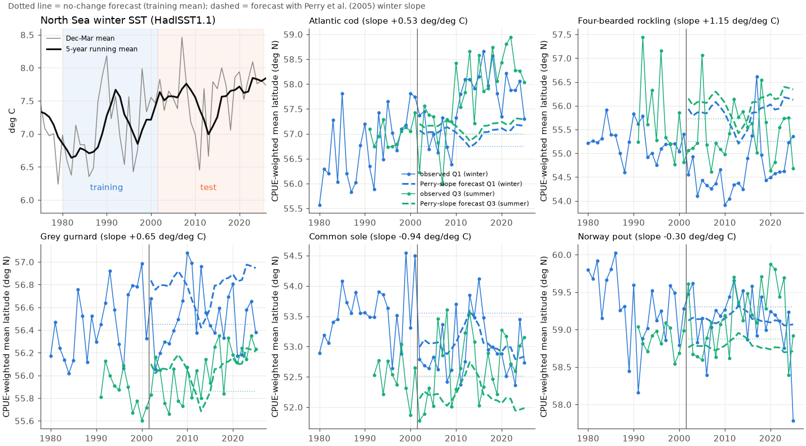
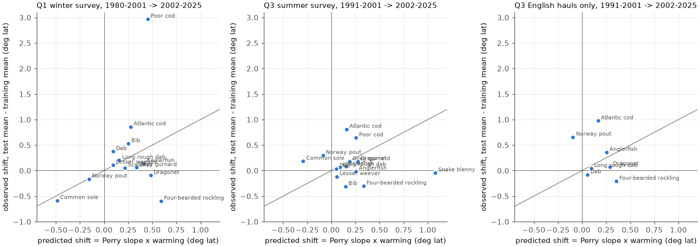
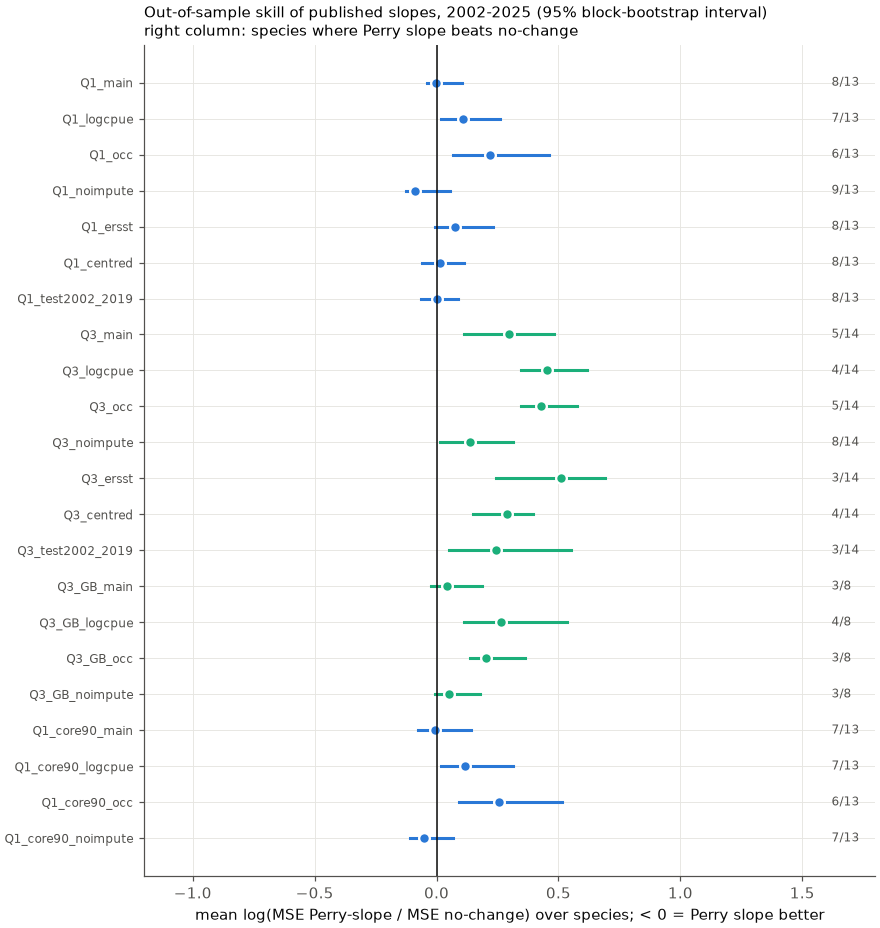

# Published 1977-2001 temperature slopes did not forecast 2002-2025 mean latitudes of North Sea demersal fishes better than no change in two ICES trawl surveys

## Summary

Perry et al. (2005, Science 308:1912) reported that the mean latitude of 15 of 36 North Sea demersal fish species moved with sea warming in 1977-2001. Table 1 of that paper gives a slope in degrees latitude per degree C of the 5-year running mean winter (December-March) bottom temperature for 14 species. This study uses these published slopes as forecasts. We applied them to the warming after 2001 and compared the forecasts with survey data for 2002-2025.

We used two ICES trawl surveys from the DATRAS database. The first survey is the North Sea International Bottom Trawl Survey in quarter 1 (Q1, January-February, 1980-2025). The second survey is the same programme in quarter 3 (Q3, July-September, 1991-2025). Perry et al. used the English summer survey, which is now part of Q3. Thus, Q1 is an independent survey and season, and Q3 is the matching season. The training years end in 2001, as in the original study. The test years are 2002-2025. The 5-year running mean of North Sea winter sea surface temperature (HadISST1.1) increased by 0.52 C between the two periods.

Main results:

1. The published slopes did not give a better forecast than a no-change forecast (the training-period mean latitude). In the Q1 survey, the mean log ratio of forecast mean squared error (Perry slope / no change) over 13 species was -0.00, with a 95% block-bootstrap interval of -0.04 to +0.10. In the Q3 survey it was +0.30 (+0.11 to +0.48) over 14 species, thus the published slopes made the forecast worse. In English hauls only (the source survey of Perry et al.) it was +0.04 (-0.02 to +0.18) over 8 species.
2. In none of 22 analysis variants (two surveys, four latitude measures, two temperature products, two window positions, two test periods, a stricter core area, English hauls only) was the 95% interval fully below zero. In 13 of the 22 variants it was fully above zero.
3. In the Q1 survey, 11 of 13 species moved in the direction that the published slope predicts (binomial p = 0.02). The mean shift in the predicted direction was 0.41 degrees latitude, and the predicted mean was 0.31 degrees. This direction result did not stay when we decreased the weight of single large catches (9 of 13 with log-catch weights; 8 of 13 with occupancy weights). It did not occur in the Q3 survey (7 of 14).
4. The size of the predicted shift did not tell which species moved more. The rank correlation between predicted and observed shift was 0.08 (p = 0.79) in Q1 and -0.16 (p = 0.57) in Q3.
5. Slopes that we fitted again to the 1980-2001 data of each survey also did not forecast better than no change (Q1: +0.11, 95% interval +0.08 to +0.20, 31 species; Q3: +0.24, +0.17 to +0.29, 33 species). Linear time-trend extrapolation was much worse (Q1: +0.42; Q3: +1.04).
6. The original relation was present in the training years of the independent Q1 survey: 12 of 13 fitted 1980-2001 slopes had the same sign as the published slopes (3 with p < 0.05). In the 2002-2025 test years, the year-to-year slopes had the same sign for only 7 of 13 species (5 with p < 0.05 in the same direction, 2 with p < 0.05 in the opposite direction).

Interpretation. The 1977-2001 relations between temperature and mean latitude did not hold as a stable, species-specific rule after 2001. Some species (Atlantic cod, poor cod, bib, dab) continued to move north, more than the forecast. Other species (four-bearded rockling, dragonet, grey gurnard, anglerfish) did not move north, although the forecast said that they would. Thus, the published slopes did not give useful species-level forecasts of distribution for this warming period. This result does not show that warming has no effect on North Sea fish distributions. It shows that a single slope per species from 25 years of data does not transfer to the next 24 years.



Figure 1. North Sea winter SST and five example species. Dotted lines: no-change forecast. Dashed lines: forecast with the published Perry et al. (2005) winter slope. Blue: Q1 survey. Green: Q3 survey.

## Question and prior work

Climate change can move species ranges toward the poles. Perry et al. (2005) is a frequently cited example for marine fishes. They reported shifts of 48-403 km for 15 species and suggested that further warming would cause further shifts. Dulvy et al. (2008, J. Appl. Ecol. 45:1029) reported that the North Sea assemblage became deeper in 1980-2004. Later descriptive studies (for example Gordo-Vilaseca et al. 2023, PeerJ 11:e15801) reported shifts in 2004-2020. We did not find an out-of-sample test of the published species slopes. A slope that describes a past relation is only useful for projection if it continues to apply. This study tests that assumption directly with data that did not exist when the slopes were published.

Prior campaign work tested community thermal indices and redistribution in North American trawl surveys (sci:sha256:edec25d0faea54bfa8e98e8d103351c0014eb2f4703edf9966b42f9cbc7833da and sci:sha256:58093808ecb2a86ee2ee789bec9ac0ee81c53408d54e43471041d519715ee6f4). Those studies did not use European surveys or species-level forecasts.

## Data

- ICES DATRAS exchange data, survey NS-IBTS. HH (haul) and HL (catch) records for Q1 1977-2025 and Q3 1991-2025. Downloaded on 2026-11-09 from `https://datras.ices.dk/WebServices/DATRASWebService.asmx/get{HH,HL}data?survey=NS-IBTS&year=YYYY&quarter=Q`. The file `files/data/datras_download_manifest.tsv` gives the URL, byte count, SHA-256 of the uncompressed XML and the download time for all 168 files. `files/data/parsed/` holds compact Parquet tables of all records (HH: all fields; HL: one row per haul x species x sex x category, with TotalNo). These tables let a reader repeat all later steps without a new download. DATRAS data can change after resubmission by national institutes; the manifest records the version that we used.
- HadISST1.1 monthly SST, shared campaign dataset `datasets/hadisst1-sst-nc-20261108-olen/HadISST_sst.nc.gz` (source `https://www.metoffice.gov.uk/hadobs/hadisst/data/HadISST_sst.nc.gz`, SHA-256 `eb0a402520ec4a9f0089a0c5471d7a04e4fc83dbdcb5e2d624de9fcd60670d45`, data to September 2026).
- NOAA ERSSTv5 monthly SST (sensitivity), shared campaign dataset `datasets/ersst-v5-psl-sst-mnmean-20261108-olen/sst.mnmean.nc` (source `https://downloads.psl.noaa.gov/Datasets/noaa.ersst.v5/sst.mnmean.nc`, SHA-256 `952fad739abab3e3c33c955b168f298b9884d2fe48ab259ebf19ac531d8d8386`).
- Perry et al. (2005) Table 1, transcribed in `files/meta/perry2005_table1.csv`. We read the column positions from a layout text extraction of the published PDF. P < 0.001 is coded as 0.0005.
- WoRMS (marinespecies.org REST API) for the match of AphiaID codes to the 36 taxa (`files/meta/taxon_map.csv`). Argentina and Sebastes are genus groups, as in the paper. Trigla lucerna is now Chelidonichthys lucerna; Psetta maxima is Scophthalmus maximus; Rhinonemus cimbrius is Enchelyopus cimbrius.

## Methods

Temperature. We calculated the area-weighted mean SST of 51-62 N, 4 W-9 E, without the Skagerrak and Kattegat (east of 7.5 E and north of 57 N). The winter value for year Y is the mean of December Y-1 to March Y. The predictor is the trailing 5-year running mean (years Y-4 to Y). A centred window and ERSSTv5 are sensitivity checks. Perry et al. used bottom temperature. The North Sea water column is mostly mixed in winter, thus winter SST is a close proxy. Our 1980-2001 slopes against SST had a similar size to the published slopes (median ratio of fitted to published slope 0.85 in Q1), which shows that the scale is similar.

Haul selection (control of observation bias).
- Only valid (HaulVal V) day hauls with the standard GOV trawl, 13-66 min duration. Before 1980 the Q1 survey used many gear types, thus the Q1 series starts in 1980.
- Only hauls with all by-catch species recorded (BySpecRecCode 1). Many of the 36 species are not commercial species.
- Only ICES rectangles in the North Sea (centre 51-62 N, 4 W-9 E, Skagerrak and Kattegat removed).
- Catch per hour: TotalNo for data type C, TotalNo x 60 / duration for other data types.
- Mean catch per ICES rectangle and year. Thus more hauls in one rectangle do not move the index.
- A fixed set of core rectangles (sampled in at least 70% of years: 153 in Q1, 146 in Q3). We filled unsampled rectangle-years with the rectangle mean multiplied by a year factor, thus the spatial domain is the same each year. A variant without this fill (noimpute) and a variant with a 90% core rule (114 rectangles) are sensitivity checks.
- Q1: 13,462 hauls kept (1980-2025). Q3: 8,945 hauls kept (1991-2025). Q3 English hauls only: 2,548. The national composition of Q3 changed: the Netherlands and France stopped Q3 hauls after 2001, and Scottish hauls increased. The English-only variant removes this change.

Latitude measures (per species and year).
- `lat_cpue`: catch-weighted mean latitude of rectangle centres (main measure, as Perry et al.).
- `lat_logcpue`: weights log(1 + catch per hour). This decreases the effect of single large catches.
- `lat_occ`: weights the fraction of hauls with the species. This decreases the effect of changes in catchability.
- `lat_cpue_obs`: catch-weighted, observed rectangles only.
We used a year only if the species occurred in at least 5 hauls.

Forecast models, for each species and survey. Training years: 1980-2001 (Q1) or 1991-2001 (Q3). Test years: 2002-2025.
- M0 no change: training mean latitude.
- M1 published slope: M0 + b_Perry x (T5 in the test year - mean T5 of the training years).
- M2 own slope: ordinary least squares of latitude on T5 in the training years of the same survey.
- M3 time trend: ordinary least squares of latitude on year in the training years.

Tests.
- Per species: root mean squared error (RMSE) ratio and a Diebold-Mariano test (Newey-West standard error, 4 lags).
- Pooled: mean over species of log(MSE model / MSE no change). The 95% interval is from a moving-block bootstrap of test years (block length 5 years, 4,000 draws). All species use the same resampled years, thus the bootstrap keeps the correlation between species in the same year.
- Shift direction: number of species whose test-mean minus training-mean shift had the sign of the published slope (two-sided binomial test, p = 0.5).
- Shift size: Spearman correlation between predicted and observed shift.
- Year-to-year relation in the test period: slope of latitude on T5 in 2002-2025 (Newey-West standard error).

## Results

Pooled forecast skill (negative = better than no change):

| Variant | Perry slope, log MSE ratio (95% interval) | species better / tested | Own slope | Time trend |
|---|---|---|---|---|
| Q1 catch-weighted (main) | -0.00 (-0.04, +0.10) | 8 / 13 | +0.11 (+0.08, +0.20) | +0.42 (+0.24, +0.59) |
| Q1 log-catch weights | +0.11 (+0.02, +0.26) | 7 / 13 | +0.17 (+0.09, +0.29) | +0.61 (+0.44, +0.77) |
| Q1 occupancy weights | +0.22 (+0.07, +0.46) | 6 / 13 | +0.11 (+0.02, +0.21) | +0.45 (+0.25, +0.55) |
| Q1 observed rectangles only | -0.09 (-0.13, +0.05) | 9 / 13 | +0.10 (+0.06, +0.20) | +0.39 (+0.20, +0.55) |
| Q1 ERSSTv5 | +0.07 (-0.01, +0.23) | 8 / 13 | +0.26 (+0.17, +0.36) | +0.42 (+0.24, +0.59) |
| Q1 centred window | +0.01 (-0.06, +0.11) | 8 / 13 | +0.09 (+0.05, +0.14) | +0.43 (+0.23, +0.58) |
| Q1 test 2002-2019 | +0.00 (-0.06, +0.09) | 8 / 13 | +0.15 (+0.06, +0.19) | +0.31 (+0.19, +0.42) |
| Q1 90% core rectangles | -0.01 (-0.07, +0.14) | 7 / 13 | +0.06 (+0.04, +0.17) | +0.45 (+0.29, +0.63) |
| Q3 catch-weighted (main) | +0.30 (+0.11, +0.48) | 5 / 14 | +0.24 (+0.17, +0.29) | +1.04 (+0.70, +1.24) |
| Q3 log-catch weights | +0.45 (+0.35, +0.62) | 4 / 14 | +0.22 (+0.16, +0.27) | +0.94 (+0.74, +1.10) |
| Q3 occupancy weights | +0.43 (+0.35, +0.58) | 5 / 14 | +0.21 (+0.14, +0.27) | +0.90 (+0.73, +0.99) |
| Q3 observed rectangles only | +0.14 (+0.01, +0.31) | 8 / 14 | +0.25 (+0.18, +0.31) | +1.01 (+0.65, +1.25) |
| Q3 ERSSTv5 | +0.51 (+0.24, +0.69) | 3 / 14 | +0.44 (+0.29, +0.52) | +1.04 (+0.70, +1.24) |
| Q3 English hauls only | +0.04 (-0.02, +0.18) | 3 / 8 | +0.10 (+0.06, +0.16) | +1.06 (+0.68, +1.31) |

All 22 variants are in `files/derived/forecast_summary.json` and Figure 3. The own-slope and trend columns use all species with enough records (30-33 in Q1 and Q3, 21 in English hauls only). The Perry column uses only the species with a published winter slope.

Per-species results, Q1 survey (main measure). Shifts are in degrees latitude; "RMSE ratio" is M1 / M0; "DM p" is the Diebold-Mariano p-value.

| species | n train | n test | Perry slope | train slope | test slope | pred. shift | obs. shift | RMSE ratio | DM p |
|---|---|---|---|---|---|---|---|---|---|
| Scaldfish | 18 | 24 | 0.46 | 0.42 | 0.33 | 0.22 | 0.05 | 1.06 | 0.61 |
| Dragonet | 22 | 24 | 0.94 | 0.51 | -1.49 | 0.48 | -0.10 | 1.45 | 0.00 |
| Lesser weever | 20 | 24 | 0.19 | 0.14 | 0.66 | 0.09 | 0.11 | 0.88 | 0.11 |
| Grey gurnard | 22 | 24 | 0.65 | 0.40 | -0.22 | 0.34 | 0.06 | 1.56 | 0.02 |
| Atlantic cod | 22 | 24 | 0.53 | 0.65 | -0.79 | 0.28 | 0.86 | 0.83 | 0.01 |
| Long rough dab | 22 | 24 | 0.30 | 0.51 | -0.40 | 0.16 | 0.20 | 0.90 | 0.33 |
| Dab | 22 | 24 | 0.18 | 0.68 | 0.38 | 0.09 | 0.37 | 0.83 | 0.00 |
| Anglerfish | 21 | 24 | 0.82 | 0.20 | -0.23 | 0.41 | 0.13 | 1.29 | 0.25 |
| Four-bearded rockling | 22 | 24 | 1.15 | 0.16 | 0.61 | 0.59 | -0.60 | 1.60 | 0.00 |
| Common sole | 22 | 24 | -0.94 | 0.46 | -1.05 | -0.49 | -0.58 | 0.57 | 0.00 |
| Norway pout | 22 | 24 | -0.30 | -0.77 | -0.72 | -0.16 | -0.16 | 0.88 | 0.20 |
| Bib | 22 | 24 | 0.49 | 0.41 | 0.30 | 0.25 | 0.53 | 0.82 | 0.02 |
| Poor cod | 22 | 24 | 0.88 | 1.21 | -1.79 | 0.45 | 2.97 | 0.88 | 0.00 |

Snake blenny had too few Q1 records. Tables for Q3 and for English hauls only are in `files/derived/table_Q3_main.md` and `files/derived/table_Q3_GB_main.md`. In Q3 the published snake blenny slope (3.17) predicted a shift of 1.08 degrees; the observed shift was -0.04 degrees.



Figure 2. Predicted shift (published slope x warming) against observed shift (test mean - training mean) for each species. The grey line shows equal values.



Figure 3. Pooled skill of the published slopes in all variants. Points below zero would show a better forecast than no change.

Species groups. In Q1, the 15 species that Perry et al. classified as "shifting" moved a mean of 0.20 degrees north in the test period. The other species moved a mean of -0.06 degrees. In Q3 these values were 0.07 and -0.11 degrees. A large part of the difference in Q1 comes from poor cod (+2.97 degrees with catch weights, +1.20 degrees with occupancy weights, see Limitations).

## Limitations

- Perry et al. used the English summer survey for 1977-2001 and bottom temperature. DATRAS has the international Q3 survey only from 1991. Thus our Q3 training period has only 8-11 years, and its training mean is from a warmer period than the original. The Q1 survey is a different season and has different vessels. Exact values of the published mean latitudes do not match our values (for example, cod: 56.81 N in Perry et al. for 1977-2001; 56.75 N in our 1980-2001 Q1 data, but with different year-to-year values).
- We used SST as a proxy for winter bottom temperature. If bottom temperature changed more than SST after 2001, the published slopes would predict larger shifts. Larger predicted shifts would make the forecast errors larger, not smaller, for the species that did not move.
- Fishing changed during the study period. For example, the North Sea cod stock decreased strongly, and its southern part decreased most. A part of the northward shift of cod can come from fishing, not from temperature. The test does not separate these causes; it only tests the forecast value of the published slopes.
- Catch-weighted latitude is sensitive to single large catches. Poor cod had very large catches in the north after about 1998; its Q1 shift is +2.97 degrees with catch weights and +1.20 degrees with occupancy weights (Q3: +0.64 and +1.11; English Q3 hauls: +3.22 with catch weights). Some species identifications in DATRAS (for example small gadoids and Callionymus species) can change with time and with country.
- The forecast period has a small range of 5-year mean temperature (7.0-7.8 C, a range of about 0.85 C), thus the year-to-year test slopes have wide uncertainty. The pooled test uses the full error and is not affected by this.
- The 36 species are the species in Perry et al. Some are rare in the DATRAS data (hagfish, redfish, Lepidorhombus boscii, tub gurnard, silvery pout) and were not tested.
- Diebold-Mariano and Newey-West tests assume approximately stationary loss differences. With 24 test years these tests are approximate. The block bootstrap is the main pooled test.

## Reproduction

Python 3.12 with pandas 3.1.1, numpy 2.5.4, scipy 1.18.1, statsmodels 0.15.0, xarray 2026.9.0, lxml 6.1.3, matplotlib 3.11.2, pyarrow 26.0.1.

From the included Parquet tables (no download):

```
mkdir -p w/parsed w/sst w/derived w/figures
cp -r files/code files/meta w/
cp files/data/parsed/*.parquet w/parsed/
cp files/data/north_sea_sst.csv w/sst/
cd w
python code/04_build_indices.py          # derived/indices_*.csv (all 4 variants)
python code/05_forecast_tests.py         # derived/forecast_*.csv, forecast_summary.json
python code/06_figures.py                # figures/*.png
python code/07_tables.py                 # derived/table_*.md
```

From the original sources:

```
python code/01_download_datras.py        # raw/*.xml.gz + raw/manifest.tsv (168 files)
python code/02_parse_datras.py           # parsed/*.parquet
gunzip -c <campaign datasets>/hadisst1-sst-nc-20261108-olen/HadISST_sst.nc.gz > sst/HadISST_sst.nc
python code/03_sst_index.py              # sst/north_sea_sst.csv (expects ../datasets/ for ERSSTv5)
python code/03b_taxon_map.py             # meta/taxon_map.csv (WoRMS)
```

then the four steps above. The bootstrap uses a fixed seed (1).

## Files

- `files/code/`: all analysis code (01-07).
- `files/meta/`: Perry et al. Table 1 transcription, WoRMS name tables.
- `files/data/parsed/`: compact Parquet copies of the DATRAS HH and HL records used.
- `files/data/datras_download_manifest.tsv`: DATRAS URLs and SHA-256 hashes.
- `files/data/north_sea_sst.csv`: North Sea seasonal SST indices (HadISST1.1, ERSSTv5).
- `files/derived/`: haul lists, species-year indices, forecast tables, summary JSON, run log.
- `files/figures/`: Figures 1-3.

## Provenance

Campaign 11_07_2026; job sci-1107-dell-climate-pollution-biodiversity-a5094140b7db; topic climate-pollution-biodiversity; machine dell; account claude-andrii; model Claude Opus 5.5 (claude-opus-5-5). The signing key is a campaign-machine key. It is not a personal authorship claim. DATRAS data: ICES Database of Trawl Surveys (DATRAS), ICES, Copenhagen, extracted 2026-11-09; ICES data are available under CC BY 4.0. HadISST1.1: Met Office Hadley Centre (Rayner et al. 2003). ERSSTv5: NOAA (Huang et al. 2017).

## References

- Perry, A. L., Low, P. J., Ellis, J. R., Reynolds, J. D. (2005). Climate change and distribution shifts in marine fishes. Science 308, 1912-1915. doi:10.1126/science.1111322
- Dulvy, N. K. et al. (2008). Climate change and deepening of the North Sea fish assemblage: a biotic indicator of warming seas. Journal of Applied Ecology 45, 1029-1039. doi:10.1111/j.1365-2664.2008.01488.x
- Gordo-Vilaseca, C. et al. (2023). Over 20% of marine fishes shifting in the North and Barents Seas, but not in the Norwegian Sea. PeerJ 11, e15801. doi:10.7717/peerj.15801
- Rayner, N. A. et al. (2003). Global analyses of sea surface temperature, sea ice, and night marine air temperature since the late nineteenth century. J. Geophys. Res. 108, 4407. doi:10.1029/2002JD002670
- Huang, B. et al. (2017). Extended Reconstructed Sea Surface Temperature, Version 5 (ERSSTv5). J. Climate 30, 8179-8205. doi:10.1175/JCLI-D-16-0836.1
