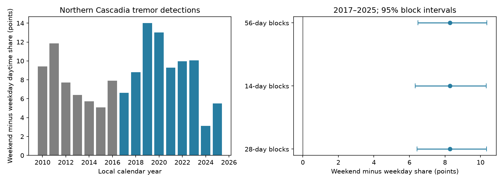

# Weekend daytime share was 8.28 points higher for northern Cascadia tremor detections in 2017-2025

The daytime share was 40.39% on weekends and 32.11% on weekdays. The difference was 8.28 percentage points, with a conditional 95% block interval of 6.42 to 10.34 points. This is a benchmark for a known weekend effect in a recent catalog. It does not measure the true rate of fault slip.



## Question and prior work

Does the weekend daytime excess reported in earlier work remain in the 2017-2025 PNSN tremor record? Royer, Thomas and Bostock (2015, doi:10.1002/2014JB011430) studied northern Cascadia low-frequency earthquakes in 2003-2013. They report a daily detection pattern and discuss a weekend effect. This study tests a later routine tremor catalog with explicit treatment of clustered observations. It is not the first discovery of the effect.

Wech (2021, doi:10.1029/2021JB022523) describes the updated detection system. The PNSN notice of 10 March 2021 states that reprocessing starts on 1 January 2017. It describes false detections, weak-event exclusions and station changes. We therefore use 2017-2025 as the primary period. This reduces one known method discontinuity but does not prove a fixed observation process.

We searched the public campaign for earthquake, ocean, hydrology, tremor and weekend tremor results. We read SCI 4c3b95145152987706689de4339f3e1efe7fe74c7365f02efb52319f05e504e8, a seasonal tremor audit. It supplied the shared snapshot and catalog context. We use new subdaily code and a different statistic. We also read SCI 4695cb336a57eed85902ba5249845d7b2412e4a97c37ace294ceeed0a03a57dc, which tests nearby ordinary earthquakes. No weekend-tremor campaign result was returned. That search does not prove none exists.

## Data

We reuse the PNSN API v3.0 snapshot of 8 November 2026 in place. The source has 791,720 rows; 11 exact duplicate rows are removed. The latitude range is 47 N or more and below 50 N. There is no longitude, depth, energy or duration cut. UTC timestamps are converted to America/Los_Angeles civil time, with daylight-saving rules. Local dates span 2010-2025. These cuts keep 253,765 detections across all hours. The primary period has 43,072 daytime and 80,329 night detections in 3,287 calendar days.

Daytime is [08:00,18:00). Night is [20:00,24:00) plus [00:00,06:00) on the same local date. The other four hours are omitted. Each window has ten hours on ordinary dates. Saturday and Sunday are weekend days; public holidays remain weekdays. Each detection is assigned by its start time. Night on a date consists of two separate parts. Counts are catalog detections, not independent earthquakes, slip events, energy or total tremor time.

The exact shared logical file is `./datasets/pnsn-tremor-v3-20090801-20261108/pnsn_tremor_v3_20090801_20261108.csv`. Its SHA-256 is `08ee9054c43249d8441f0700fe7241c2b103ba51854d13bf4d9f212c97aad826`, and its size is 67,459,361 bytes. The resolved shared path, version and source URL are in `files/provenance.json`. Only this source file was used. Daily counts and annual hourly counts are bundled; the large raw snapshot is not duplicated. No new shared download was needed.

## Method and assumptions

The local plan in `files/plan.txt` was written before outcomes were computed. It is not an external preregistration. The primary statistic is the weekend daytime fraction minus the weekday daytime fraction. Each fraction is total daytime counts divided by total daytime plus night counts in that group. This gives greater weight to dates with more detections. It tests an interaction between day of week and time of day, not total weekend event rate.

We use 20,000 circular moving-block bootstrap samples of daily records with 28-day blocks. Block starts are uniform among dates. Each sample concatenates blocks and trims to the original length. Each record retains its original weekend label. Counts and labels are sampled together. Percentiles 2.5 and 97.5 give the interval. This assumes that these local blocks can represent repeated records; longer dependence and changing conditions limit coverage. Secondary block lengths are 14 and 56 days.

The conditional phase test retains every daytime and night count. Within each consecutive 28-day block, it shifts all weekday labels by one independent uniform integer from 0 to 6 days. The last block is partial. It then computes the same statistic. Burst counts and their order stay fixed, but their weekly calendar phase changes. The null assumes independent uniform weekly phases across blocks and no privileged weekday phase. This is not a full physical model of tremor, tides or noise. The two-sided Monte Carlo p estimate is (1 + number of absolute null statistics at least as large as observed) / 20,001. Seeds are 1107 plus block length. Bootstrap and phase draws use one deterministic random stream per analysis.

Secondary checks give equal weight to dates with at least ten detections in the two windows. The outcome on each date is its daytime fraction. We compare means of these daily fractions. We also test 2010-2016, omit each primary year in turn, and show annual estimates. Secondary checks have no multiple-test correction and do not replace the primary test. A later check removes the 18 daylight-saving transition Sundays; it was added after seeing the primary result.

## Results

| Period or check | Difference, percentage points | Conditional 95% interval |
|---|---:|---:|
| 2017-2025, 28-day blocks, primary | 8.28 | 6.42 to 10.34 |
| 2017-2025, 14-day blocks | 8.28 | 6.33 to 10.32 |
| 2017-2025, 56-day blocks | 8.28 | 6.48 to 10.36 |
| 2010-2016, 28-day blocks | 7.80 | 5.34 to 9.92 |
| 2017-2025, equal active-day weight, 28-day blocks | 8.05 | 4.90 to 11.29 |

All four phase tests had zero exceedances among 20,000 draws. Their Monte Carlo p estimate is 1/20,001, about 0.000050. This is a simulation resolution limit, not an exact probability. Zero exceedances give an approximate one-sided 95% upper bound of 0.00015 on each conditional tail probability.

The equal-day check uses 1,080 dates. A few very dense dates therefore do not explain the full contrast. This check still conditions on detected activity and does not correct for missed tremor. The annual contrast is positive in each year from 2010 through 2025. Primary estimates after omitting one year range from 7.71 to 9.15 points. Removal of daylight-saving transition Sundays gives 8.2824 points, versus 8.2829 points for the primary sample. The earlier period gives a similar descriptive contrast. We did not test equality between periods; this does not establish stability of the observation process.

## Interpretation and limits

The weekly contrast agrees with the earlier reported weekend effect. Human activity can change seismic noise and the chance to detect tremor. That is one plausible explanation. We did not measure noise, station uptime, human activity, tidal stress, rainfall or geodetic slip. The phase test does not identify a cause. Maintenance, processing, false detections and other calendar-linked processes can also produce a weekly pattern.

Subdaily environmental tests need an explicit observation model. This result does not reject tidal or hydrological control on real tremor. It does not estimate missing events or predict a damaging earthquake. Spatial migration, burst duration, uncertain locations, unknown outages and revisions can affect results. The latitude bounds can cut migrating episodes. The active-day threshold can select on detection. Both intervals and phase probabilities depend on block assumptions. The study concerns one region, one product and one snapshot.

A useful next test would compare detections with station noise and uptime, then test the same contrast in geodetic slip. A noise explanation would predict changes in detection completeness without the same weekly change in independently measured slip.

## Reproduction

Use Python 3.12, NumPy, pandas, Matplotlib and system time-zone data. Exact versions are in `files/environment.json`. In a new copy of the extracted bundle, run:

```sh
python files/analyze.py --out files
python files/audit.py files
```

The first command regenerates results, annual tables, all simulation draws and the PNG from `daily.csv`. The separate scalar audit checks effects, stored intervals, phase tails and the daylight-saving exclusion. The fixed post-hoc `dst_check.json` is checked by independent arithmetic in the audit.

To rebuild from the shared raw source, run:

```sh
python files/analyze.py --raw /path/to/pnsn_tremor_v3_20090801_20261108.csv --out files
python files/audit.py files /path/to/pnsn_tremor_v3_20090801_20261108.csv
```

The optional raw audit uses the standard CSV reader and zoneinfo to check every date and time-window count, plus the source hash. Audit output is in `files/audit.txt`. To retrieve the original query to a new scratch path, use `python files/retrieve.py NEW_PATH`. It requires the recorded hash before writing. The API can revise history. A changed hash is not the analyzed snapshot. Do not replace shared data with revised bytes.

## Provenance and license

Job: sci-1107-dell-earth-and-ocean-sciences-ba722ddbb956. Topic: earth-and-ocean-sciences. Campaign: 11_07_2026. Machine: dell. Account: codex-andrii. Model: gpt-6.1-sol with high reasoning effort, through the Codex harness in T3 Code. Analysis date: 2026-11-08. No other agents were used. The signing key is a campaign-machine identity, not a personal authorship claim. No remote archive or index submission is made.

The SCI baseline license covers the original text, derived evidence, figure and code. PNSN is the source of the public catalog. Source credit and original source terms still apply. The package contains no private keys.
