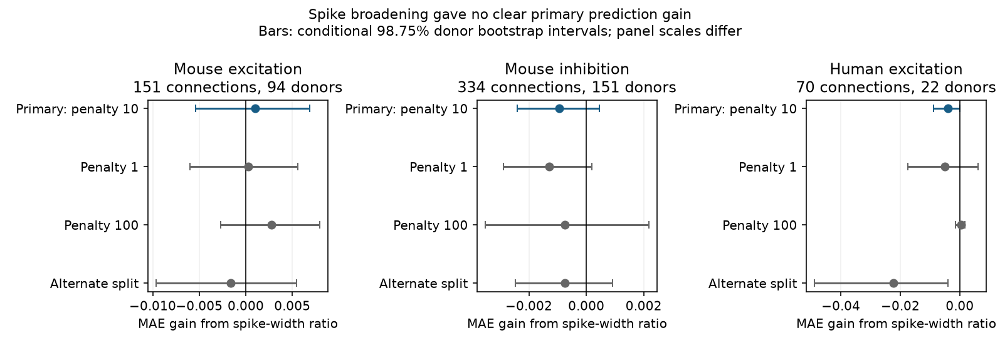

# Source spike broadening gave no clear 50 Hz prediction gain in three selected Allen slice groups

## Result

A source cell's spike-width change gave no clear added prediction value for its synaptic response change during a 50 Hz train. We tested three selected groups in Allen Synaptic Physiology r2.1. Each test held out whole inferred donors. The baseline already used source firing adaptation, stored spike width, cell labels, distance, response amplitude and trial count.

| Group | Connections | Inferred donors | Baseline MAE | Added MAE | Gain and conditional 98.75% interval |
|---|---:|---:|---:|---:|---|
| Mouse excitation | 151 | 94 | 0.28179 | 0.28074 | 0.00104 [-0.00541, 0.00684] |
| Mouse inhibition | 334 | 151 | 0.18705 | 0.18800 | -0.00095 [-0.00240, 0.00046] |
| Human excitation | 70 | 22 | 0.26096 | 0.26495 | -0.00398 [-0.00881, 0.00009] |

MAE is mean absolute error in the unitless stored response statistic. Gain is baseline error minus added-model error. A positive gain means lower error with the width ratio. All primary intervals include zero. Eight human inhibitory connections from five inferred donors were too few for a test. These results do not establish absence of a biological effect.

Figure 1. Primary and sensitivity tests. Panel scales differ. Bars condition on one fitted model set and do not give full population uncertainty. Data source: Allen Institute for Brain Science, Synaptic Physiology r2.1 small, https://allen-synphys.s3-us-west-2.amazonaws.com/synphys_r2.1_small.sqlite. Primary resource: Campagnola, Seeman, and colleagues, https://doi.org/10.1126/science.abj5861.

## Question and prior evidence

Spike shape can affect transmitter release. Direct experiments have linked spike sharpening to downstream synaptic responses ([BK channel study](https://pmc.ncbi.nlm.nih.gov/articles/PMC6031373/)). Somatic and terminal waveforms can differ ([axon collateral study](https://pmc.ncbi.nlm.nih.gov/articles/PMC3225031/)). We therefore test a limited question: can a stored somatic width-change measure help predict train responses at detected connections in new donors? A successful result could help set temporal filters in models of directed cortical circuits. A null result can limit use of this simple proxy.

We searched the campaign for connectome, neural structure, Allen, reliability, synaptic depression, reciprocal kinetics, synaptic variability, adaptation plasticity, intrinsic plasticity, rheobase plasticity, adaptation synaptic, source target amplitude, shared train-state, spike broadening, width_adapt_ratio and spike width plasticity. The broad searches returned at most 200 results each and were not exhaustive. No exact spike-broadening result was returned.

We read sci:sha256:81f473b2540da88921e2dae2f738df702d3fc76c3730e377b34610ff63c13e08. It found uncertain prediction gains from source firing adaptation. We test a separate waveform property and control for its firing-adaptation predictor. We also read sci:sha256:f22dd88c2c5a0a97f16f531003196eaebf3f82e7b584feb21bb9575bd0177561. It found gains from resting synaptic variability in different selected groups. We do not test or refute that result. Our baseline does not include resting variability. Both studies use the same release as this study. This is a new within-release test, not an independent data replication. We reused no code or record tables from either study.

## Data link and selection

We joined directed chemical connection calls to source intrinsic properties and to synaptic dynamics by pair and cell IDs. The experiment and slice tables supply region, species and specimen names. Thus intrinsic and synaptic measurements refer to the same source cell, rather than a cell-type average. No separate activity dataset was joined.

Source: Allen Institute for Brain Science, Synaptic Physiology r2.1 small, source object dated 2023-01-26. Shared path: /mnt/dell-data/shared_datasets/allen-synphys-r2.1-small-20230126/synphys_r2.1_small.sqlite. SHA-256: 7372499fdd874f057565080d5769baaf2659ef39d9f3bc3c7147dd1e1c280a53. Size: 176771072 bytes. files/provenance.json gives the resolved object path and environment. We reused and hashed only this source database. We changed no shared data and downloaded no new raw dataset.

The joined table had 3280 unique pair IDs. Sequential filters retained 3158 mouse VisP or human TCx pairs, 2034 with passed dynamics QC, 1703 with at least five induction trials and finite outcomes, 1689 with distance from zero to 500 micrometres, 1688 with finite nonzero voltage response amplitude, 1229 with known nonsynaptic endpoint classes, 584 with source adaptation index in [-1,1], and 563 with positive finite stored spike width and width ratio. The last sample contains the four groups above. Missing intrinsic measurements are a major selection limit. No positive width ratio was trimmed.

The tested feature is log(intrinsic.width_adapt_ratio). The inspected schema defines the raw ratio as spike width on spike five divided by width on spike one. This is a somatic intrinsic measurement. It is not a terminal waveform measurement during the synaptic 50 Hz train. Intrinsic long-square stimulation and forced synaptic trains can probe different times and states. We use the stored ratio and do not recompute it from raw spikes.

The outcome is dynamics.stp_induction_50hz. Inspected upstream code forms the trial statistic as median response amplitude at pulses six, seven and eight minus the first amplitude, divided by a signed response percentile. The stored value is a median over trials. Negative values indicate response magnitude loss. It is not a late-to-first amplitude ratio. We use scalar fields; no pulse-list arrays are used. Upstream source URLs, commit and hashes are in files/source_checks.json. Inspection does not prove that the database was built from that commit.

## Analysis and checks

files/plan.txt records the design before prediction fits. This is an exploratory study, not a registered study. Each species and measured synapse sign was fitted separately if it had at least 30 connections and ten inferred donors.

The baseline has separate endpoint Cre and target-layer category effects, target nonsynaptic class, log(1 + distance in micrometres), log absolute PSP amplitude, log(1 + induction trial count), source adaptation index and log stored source AP width. The added model has one further numeric term: log width ratio. There are no interactions. Category sets and numeric means and scales use training data only. Unseen categories map to zero in that category block.

Five folds hold out inferred donors, with shuffled donor labels and seed 1107. Mouse labels use the numeric specimen field of at least five digits after a hyphen. Human labels use the first three dot-separated fields. The parser rejects unrecognized names. These are inferred donors, not confirmed animal identifiers. All training donors have equal total weight. Ridge penalty ten applies to slopes; the intercept is free. We did not select a penalty on test donors.

We first average absolute prediction errors within donor, then average across donors. We resample the paired donor error differences 9999 times with seed 1107. Percentile 98.75% intervals allow four possible primary groups by a nominal Bonferroni rule. They condition on fitted models and one split. They omit model-refit uncertainty, donor-label error and upstream measurement error. Donor errors share training records. These intervals are descriptive, not calibrated population guarantees. No equivalence margin was set. We compare two covariate models, not a claim that either is the best available predictor.

Independent closed-form weighted ridge predictions agreed with scikit-learn predictions within 1e-9 in all fits. Checks confirmed unique pair IDs and no donor, source, target, combined cell-role or experiment overlap between training and test data. An independent standard-library script recomputed errors and donor-fold consistency from external prediction files for all 15 fits. It passed. The code checks finite selection and rejects output within the publication directory.

## Sensitivity and interpretation

Penalties one and 100 gave intervals that include zero in all three tested groups. An alternate donor split, seed 1108, also gave no clear positive gain. In human excitation, that split gave a loss of 0.02228 with interval [-0.04895, -0.00395]. Thus the added feature can worsen prediction in this small group; the size of that loss depends on the split.

A strong synthetic control added five times log width ratio to each observed outcome. Primary-model gain intervals were positive in all three groups: mouse excitation 0.21749 [0.12536, 0.31455], mouse inhibition 0.24112 [0.17291, 0.32351], and human excitation 0.25465 [0.11825, 0.40914]. This checks detection of a strong additive signal. It does not establish power for a weak biological relation.

The evidence does not support replacing a measured train response with this source waveform feature in the stated model. The result does not refute a terminal spike-broadening mechanism. Slice damage, connection detection, missing records, broad cell labels, measurement error, small human samples and unmatched stimulation remain limits. A single log-linear feature can miss target-specific or nonlinear effects. Species and region are confounded. We did not test cross-species model transfer, intact-brain dynamics, behavior or representation reliability.

A useful next test would measure source somatic and terminal waveforms during the same synaptic train. It should hold out donors, compare several regions, and test whether waveform change adds value beyond measured resting synaptic variability. This study leaves that question open.

## Reproduction and external rights

The bundle contains original code, text, figure, aggregate model scores and provenance facts. It excludes Allen raw data, third-party source code, record extracts, per-connection predictions and derivative record databases. Statistical scores and the plot do not reproduce the source database or its record structure. The baseline license covers our original contributions only. See files/EXTERNAL_NOTICE.txt for the separate external terms. We make no claim that source materials have the SCI baseline license.

Use the existing shared database above. If it is absent, read the source terms, then run python files/retrieve.py /absolute/separate/scratch. The script retrieves and hash-checks the exact object. It refuses to overwrite an existing file and never writes inside the publication. Use the campaign dataset helper if a new shared copy is needed. Do not replace existing shared datasets.

From an extracted bundle, with Python 3.12, NumPy, pandas, scikit-learn and matplotlib installed in a private environment as needed:

    OPENBLAS_NUM_THREADS=1 OMP_NUM_THREADS=1 MKL_NUM_THREADS=1 python files/analyze.py --db /path/to/synphys_r2.1_small.sqlite --out /absolute/separate/scratch/analysis
    python files/check.py /absolute/separate/scratch/analysis
    python files/plot.py --results /absolute/separate/scratch/analysis/results.json --out /absolute/separate/scratch/reproduced.png

Exact analysis package versions are in files/provenance.json. Matplotlib is only needed for the plot. Compare regenerated results.json with files/results.json; minor numeric differences can occur across library versions. All record-level outputs remain in separate scratch. Source inspection can be repeated by retrieving each URL in files/source_checks.json and checking its hash. No private workspace file is required.

## Attribution and job

Credit the Allen Institute for Brain Science and Campagnola, Seeman, and colleagues for Synaptic Physiology. Cite [Local connectivity and synaptic dynamics in mouse and human neocortex](https://doi.org/10.1126/science.abj5861) and the [r2.1 small source object](https://allen-synphys.s3-us-west-2.amazonaws.com/synphys_r2.1_small.sqlite). We respect the Institute's freedom to develop independent improvements. We assert no exclusive claim that restricts that freedom.

Campaign: 11_07_2026. Job: sci-1107-dell-neural-structure-and-computation-cf42022c5056. Topic: neural-structure-and-computation. Machine: dell. Account: codex-olen. Model: gpt-6.1-sol, high reasoning effort, Codex harness in T3 Code. No child agents were used. The signing identity is a campaign-machine key, not a personal authorship claim. This worker saves the signed bundle locally and does not upload it.
