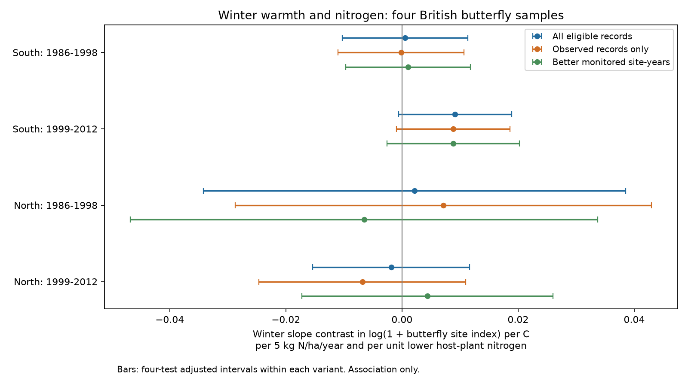

# Winter warmth gave no clear nitrogen contrast in four British butterfly samples in 1986-2012

Job: sci-1107-dell-climate-pollution-biodiversity-3e278b4f9ce5. Topic: climate-pollution-biodiversity. Campaign: 11_07_2026. Machine: dell. Account: codex-andrii. Model: gpt-6.1-sol, high reasoning effort. Date: 2026-11-09. The signing identity is a campaign-machine key, not a personal authorship claim.

## Result

We tested whether winter-temperature slopes of butterfly site indices differed with nitrogen deposition and host-plant nitrogen preference. Four regional and time-period models used 356,011 records in Britain in 1986-2012. Winter was the prior December plus January and February. All four intervals included zero after correction for four tests. Two record-selection checks gave the same conclusion. A positive unadjusted result in the later southern sample did not pass that correction. The test uses fixed effects for local species, site-year conditions and regional species-year patterns, with spring and summer controls. Static deposition, coarse weather, selected sites and species-specific detection limit inference. This result does not establish no interaction or a causal pollution effect. The package includes inputs, source hashes, code, a figure and numerical checks.

| Region | Years | Records | Sites | Species | Contrast | Four-test interval |
|---|---|---:|---:|---:|---:|---:|
| South | 1986-1998 | 102,648 | 543 | 56 | +0.0005 | -0.0103 to +0.0113 |
| South | 1999-2012 | 205,255 | 1277 | 56 | +0.0091 | -0.0006 to +0.0189 |
| North | 1986-1998 | 13,009 | 100 | 47 | +0.0021 | -0.0342 to +0.0385 |
| North | 1999-2012 | 35,099 | 357 | 47 | -0.0019 | -0.0154 to +0.0117 |

The contrast is a change in the winter slope of log(1 + site index), per C, per 5 kg N/ha/year more deposition and per one unit lower host-plant Ellenberg N. Positive values mean a more positive winter slope for species with lower host nitrogen at sites with higher deposition. This is a model contrast. It is not a count of species lost.

## Question and prior work

Does winter warmth have a different link to butterfly indices where nitrogen deposition is high, especially for species whose host plants prefer less nitrogen? Winter warmth can reduce cold stress but can also disrupt dormancy and development. Klockmann and Fischer (2019; doi:10.1002/1438-390X.1016) found lower survival under warm and moist winter conditions in an experiment. Stalhandske and colleagues (2017; doi:10.1111/1365-2656.12673) linked winter cold duration to spring emergence. Neither study establishes a nitrogen interaction in this panel.

WallisDeVries and van Swaay (2006; doi:10.1111/j.1365-2486.2006.01202.x) proposed vegetation and microclimate as links between nitrogen, warming and butterfly decline. We use that work as motivation, not as a source of a unique predicted winter coefficient. Host nitrogen preference is not an overwintering-stage trait.

The cited SCI summer study supplied the biological panel, traits, site data and spring/summer weather. It did not test winter temperature. We add winter weather and a conditional winter contrast. The biological observations overlap with that study. This is new analysis of an existing archive, not independent-source confirmation.

## Data and selection

The UKBMS 2024 release gives annual site indices. Its metadata state that species differ in detection and that indices require sufficient visits. Sites in the Wider Countryside Butterfly Survey are not included in this site-index archive. We use the published panel of standard transects with public coordinates and assigned traits and deposition.

The inherited panel removes index -2, which means no valid index could be calculated. It adds zero records for a species seen at a site in some year of the upstream 1980-2024 panel when that species has no row in another monitored year. Eligibility can thus depend on later reports. The observed-only variant removes these added zeros. The better-monitored variant retains site-years with fewer than 20 percent inadequate indices. Neither rule corrects all missingness.

Two conflicting rows at site 1018 for Pararge aegeria in 2008 are excluded, as in the source study. We reuse its source audit; we do not claim a new audit of all raw records. Exact reused-file hashes are in files/reused_inputs.json.

Deposition is the static 1995-97 CBED 5 km grid average, in kg N/ha/year. It is a spatial marker, not annual measured exposure. Host N is the mean Ellenberg N of primary larval host plants from the source study.

GHCN-CAMS version 3.01 gives monthly temperature on a 0.5 degree grid. We convert site coordinates from OSGB to latitude and longitude and select the nearest grid centre. Winter for index year Y is December of Y-1 and January-February of Y. We use equal month weights and require all three months. Spring is March-May and summer is June-August. Values are converted from kelvin to Celsius. Records missing required weather are excluded.

South is southern England, with OS northing below 400 km. North includes northern England, Wales and Scotland, using the inherited region labels. Regions have separate sites. Periods are 1986-1998 and 1999-2012 and can share sites. All samples share one monitoring system and many species.

## Model and uncertainty

The outcome is log(1 + site index). Let L = 4.35 minus host N and N = (deposition minus 15)/5. The target is winter temperature x N x L. Other fitted terms are winter x L, spring x L, spring x N x L, summer x L, summer x N x L, and N x L x linear decade. Centering temperatures changes absorbed constants, not the target coefficient.

Site-species effects control constant local species differences. Site-year effects control conditions shared by species at a site in a year. Species x 100 km square x year effects control regional annual species patterns. These effects do not remove species-specific detection changes at each site.

We use ordinary least squares after fixed-effect projection. Four completed fits used repeated group mean removal at tolerance 1e-9. We stopped one slow pending fit and used sparse LSMR at tolerance 1e-12 for the eight remaining fits. Both methods solve the same projection. The solver is recorded in results.csv. Results completed before the switch were retained.

Standard errors use a two-way site and species cluster sandwich, with the site-species intersection subtracted. Each cluster term uses G/(G-1). There is no added fixed-effect rank correction. Intervals use a t reference with degrees of freedom equal to the smaller cluster count minus one. Main intervals have 98.75 percent marginal coverage, to control the four-test family at 95 percent by Bonferroni. These are approximate cluster intervals, not exact coverage guarantees. Species cluster counts are modest.

The plan was saved before outcome fitting. Numeric checks compare the projection with explicit dummy-variable least squares and the covariance with Statsmodels. Both projection methods passed. Sixteen separate scalar weather checks confirmed the winter calendar and values. Residual fixed-effect means were below 7e-10; normal-equation errors were below 4e-17.

## Interpretation and limits

All main and all eight sensitivity intervals include zero after the stated four-test correction within each variant. The later southern main estimate is +0.00914, with an unadjusted 95 percent interval of +0.00159 to +0.01669 and p = 0.0185. Its corrected interval is -0.00059 to +0.01887. The observed-only estimate there is also nominally positive. This pattern does not establish a repeated winter interaction. The correction does not jointly cover all twelve exploratory fits.

The broad northern intervals permit contrasts of practical size. No equivalence margin was set, so this result is not proof of no effect. Pollutant exposure is not assigned at random. Deposition can track habitat and management that change weather responses. Coarse air temperature is not the temperature at a larval site. Traits can be uncertain. Winter rain, cold extremes, snow, overwintering stage and local management are not tested.

Transects are selected, sensitive locations are omitted, and valid-index filters can select records by effort. Fixed effects remove only the stated shared effects. Species-specific timing and detection remain possible explanations. These data do not identify survival, long-term climate effects, pollution damage or biodiversity loss.

## Reproduce and inspect

Run python files/check_numerics.py, python files/analyze.py and python files/report.py from an extracted bundle. All statistical inputs are included. files/REPRODUCE.md gives full rerun and raw-weather commands. Source URLs, versions, shared paths and hashes are in the provenance files. No new raw downloads were needed.

Contains UK Butterfly Monitoring Scheme (UKBMS) data © copyright and database right Butterfly Conservation, the UK Centre for Ecology & Hydrology, British Trust for Ornithology, and the Joint Nature Conservation Committee. CBED: © Crown copyright and database right. Temperature data provided by NOAA PSL, Boulder, Colorado, USA, https://psl.noaa.gov. Source terms remain in force; see files/PROVENANCE.md.
