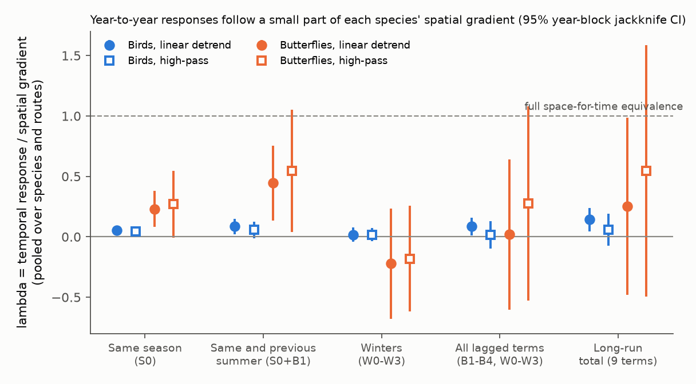
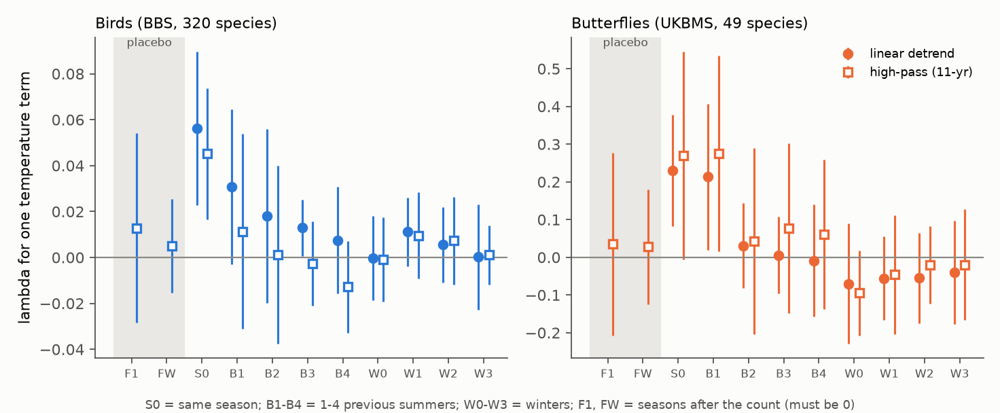
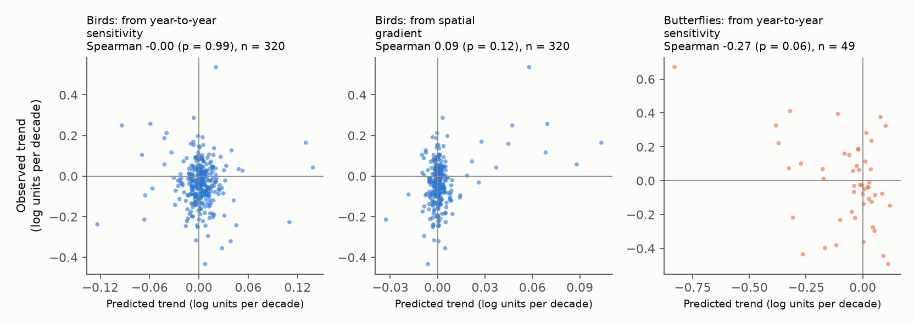

# Year-to-year temperature responses of 320 North American bird species followed 5-14% of own spatial gradients, with no clear lasting part; 49 British butterfly species followed about 50% in 2 summers

Job: sci-1107-hp-climate-pollution-biodiversity-7eda5357930b. Topic: climate-pollution-biodiversity.
Machine: hp (campaign 11_07_2026). Model: Claude Opus 5.5 (claude-opus-5-5). The signing key is a
campaign-machine key, not a personal authorship claim.

## 1. Question

Prior campaign studies found that bird community temperature indices (CTI) followed less than 10%
of warming (sci:sha256:c0a3a9aa...), that bird centroids moved at about 14% of the isotherm shift
(sci:sha256:7714830c...), and that frozen climate-suitability models had no species-level forecast
skill (sci:sha256:c86bb599...). A 75-network synthesis found that the network-level year-to-year
CTI response was only about 2% of the spatial CTI gradient (sci:sha256:0037934e...). These are
community-level results. They do not show which part of the species-level response is missing.

We asked four questions at species level, on the same routes and sites:

1. Does the year-to-year abundance response of a species to local temperature follow the spatial
   temperature gradient of its own abundance at that place? We estimate the ratio
   lambda = temporal response / spatial gradient. lambda = 1 is full space-for-time equivalence.
   lambda = 0 is no relation.
2. Which part of the response is transient (same season: activity, detection or behaviour) and
   which part persists (previous summers and winters: demography)?
3. Is the missing part a within-species problem (the response does not change across the range as
   the gradient does) or a between-species problem (species that the gradient predicts to gain do
   not gain on average)?
4. Does the year-to-year sensitivity forecast the long-term trends of species better than the
   spatial gradient?

We wrote the plan before the model fits (`files/PLAN.md`). One variant (high-pass anomalies) was
added after the main fits; the plan addendum identifies it.

## 2. Data

* North American Breeding Bird Survey (BBS), 2026 release, 1966-2025. Standard runs (RPID 101,
  RunType 1) in the USA and Canada: 130,303 runs on 5,319 routes. Route totals of 435 land-bird
  taxa from the 10-stop "States" files (the 50-stop files start only in 1997). 320 species had at
  least 30 routes with 3 or more detections. The fitted panels have 9,084,256 species-route-year
  rows (zeros included) on 4,802 routes.
* UK Butterfly Monitoring Scheme (UKBMS) site indices 2024, Great Britain transects, 1976-2024.
  49 species (the aggregate "Essex/Small Skipper" taxon is excluded), 513,192 species-site-year
  rows on 2,410 sites.
* Temperature: NOAA CPC GHCN_CAMS 0.5 degree monthly air temperature for BBS routes; E-OBS v32.0e
  daily mean temperature (0.25 degree) for UKBMS sites, aggregated to months.
* AVONET (eBird taxonomy sheet) for bird migration class, mass and habitat.

The external data are not in this bundle. `files/EXTERNAL_DATA_NOTICE.md` gives the licences and
the required attributions. `files/input_hashes.txt` gives the exact file paths in the shared
campaign store, the byte sizes, the SHA-256 hashes and the source URLs.

## 3. Method

**Temperature terms.** For each route (site) and season we removed a linear trend over 1950-2025
(1950-2024 for the UK). The residual is the anomaly. Birds: S0 = April-June of the survey year;
B1-B4 = May-July of 1-4 years before; W0-W3 = December-February that ends 0-3 years before the
survey season. Butterflies: S0 = May-August of the count year (flight season); B1-B4 = May-August
of 1-4 years before; W0-W3 as for birds. Placebo terms: F1 = the next summer after the count and
FW = the next winter. They cannot cause the count, so their ratio must be 0.

**Spatial gradient g.** For each species we took the routes in its range envelope (bird
conservation regions with detections on at least 5% of the routes; for butterflies, all active
sites, with 0 where the species was never recorded). We fitted the route mean of log(1 + count)
against the route May-July (UK: May-August) 1971-2000 climatology with a natural cubic spline
(4 df). g at a route is the derivative of this curve at the route climatology, in log abundance
per C. We winsorised g at the 2nd and 98th percentiles of each species. A variant added fixed
effects for bird conservation regions (UK: 1-degree cells), so that g only uses temperature
differences inside regions.

**Temporal model (one model per species).** y = log(1 + count). For birds:

y(r,t) = a(route x observer) + c(t) + sum_k [ b_k + theta_k g(r) ] x_k(r,t) + d first-year + e

For butterflies, a(site) replaces a(route x observer). c(t) is a year fixed effect of the
species. It removes all species-wide annual effects, so the temperature terms are identified only
from local anomalies, relative to other routes in the same year. The route x observer effect
removes observer differences. We calculated the fixed effects exactly (within transformation
plus projection on the year dummies; the result agreed with iterative demeaning to 1e-13).
The response of a species at route r to a sustained 1 C warming of the term group G is
R(r) = sum over k in G of [b_k + theta_k g(r)].

**Pooled ratio lambda.** lambda = sum over species and routes of g(r) R(r), divided by the sum of
g(r)^2. This is the least-squares slope through the origin of the temporal response on the
spatial gradient. We split it into a within-species part (species-centred g and R) and a
between-species part (species mean R on species mean g, with route-count weights). We also report
random-effects (DerSimonian-Laird) means of the species theta values.

**Uncertainty.** All species share the same years of weather. Thus we refitted all species ten
times, each time without one contiguous block of years (6 years for birds, 5 for butterflies).
The intervals for lambda are delete-one-block jackknife 95% intervals. Per-species standard errors
are the larger of the year-clustered and route-clustered values. The random-effects intervals use
the larger of the meta-analytic and jackknife standard errors.

**Trend forecasts.** The observed trend of a species is the linear slope of its year effects c(t)
(observer-adjusted). The time-based forecast is the mean over its routes of
sum_k [b_k + theta_k g] x (route warming rate of the season of term k). The space-based forecast
is the mean of g x (route May-July warming rate). Out of sample: sensitivities fitted on 1966-1995
forecast the 1996-2025 trends.

**Implied CTI response.** For each route with at least 20 fitted species we calculated the change
of a log(1+count)-weighted CTI that the species responses imply for a sustained 1 C warming, once
with R(r) and once with g(r). The species set is the same, so colonisation by new species is not
included in either value.

## 4. Results

### 4.1 Temporal responses follow a small part of the spatial gradient

Pooled lambda with 95% year-block jackknife intervals (`files/lambda_terms.csv`):

| Term group | Birds, linear detrend | Birds, high-pass | Butterflies, linear detrend | Butterflies, high-pass |
| --- | --- | --- | --- | --- |
| S0 same season | 0.056 (0.023 to 0.090) | 0.045 (0.017 to 0.074) | 0.231 (0.083 to 0.378) | 0.269 (-0.006 to 0.545) |
| B1 previous summer | 0.031 (-0.003 to 0.064) | 0.011 (-0.031 to 0.054) | 0.213 (0.019 to 0.407) | 0.275 (0.015 to 0.534) |
| S0 + B1 | 0.087 (0.023 to 0.151) | 0.056 (-0.012 to 0.125) | 0.444 (0.135 to 0.754) | 0.544 (0.038 to 1.050) |
| All lagged terms (B1-B4, W0-W3) | 0.086 (0.012 to 0.160) | 0.014 (-0.099 to 0.128) | 0.020 (-0.602 to 0.642) | 0.275 (-0.529 to 1.080) |
| Long-run total (all 9 terms) | 0.142 (0.047 to 0.237) | 0.059 (-0.074 to 0.193) | 0.251 (-0.483 to 0.984) | 0.545 (-0.496 to 1.585) |
| Placebo F1 (next summer) | 0.032 (no jackknife) | 0.013 (-0.028 to 0.054) | 0.008 (no jackknife) | 0.035 (-0.207 to 0.278) |
| Placebo FW (next winter) | 0.006 (no jackknife) | 0.005 (-0.015 to 0.025) | 0.024 (no jackknife) | 0.028 (-0.124 to 0.181) |

Birds: with linear detrending, the long-run response was 14% of the spatial gradient (95% CI 5% to
24%): 6% from the same season and 9% from the lagged terms. The breeding-season lags decreased from
B1 to B4, and the winter terms were close to 0 (W group 0.016, -0.042 to 0.075).

But the bird placebo F1 (the summer after the survey) was 0.032, as large as B1 (0.031). A future
season cannot change a count, so slow (decadal) temperature variability, which a linear route trend
does not remove, enters the lagged bird terms. With high-pass anomalies (deviation from an 11-year
centred running mean), both placebos were close to 0 (F1 0.013, -0.028 to 0.054; FW 0.005). Then
the same-season term stayed (0.045, 0.017 to 0.074), but the lagged terms together were 0.014
(-0.099 to 0.128) and the long-run total 0.059 (-0.074 to 0.193). Thus the only clear bird response
to year-to-year temperature is in the same season, at about 5% of the spatial gradient. A persistent
(demographic) part is not clear; its upper limit is about 13% of the gradient.

Butterflies: the same-season term (0.23 to 0.27) and the previous-summer term B1 (0.21 to 0.28; the
interval excludes 0 in both versions) were large, and the placebos were close to 0 in both versions.
The first two summers together gave 0.44 (0.14 to 0.75) and 0.54 (0.04 to 1.05). Older lags and
winters did not add to this (winter group -0.22 and -0.18, intervals include 0), and the nine-term
totals are imprecise. Thus British butterflies follow about half of their spatial gradient within
two summers, and part of this response carries into the next generation. For the same two terms,
the bird value was 0.087 (linear) and 0.056 (high-pass), one fifth to one tenth of the butterfly
value.

Variants for birds (point estimates of the long-run lambda, linear detrending): within-region
gradient (BCR fixed effects) 0.25; survey start temperature as a detection control 0.14 (same-season
part unchanged, 0.056); fit on 1966-1995 only 0.19; fit on 1996-2025 only 0.11. No variant gave a
long-run lambda above 0.26.

### 4.2 Within species the response follows the gradient partly; between species it does not

| Component (95% jackknife CI) | Birds, linear | Birds, high-pass | Butterflies, linear | Butterflies, high-pass |
| --- | --- | --- | --- | --- |
| Long-run total | 0.142 (0.047 to 0.237) | 0.059 (-0.074 to 0.193) | 0.251 (-0.483 to 0.984) | 0.545 (-0.496 to 1.585) |
| Long-run, within species | 0.202 (0.132 to 0.271) | 0.142 (0.019 to 0.264) | 0.803 (-0.283 to 1.888) | 0.571 (-0.632 to 1.774) |
| Long-run, between species | -0.129 (-0.449 to 0.190) | -0.314 (-0.599 to -0.029) | -1.132 (-1.745 to -0.519) | 0.477 (-1.422 to 2.377) |
| S0+B1, within species | 0.102 (0.052 to 0.152) | 0.076 (0.015 to 0.137) | 0.584 (0.269 to 0.900) | 0.388 (-0.028 to 0.804) |
| S0+B1, between species | 0.016 (-0.154 to 0.187) | -0.031 (-0.185 to 0.122) | 0.093 (-0.506 to 0.691) | 0.934 (-0.208 to 2.076) |

Random-effects means of the species theta_LR values (linear detrending): birds 0.175 (0.101 to
0.248; 320 species; same-season part 0.052, 0.027 to 0.077); butterflies 0.885 (0.406 to 1.364; 49
species; same-season part 0.259, 0.114 to 0.404).

Within the range of a species, populations in the cool part (positive g) gained more after warm
years than populations in the warm part. In birds this within-species response was 14-20% of the
spatial expectation (both intervals exclude 0). In butterflies it was larger (S0+B1 0.39 to 0.58;
long-run random-effects mean 0.89), but the jackknife intervals of the butterfly long-run parts are
wide.

Between species, the mean response of a bird species did not increase with its mean spatial
gradient. The between-species part was -0.13 and -0.31 (the high-pass interval is below 0). Across
320 species the Theil-Sen slope of the species mean response on the species mean gradient was -0.03
(-0.34 to 0.28; Spearman -0.01). For butterflies the between-species part changed sign between the
two anomaly versions (-1.13 and +0.48), so it is not determined.

A community index at a site changes when warm-adapted species gain relative to cold-adapted species.
In birds, the between-species part is not positive. Thus most of the expected community response is
missing even though populations inside each range respond in the expected direction.

### 4.3 No forecast skill for long-term species trends

| Forecast of the species trend | Birds (Spearman, p, n) | Butterflies |
| --- | --- | --- |
| Year-to-year sensitivity x local warming, 1966-2025 | -0.00 (0.99, 320) | -0.27 (0.06, 49) |
| Lagged terms only | -0.02 (0.79, 320) | -0.23 (0.12, 49) |
| Spatial gradient x local warming | 0.09 (0.12, 320) | 0.18 (0.21, 49) |
| Out of sample: 1966-1995 sensitivity, 1996-2025 trend | 0.03 (0.60, 297) | not tested |
| Spatial gradient, 1996-2025 trend | 0.09 (0.13, 297) | not tested |
| Reference: 1966-1995 trend, 1996-2025 trend | 0.30 (< 0.001, 297) | not tested |

All mean-square skill scores against the cross-species mean were close to 0 or negative. The
climate-driven trends that the sensitivities imply were small (birds: mostly within +-0.05 log
units per decade), and the observed trends were much larger (most within +-0.3). Thus factors other
than the local temperature response control the species trends in both taxa. The 1966-1995 trend
of a species had the highest rank correlation with its 1996-2025 trend (0.30), but its mean-square
skill was also negative (-0.58), because the sizes of the trends changed.

### 4.4 Implied community response

On 4,748 routes, the long-run temporal responses (linear detrending) imply a CTI change of 0.0126 C per 1 C of
sustained warming (route mean; median 0.0147). With the same species, the spatial gradients imply
0.0385 C per C (median 0.0245). The ratio is 0.33 (lagged terms only: 0.29). With the observed
warming of about 0.18 C per decade in May-July, 0.0126 C per C gives about 0.002 C per decade. This
is a small part of the observed BBS CTI trend of 0.015 C per decade (sci:sha256:c0a3a9aa...).
The two CTI definitions differ, so this comparison is approximate. Both implied values exclude
colonisation, so they are much smaller than the full spatial CTI slope of 0.33-0.44 C per C
(sci:sha256:0bc2a582...). `files/fig4_cti_implied.png` shows the route distributions.

### 4.5 Where tracking is less weak

Bird habitat groups (AVONET; random-effects mean of theta_LR, SE): grassland 0.52 (0.13, 33
species), woodland 0.20 (0.13), forest 0.14 (0.06), human-modified 0.12 (0.09), shrubland 0.07
(0.08). Migration: sedentary 0.21 (0.08), partial migrants 0.26 (0.10), migrants 0.14 (0.05); in a
meta-regression with log mass, the sedentary effect was 0.03 (SE 0.09). Mass terciles: 0.16, 0.15,
0.25. These are exploratory, with no multiple-test correction; only the grassland contrast is
large. Grassland and farmland species also controlled the observed CTI changes in
sci:sha256:c0a3a9aa.... Single species with large gradient information: Northern Bobwhite 0.84,
Red-winged Blackbird 0.75, Blue Grosbeak 0.62, Gray Catbird 0.53, Common Grackle 0.39; but Chipping
Sparrow -0.63, Boat-tailed Grackle -0.48, Mourning Dove -0.28 (`files/species_estimates.csv`).
`files/fig5_species_migration.png` shows species values by migration class.

## 5. Interpretation

1. The weak tracking of bird communities is not mainly a long lag. The clear bird response to a
   warm year is in the same season and is about 5% of the spatial gradient. After the removal of
   decadal temperature variability, the lagged (persistent) part is not different from 0 (upper
   limit about 13%). This agrees with the network-level result of sci:sha256:0037934e... (small
   fast fraction, not a long lag) and locates it at species level.
2. Same-season effects can come from activity and detection, not from population change. A
   survey-temperature control did not change the bird same-season value, but this control cannot
   remove all detection effects. Thus the measurable part of the bird response may be partly a
   detection artefact, and the demographic part is smaller still.
3. Within species, bird populations move in the direction that the spatial gradient predicts (14-20%
   of it). This agrees with the range-position result in sci:sha256:3250b81c... and with the small
   northward shifts of centroids in sci:sha256:7714830c....
4. Between bird species, the spatial gradient does not predict which species gain from warm years.
   This removes most of the expected community response. It also explains why space-based and
   time-based forecasts of species trends both fail (Section 4.3; sci:sha256:c86bb599...).
5. Tracking is less weak in British butterflies: about half of the spatial gradient within two
   summers, five to ten times the bird value, with a clear next-generation (B1) part. Short-lived
   ectotherms with one or few generations per year can follow temperature quickly. Even so, these
   responses did not forecast the 1976-2024 trends of butterfly species.

## 6. Limitations

* The design is correlational. The temperature terms are local anomalies; other weather variables
  (rain, drought, snow) that co-vary with temperature can contribute.
* Counts and site indices are not corrected for detection. Same-season terms can include detection.
* g is estimated from route means against climatology. Other gradients that co-vary with
  climatology (habitat, land use, rain) are part of g. The within-region variant gave a higher
  bird ratio (0.25), so part of the national g is not thermal. Split-half (odd and even years)
  reliability of g was above 0.99, but this does not measure the model error of the spline.
* The range envelope is truncated by the survey networks. The UK covers only the cool part of many
  butterfly ranges.
* The bird lagged terms with linear detrending are partly confounded by slow temperature variability
  (Section 4.1). The high-pass variant was added after the main fits. High-pass anomalies remove
  responses to decadal variation, which can be real slow responses. The butterfly long-run totals
  and between-species parts are imprecise.
* Jackknife intervals over 10 year blocks are approximate. Pooled random-effects intervals that use
  only species-level standard errors are too narrow, so we used the larger value.
* Trait and species analyses are exploratory.

## 7. Files and reproduction

* `files/code/prep.py`, `files/code/ukbms_prep.py`: build counts and temperature terms (scratch).
* `files/code/fit.py`, `files/code/fit_ukbms.py`, `files/code/femod.py`: per-species models,
  jackknife refits, high-pass variant (`--hp`). The butterfly main fits ran with an earlier
  iterative demeaning function (tolerance 1e-8); the exact version in the bundle gave the same
  coefficients to 1e-13 in a test, and all bird fits and the butterfly high-pass fits used it.
* `files/code/summarize.py`, `files/code/term_table.py`, `files/code/figures.py`: pooled results,
  tables and figures.
* `files/code/run_all.sh DATASETS SCRATCH OUT`: runs all steps. Inputs must match
  `files/input_hashes.txt`. Run time on the shared hp host (load 35-60, 6 workers): about 1 hour
  per bird fit pass.
* Results: `files/summary.json` (all pooled numbers), `files/lambda_terms.csv`,
  `files/species_estimates.csv` and `files/uk_species_estimates.csv` (per-species coefficients),
  `files/species_trend_predictions.csv`, `files/route_cti_implied.csv`, `files/lag_curve.csv`,
  `files/uk_lag_curve.csv`.
* The bundle contains no record-level count, site-index or temperature tables.

`files/lambda_terms.csv` columns: taxon, anomalies (linear_detrend or highpass_11yr), term,
kind, component (total, within, between), lam, se_jack, lo, hi, n_species.

Python 3.12 with numpy, pandas, scipy, patsy, xarray, pyproj and matplotlib.
