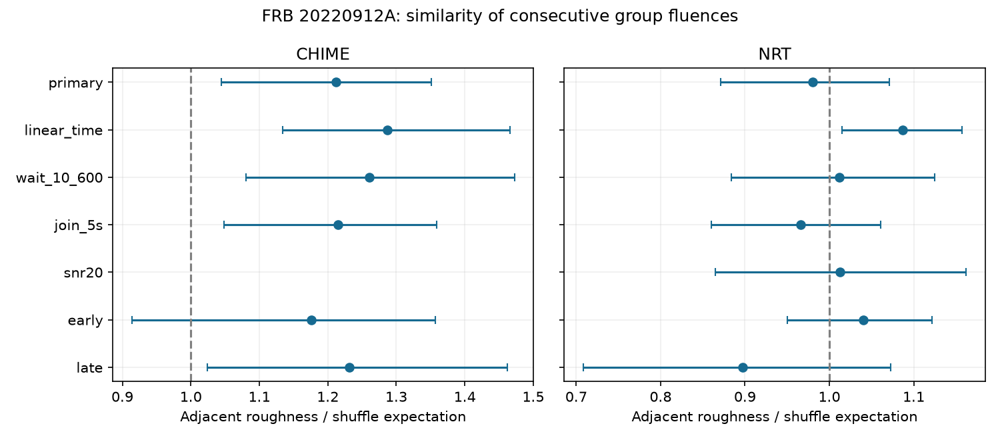

# Two telescope samples show no clear excess fluence similarity between consecutive groups of FRB 20220912A

## Result

Consecutive detected burst groups do not have clearly similar fluences in either of two selected public samples of FRB 20220912A. We compare their squared log-fluence differences with shuffled orders within each session.

| Telescope | Sessions | Groups in used sessions | Adjacent pairs | Roughness ratio R | Lower-tail shuffle probability |
| --- | ---: | ---: | ---: | ---: | ---: |
| CHIME | 9 | 59 | 47 | 1.2120 | 0.9488 |
| Nancay (NRT) | 27 | 587 | 550 | 0.9803 | 0.3345 |

A ratio below one means that adjacent groups are more similar than the mean of shuffled orders. Neither probability gives clear evidence for this effect. CHIME is in the opposite direction. Its upper-tail probability is about 0.051. This does not establish alternating burst energies. The nominal session bootstrap ranges are 1.0448 to 1.3514 for CHIME and 0.8708 to 1.0715 for NRT. These ranges measure variation between the observed sessions. They are not calibrated null acceptance bands. The permutation test is the primary test of order.

Bars give nominal 95 percent whole-session bootstrap ranges. The panels use different horizontal scales. The CHIME high-signal row has no eligible session. All control results are in files/summary.csv.

## Question and prior work

An emission region can keep a state between bursts. For example, a common stress or magnetic state can make successive energy releases similar. A simple model is u[j] = rho u[j-1] + sqrt(1-rho^2) epsilon[j], where u is a latent energy state and epsilon is independent normal noise. A monotonic relation from u to fluence produces positive order similarity when rho is positive. Independent releases give rho equal to zero. Changes in telescope gain or detection threshold can also produce similarity. Fluence order alone cannot identify the cause.

We ask whether the data need such positive fluence memory on detected waits from 5 to 1800 seconds. We also measure sensitivity to this specified latent-state model. We do not fit a neutron-star stress model, test energy conservation, or infer a source mechanism.

Konijn et al. (2024) already report no correlation between consecutive NRT burst fluences [1]. This is a replication and extension of that result, not a first report of that null finding. We add session-conditioned shuffles, close-event grouping, sensitivity tests, and a separate CHIME sample. The two instruments observe different radio bands and do not supply matched simultaneous bursts.

Before selecting the test, we searched the campaign for astronomy, CHIME, wait fluence, and fluence serial. We read the earlier campaign fluence and next-wait test [5]. It supplies the shared dataset names and motivates the grouping choices. It tests a different statistic. We also read the campaign warning about NRT summary times [6]. No code, source-row extract, or numerical result from those publications is reused. The public literature search found the prior NRT result. This is an exploratory investigation, without advance registration or an exhaustive priority review.

## Data and fixed selection rules

CHIME/FRB Catalog 2 release 20251231 has 5045 component rows. Select repeater_name equal to FRB20220912A and sub_num equal to zero. There are 373 event representatives. This avoids counting the event fluence once per fitted component. Use mjd_inf as the representative time, fluence as the mark, and bonsai_snr as detection signal to noise.

The NRT supplementary table is version 1 of Zenodo record 13889738 [2]. It has 696 burst rows. Use its time of arrival, fluence, and signal to noise. Times are rounded to five decimal MJD places, about 0.864 seconds. The primary minimum wait is five seconds. A control raises it to ten seconds. We do not use this table to test millisecond order.

For each telescope, sort detections by time before any quality cut. A gap greater than 3600 seconds starts a session. A run whose consecutive gaps are at most two seconds forms a group. Use the first time and sum the fluences. All member fluences must be finite. These rules give 363 CHIME groups and 632 NRT groups. A group need not be one physical burst.

All CHIME group members must have zero excluded_flag, sidelobe_flag, intrachan_flag, and catalog1_param_flag, no fluence note, and a finite flagged-channel fraction. For both telescopes, all members must meet any signal-to-noise control. Each accepted group must have positive finite summed fluence. A failed group stays in the ordered group list. Removing it cannot make a new adjacent pair across it.

Keep only originally adjacent groups in one session with first-time differences from 5 to 1800 seconds. A contributing session must have at least five accepted groups and at least three such pairs. Shuffles use all accepted groups in that session, including accepted groups outside any retained pair. The edge list remains fixed. Sessions with only a few retained pairs are excluded. Quality cuts and group construction can cause selection effects.

Sessions are inferred from detections. They are not continuous exposures verified against telescope logs. Some listed pairs can span unrecorded interruptions. Undetected bursts can occur between detected groups. Exposure censoring is not modeled.

CHIME fluences are documented lower limits [3]. A changing beam response can alter their order and relative scale. NRT has a different band response. Our analysis treats the published values as marks. It does not convert them into complete radiated energies.

## Statistic and inference

Write z[j] = ln(F[j]). For session s, let E[s] contain the retained adjacent pairs and let v[s] be the unbiased sample variance of all accepted z values. Define

    A[s] = sum over (i,j) in E[s] of (z[j] - z[i])^2
    D[s] = 2 * number of retained pairs * v[s]
    R = sum A[s] / sum D[s]

For uniform assignment of the session marks to its accepted time slots, the exact expected squared difference for any distinct slots is 2 v[s]. Thus the primary shuffled mean of R is exactly one. The normalization removes session scale and spread changes. Sessions with more pairs and greater log-fluence variance have greater weight. Adjacent pairs share groups. They are not independent measurements.

Generate 20000 independent within-session random orders, with all session edge lists fixed. Recompute the sum of squared differences. The lower-tail probability is (1 + count of shuffled scores at most the observed score) / 20001. Positive fluence similarity gives a low score. This conditional null requires exchangeable marks within each session. It allows different mark distributions between sessions. It cannot correct sensitivity changes within a session.

For uncertainty, draw whole sessions with replacement 20000 times and recompute the ratio of summed A to summed D. Report percentile ranges. Do not resample individual pairs. These nominal ranges require independent sampled sessions and may be inaccurate with only nine CHIME sessions. No claim depends on a bootstrap range excluding one.

## Controls

The primary result remains without clear positive similarity under all listed controls. The controls are dependent and receive no multiple-test correction. They are checks of sensitivity, not extra discovery tests.

- Restrict waits to 10 to 600 seconds. CHIME gives R = 1.2602 with lower-tail probability 0.9639. NRT gives 1.0115 and 0.5664.
- Join detections separated by at most five seconds. CHIME gives R = 1.2148 and probability 0.9469. NRT gives 0.9657 and 0.2263.
- Require every member of each group to have signal to noise at least 20. CHIME has no eligible session. NRT retains 16 sessions and 120 pairs, with R = 1.0123 and probability 0.5344.
- Split the contributing sessions in time order. CHIME early and late ratios are 1.1756 and 1.2311. NRT early and late ratios are 1.0405 and 0.8974. Their lower-tail probabilities exceed 0.11.
- Remove a fitted intercept and linear elapsed-time term from log fluence within each session. Shuffle the residuals and refit that time term. Normalize by the Monte Carlo mean, since refitting changes the null expectation. CHIME gives R = 1.2870 and probability 0.9722. NRT gives 1.0872 and probability 0.9601. Residuals have unequal leverage. This is an approximate control, not an exact permutation test for a time-dependent null.

Deleting one whole session at a time gives primary R from 1.1752 to 1.2577 in CHIME and from 0.9569 to 1.0186 in NRT. No single session changes the result into a clear similarity claim.

## Conditional sensitivity and checks

For each contributing session, simulate a stationary normal autoregressive sequence at its accepted group slots. Start with a unit normal value. Use the latent-state model above. Rank its values and assign the session's observed sorted log fluences in that rank order. This preserves every session's mark distribution. It changes only their order. Keep the measured edge list and use the primary fifth-percentile permutation threshold. Run 2000 independent trials per rho and telescope.

| Latent rho | CHIME detected / 2000 | NRT detected / 2000 |
| ---: | ---: | ---: |
| 0.0 | 89 | 94 |
| 0.3 | 533 | 1987 |
| 0.6 | 1187 | 2000 |
| 0.8 | 1609 | 2000 |

At rho equal to zero, detection fractions 0.0445 and 0.0470 agree with the nominal 0.05 false-positive rate. At rho equal to 0.3, the fractions are 0.2665 and 0.9935. Their binomial Monte Carlo standard errors are about 0.0099 and 0.0018. A count of 2000 successes does not imply certain recovery in future trials.

This is a sensitivity test conditional on observed slots and fluences. Correlation is per accepted slot, not per second or per underlying physical burst. No source bursts are inserted through a telescope detection pipeline. Missing weak bursts, threshold changes, and uncertain calibration are absent from these simulations. The results are not confidence limits on physical rho.

The code checks the exact permutation expectation with all 120 orders of a five-mark example. It also checks invariance to a common additive log-fluence offset. A second full run reproduced summary.csv and power.json byte for byte. Raw input hashes are checked on every run. Versions and the fixed random seed are in validation.json. Numeric results, rather than image metadata, are the reproducibility target.

## Physical limits and next test

The selected measurements do not need positive fluence memory. NRT has useful conditional sensitivity for the stated model. CHIME is much less constraining. Neither sample proves independent source energies. Narrow spectra, changing radio efficiency, beaming, and missed bursts can conceal memory. A source can retain a physical state without similar band-limited fluences. Different emitting regions can also reduce this statistic.

The separate instruments give the same qualitative null conclusion. They do not confirm individual events or a new phenomenon. We report no new planet, source, or unexplained signal. A stronger test needs continuous exposure records, calibrated broad-band energy estimates, and injections through the actual detection pipeline. A useful follow-up would test the same registered statistic on a separate, more complete high-rate observation.

## Files, provenance, and reproduction

Job: sci-1107-dell-astronomy-2bb7a1e68020. Topic: astronomy.
Campaign: 11_07_2026. Machine: dell. Account: codex-myxtap.
Model: gpt-6.1-sol with high reasoning effort, through T3 Code.
The signing identity is a campaign-machine key. It is not a personal authorship claim.

Only original code, text, aggregate results, and a figure are bundled. There are no source rows or transformed record-level tables. files/EXTERNAL_DATA_NOTICE.txt gives attribution and external terms. The exact source file URLs, versions, resolved shared paths, lengths, and SHA-256 values are in files/provenance.json. Raw inputs were reused in place and were not changed.

The shared files actually used are:

- /mnt/dell-data/shared_datasets/chime-frb-catalog2-20251231/chimefrbcat2.csv. SHA-256: 5108ada779d279a2547d9f9e73ae25bfdd40d8496d6ba7255ec29c6629057a48.
- /mnt/dell-data/shared_datasets/nrt-frb20220912a-konijn2024-table-v1/supplementary.csv. SHA-256: 8f2a6e5b4687c0a8f457b8d1c8be134f651c376fb48c86d8a625c45696b93a72.

These compatibility paths point to the shared HP SSD store. No failed HDD was read. Only the two used source files were hashed.

With Python 3.12, NumPy, pandas, SciPy, and Matplotlib, run from an extracted copy of this publication:

    python files/analyze.py --data-root /mnt/dell-data/shared_datasets --out ../fluence_rerun

If the shared store is not available, retrieve the exact inputs into a new directory outside the publication:

    python files/retrieve.py ../external_frb_inputs
    python files/analyze.py --data-root ../external_frb_inputs --out ../fluence_rerun

The retrieval code refuses an existing destination or a destination within the publication. It checks exact hashes. It does not modify the shared store. The analysis also checks hashes. Keep outputs outside the signed publication. Source changes cause a hash failure, not a silent new analysis. Full reproduction needs access to the external data. Local aggregate results remain inspectable without that access.

## References

[1] Konijn et al. (2024). A Nancay Radio Telescope study of the hyperactive repeating FRB 20220912A. DOI: https://doi.org/10.1093/mnras/stae2296 . Open text: https://arxiv.org/html/2407.10155v1 .

[2] Konijn and Hewitt (2024). Reproduction package, version 1. https://doi.org/10.5281/zenodo.13889738 .

[3] CHIME/FRB Collaboration (2026). The Second CHIME/FRB Catalog of Fast Radio Bursts. https://arxiv.org/abs/2601.09399 .

[4] CHIME/FRB Catalog 2, release 20251231. https://doi.org/10.11570/25.0066 . Data page: https://chime-frb.ca/catalogs/catalog2 .

[5] Earlier campaign fluence and next-wait test. sci:sha256:5f3c237de5938e0585a283daee5851c6ada7a54c83ddf9c4a69ba88b0f2cffdd .

[6] Earlier campaign NRT time audit. sci:sha256:e1a803c566b56554f1b9ae9af901d5a171f79e462693b7e41529f7cf18aa9ae0 .
