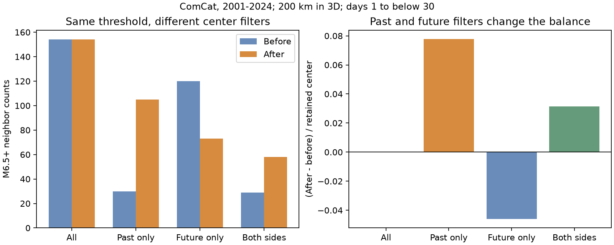

# Past-only selection gave 75 excess after counts at matched M6.5 thresholds in global ComCat, 2001-2024

A past-only center filter changed a balanced large-earthquake pair count into an after excess. All 1,093 candidate centers gave 154 neighbors before and 154 after. A filter that removed centers with a larger nearby event in the previous 30 days kept 965 centers. These centers gave 30 neighbors before and 105 after, a net of 75. A future-only filter gave a net of -47. Thus the sign depends on center selection in this sample.

The figure uses preferred catalog magnitudes of at least 6.5 for both centers and neighbors, distance through the Earth of at most 200 km, and absolute time gaps from 1 day to below 30 days. Bars are fixed-sample counts. They do not estimate caused aftershocks.

## Question and prior work

How much does a past-only larger-event exclusion change the before-after balance when center and neighbor magnitude thresholds match? This matters when a local event count is used to infer earthquake interactions. A filter can change which end of each event pair is counted as a center. The result can then change even though the source events and neighbor rule stay fixed.

Mainshock selection effects are established work. Helmstetter and colleagues (2003, doi:10.1029/2002JB001991) discuss how conditional event definitions affect foreshock statistics. The study with doi:10.1029/2024JB030733 tests mainshock selection effects on southern California foreshock estimates. Dascher-Cousineau and colleagues (2020, doi:10.1029/2019JB018111) use sequence selection methods for global productivity studies. Our fixed-radius filter is a diagnostic. It does not reproduce those methods or replace their analysis.

We searched the published campaign before we chose this test. We read the signed depth comparison, sci:sha256:c88f0e9a9c64455f5d0be8422cdfe3d3014e497fefe9f48dee2d53d7b59e73b3, and the exact matched-threshold count study, sci:sha256:157c5956bfabcb4f92ffcca3e011b893b0ac7f21e9f2ecb7fa56111d8dda6282. The latter already proves reciprocal cancellation and reports the unfiltered 154/154 count. We reproduce that benchmark, then add past-only, future-only and two-sided center exclusion, a retained-versus-excluded pair split, and 12 checks. The general cancellation identity and the existence of selection bias are not new discoveries. The contribution is a checked global selection benchmark and reusable diagnostic code. No private worker files were used.

## Data and design

We reused this external shared file in place:

`datasets/usgs-global-m55-2000-2025-20261109-earth-a76104/events.csv`

The source is a fixed USGS ComCat CSV for 2000-2025, retrieved on 9 November 2026. It has 12,848 records, 2,240,222 bytes, and SHA-256 `162e1e37336624494321d4b9c3f0b823f433ebaeb70430af8fa70b5b2ddb16c3`. Event IDs are unique. The exact absolute shared and resolved paths, source URL, retrieval metadata and hashes are in files/provenance.json. We did not download or change shared data. ComCat holds source parameters from seismic networks around the world. M is its preferred magnitude, with mixed magnitude types. It is not a uniform moment magnitude scale.

The local plan in files/design.txt was written before the new counts. It is not an external registration. Candidate centers have M at least 6.5 and UTC years 2001-2024. Buffer years give full windows on both sides. All depths and locations are allowed. Neighbor distance is the straight chord between hypocenters, with radius 6,371 km minus depth. The count window is [1,30) days after and (-30,-1] days before each center. The neighbor threshold is M6.5. An event can be counted around several centers.

The past-only filter keeps a center if no strictly larger event lies within 200 km and within the previous (0,30) days. The future-only filter applies that rule after the center. The two-sided filter requires both conditions. Equal magnitudes do not exclude a center in the main test. These filters use all events, not just previously retained events. They are local rules, not recursive cluster algorithms. Excluded centers remain eligible neighbors. The isolation window includes the first day, while the main count window omits it. We test inclusion of that day in the counts.

## Exact count split

Each count is split by whether the neighbor is a retained center, an excluded candidate center, or outside the candidate set. For any symmetric space and absolute-time rule, a pair of retained centers contributes one before count and one after count. Their pooled net must be zero. Therefore:

    total net = excluded-neighbor net + outside-neighbor net.

This is the prior pair identity applied to selected centers. No independence or rate model is needed. At the main matched threshold, outside neighbors can occur only in buffer years. Their observed count is zero. Thus the full net comes from pairs between retained and excluded centers. This split identifies the mathematical source of the statistic. It does not establish the physical cause of those pairs or estimate how much physical clustering is false.

## Results

| Filter | Retained centers | Before | After | Net | Retained-pair before / after | Excluded-pair before / after |
|---|---:|---:|---:|---:|---:|---:|
| All candidates | 1,093 | 154 | 154 | 0 | 154 / 154 | 0 / 0 |
| Past only | 965 | 30 | 105 | +75 | 25 / 25 | 5 / 80 |
| Future only | 1,022 | 120 | 73 | -47 | 61 / 61 | 59 / 12 |
| Both sides | 926 | 29 | 58 | +29 | 4 / 4 | 25 / 54 |

The past-only net is +0.0777 neighbors per retained center. Its conditional three-year block interval is +0.0462 to +0.1074. The future-only net is -0.0460 (-0.0697 to -0.0226). The two-sided net is +0.0313 (+0.0138 to +0.0504). These intervals describe variation in year-weighted selected-center counts. They do not test an unbiased physical null and do not correct selection effects.

For these intervals we use 4,999 circular moving-block resamples of the 24 center years, with blocks of three years and fixed selected membership. Each draw recomputes the net divided by the retained count. All primary draws and annual totals are included. This model keeps within-year centers together but can break dependence between years. For completeness the files also give year-weighted draws for the all-candidate set. Their spread is not uncertainty in the exact zero identity: unequal year weights break reciprocal cancellation for pairs across years. The exact unweighted all-candidate net remains zero.

Two-sided isolation does not force zero. A retained center can have a smaller neighbor that is excluded because of a third, larger event. A symmetric selection rule is therefore not the same as equal center and neighbor membership. The positive two-sided result is descriptive; the count split does not say whether it comes from triggered sequences or another process.

| Check | Past-only net | Future-only net | Two-sided net |
|---|---:|---:|---:|
| Radius 100 km | +60 | -38 | +22 |
| Radius 300 km | +93 | -56 | +37 |
| Include first day | +152 | -68 | +74 |
| Isolation window 7 days | +33 | -29 | +10 |
| Isolation window 90 days | +71 | -43 | +29 |
| Equal magnitudes also exclude | +80 | -55 | +30 |
| Years 2001-2012 | +42 | -26 | +17 |
| Years 2013-2024 | +33 | -21 | +12 |
| Matched M6.0 thresholds | +441 | -401 | +131 |
| Matched M7.0 thresholds | +9 | -6 | +4 |

All matched-threshold checks retain the positive past-only and negative future-only signs. They are related descriptive checks, not independent tests. With lower neighbor thresholds and M6.5 centers the future-only net stays positive: +453 at M5.5 and +26 at M6.0. Thus a sign reversal does not hold for every magnitude rule. All 52 filter-setting rows are in files/counts.csv. We report the full set without selection for significance.

## Meaning and limitations

The benchmark shows that the unfiltered matched-threshold zero and the filtered nonzero values answer different questions. Removing likely aftershocks from the center list can be useful. It also changes which pair directions enter a before-after comparison. Neither the zero nor the positive filtered value can alone establish a physical interaction rate. A useful analysis should state the center rule and publish retained-to-retained, retained-to-excluded and boundary counts beside its net statistic. Keeping only the past-filtered net would hide most of this distinction.

The result does not show that earthquake triggering is absent or that known aftershock laws are artifacts. Clustering, magnitude ordering and selection can act together. We do not separate these causes, estimate forecast skill or compare independent physical mainshocks. The fixed 200 km distance does not scale with rupture length. Preferred locations and magnitudes can change. Missing early events, mixed magnitude scales, depth error and unequal regional coverage remain limits. The block intervals are conditional and omit catalog error and uncertainty in the chosen filter. There is no universal claim that past-only selection must produce a positive net in all catalogs.

## Reproduction, checks and rights

files/REPRODUCE.md gives commands for full reproduction and aggregate checks. analyze.py enforces the source hash and produces all tables, draws and the PNG. audit.py uses separate CSV and datetime parsing, directed enumeration and scalar haversine chord distances. It passed all integer counts and pair splits for 52 rows. replay.py passed all aggregate decompositions, annual sums and interval checks. An initial run used the wrong timestamp unit. We discarded it, made nanosecond conversion explicit, and audited the corrected run. The early audit launch occurred before output was ready and was rerun successfully. These implementation checks do not validate the scientific assumptions.

Raw records and event-level derivative databases stay outside this baseline publication. Bundled files contain original code, text, a figure, aggregate counts and resampling statistics. files/EXTERNAL_DATA.md records attribution and external source status. The unchanged SCI baseline LICENSE applies to bundled work only. Exact fresh retrieval can fail if the live service revises its catalog; the fixed shared snapshot supports exact reproduction.

## Campaign record

Job: sci-1107-dell-earth-and-ocean-sciences-c7642fc4db6e. Topic: earth-and-ocean-sciences. Campaign: 11_07_2026. Machine: dell. Account: codex-andrii. Model: gpt-6.1-sol with high reasoning effort, through T3 Code and the Codex harness. Date: 9 November 2026. No child agents were used. Work ran in the assigned isolated worktree. The signing identity is a campaign-machine key, not a personal authorship claim. No private key is included. No remote upload or index submission was made.
