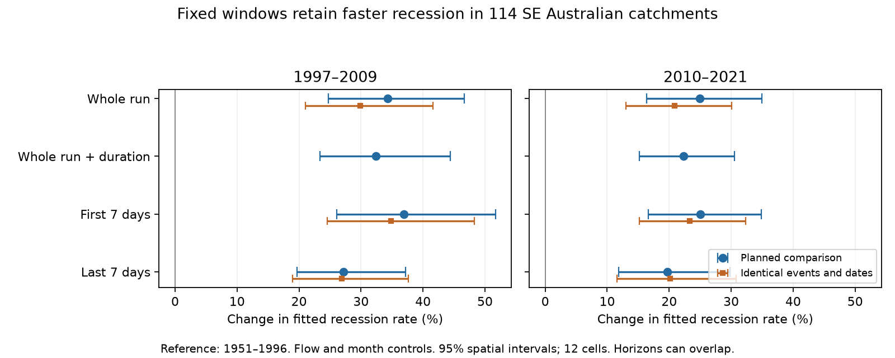

# Fixed seven-day windows retain faster post-1997 stream recession at 114 south-east Australian catchments

## Result

We test whether variable measurement duration explains a reported stream recession rise. We use CAMELS-AUS v2.03 daily flow at the same 114 south-east Australian catchments as the prior whole-run study. We reproduce its gauge estimates within 0.00000022 log units. With flow and month controls and a 1951-1996 reference, the first seven retained days give rate increases of 36.9% in 1997-2009 (95% spatial limits 26.1-51.7%) and 25.0% in 2010-2021 (16.7-34.9%). The last seven days give 27.2% and 19.7%. Run-duration controls remove only 4.8% and 9.3% of the whole-run log changes. A stricter test uses identical events and dates for all horizons. It retains first-window increases of 34.8% and 23.3%, and last-window increases of 26.9% and 20.2%. In 1997-2009, the last-window era multiplier is 5.9% smaller than the first-window multiplier (3.4-8.7%). Thus changes in run duration do not explain the rise in this selected event set. The result supports a change across these declining-flow runs, but does not identify a change in aquifer properties. Monotonic flow does not imply no rain or recharge. Horizons can overlap. Limits resample 12 spatial cells and hold years and event selection fixed. This test does not address the century-scale record or establish the cause of annual runoff loss.

## Question and prior evidence

The post-1997 runoff loss has no confirmed cause. The selected work reports faster recession at equal flow and month. Its latest broad test uses maximal declining-flow runs, each with its own duration. This can mix a change in event shape with a change in the sampled horizon. Published methods research shows that extraction and estimation choices affect recession parameters (Tashie et al., doi:10.1029/2019WR025448; Jachens et al., doi:10.5194/hess-24-1159-2020; doi:10.1080/02626667.2016.1170940). We ask a narrower question: **does the observed rise remain when the measurement window has a fixed length?**

Campaign study c8882d21 already matched dry-spell age and found a smaller pooled rise, with uncertain late and long-spell effects. Study 0612e482 used a rank outcome and found no clear late-period rise. We do not repeat either test. The new contribution is a paired horizon test of the larger whole-run result, with exact reproduction of its starting estimates. It adds evidence about estimator robustness, not a new cause of runoff loss.

## Data and scope

We fix the 114 SE gauges and 12 two-degree cells from files/results/broad_catchments.csv in SCI publication fab37b7c. They are in Victoria, New South Wales and the Australian Capital Territory. The prior sample requires at least 30 complete reference years and eight complete years after 2010. We do not select gauges on the result of this test.

We use CAMELS-AUS v2.03 (Fowler, Zhang and Hou, 2024), streamflow_mmd.csv from 03_streamflow.zip. Negative sentinel values are missing; positive flows alone enter recession events. Flow is in mm/day. The input is clipped to 1951-2021 before events are found. This matches the prior calculation. Raw data remain in the shared store. Exact paths, source URL, archive and member SHA-256 hashes, software versions and plan hash are in files/provenance.json. The archive hash comes from the immutable dataset helper record; the member hash is computed on the bytes read for analysis.

## Methods

1. Find maximal runs with positive, finite Q(t) <= Q(t-1). Ties remain. Remove the first two transitions. Require at least seven remaining transitions and a net decline. A remaining run has n transitions.
2. Measure k = log(Q_start/Q_end)/h over the whole remaining run (h=n), its first seven transitions, and its last seven transitions. Calculate geometric mean flow and midpoint month and year separately for each window. The two fixed windows can overlap.
3. Keep window flow at or below the reference daily 90th percentile. Define ten flow bins from reference events. Fit log(k) on flow-bin, calendar-month and year indicators for each gauge. Require at least 50 reference events and three events per retained year. Use least squares with squared-error weights n, as in the prior study. The equal-event variants use weight one. Fixed-window variants retain the parent-run weight n to separate horizon from event weighting.
4. Center year effects on their reference mean. Average them in each era with at least five retained years. Average gauges equally. Report 100*(exp(mean log effect)-1), a ratio of fitted geometric rates, not a change in mean runoff.
5. Add parent-run duration bins (7-9, 10-13, 14-20, 21-30, 31+ transitions) to the whole-run model. Compare its era effects with the original model on paired gauges.
6. Resample the 12 two-degree cells 2,000 times. All gauges in a cell move together. Report percentile limits. Keep years, events and fitted gauge effects fixed. Seed 477 is used for the planned comparison; seed 478 for the strict support audit.

The plan in files/PLAN.md precedes new estimates. All ten planned variants are in summary.csv. They include equal weights and a check that drops flat first or last windows. The post-plan audit in common.py is stricter: all three windows must have positive decline and pass their flow cutoff. All three use the whole-run midpoint year and month. This holds event identity, year allocation and month allocation fixed across horizons. It was added after the first fit to resolve support differences. No rain or ET screen is applied. A monotonic run is not necessarily an unforced drainage event.

## Main evidence

All methods retain 114 gauges, so the reported differences are paired across gauges.

| Rate measure | 1997-2009 change, % [95% limits] | 2010-2021 change, % [95% limits] |
|---|---:|---:|
| Whole run | 34.3 [24.7, 46.6] | 24.9 [16.4, 35.0] |
| Whole run with duration bins | 32.4 [23.4, 44.4] | 22.4 [15.2, 30.6] |
| First seven days | 36.9 [26.1, 51.7] | 25.0 [16.7, 34.9] |
| Last seven days | 27.2 [19.7, 37.2] | 19.7 [11.8, 29.8] |
| Whole run with equal event weights | 33.6 [24.5, 45.5] | 22.5 [14.9, 31.5] |
| First seven days with equal event weights | 35.9 [26.0, 49.4] | 23.3 [15.7, 32.4] |
| Last seven days with equal event weights | 28.0 [20.7, 37.4] | 18.8 [11.4, 28.1] |

The duration-bin change is -0.01427 log units in 1997-2009 (95% limits -0.02775 to -0.00425) and -0.02058 in 2010-2021 (-0.03900 to -0.00729). These are 4.8% and 9.3% of the original log changes. Duration has a detectable effect, but does not remove most of the observed rise. This is a model adjustment, not a causal mediation fraction.

The planned first-minus-whole difference is +0.01890 log units in 1997-2009 (+0.00101 to +0.03790). In 2010-2021 it is +0.00073 (-0.01926 to +0.01463). Thus fixing the first window does not reduce the effect in this comparison.

### Identical-event and date audit

| Rate measure | 1997-2009 change, % [95% limits] | 2010-2021 change, % [95% limits] |
|---|---:|---:|
| Whole run | 29.9 [21.0, 41.6] | 20.9 [13.0, 30.1] |
| First seven days | 34.8 [24.5, 48.3] | 23.3 [15.2, 32.4] |
| Last seven days | 26.9 [18.9, 37.6] | 20.2 [11.6, 30.8] |

The last-minus-first difference is -0.06034 log units in 1997-2009 (-0.09145 to -0.03491). The ratio of the two era multipliers is 0.941, with limits 0.913-0.966. In 2010-2021 the log difference is -0.02617 (-0.05450 to +0.00399); its limits cross zero. These are contrasts of era changes. They are not the absolute difference between the first and last rates in an event. The early-era contrast supports some dependence on horizon, while both fixed horizons retain a rise.

### Selection and numerical checks

The prior whole-run gauge effects are reproduced to within 2.2e-7 log units in both eras (files/replication.json). Initial development runs did not clip the input before event extraction. The boundary check found this difference; all reported outputs use the corrected clip. This is a computational correction to match the test scope, not a change of the question.

Tests with exact exponential decline recover the known rate at every horizon. Other tests verify tie handling, breaks at missing or zero flow, and flat fixed windows inside a declining whole run (files/audit.json). No field estimate is replaced with a synthetic value.

Event counts, run lengths and flat-window counts by gauge and era are in event_audit.csv. These counts precede the window flow cutoff and the three-events-per-year rule. Flat windows are excluded from logarithmic fits. The common-event audit checks this difference directly. Complete source code, fitted gauge effects, aggregate results and spatial draws are included.

## What the result means

Variable run duration is not a sufficient explanation of the reported whole-run rate rise at these catchments. The rise also appears in fixed endpoint ratios near both ends of the selected runs. This strengthens the empirical observation against a specific sampling explanation.

The result does not show that all stores drained faster, that hydraulic conductance changed, or that faster recession caused the annual water loss. ET, recharge, changing source mixtures, river routing, rating shape and event selection can affect these rates. The sample conditions on a future non-increasing trajectory. Such selection can itself change across eras. Flow bins give coarse equal-flow control. Calendar month is a coarse climate control. Our last window is at the end of a monotonic run, not at a fixed dry-spell age. It cannot be equated to the long rain-free events in c8882d21. The different estimates in that study remain a useful limit on physical interpretation.

## Limits and next test

Spatial intervals do not include uncertainty from which years occurred, source errors or event extraction. There are only 12 resampled cells. Overlapping seven-day windows are not independent evidence. Source quality codes are not screened beyond the missing-value rule. This study stops in 2021 and does not test the reported return to slower recession in 2020-2025 or early-century changes. It makes no claim about a permanent state shift.

A useful next test would apply fixed horizons to events that pass a full rain and ET screen, while controlling antecedent flow and wetness. It should refit models within joint spatial and multi-year resamples. That would test whether the effect in monotonic runs remains under a stronger approximation to unforced drainage. It is not performed here.

## Reproduction and rights

Extract the signed ZIP to a local directory. Use Python 3.12 with numpy, pandas and matplotlib. Set CAMPAIGN_ROOT to a directory containing the shared campaign/ and datasets/ links. Set OUTPUT_DIR to a separate scratch directory. Run `sh files/reproduce.sh`. This reruns the two data analyses and synthetic checks. To make the figure, copy files/plot.py into OUTPUT_DIR and run that copy. It reads the new aggregate CSVs. The signed folder need not be changed. Raw records are not written into the draft. See files/DATA_NOTICE.md for attribution, source terms and the retrieval command. The prior signed ZIP must be present in campaign/; its ID is listed in the citations. Run `sci verify <prior-ZIP>` before reuse if it has not already been verified by SCI.

## Job and authorship record

Job: sci-1107-dell-earth-and-ocean-sciences-477b2815987b. Topic: earth-and-ocean-sciences. Campaign: 11_07_2026. Machine: dell. Account: codex-olen. Model: gpt-6.1-sol, high reasoning effort, in T3 Code through the Codex harness. No child agents were used. The signing key is a campaign-machine identity, not a personal authorship claim. The publication contains our analysis material under the exact SCI baseline license. External source rights and attribution are stated separately.
