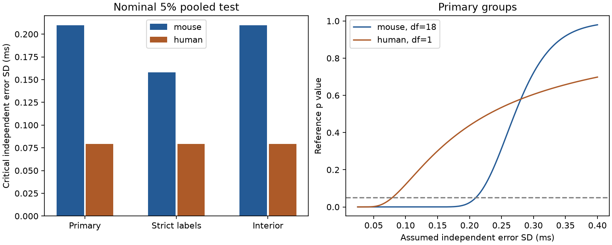

# An independent Gaussian error model gives a 0.210 ms delay threshold in selected Allen mouse circuits

A source-cell plus target-cell model of synaptic delay has 18 independent test constraints in the selected mouse slice data. The sum of squared residuals is 1.27035 ms squared. Under a reference model with fixed graph support and independent, zero-mean Gaussian edge errors of known common standard deviation (SD), the nominal 5% test rejects below 0.20977 ms SD. Strict cell-label matching lowers the threshold to 0.15780 ms. These are noise sensitivity thresholds. The actual measurement error is not known. Thus this study does not reject the biological model in these data.

The left panel shows the assumed error SD at the nominal 5% test boundary. The right panel shows the primary reference p value as assumed SD changes. Mouse data are from visual cortex. Human data are from temporal cortex. Species and region change together. The bars are deterministic thresholds, not confidence intervals or a species effect.

## Question and prior work

Can one delay contribution per source cell and one per target cell explain measured synaptic onset times? Such a model can reduce the number of timing parameters in circuit models. Tests need loops in a bipartite graph of source and target roles. A physical neuron has separate source and target roles. These loops are not necessarily directed biological feedback loops.

Campagnola, Seeman and colleagues measured local connectivity and synaptic physiology in mouse and human cortex (Science 2022, doi:10.1126/science.abj5861). The Allen schema defines latency from the maximum slope of the source spike to the onset of the synaptic response. The response and connection use the same recorded cell IDs. This is a direct structure and function link within each slice experiment. It is not a link between separate animals or atlases.

SCI campaign searches for connectome neural, synaptic dynamics, effective resistance, timing constraints, and delay chi found prior delay studies. We read publications 7dc74039 and 5027b4e3, cited by full SCI IDs in sci.json. The first showed sparse support for omitted-edge tests. The second gave exact bounds for a uniform absolute error limit. We reuse their sample and group definitions, not their code or derived tables. We also read the related nonnegative-term study 62068c28. The present calculation uses unrestricted cell terms and a probabilistic error reference. It adds a pooled noise threshold, a strict-label check, and a test that removes each constrained group in turn. It does not replace the prior deterministic bounds. Graph fixed-effect methods have an established literature, including Jochmans and Weidner (2019), doi:10.3982/ECTA14605. We make no claim that the projection test is a new general statistical method.

## Data and selection

We use Allen Synaptic Physiology r2.1 small, schema 22, dated 2023-01-26. The shared alias is /mnt/dell-data/shared_datasets/allen-synphys-r2.1-small-20230126/synphys_r2.1_small.sqlite . The resolved path, exact source URL, byte count, hash, SQL, and software versions are in files/provenance.json. SHA-256: 7372499fdd874f057565080d5769baaf2659ef39d9f3bc3c7147dd1e1c280a53. We reused this file read-only. We did not download or change shared data.

We join pair, synapse, source cell, target cell, experiment, and slice tables. We retain confirmed chemical connections between distinct cells with finite positive latency in mouse VisP or human TCx. There is no additional fit-quality filter. Primary groups fix experiment, synapse sign, source nonsynaptic class, and target nonsynaptic class. Missing labels form explicit groups. Strict groups also fix ordered source and target Cre and target-layer labels. The interior check keeps only 0.2 < latency < 5 ms. Terms are shared within a group only. These choices follow prior work and were set before this residual calculation. This is an exploratory secondary analysis, not a registered or independent confirmation.

## Model and test

For each group, let y be the edge delay vector in ms. Let A have one row per edge, one column per source role, and one column per target role. A row has two entries equal to one. The model is y = A beta + epsilon. Cell terms beta are unrestricted real offsets. A group intercept is already in their span. This model does not separate measured conduction and receptor delays.

Let P project onto the null space of A transpose. Set Q = sum over groups of y transpose P y. Let d = sum over groups of edges minus rank(A). The graph identity gives rank(A) = number of active role vertices minus connected components. Thus d counts independent cycle constraints. Forests contribute zero, regardless of their stored delays. We calculate the projector with singular value decomposition and check it with direct least squares and an independent graph rank calculation.

For fixed graph support and y = A beta + epsilon with independent Gaussian errors of common known SD sigma, Q / sigma squared has a chi-square distribution with d degrees of freedom. The cell terms cancel. The reference p value is the upper-tail probability. The 5% boundary is sigma_star = sqrt(Q / chi2_quantile(0.95, d)). An assumed SD below this boundary gives rejection in this reference experiment. The boundary is not an estimate of actual instrument noise. It also does not bound the largest edge error.

This test remains conservative for independent zero-mean Gaussian errors with unequal SDs all at most sigma. To see this, the covariance of projected errors is P Sigma P. If Sigma is diagonal and bounded above by sigma squared times the identity, each of its d nonzero projected eigenvalues is at most sigma squared. The quadratic form is therefore bounded in distribution by sigma squared times a chi-square variable with d degrees of freedom. More generally, the same result holds if the covariance in the residual space has that spectral bound.

An arbitrary bias of the form A gamma cancels exactly, even if it is large or correlated across cells. This includes common recording shifts and source-only or target-only shifts within a group. Other shared errors need not cancel. If residual-space covariance has an upper bound of kappa times sigma squared, the sufficient rejection boundary becomes sigma_star / sqrt(kappa). For example, a factor of four lowers the primary mouse boundary to 0.10489 ms. A marginal SD bound alone does not control arbitrary correlations. We do not estimate kappa from these data.

The Gaussian calibration assumes graph and sample selection are fixed or ignorable. In the source, detection, missing values, positive-delay selection, fitting, and the interior range filter can depend on the measured response. Exact calibration conditional on those selection steps has not been established. The reported p values are reference sensitivity values, not validated p values for the selected biological sample. This qualification is essential even for the primary analysis.

## Results

| Sample | Edges | Groups | Constrained groups | d | Edges on cycles | Q, ms squared | Critical SD, ms |
| --- | ---: | ---: | ---: | ---: | ---: | ---: | ---: |
| Mouse primary | 2248 | 1543 | 10 | 18 | 57 | 1.270352 | 0.209770 |
| Mouse strict | 2248 | 1705 | 8 | 11 | 39 | 0.489941 | 0.157802 |
| Mouse interior | 2228 | 1529 | 10 | 18 | 57 | 1.270352 | 0.209770 |
| Human primary | 309 | 196 | 1 | 1 | 4 | 0.024032 | 0.079094 |
| Human strict | 309 | 200 | 1 | 1 | 4 | 0.024032 | 0.079094 |
| Human interior | 308 | 196 | 1 | 1 | 4 | 0.024032 | 0.079094 |

Graph support matches the prior deterministic study. Removing 20 mouse and one human outer-range edges changes no cycle evidence. In mouse primary groups, Q/d has square root 0.26566 ms. At assumed independent SD 0.1 ms, the reference p value is 1.95e-18; at 0.2 ms it is 0.02348. Strict groups give 9.48e-7 and 0.34526, respectively. Thus a 0.2 ms reference fails under primary grouping but passes under strict grouping. A smaller reference p value is not a direct measure of biological importance.

The largest mouse primary group contributes 31.1% of Q. Removing each constrained group in turn gives critical SDs from 0.17813 to 0.21439 ms. Under strict matching, the largest group contributes 46.8%, and the removal range is 0.12417 to 0.16322 ms. These are sensitivity ranges, not sampling intervals. They show that the primary threshold is not due to just one group. They do not show independence across animals or robustness to all selection choices.

The human sample gives one constraint from four edges. Its reference p value at 0.1 ms is 0.12109. Removing its only constrained group leaves no test. There is no clear cross-region or cross-species confirmation.

## Interpretation and limits

The method gives an explicit requirement for future error validation. In the selected mouse graphs, an independent Gaussian residual error SD smaller than about 0.16 ms conflicts with both tested group definitions in the reference test. This statement also requires fixed or ignorable selection and correct cell labels. The method shows why large cell-shared timing shifts can be harmless for loop tests while smaller edge-specific errors can matter.

We do not know the actual error SD, its distribution, correlation, or selection process. Residuals can include biological edge terms, changes in cell state, reconstruction or connection-call errors, synapse location effects, and fitting errors. We cannot separate these causes. A Gaussian shape cannot be checked well from 18 or one independent contrasts. Independence across groups, including groups from the same recording, is an assumption for the pooled reference. Missing delay estimates, slice damage, and uncertain cell labels limit generalization. Most edges lie in forests and cannot test this unrestricted model. Model compatibility there supplies no positive evidence for shared timing terms.

No familywise biological rejection claim is made across the six overlapping analyses. Mouse primary is the main reference; the other settings are descriptive sensitivity checks. No neuronal activity time series or behavior is modeled. The result concerns onset timing in selected detected slice connections, not intact-brain dynamics or representation reliability. No general law across animals is established.

## Checks, rights, and reproduction

All graph rank, projector, and least-squares checks passed. Known four-edge and forest cases gave Q=1 and Q=0 ms squared. For each setting, 50000 edge-space Gaussian simulations checked the reference calibration using the actual projectors. Nominal 5% rejection rates ranged from 4.834% to 5.046%. Source-plus-target shifts projected below 1.1e-15 in magnitude. The simulations validate implementation under the reference assumptions. They do not validate those assumptions in biology.

Files include original analysis and retrieval code, six aggregate result rows, numerical checks, the figure, exact provenance, and reproduction instructions. No external database, copied source code, or record-level derivative table is included. Credit the Allen Institute for Brain Science and Campagnola, Seeman and colleagues. External data remain under their source terms. See files/EXTERNAL_DATA.md. The exact SCI baseline license applies to the new bundled materials. The supplied SQL and scripts preserve the full transformation method while keeping external data outside the signed publication.

Job: sci-1107-dell-neural-structure-and-computation-1a7185b60ded. Topic: neural-structure-and-computation. Campaign: 11_07_2026. Machine: dell. Account: codex-andrii. Model: gpt-6.1-sol, high reasoning effort, Codex harness in T3 Code. No agents were launched. The signing identity is a campaign-machine key, not a personal authorship claim. No remote SCI archive or index submission was performed.
