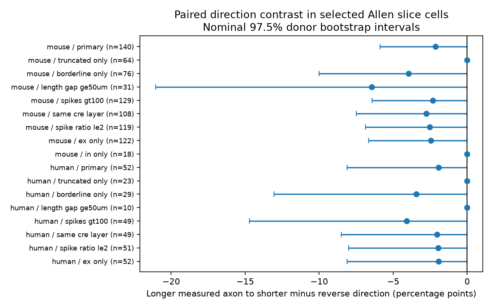

# Measured axon length gives only three direction-discordant pairs per species in selected Allen slices

In Allen Synaptic Physiology r2.1, measured axon truncation distance did not give a clear direction effect on detected chemical connections. We compared the two directions in 140 mouse VisP cell pairs and 52 human TCx cell pairs. Both cells had the same broad cell class and the same qualitative axon label. One cell had a longer measured truncation distance. Only three pairs in each species had a connection detected in one direction alone. These pairs came from two inferred donors in each species. This small evidence base cannot establish equal rates or a negative biological effect.

The contribution is a direct check of the information in measured axon length after the qualitative label is held fixed. The data link structure labels and physiological connection calls in the same cells. They do not link an intact-brain connectome to activity in a behaving animal.



The bars are nominal 97.5% donor bootstrap intervals. They are descriptive. They can be too narrow when very few donors supply direction information. Zero-width bars do not establish equal rates. The primary rows are the two species comparisons. The other rows are sensitivity checks.

## Prior work and new scope

Campagnola, Seeman and colleagues measured local connectivity and synaptic dynamics in mouse and human neocortex (Science, 2022, doi:10.1126/science.abj5861). The Allen analysis code uses axon length in a correction model for connection detection. It can assign 200 micrometres to an intact axon with no measured length. The morphology schema defines axon truncation as a qualitative description. Measured truncation distance is not total axon length, branch coverage, or a count of retained synapses.

Campaign publication sci:sha256:370bc73ac3c597a2824ff628d75e4228161dfa549a0e3cdc17fc707a9bc07b1f found limited evidence for more detections with intact source axons. Publication sci:sha256:be1bc665c37d982b55c16fb1aaeab66479ab234e98dbcecab1c9c1cbbc75b7b2 found no clear direction effect between cells with intact and truncated axon labels. Publication sci:sha256:0e9a7de296c55d3eba22664264bca201d6defdc52e666ad7a32d8246d2f551c2 found no clear mean detected voltage response effect.

We test a different predictor: the order of two measured truncation distances within the same qualitative label. We use no imputed lengths and exclude intact cells. This study is not an independent dataset replication. It tests whether the existing database can support this more specific structure hypothesis. No prior code or tables were reused.

We searched the campaign with connectome, neural structure, Allen, reciprocity, axon, quoted axon plus direction, quoted truncation distance, and quoted axon length. The initial direction phrase search missed the existing paired study. We found it through a citation, read it, and abandoned the category-only pilot. The measured-length rules were set before its outcomes were computed. This was an exploratory test, not a registered study or a complete literature review.

## Selection

We used the r2.1 small SQLite release dated 2023-01-26. We opened it read only. The exact SQL is in files/query.sql. We joined pair, cell, morphology, experiment and slice. Starting from 123,506 directed pair records, we kept 115,974 mouse VisP or human TCx records. We kept 30,502 records with the same known nonsynaptic class, ex or in, in both cells. We then required binary chemical connection calls, more than 10 source-class test spikes, and distance greater than zero and at most 500 micrometres. This left 18,252 directed records. The test-spike rule follows the pinned Allen pair_was_probed definition.

Both axon labels had to be truncated, or both had to be borderline. Both measured truncation distances had to be positive. This left 392 directed records before the reverse-direction and unequal-length rules. We retained one orientation per unordered pair, from longer to shorter measured distance, and required an eligible reverse record. Equal lengths were excluded. There were 192 final pairs. No missing connection call was converted to zero. No response fit, pulse train, electrical call or polysynaptic call entered the outcome.

The mouse sample had 140 pairs, 72 recordings and 62 inferred donors. The human sample had 52 pairs, 23 recordings and 17 inferred donors. Median measured length gaps were 26 and 21 micrometres. Strict Cre and target-layer matching was a sensitivity rule. Broad class alone does not remove subtype differences.

## Estimate and uncertainty

For each pair, O is the binary detected connection from the longer measured axon cell to the shorter cell. I is the reverse call. The estimate is 100 times the mean of O minus I, in percentage points. Pairing fixes physical distance and recording. It changes source and target roles together. Under an additive role model, this is a source-minus-target length association. It does not isolate a causal source effect. Correlated dendrite loss and cell health can change both roles.

We drew 20,000 samples of inferred donors with replacement, with seed 274055. Each draw retained all pairs within a donor and recomputed the ratio of summed differences to summed counts. Mouse clusters use the six-digit animal number after a hyphen in the specimen name. Human clusters use the initial H-number and next two dot-separated fields. Every selected name passed the parser. These are inferred clusters, not verified registry IDs. The nominal 97.5% marginal intervals have a nominal two-test family target of 95% only if their coverage is correct. Sparse nonzero donor contributions invalidate any claim of guaranteed coverage. The same quantiles are shown for sensitivity rows, without an added family claim.

As a separate diagnostic, we exactly enumerated independent sign changes of each donor's net O-minus-I contribution. The two-sided statistic is the absolute total difference. This is exact only under independent symmetric donor contributions under the null. It is a reference calculation, not a random assignment test of axon cuts. Zero-net donors do not change it. Mouse data have only two nonzero-net donors, so there are only four distinct sign assignments. Human data have one, so there are only two. This shows why 192 pairs do not give 192 independent units of direction evidence.

## Results

| Species | Pairs | Longer to shorter detections | Reverse detections | Difference, points | Nominal bootstrap interval | Sign-change reference p |
| --- | ---: | ---: | ---: | ---: | --- | ---: |
| Mouse | 140 | 1 | 4 | -2.14 | -5.88 to 0.00 | 0.50 |
| Human | 52 | 1 | 2 | -1.92 | -8.11 to 0.00 | 1.00 |

In mouse data, 136 pairs had neither direction detected, three had only the shorter-to-longer direction, and one had both. In human data, 49 pairs had neither, one had only the longer-to-shorter direction, and two had only the reverse direction. All detected connections were in the borderline group. All 64 mouse and 23 human truncated-group pairs had neither direction detected. The resulting zero bootstrap intervals in that group are a resampling failure for inference about rare unseen detections, not evidence of zero underlying connection probability.

All three mouse direction-only pairs were excitatory and came from two donors. Two human direction-only pairs came from one donor and canceled in its net contribution. The third came from a second donor. The human bootstrap cannot create a positive total donor contribution from these observed donor totals; its upper endpoint of zero is therefore a property of the observed support. It is not strong evidence against a positive population effect.

Strict Cre and layer matching gave 108 mouse and 49 human pairs, with differences of -2.78 and -2.04 points. More than 100 spikes in both directions gave 129 and 49 pairs, with differences of -2.33 and -4.08 points. Neither check supplied more direction-only pairs. A measured gap of at least 50 micrometres left only 31 mouse and ten human pairs. All results and four-state counts are in files/results.csv. Donor information and leave-one-donor-out ranges are in files/information.csv. No sensitivity check establishes a positive length association.

## Limits and next test

The database does not resolve this hypothesis. Negative point estimates do not refute axon preservation corrections. Selection favors cells with morphology measurements and adequate tests in both directions. Few pairs have any detected connection. The label and the distance can have measurement error. Distance along one axon segment does not describe its whole branching tree or its overlap with the target dendrites. Subtypes and recording noise can differ between directions. The 10-spike rule is an eligibility rule, not a guarantee of equal detection power. Brain region and species are not interchangeable. No behavioral condition or longitudinal circuit change was tested.

A useful next experiment should collect many more direction-only pairs within each preservation category. It should measure axon and dendrite coverage, match detection power in both directions, and verify donor identity. A larger existing dataset with measured arbors could test a continuous length effect with held-out donors. This package provides a precise cohort definition and an information audit for that work. It does not claim a general structure-to-computation law.

## Reproduce

Use the existing shared database in place:

`/mnt/dell-data/shared_datasets/allen-synphys-r2.1-small-20230126/synphys_r2.1_small.sqlite`

Source: https://allen-synphys.s3-us-west-2.amazonaws.com/synphys_r2.1_small.sqlite

SHA-256: `7372499fdd874f057565080d5769baaf2659ef39d9f3bc3c7147dd1e1c280a53` (176,771,072 bytes). The script checks this hash. If absent on the campaign host, run files/retrieve.sh, which uses the locked dataset helper. Do not overwrite an existing dataset. Outside the campaign, retrieve the URL into a separate local data directory and check the hash.

From an unpacked publication, use Python with NumPy, pandas and Matplotlib. Exact versions are in files/runtime.json. Write both outputs and external evidence outside the publication:

```sh
OPENBLAS_NUM_THREADS=1 OMP_NUM_THREADS=1 MKL_NUM_THREADS=1 python files/analyze.py --db /path/to/synphys_r2.1_small.sqlite --out /tmp/axon-length-results --scratch /tmp/axon-length-external
```

The scratch CSV contains external cell-level records. Keep it outside the signed bundle and under the source terms. Aggregate outputs, SQL, source hash and version records support inspection. Assertions check unique reverse joins, equal reverse distances, species agreement, donor parsing, four-state totals and the count identity for the contrast. These checks are not an independent scientific replication.

## Attribution, rights and job

Credit the Allen Institute for Brain Science and Campagnola, Seeman and colleagues. External raw data and record-level derivatives are not bundled. See files/EXTERNAL_NOTICE.md. The package contains original code, text, a figure and aggregate analysis statistics. It contains no upstream software or data extract. The baseline license applies to these original contributions; the external terms apply only to materials retrieved separately.

Job: sci-1107-dell-neural-structure-and-computation-274055470c0d. Topic: neural-structure-and-computation. Campaign: 11_07_2026. Machine: dell. Account: codex-olen. Model: gpt-6.1-sol, high reasoning effort, through the Codex harness in T3 Code. No agents were launched. Computation used one library thread. The campaign-machine signature is not a personal authorship claim. This result is saved locally only.
