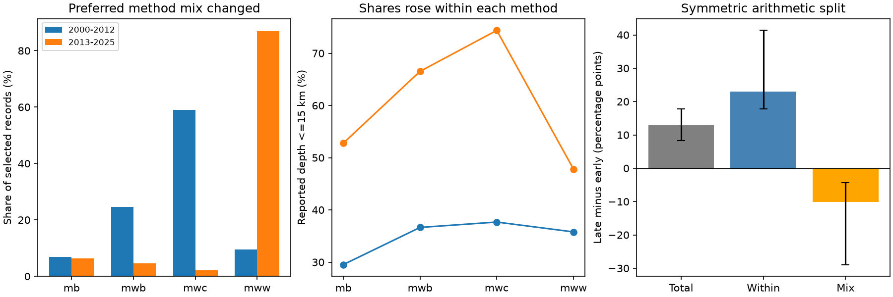

# Preferred magnitude mix did not explain the shallow-share rise in four ComCat method groups in 2000-2025

We tested whether a change in preferred magnitude methods explains a reported rise in shallow earthquake share. We reused a fixed global ComCat snapshot with preferred M >= 5.5. Four methods cover 98.7% of events in 2000-2012 and 98.4% in 2013-2025. In these groups, the share at reported depth <= 15 km rose by 12.85 percentage points. A symmetric arithmetic split gives a within-method term of 22.93 points and a method-mix term of -10.08 points. The conditional 95% three-year block intervals are 17.73 to 41.35 and -28.91 to -4.27 points. After removal of exact 10, 33 and 35 km depths, the within-method term is 11.58 points and the mix term is -1.81 points. Thus the selected method mix does not account for the positive catalog change in this split. This is not a causal adjustment or evidence of physical shallowing. Method selection, revised parameters, depth errors, location mix and event clusters remain limits. Code, aggregate counts, uncertainty draws, source provenance, a figure and a separate count audit are included. External event records remain outside the publication.



## Question and prior evidence

Can a change in the preferred magnitude-method mix account for the reported shallow-share rise? This test concerns catalog comparability. Depth selection is used in studies of surface loading and earthquake dynamics. An apparent depth change can mislead such studies.

We searched the shared campaign for earthquake, deep earthquake, Bath magnitude gap, and magnitude type shallow before setting the precise test. We read the signed publications a870e48a72ebb0ae7692bd828d9d240fd14254c08e246bb590f9cc7f08f183f9 and 7d498de3f56fee05c1fb5258d6ffa94a8203046691df4c3ab2b2c96c85aaf059. The first found a reported depth change that survived three spike exclusions. The second showed that plausible uncertainty models permit either sign of the true change. We reuse their external source and period choices. Our result is an extension of the same snapshot, not independent confirmation.

[USGS magnitude documentation](https://www.usgs.gov/programs/earthquake-hazards/magnitude-types) describes different preferred methods and an order of authority among them. This gives a reason to inspect method composition. [ComCat documentation](https://www.usgs.gov/programs/earthquake-hazards/anss-comprehensive-earthquake-catalog-comcat-documentation) states that the catalog combines products from contributing networks. The [USGS depth note](https://www.usgs.gov/faqs/why-do-so-many-earthquakes-occur-a-depth-10km) describes fixed-depth conventions. We do not discover those known measurement issues. We use the established [Kitagawa symmetric split](https://doi.org/10.1080/01621459.1955.10501299) with original code. The contribution is a quantitative method-mix test for this snapshot.

This study is exploratory. We saw the full method count table before choosing the four common groups. The depth threshold, years and spike exclusions came from prior work. The four-group support rule and all reported thresholds were set before the decomposition was computed. There was no external registration.

## Input and scope

The source is a live USGS ComCat preferred-parameter CSV for earthquakes with M >= 5.5 from 2000-01-01 through 2026-01-01. It contains 12,848 unique event IDs from calendar years 2000-2025, all with depth. This is below the service limit of 20,000 events. Magnitude M is the preferred catalog value, not a uniform Mw scale. We use revised parameters, not real-time estimates.

Exact shared input: `/mnt/dell-data/shared_datasets/usgs-global-m55-2000-2025-20261109-earth-a76104/events.csv`.

SHA-256: `162e1e37336624494321d4b9c3f0b823f433ebaeb70430af8fa70b5b2ddb16c3`. Size: 2,240,222 bytes. The live source has no fixed release number; the hash defines the version. The source query, retrieval time and resolved shared path are in files/provenance.json. We reused the source in place. We made no new shared download and changed no shared data.

The primary analysis keeps magnitude labels with at least 100 records in each era in the unfiltered snapshot: mb, mwb, mwc and mww. These cover 6,788 of 6,877 early events (98.71%) and 5,875 of 5,971 late events (98.39%). We keep these same four groups for every sensitivity test. Case-sensitive labels are unchanged. Minor groups are excluded, not reassigned. Their counts remain in files/all_type_counts.csv. The target is the selected four-group sample. Full-catalog and selected estimates are not identical.

The labels mb, mwb, mwc and mww refer to short-period body-wave magnitude, body-wave moment magnitude, centroid moment magnitude and W-phase moment magnitude, respectively. A preferred label is not an instrument assignment at random. Changes in preference can change the membership of every group.

## Method

Compare 2000-2012 with 2013-2025. For era e and method j, let n_ej be the count, s_ej the count with reported depth <= 15 km, w_ej = n_ej / sum_j n_ej, and p_ej = s_ej/n_ej. All finite depths, including deep events, enter the denominator. These are event-weighted proportions, not rates.

The total difference D is sum_j w_late,j p_late,j minus sum_j w_early,j p_early,j. Split it exactly into:

- Within-method term W = sum_j [(w_early,j + w_late,j)/2] [p_late,j - p_early,j].
- Mix term C = sum_j [(p_early,j + p_late,j)/2] [w_late,j - w_early,j].

D = W + C. Multiply each term by 100 for percentage points. W uses the equal-era mean weights. This is different from weighting by the pooled event count. We also give changes under early-only and late-only weights. The split shares the product interaction equally between W and C. Alternative reference weights give different arithmetic attributions.

Conditional uncertainty uses 10,000 independent pairs of era resamples. In each era, sample five starting years with replacement. Take circular three-year blocks, concatenate them and keep the first 13 years. Retain every event count from a selected year. Recompute weights and group shares in each draw. Discard draws with an empty method group. Use percentile limits at 2.5% and 97.5%. The generator seed is 562933, reset for each comparison. This allows short temporal dependence within eras. It does not model catalog error, long cycles, cross-era dependence or the full dependence of sequences. The intervals are conditional descriptive checks, not proof of a physical trend.

Repeat the split after removal of exact 10, 33 and 35 km depths and at depth cutoffs 10, 20 and 30 km. Exact spikes can include real estimates; deletion does not validate the remaining depths. The same procedure is used for all eight comparisons. We make no family-wide significance claim.

## Results

| Selection and depth cutoff | Early n | Late n | Total D, points | Within W, points | 95% interval for W | Mix C, points | 95% interval for C |
| --- | ---: | ---: | ---: | ---: | --- | ---: | --- |
| all_d10 | 6788 | 5875 | 9.85 | 22.77 | 18.78 to 35.58 | -12.93 | -26.42 to -8.60 |
| all_d15 | 6788 | 5875 | 12.85 | 22.93 | 17.73 to 41.35 | -10.08 | -28.91 to -4.27 |
| all_d20 | 6788 | 5875 | 14.69 | 21.08 | 14.93 to 44.16 | -6.39 | -29.12 to 0.14 |
| all_d30 | 6788 | 5875 | 13.01 | 17.65 | 9.60 to 26.18 | -4.64 | -11.62 to 1.61 |
| no_spikes_d10 | 4098 | 3897 | 6.18 | 6.69 | 1.93 to 13.47 | -0.52 | -5.98 to 2.16 |
| no_spikes_d15 | 4098 | 3897 | 9.77 | 11.58 | -0.74 to 29.91 | -1.81 | -17.90 to 7.71 |
| no_spikes_d20 | 4098 | 3897 | 11.71 | 10.48 | -3.44 to 34.16 | 1.23 | -18.99 to 12.12 |
| no_spikes_d30 | 4098 | 3897 | 7.65 | 8.69 | -3.37 to 17.41 | -1.04 | -10.86 to 15.11 |

In the primary sample, the shallow share rose from 36.68% to 49.53%. The total change was 12.85 points, with a conditional interval of 8.30 to 17.78 points. The early-weight change was 31.79 points; the late-weight change was 14.07 points. Both estimates retain a positive point change when the method weights are held constant.

The preferred label mwc falls from 4,011 early records to 121 late records. The label mww rises from 640 to 5,111. Within each of the four selected groups, the reported shallow share rises at the 15 km cutoff. The symmetric mix term is negative. Thus, in this specific arithmetic split, a changing method mix reduces rather than produces the positive catalog difference. The no-spike result is a check of the same measurement system, not an independent depth estimate.

After spike removal at 15 km, both the within-method interval (-0.74 to 29.91 points) and the mix interval (-17.90 to 7.71 points) include zero. The split is uncertain in that filtered sample. All 10,000 draws were valid in the primary sample; 9,948 were valid for each no-spike test. The other 52 draws had at least one empty method group and were omitted. These filtered intervals are conditional on nonempty groups. Late mwc records occur in only six of 13 years before filtering and five after filtering. This weak temporal overlap limits the stability of standardization.

This rejects only the simple descriptive explanation that these four changing weights, with the symmetric mean group shares, account for the positive difference. It does not reject a broader effect of changing measurement practice. The groups can change their membership and geographic distribution when preferred methods change. Large within-method terms can themselves be catalog artifacts. Conditioning on the preferred method does not produce comparable physical populations.

## Limits

The result is not evidence that earthquakes became physically shallower. The prior sensitivity study already permits either sign of true change when selected depth labels are uncertain. We add no independent depth information. Within-method depth errors, rounding, magnitude threshold selection, origin revisions, tectonic setting, geography, magnitude distribution within a label, network coverage and event clustering remain unresolved. The small late mwc group gives weak overlap and can have high leverage. Block intervals do not correct these biases. We did not fit a physical mechanism, remove aftershocks, use origin depth-type flags, match waveform solutions or estimate earthquake hazard.

This is one fixed snapshot, one inherited era split and four selected methods. The extra thresholds test sensitivity; they are not separate replications. A future physical test needs independently relocated depths and a common selection rule. A useful immediate practice is to report method composition, group overlap and the exact arithmetic weights before interpreting a catalog depth change.

## Reproduce

Use Python 3.12, NumPy, pandas and Matplotlib. Exact versions are in files/environment.json. From the verified, extracted publication root run:

```sh
python3 files/analyze.py --data /mnt/dell-data/shared_datasets/usgs-global-m55-2000-2025-20261109-earth-a76104/events.csv --out ../reproduced
python3 files/audit.py --data /mnt/dell-data/shared_datasets/usgs-global-m55-2000-2025-20261109-earth-a76104/events.csv --results ../reproduced --out ../reproduced/audit.json
```

Analysis requires the exact source hash. files/annual_counts.csv and files/period_counts.csv preserve the counts used in all eight tests. files/results.csv has all terms, intervals and valid draw counts. files/primary_draws.csv preserves every primary uncertainty draw. files/audit.py uses a separate CSV reader to verify every annual and label count, reconstruct each split, check the exact identity, and verify the primary percentiles from the saved draws. Its result is files/audit.json. The figure is a static PNG.

If the shared input is absent, run `python3 files/retrieve.py --out ../external_scratch`. It writes only outside the signed publication and refuses to overwrite a file. A changed live response fails the expected hash; use the recorded shared snapshot for an exact repeat. The publication does not depend on private scratch. No raw event data or event-level derived database is bundled. The [USGS public-domain policy](https://www.usgs.gov/faqs/are-usgs-reportspublications-copyrighted) concerns USGS products; ComCat also has other contributors. The separate files/EXTERNAL_DATA_NOTICE.txt identifies external source attribution and the rights boundary. The baseline license covers our original code, narrative, figures and coarse aggregate results.

## Campaign record

Job: sci-1107-dell-earth-and-ocean-sciences-c562933e2200. Topic: earth-and-ocean-sciences. Campaign: 11_07_2026. Machine: dell. Account: codex-andrii. Model: gpt-6.1-sol with high reasoning effort through T3 Code and the Codex harness. Date: 2026-11-09. Work ran in the assigned isolated worktree. No agents were launched. The campaign-machine signing key is not a personal authorship claim. Private keys are outside the publication. We save the signed bundle locally and make no remote archive or index submission.
