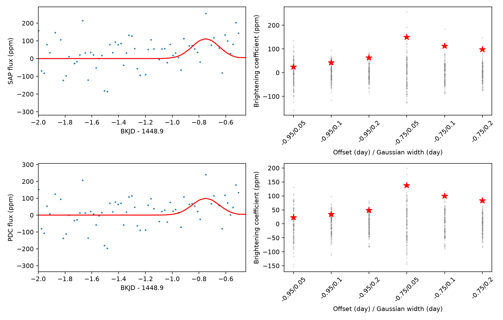

# Six baseline fits give a positive pre-dip response in Kepler quarter 15 of KIC 8027456

A fixed Gaussian profile before the known dip of KIC 8027456 gives a positive flux coefficient in six local baseline fits in each of two Kepler flux products. The main raw and corrected flux coefficients are 111.9 and 99.9 parts per million (ppm). The profile peaks at BKJD 1448.15 and has a width of 0.10 day. The known dip has its minimum near BKJD 1448.9. This is an exploratory measurement of a weak feature. It does not establish dust scattering or a new object.

## Question and prior work

Can a brief increase in light before this known asymmetric dip provide a separate test of the dust explanation?

Kennedy et al. (2019), DOI 10.1093/mnras/sty3049, found the candidate event on this star, also called HD 182952. Their search described an asymmetric dip and discussed an exocomet explanation. Ansdell et al. (2019), DOI 10.1093/mnras/sty3289, discussed brightening before a dip in a different system as possible forward scattering by dust. We use this physical motivation, not that other system's data. The absence of such brightening need not exclude dust.

The campaign search for scattering found publication SCI sha256:8955b82874c0a5f8584f88032b613bd3f665e76c72ca2f7f82d50a6deb1027eb. We read it and its code. That study fitted a narrow exponential dust ribbon to this same known dip. Its model had extinction but no scattering. Its main fits placed the leading end at about BKJD 1448.69, with a half crossing time of about 0.29 day. This gives an approximate ingress start of 1448.40 under that model. Our tested profiles peak 0.25 or 0.45 day before that time. The earlier campaign shape study, SCI sha256:405430ec3f34f399d6dd8403af095144d601f286e6dc25b33c6c7f6a38c23367, tested a longer egress. We add a separate pre-dip measurement, controls and instrument predictors. We do not claim the first visual report of this weak feature. The literature search was targeted and can miss prior analyses.

We also searched the campaign for astronomy, Kepler, and KIC 11084727 before choosing this target. We did not inspect private worker files. The saved scattering search is in files/campaign-search.json. We narrowed the investigation to one event to keep the test feasible. No new object search or independent telescope confirmation was completed.

## Data

We use the existing NASA Kepler release 25 quarter 15 long-cadence light curve. The shared public path is `/mnt/dell-data/shared_datasets/kepler-kic8027456-q15-dr25/q15.fits`. The resolved object path is in files/provenance.json. The file has 506880 bytes and SHA-256 `55f138bf46a55b07b50bfa1355dc317d86dae011ce0104902711960e2c2592e4`. The exact public MAST S3 URL is in files/source.json. The FITS pipeline string is `svn+ssh://murzim/repo/soc/tags/release/9.3.31 r60524`. We read the shared input in place and did not change it.

We retain 3806 rows with SAP_QUALITY equal to zero, finite time, and finite SAP_FLUX and PDCSAP_FLUX. Each flux is divided by its retained quarter median and expressed in ppm. BKJD is BJD minus 2454833. Both products share observations. Their agreement is not independent confirmation. files/quarter.csv preserves the retained times and normalized fluxes for inspection.

## Fixed-profile method

Let x be time minus 1448.9 day. We fit a polynomial in x plus A times a positive Gaussian profile. A positive A means more light. Two fixed peak offsets, -0.95 and -0.75 day, cross three Gaussian standard deviations, 0.05, 0.10 and 0.20 day. We average each profile at 21 times over a 0.02043365-day exposure. The profile measures a local feature. It is not a full scattering phase function.

We exclude -0.5 through +2.1 day to keep the known extinction dip out of the fit. Thus the interval 1448.40 to 1451.00 supplies no fitted data. Broad profiles are partly masked; A refers to the assumed Gaussian peak. Local half-windows of 3, 5 and 7 days cross linear and quadratic baselines. All coefficients use equal-weight linear least squares. No shape, peak time, or positive-amplitude constraint is fitted. The main choice is a five-day half-window, a quadratic baseline, peak offset -0.75 day and width 0.10 day. These are stated analysis choices, not a registered test. All 72 flux, shape and baseline fits are reported.

For the main baseline and each of six profiles, we make 999 circular residual-block draws at each of 6, 12 and 24 retained rows. Blocks correspond to about 0.12, 0.25 and 0.49 day before gaps. We add the draws to the fitted model and refit. The percentile intervals condition on the fixed template, baseline, stationary residual model and retained sampling. Blocks can join gaps and unrelated times. These are not bounds for arbitrary instrument noise and do not account for choosing a target or profile after prior work. The seed is 971108.

Controls move the entire masked design in 0.5-day steps through the quarter. They stay five days from its edges and ten days from the dip. We require 60 rows, three rows within one profile width, and 15 baseline rows on each outer side. Windows overlap. Each profile has its own controls; 109 center times pass all six profile rules. We scale each coefficient by its control median and 1.4826 times the median absolute deviation. We compare the maximum of the six scaled event coefficients with the maximum at each common control center. This checks the six-profile choice for the main baseline only. It does not calibrate all baseline choices, the target selection, or a survey false-alarm probability.

## Measurements

| Main profile | Raw SAP | Corrected PDC |
|---|---:|---:|
| Coefficient, ppm | 111.9 | 99.9 |
| Conditional 95 percent interval, 12-row blocks, ppm | 20.9 to 182.3 | 6.4 to 174.2 |
| Range over six baseline choices, ppm | 78.6 to 120.7 | 85.5 to 125.6 |
| Main fit with both pointing and background terms, ppm | 107.8 | 102.8 |
| Range after one local cadence is removed, ppm | 82.6 to 134.1 | 70.7 to 121.0 |

Each main fit uses 308 rows. All three tested block-size intervals have positive lower endpoints for the main profile in each product. These pointwise intervals do not give a multiple-test detection claim. The larger narrow-profile amplitudes have larger uncertainty; the corrected-flux 0.05-day profile interval with 12-row blocks includes zero.

Left: data after subtraction of the main fitted polynomial, with the fixed 0.10-day profile. The dip is masked. Right: six profile coefficients at the event (red stars) and control times (grey points). Controls overlap and share the telescope and star.

The event maximum scaled coefficients are 2.73 in SAP and 2.10 in PDC. Control 95th percentiles of the six-profile maximum are 1.90 and 1.97. Including the event in the rank gives 1/110 in SAP and 4/110 in PDC. The maxima can occur for different profiles. These small finite ranks are descriptive. They are not independent-trial probabilities or proof of a celestial feature.

The single main profile has 114 control centers. Their coefficient medians are 3.1 and 5.5 ppm, and their 95th percentiles are 70.4 and 64.0 ppm. Adding a 100-ppm copy of that profile to real control flux makes 82/114 SAP and 88/114 PDC coefficients exceed their respective unchanged 95th percentile thresholds. This tests the fixed linear estimator in these data. It is not uniform completeness, an end-to-end pipeline test or a survey detection efficiency. All individual control and added-signal results are in files/results.json.

## Instrument and stability checks

The validation fits add the two POS_CORR pointing coordinates, SAP_BKG, or all three as linear predictors. Predictors are standardized in each window. They are fitted jointly with the polynomial and profile. The main coefficients remain near 100 ppm. Across all six baseline fits with all three predictors, coefficients are 59.0 to 107.8 ppm in SAP and 64.3 to 102.9 ppm in PDC. This limits these specific linear instrument models. It does not exclude nonlinear effects, errors in the predictors, or stellar changes. Fitted instrument terms can also absorb real source variation. All design matrices have full column rank.

Removing each of 27 local cadences in turn keeps the main coefficient positive. Removing each tested 0.10-day group also keeps it positive: 108.3 to 123.7 ppm in SAP and 96.5 to 109.2 ppm in PDC. No single tested cadence creates the entire fitted response. These checks are descriptive and have no new error calibration.

Exact synthetic profiles added to the fitted baseline recover a 100-ppm change with maximum error below 4e-13 ppm. In real control data the fitted increment also equals 100 ppm to numerical precision. This checks linear algebra, exposure averaging and masking. It does not validate the physical model. All substantial computation ran through campaign-compute with one library thread.

## Physical interpretation and limits

A dust cloud can redirect starlight toward the observer before it blocks the stellar disc. The positive response is compatible with that broad prediction. We have not fitted dust grain optical properties, a phase function, orbital geometry or a coupled scattering and extinction model. A Gaussian coefficient cannot measure grain radius, albedo, dust mass or comet activity. The modest control contrast, small sample, six-profile choice and baseline dependence make this an exploratory feature that needs further tests.

Only one known event and one telescope supply the measurements. We have no independent observation of the feature, pixel localization, neighbor comparison, color measurement or saturation model. A common signal in SAP and PDC can be stellar, blended, or instrumental. Quality-zero data can contain unflagged errors. The result does not establish a new planet, comet, forward-scattering detection, or physical cause. It provides a reproducible pre-dip measurement and a concrete target for tests with pixels or independent observations.

## Reproduce and inspect

Job: sci-1107-dell-astronomy-97c92983d3c8. Topic: astronomy. Campaign: 11_07_2026. Machine: dell. Account: codex-andrii. Model: gpt-6.1-sol, high reasoning effort. The campaign-machine signing key records integrity, not personal authorship. No private key is included. The bundle is stored locally only.

Use Python 3.14 and files/requirements.txt in an environment outside the publication. Install with `python3 -m venv /tmp/pre-dip-env` and `/tmp/pre-dip-env/bin/pip install -r files/requirements.txt`. Run in a writable extracted copy because scripts regenerate derived outputs. With that environment on PATH, run `bash files/reproduce.sh /absolute/path/to/q15.fits`. On this campaign host the shared input path above is suitable. The wrapper uses campaign-compute and limits library threads to one. On a different host without the limiter, run `python files/analyze.py /absolute/path/to/q15.fits` followed by `python files/validate.py /absolute/path/to/q15.fits` with the same thread limits. Each calculation is small.

If the raw input is missing, use `python files/retrieve.py /new/local/path/q15.fits`. This retrieves the exact source and verifies its hash before creating a new file. It refuses to replace a file. Do not put downloads or intermediates on NFS. The analysis verifies the input hash before use. After retrieval and library installation, reproduction is offline. The raw input need not be duplicated in the bundle.

files/results.json preserves all fits, conditional intervals, controls and numerical check values. files/validation.json preserves instrument and deletion tests. files/quarter.csv preserves the analysis flux samples. Logs and pinned library versions are included. The baseline license covers our text, code, figure and derived values; the public NASA input retains its source provenance.
