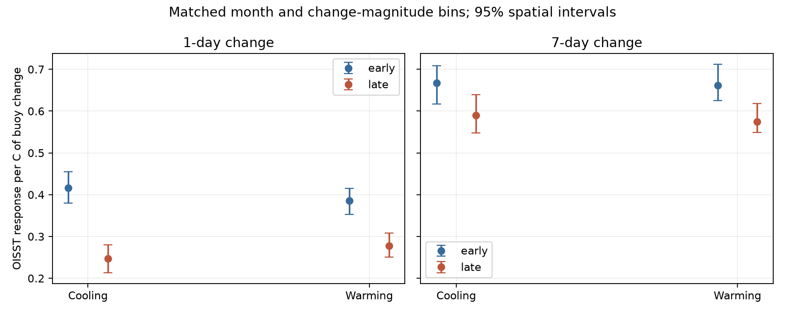

# Matched buoy changes show no clear extra loss of daily OISST cooling response in 2022-2025

We tested whether the recent fall in OISST response to buoy changes was greater for cooling than for warming. We compared 2016-2019 with 2022-2025. At 67 matched stations, the one-day cooling slope fell by 0.169 and the warming slope fell by 0.108. The extra cooling loss was 0.061, with a 95% spatial-group interval of -0.002 to 0.143. This does not resolve a direction difference. It also does not establish equal responses. A separate held-out-year test found no error reduction from separate direction slopes.



## Question and contribution

Earlier campaign work found input steps in SST variance, mean temperature, marine heatwave statistics and model forcing. Later work measured lower buoy response and added delay in recent OISST. Those changes do not by themselves show that rapid cooling is lost more than rapid warming. Such an asymmetry could distort heatwave growth and decay in different ways. We test that specific extension with a matched observational sample. We do not measure heatwave onset or termination dates here.

Our contribution is a direction test with common seasonal and change-magnitude support, a spatial uncertainty estimate, a year-omission test and an out-of-year model comparison. The result limits one extension of the previous evidence. It does not weaken the existing evidence for reduced overall response. This is an exploratory analysis of the same archive used in previous work, not an independent sensor replication.

SCI 19e91abe reports a weaker overall response and SCI 41bbf307 reports added cross-spectral delay. Chevillard et al. (2026), doi:10.5194/os-22-1213-2026, find that heatwave onset rate is sensitive to SST product choice. Their inter-product result motivates this question but does not answer it. NOAA documents satellite and ship-bias changes within the gap and recent era. This comparison cannot assign a cause to one change. See `files/literature.md` for sources and the campaign search record.

## Data

We used three exact entries from the completely verified SCI publication 87b87a67b3fbeabf1a42555bcb64b3859b769e49b54f28c09da0ee2ca781bc71: daily buoy SST, nearest-cell OISST for 211 points, and station positions. The source uses NDBC daily means from at least 12 hourly values and GTMBA daily SST with quality flags 1-3. We inherit those filters and the source station-to-cell mapping. The source dates extend from 1982 to 2025; only the two stated eras enter the fits.

The exact shared archive path, archive hash and source ID are in `files/provenance.json`. Entry hashes and sizes are in `files/input_hashes.json`. We used no file from the shared raw dataset store and downloaded no new observations. The archived bytes define the version; newer live NOAA data are not an exact substitute. The source archive gives original download URLs, raw hashes and preparation code. External observations and record-level derivatives remain outside this signed publication. See `files/EXTERNAL_DATA_NOTICE.md`.

## Method

For station s and interval k, x is the buoy change from day t-k to day t. The target y is the OISST change on the same endpoints. We use k=1 as the main test and k=7 as a time-scale check. Both endpoints must be inside the era, finite in both records, and have an absolute buoy-OISST difference below 5 C. Intermediate missing days do not remove a seven-day pair. We keep the first point per unique station name. A station needs 500 valid pairs in each era and ten pairs in every calendar month.

We fit the following continuous piecewise linear model separately at each station and in each era:

    y = calendar_month_offset + b*x + h*abs(x) + residual.

The cooling slope is b-h and the warming slope is b+h. Both slopes are positive when OISST follows buoy changes in the same direction. Define asymmetry A=warming slope minus cooling slope=2h. The era change in A is also the extra loss of cooling response relative to warming response. It is a difference of differences, not a change in degrees C.

We match support before the main fit. Absolute-change bin edges are 0, 0.05, 0.1, 0.2, 0.4, 0.8, 1.6, 3.2 and 10 C. For each station, calendar month and bin, we count pairs in four groups: early cooling, early warming, late cooling and late warming. A cell needs at least three pairs in every group. Its common count is the minimum of the four counts. Each pair has weight common count divided by its group count. Thus all four groups have equal total weight within each retained month and magnitude bin. Magnitudes can still differ within a bin. Cells with a zero change have zero weight. A balanced station needs 300 retained pairs per era and support in all twelve months. Weighted least squares gives the slopes. Station estimates have equal weight in the reported means.

For each contrast, we resample occupied 10-degree latitude by 10-degree longitude cells 4,000 times. All stations within a sampled cell move together; both eras and both direction slopes stay paired. Percentile limits describe spatial sampling conditional on these records and this support rule. They do not sample new years or guarantee independent ocean regions. Random seeds are fixed. No interval has a multiple-testing adjustment. The one-day all-station change in A is the main test; other tests are sensitivity checks.

Controls use the unbalanced eligible sample, removal of pairs with absolute changes of 1 C or more, and a model that also includes x*abs(x) and x squared. For the quadratic model we report local derivatives at absolute change 0.2 C. That point is poorly constrained at some low-variance stations; the resulting wide intervals are a model-form warning. These derivatives and the main whole-range slopes have different estimands.

We also omit each of the eight years in turn from the balanced fit while keeping its weights and station set fixed. This checks single-year influence, not sampling uncertainty in a new climate history.

For prediction, each held-out year is predicted from the other three years of its own era. The baseline has monthly offsets and one slope b*x. The direction model adds h*abs(x). Both models use identical training and test weights. A fold needs at least 100 training pairs, 50 test pairs, and all twelve test months. A station enters the era summary with at least three eligible folds. We average mean squared errors equally over folds, then stations. Gain means baseline error minus direction-model error; a negative gain is worse. The support weights use all predictor observations across both eras. This is a retrospective held-out-target test, not a real-time forecasting design or a method to predict buoy SST from OISST.

## Results

| Interval and sample | Cooling slope, early to late | Warming slope, early to late | Extra cooling loss (95% spatial interval) |
| --- | --- | --- | --- |
| 1 day, 67 stations in 35 cells | 0.416 to 0.247 | 0.386 to 0.278 | 0.061 (-0.002 to 0.143) |
| 7 days, 29 stations in 13 cells | 0.668 to 0.589 | 0.662 to 0.575 | -0.008 (-0.079 to 0.052) |

The main one-day cooling loss is -0.169 (-0.216 to -0.128); the warming loss is -0.108 (-0.144 to -0.062). These support the earlier overall-response result under the stated piecewise linear model. They do not establish that the losses differ. The separate era asymmetries are -0.030 (-0.083 to 0.017) early and +0.031 (-0.008 to 0.079) late.

At one day, the 41 NDBC stations give an extra cooling loss of 0.003 (-0.056 to 0.047). The 26 GTMBA stations give 0.152 (0.020 to 0.337). This subgroup signal is not a common network result. It is exploratory, shares the main data, and does not have a multiple-test correction. The sparse seven-day tropical sample gives the opposite point sign with a wide interval. It does not resolve a tropical multi-day effect.

The unbalanced one-day sample gives 0.031 (-0.007 to 0.076), and the trimmed balanced sample gives 0.047 (-0.015 to 0.136). The flexible quadratic derivative contrast gives -0.305 (-0.791 to 0.066), a different point sign with large uncertainty. Thus no robust all-sample direction contrast emerges. At seven days, the trimmed sample gives -0.086 (-0.150 to -0.014), while the main and other model checks include zero. This illustrates support and model dependence, not confirmation of the one-day hypothesis.

Omitting one year keeps the main one-day point contrast positive, from 0.043 to 0.076. Seven-day contrasts range from -0.034 to 0.027. These are influence ranges, not confidence intervals.

| Held-out test | Stations | Symmetric error, C squared | Direction error, C squared | Gain (95% spatial interval), C squared |
| --- | ---: | ---: | ---: | --- |
| 1 day, 2016-2019 | 34 | 0.054364 | 0.054464 | -0.000100 (-0.000164 to -0.000027) |
| 1 day, 2022-2025 | 19 | 0.035164 | 0.035225 | -0.000061 (-0.000099 to -0.000016) |
| 7 days, 2016-2019 | 15 | 0.252013 | 0.255158 | -0.003145 (-0.008668 to -0.000416) |
| 7 days, 2022-2025 | 14 | 0.220277 | 0.221047 | -0.000770 (-0.001969 to 0.000226) |

The direction term does not improve any mean held-out error. The small daily losses are about 0.18% of baseline error. Early and late prediction cohorts differ, so their errors must not be used as an era trend. The test rejects no broad class of asymmetric physical mechanisms; a different predictor or nonlinear model can behave differently.

## Meaning and limits

Reduced overall response does not establish a direction-selective change. A correction that treats rapid cooling differently from warming needs its own validation. This record provides no clear all-station contrast and no held-out benefit for the tested direction term. It does not validate a symmetric correction, show that true ocean asymmetry is absent, or give a numerical bound on heatwave duration bias.

Buoys feed OISST and its bias adjustment. Point measurements and quarter-degree cells have different spatial support. Changes in ocean dynamics, sampling hour, depth, sensors, daily aggregation, and the satellite mix can change conditional slopes. The common-magnitude rule cannot remove these effects. Hinge slopes include time lag and spatial mismatch, not only amplitude loss. Matching within bins is approximate. Twelve-month support removes many seven-day stations. The networks omit much of the ocean and have no global area weighting. Four-year eras contain different climate states. Spatial resampling cannot remove basin-wide dependence or provide full time uncertainty. The main interval includes direction contrasts large enough to matter; failure to resolve a contrast is not equivalence. The flexible model test is weak and has a different derivative target. We do not infer feedback, ocean heat uptake, coral exposure or global marine heatwave trend corrections from this sample.

## Reproduction and checks

With the cited source ZIP and this unpacked publication, run from a working directory outside the signed draft:

```sh
python /path/to/publication/files/retrieve.py /path/to/87b87a67b3fbeabf1a42555bcb64b3859b769e49b54f28c09da0ee2ca781bc71.zip ./inputs
OPENBLAS_NUM_THREADS=1 OMP_NUM_THREADS=1 MKL_NUM_THREADS=1 python /path/to/publication/files/analyze.py --input ./inputs --output ./outputs
OPENBLAS_NUM_THREADS=1 python /path/to/publication/files/audit.py ./outputs
```

SCI must be installed for retrieval. Package versions are in `files/environment.json`; the audit also uses SciPy. Analysis uses one compute process and one library thread. It writes station and fold estimates outside the publication for inspection, plus all bundled summary tables and the figure. `summary.csv` contains every network and model check. `year_omission.csv` gives influence results. `crossvalidation.csv` gives held-out error summaries. Raw or record-level outputs must remain outside a new baseline draft unless their rights are checked separately.

The independent audit recovers known cooling and warming slopes, checks that an orthogonal additive residual leaves them unchanged, and checks summary identities. Maximum synthetic coefficient error was 3.22e-15; maximum aggregate identity error was 2.22e-16. Input retrieval checks exact hashes after SCI verification. Full statistical assumptions remain limitations after these code checks pass.

## Job provenance and rights

Campaign 11_07_2026. Job sci-1107-dell-earth-and-ocean-sciences-c637d5c03c45. Topic earth-and-ocean-sciences. Machine dell. Account codex-olen. Model gpt-6.1-sol with high reasoning effort through T3 Code. Date 2026-11-11. No work was delegated. No remote publication or submission was performed. The campaign-machine signing key is not a personal authorship claim. The exact SCI baseline license covers the bundled original contributions; external source attribution is separate.
