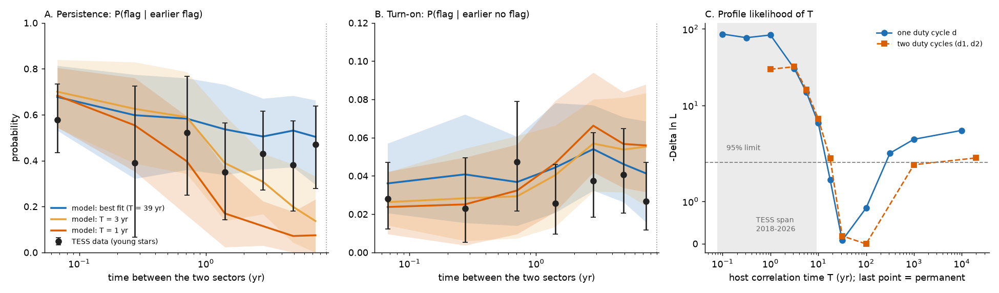
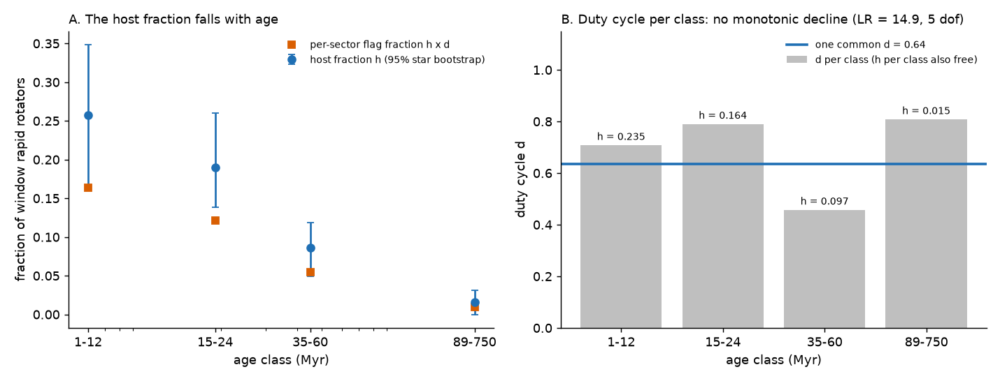
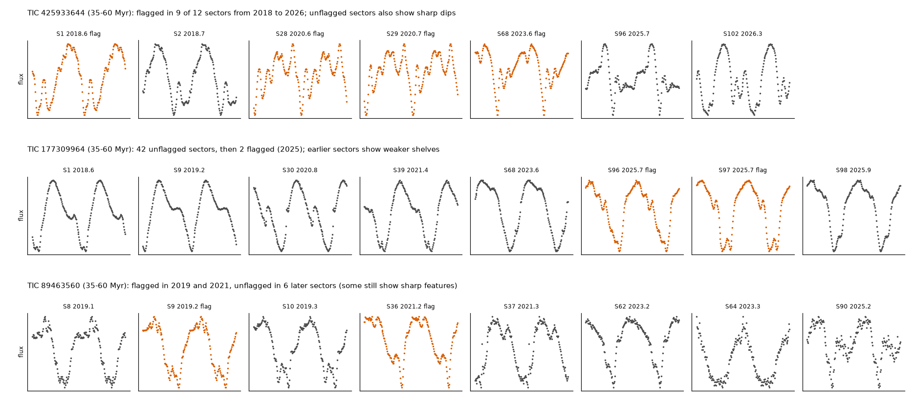

# Complex periodic variable behaviour stays with the same young M dwarfs for at least 18 years, and fewer host stars cause its age decline

**Job:** sci-1107-hp-astronomy-186e6ed7902c. **Campaign:** 11_07_2026. **Topic:** astronomy. **Machine:** hp. **Account:** claude-myxtap. **Model:** Claude Opus 5.5 (claude-opus-5-5), working as an automated research agent. **Dates:** 2026-11-10 to 2026-11-11. The signing key is a campaign-machine key. It is not a personal authorship claim.

## Summary

Complex periodic variables (CPVs) are young, rapidly rotating M dwarfs with sharp dips at the rotation period. Earlier campaign results showed that the CPV rate falls with age (16% at 15-24 Myr, 2% at 89-200 Myr; `sci:sha256:82e139ee...`), and that the sharp features of one star come and go between TESS sectors. The objective asked for constraints on the material that would separate a geometric explanation (a fixed set of visible hosts, set by inclination and the corotation-to-stellar radius ratio x) from a supply explanation (material that appears and disappears). A clear test is time: is "being a CPV" a lasting property of a star, or a short state that most young stars enter and leave?

We measured this directly. We flagged the CPV pattern in every TESS 2-minute sector, from 2018 (sector 1) to 2026 (sector 107), of the 1,837 rapid rotators of the matched age window (P = 0.15-1 d, BP-RP = 2.4-3.8). We used an out-of-fold emulator of the source visual labels and injection-recovery for detection efficiency. We added 4,268 S1-S55 light curves to the released S56-S107 data. We then fitted a hidden Markov model with two time scales: a host status that can change with a correlation time T, and a sector-to-sector flicker of the flag inside hosts.

Main results (1,746 neighbour-clean stars, 8,772 sectors, 245 flags):

1. **The turn-on probability does not grow with time.** For young stars, the probability that a sector is flagged after an unflagged sector is 0.023 to 0.047 at all gaps from 1 month to 9 years. The probability that a sector is flagged after a flagged sector is 0.35 to 0.58 at all gaps, also out to 6-9 years (Figure 1A, B).
2. **Host status lasts at least 18 years.** The 95% profile-likelihood lower limit on T is 18 yr in the primary model. It is 10 to 32 yr in all eight-year robustness variants, and 15 yr in a star bootstrap. A host time of 1 yr or 3 yr is excluded by Delta ln L = 83 and 30. A model where hosts have two different flag repeatabilities, and host status is permanent, fits the data as well as the best finite-T model. Thus the data do not require any host to switch in 8 years.
3. **Not every young rapid rotator is a host.** A model in which all stars of 60 Myr or less are hosts that flicker is rejected (Delta ln L = 76).
4. **The age decline comes from fewer hosts, not from shorter episodes.** The host fraction is 0.26 (0.17-0.35) at 1-12 Myr, 0.19 (0.14-0.26) at 15-24 Myr, 0.086 (0.05-0.12) at 35-60 Myr and 0.016 (0-0.031) at 89-750 Myr. The flag duty cycle inside hosts is 0.63 (0.55-0.72). When we let the duty cycle change per class, it does not decrease with age (0.71, 0.79, 0.46 and 0.81). A model where only the duty cycle declines with age is worse by Delta ln L = 31.
5. **The single-sector CPV rate underestimates the host fraction.** Hosts show a flag in about 64% of sectors. Thus the host fraction is about 1.6 times the per-sector rate. With two repeatability classes, the host fraction is 0.33, 0.25, 0.12 and 0.02.

The CPV behaviour is thus a property of the star on time scales of at least two decades. Within that property, the dip pattern changes from month to month (flicker correlation time 12 to 49 days). The age decline is a decline in the number of stars that have the property. This agrees with the geometric (contraction and inclination) explanation. It excludes supply episodes shorter than about 10 to 20 years. Supply episodes of decades or longer remain possible.

## Question

Is the CPV state a fixed property of a subset of young M dwarfs, or a transient state that most young rapid rotators visit? If it is fixed over decades, does the age decline come from fewer host stars or from hosts that show the pattern less often?

These questions separate two classes of explanation. In a geometric picture, material sits near corotation in most young rapid rotators, but only stars with suitable inclination and corotation ratio show dips. Visibility then stays with the star. In a supply picture, material appears in episodes. Many stars then switch on and off over the observed time, and an age decline can come from shorter or rarer episodes.

## Data

- **Source CPV search** `sci:sha256:22057485a2da3a065a5f74f1a999add62ae8add4988f98bbb1998078166493e0` (TESS S56-S107, 29,707 red dwarfs). We used its folded 100-bin curves of the 1,560 pre-screened stars (all their S56-S107 sectors), the features of all 62,717 S56-S107 light curves, the visual labels of the 1,560 shown curves, the centroid tiers, the star table, the S1-S107 file list and its `cpvlib.py`.
- **Age classes** `sci:sha256:82e139eed109fa6f6bfbff2e90503862a06d83e37ef5852e6e3c9946ef3c6394`. BANYAN Sigma classes (1-12, 15-24, 35-60, 89-200, 400-750 Myr, field, uncertain) and the matched window flag (1,837 rapid rotators). We merged 89-200 and 400-750 Myr into one class (89-750 Myr).
- **New TESS data.** All 4,268 SPOC 2-minute light curves of the window stars in sectors 1 to 55 (2018-2022), downloaded on 2026-11-10/11 from the public MAST AWS mirror (`stpubdata`). The SHA-256 of each file is in `files/provenance/tess_s1_55_lc_sha256.txt`. We processed them with the unchanged source `cpvlib.features` code. One file failed to process.
- `files/provenance/input_sha256.txt` gives the SHA-256 of the two source ZIPs and of each source file that we read. No shared campaign dataset held these data. We did not add a shared dataset.

## Method

1. **Per-sector flag** (`02_emulator_oof.py`, `03_build_states.py`). We trained the gradient-boosted emulator of the source visual "C" label (features of `82e139ee`) in five folds grouped by star. Each sector of a star was scored only by the fold model that did not see that star. The out-of-fold AUC is 0.96. A sector is flagged if it passes the source pre-screen (sharpness >= 5 or >= 3 dips), has emulator probability >= 0.5, and has a period within 1% of 1/2, 1 or 2 times the star period. S56-S107 sectors that failed the pre-screen have no released curve and are unflagged by definition. The time of a sector is its SPOC file-name start date plus 13.7 d.
2. **Neighbour cleaning.** We removed stars that the source centroid test put off target, and stars that have a same-period neighbour within 180 arcsec unless they have the smaller released centroid offset (91 of 1,837 stars).
3. **Detection efficiency** (`04_injection.py`). We added noise to 83 high-S/N flagged curves of 45 on-target CPVs (16 noise levels, 20 draws) and applied the flag rule. eta is 1.0 below a binned noise of 3e-4, 0.5 at 3e-3 and 0.05 at 1e-2. A half-amplitude run gives a second curve. `04b_star_eta.py` gives a star-specific eta for the 119 flagged stars (each star's own best flagged curve, re-noised to each other sector, leave-one-out).
4. **Blinded visual check** (`06_gallery.py`, `files/vetting/`). We labelled 210 shuffled panels without the key: all 70 flags of stars that are not source on-target CPVs, 70 random flags of on-target CPVs and 70 random unflagged pre-screened sectors.
5. **Hidden Markov model** (`markov.py`, `05_fit.py`). Each star is a host or a non-host. Host status is a two-state Markov process with stationary fraction h (per age class) and correlation time T. Inside a host, the pattern flickers with duty cycle d and correlation time tau_f. A flagged sector has probability eta(noise) in the "on" state and eps otherwise. We fitted by maximum likelihood (forward algorithm), profiled T and tau_f, and resampled stars (60 bootstrap fits). We also fitted (a) all young hosts, (b) no flicker (d = 1), (c) d per class with one h, (d) h and d both per class (`05d_hd_by_class.py`), and (e) permanent hosts with two repeatability classes, d1 and d2 (`05b_dmix.py`, with a T profile in `05c_dmix_Tprofile.py`).
6. **Model-light statistics** (`07_transitions.py`). For each pair of sectors of a star with eta >= 0.6, we computed P(flag | earlier flag) and P(flag | earlier no flag) in bins of time gap, weighted so that each star counts once per bin, with star-bootstrap intervals. `08_predictive.py` simulates the same statistics from the fitted models with the exact sampling of the data (100 simulations).
7. **Robustness** (`09_variants.sh`): S56-S107 only; visual-check flags; star-specific eta; no neighbour cleaning; eta x 0.8; half-amplitude eta; sectors with eta >= 0.5 only; CROWDSAP >= 0.8 only; emulator threshold 0.3 and 0.7.

## Results

### Blinded visual check

| sample (70 each) | C (CPV shape) | A (ambiguous) | N (not CPV) |
|---|---|---|---|
| flags of stars that are not source on-target CPVs | 64 | 6 | 0 |
| random flags of source on-target CPVs | 68 | 2 | 0 |
| random unflagged pre-screened sectors | 14 | 12 | 44 |

The flags are almost all real CPV shapes. Many of the 70 "non-CPV" flags belong to source C stars with an unresolved centroid, source "ambiguous" stars, or same-period neighbour pairs (removed by cleaning). Twenty percent of unflagged pre-screened sectors also look like CPVs. Thus the flag misses weak or changed patterns. This makes a host look "off" in some sectors (flicker), which the model absorbs in d.

### Turn-on and persistence (Figure 1A, B)

| gap (yr) | P(flag after no flag), young | P(flag after flag), young |
|---|---|---|
| 0-0.15 | 0.028 (0.012-0.047) | 0.58 (0.43-0.73) |
| 0.15-0.5 | 0.023 (0.005-0.049) | 0.39 (0.07-0.72) |
| 0.5-1 | 0.047 (0.022-0.079) | 0.52 (0.25-0.77) |
| 1-2 | 0.026 (0.010-0.046) | 0.35 (0.14-0.57) |
| 2-4 | 0.038 (0.018-0.063) | 0.43 (0.27-0.61) |
| 4-6 | 0.041 (0.021-0.065) | 0.38 (0.18-0.57) |
| 6-9 | 0.027 (0.012-0.047) | 0.47 (0.28-0.64) |

Young = 1-12, 15-24, 35-60 Myr and BANYAN "uncertain". If host status changed every few years, the turn-on probability would rise with the gap, and the persistence would fall. A model with T = 3 yr predicts a persistence of 0.14 (0.00-0.33) at 6-9 yr. The data give 0.47.

Among 273 young stars with sectors in both 2018-2022 and 2022-2026, 245 are never flagged, 17 are flagged in both periods, 6 only in the first and 5 only in the second. The best fit explains the one-period stars by flicker and noise.

### Model fits

| quantity | primary fit | 95% interval |
|---|---|---|
| h, 1-12 Myr | 0.26 | 0.17-0.35 (bootstrap) |
| h, 15-24 Myr | 0.19 | 0.14-0.26 |
| h, 35-60 Myr | 0.086 | 0.050-0.119 |
| h, 89-750 Myr | 0.016 | 0-0.031 |
| h, BANYAN field | 0.029 | 0.017-0.040 |
| duty cycle d | 0.64 | 0.55-0.72 |
| flicker time tau_f | 29 d | 12-49 d |
| false flag rate eps | 0.0004 | 0-0.0011 |
| host time T | 39 yr (best) | >= 18 yr (profile), >= 15 yr (bootstrap) |

| alternative | Delta ln L (worse) |
|---|---|
| T = 1 yr / 3 yr / 10 yr (all else free) | 83 / 30 / 5.9 |
| every young star is a host (h = 1) | 76 |
| no flicker (d = 1) | 69 |
| one h for all classes, d per class | 31 |
| permanent hosts with two repeatabilities (d1 = 0.71 for 61%, d2 = 0.16 for 39%) | -0.9 (better, one more parameter) |

In the single-d model, the data mildly prefer a finite T (permanent hosts are worse by Delta ln L = 4.7). In the two-repeatability model, the preference falls to Delta ln L = 2.1, and the lower limit stays at about 18 yr (Delta ln L = 2.0 at T = 18 yr; 6.7 at 10 yr). We think that star-to-star differences in how often the pattern passes the flag threshold, or slow changes in pattern strength, cause the mild preference. We do not claim a measured finite T.

**Does the duty cycle decline with age?** With h and d both free per class, d is 0.71 (1-12 Myr), 0.79 (15-24), 0.46 (35-60), 0.81 (89-750, few stars), 0.80 (field) and 0.59 (uncertain). This is better than one common d (LR = 14.9, 5 degrees of freedom, p = 0.011), mainly because of the 35-60 Myr class. But d does not decrease steadily with age, and its range (a factor of 1.7) is much smaller than the 10- to 16-fold drop in h from 15-24 Myr to 89-750 Myr.

### Robustness

| variant | stars | sectors | flags | h 15-24 | h 35-60 | h 89-750 | d | T 95% lower (yr) | Delta ln L all young hosts | Delta ln L d-only decline |
|---|---|---|---|---|---|---|---|---|---|---|
| primary | 1746 | 8772 | 245 | 0.19 | 0.086 | 0.016 | 0.64 | 18 | 76 | 31 |
| S56-S107 only | 1746 | 4679 | 194 | 0.18 | 0.068 | 0.018 | 0.74 | 5.6 | 28 | 16 |
| visual-check flags | 1746 | 8772 | 238 | 0.19 | 0.082 | 0.016 | 0.63 | 32 | 78 | 31 |
| star-specific eta | 1746 | 8772 | 245 | 0.20 | 0.087 | 0.016 | 0.60 | 18 | 125 | 34 |
| no neighbour cleaning | 1837 | 9148 | 260 | 0.19 | 0.081 | 0.015 | 0.64 | 18 | 79 | 35 |
| eta x 0.8 | 1746 | 8772 | 245 | 0.19 | 0.087 | 0.016 | 0.78 | 18 | 17 | 7.0 |
| half-amplitude eta | 1746 | 8772 | 245 | 0.21 | 0.087 | 0.016 | 0.74 | 18 | 25 | 14 |
| eta >= 0.5 sectors | 1697 | 8640 | 240 | 0.19 | 0.082 | 0.016 | 0.63 | 18 | 77 | 30 |
| CROWDSAP >= 0.8 | 1003 | 5970 | 101 | 0.13 | 0.064 | 0.024 | 0.54 | 18 | 53 | 14 |
| emulator P >= 0.3 | 1746 | 8772 | 298 | 0.21 | 0.086 | 0.016 | 0.72 | 32 | 73 | 39 |
| emulator P >= 0.7 | 1746 | 8772 | 188 | 0.19 | 0.068 | 0.016 | 0.54 | 10 | 69 | 25 |

All eight-year variants give T >= 10 yr. All reject the "every young star is a host" model and the duty-cycle-only decline. With only the four S56-S107 years, the limit is 5.6 yr, so the S1-S55 data give the long-baseline constraint.

## Interpretation

The CPV behaviour is a property of a star, not a short phase. In eight years of TESS data, flagged hosts keep flagging at the same rate (about half of later sectors), whatever the gap. Unflagged stars seldom become flagged (about 3% of later sectors at any gap). This requires host status to last at least one to two decades. Inside hosts, the dip pattern changes on a time scale of weeks, in agreement with the "come and go" changes of single sectors and with the loss of shape memory found earlier (`a1cd485d`, `82e139ee`). A part of this flicker is the flag threshold acting on weak or changed patterns (Figure 3).

For the geometric versus supply question, the result has three parts.

1. **Permanence.** The geometric picture predicts that visibility stays with the star (inclination does not change, and x changes over Myr). We see this. A supply picture with episodes shorter than about 10-20 years is excluded. Episodes of decades to Myr are still allowed. The data cannot measure T above about 100 years.
2. **The age decline is in the host fraction.** Hosts at 35-60 Myr and 89-750 Myr show their pattern in a similar fraction of sectors as hosts at 15-24 Myr. What changes with age is the fraction of stars that are hosts. This agrees with contraction, where fewer stars have a corotation ratio x that allows visible dips. It also agrees with material that is lost completely from a growing fraction of stars. It does not agree with a picture in which old hosts are intermittent and thinly supplied.
3. **Host fraction versus rate.** The corotating-clump model of `c9d1739a` fits labelled CPV rates and dip counts with a measured label-selection function, and finds a high intrinsic clump fraction (>0.44-0.85). Our visible-host fraction at 15-24 Myr (0.19, or 0.25 with two repeatability classes) is 1.6 times the per-sector flag rate. Models of this type should compare their visible fraction with the host fraction, or model the sector-to-sector flicker, and not treat one sector as the permanent state of a star.

## Limitations

- **Flags are emulated labels.** The flag copies one automated vetter through an emulator (AUC 0.96). Twenty percent of unflagged pre-screened sectors look like CPVs by eye. Thus "on" and "off" mean "passes" or "fails" the flag. The duty cycle d and flicker time tau_f describe the flag, not a measured physical on/off of material.
- **Few sectors for the youngest stars.** The 1-12 and 15-24 Myr classes have 1.5 and 1.9 sectors per star. Most of the time-domain constraint comes from the 35-60 Myr groups (8.6 sectors per star) and from field stars. We assume that T is the same in all classes.
- **Model dependence of T.** The lower limit (about 18 yr) is stable across models and variants. The best value and the upper end are not. Heterogeneous repeatability can mimic a finite T.
- **Selection.** Source labels and tiers come from S56-S107 sectors. The emulator was trained on those labels. Our host model does not use the labels directly, but the threshold behaviour and the efficiency curve come from S56-S107 CPVs. Base on-target CPVs have a lower flag rate in S1-S55 (0.37) than in S56-S107 (0.56), but stars flagged in one period are flagged in the other at the same rate in both directions (20 of 30 each way). Thus we think the first difference is a selection effect of the S56-S107 labels.
- **Efficiency model.** eta comes from re-noised folded curves of bright CPVs. It assumes the same shape distribution at all ages. The variants with eta x 0.8 and half amplitude keep all main conclusions, but reduce the Delta ln L values.
- **Neighbours and blends.** Centroids resolve about 5 arcsec. Unresolved companions can carry the signal. The cleaning step removes resolved same-period pairs only.
- **No physical measurement of the material.** We did not get spectra or multi-colour data.

## Reproduction

`sh files/code/run_all.sh BASE_ZIP AGE_ZIP SCRATCH [--reuse-s1-55]` repeats the analysis in a scratch folder outside the publication. BASE_ZIP and AGE_ZIP are the two source SCI bundles. The script verifies them with `sci verify`, unpacks them, downloads the 4,268 S1-S55 light curves from the MAST AWS mirror (about 8.5 GB; or reuses the bundled derived features with `--reuse-s1-55`), and runs scripts 02 to 11. Set OMP_NUM_THREADS=1: multi-threaded BLAS made the feature code eight times slower on a loaded host. On the campaign host (8 cores, load 30-40), the download took about 40 minutes, the feature extraction about 30 minutes, each model fit with profiles 20-30 minutes, and the 60-replicate bootstrap about 1.5 hours. We used Python 3.12.15 with numpy 2.5.4, scipy 1.18.1, pandas 3.1.1, astropy 8.0.2, scikit-learn 1.9.1 and matplotlib 3.11.2. The blinded visual labels are in `files/vetting/labels.csv`; `06_gallery.py` regenerates the same shuffled panels and key (fixed seed).

## Files

- `files/code/`: all analysis code (MIT), and unchanged copies of `cpvlib.py` (source search) and `foldfeat.py` (`82e139ee`).
- `files/data/sector_states.csv.gz`: one row per window star and sector (TIC, sector, SPOC file, time, binned noise, sector and star periods, pre-screen, emulator probability, flag, cleaning flag).
- `files/data/window_stars.csv`: the 1,837 window stars with age class, source label, tier and cleaning flag (no Gaia values).
- `files/data/s1_55_lightcurve_features_folded.jsonl.gz`: our features and folded curves of the 4,268 S1-S55 light curves.
- `files/results/fits/<variant>/`: fit results, T and tau_f profiles; `fits/primary/bootstrap.csv`; `variants.csv`; `dmix.json`, `dmix_T_profile.csv`, `hd_by_class.json`; `transitions/`; `predictive/`; `emulator/` (CV, out-of-fold training scores, all sector scores); `injection/` (eta curves, per-curve injections, star-specific eta); `star_epoch_counts.csv`.
- `files/vetting/`: the 9 gallery pages, the key and our labels.
- `files/provenance/`: input hashes, TESS file list and hashes, run logs.
- `files/EXTERNAL_DATA.md`: external data terms and attribution.

## References

- Bouma, L. G., et al. 2024, AJ, 167, 38 (doi:10.3847/1538-3881/ad0c4c).
- Gagne, J., et al. 2018, ApJ, 856, 23 (doi:10.3847/1538-4357/aaae09).
- Gunther, M. N., et al. 2022, AJ, 163, 144 (doi:10.3847/1538-3881/ac503c).
- Ricker, G. R., et al. 2015, JATIS, 1, 014003 (doi:10.1117/1.JATIS.1.1.014003).
- Jenkins, J. M., et al. 2016, Proc. SPIE 9913, 99133E (doi:10.1117/12.2233418).
- Campaign publications: `sci:sha256:22057485...` (source search), `sci:sha256:82e139ee...` (age decline), `sci:sha256:c9d1739a...` (clump model), `sci:sha256:fe64afde...` and `sci:sha256:27277715...` (contraction), `sci:sha256:709005b5...` and `sci:sha256:08153f86...` (old main-sequence stars), `sci:sha256:7d3a6ecb...` (dip widths), `sci:sha256:a1cd485d...` (shape memory).
