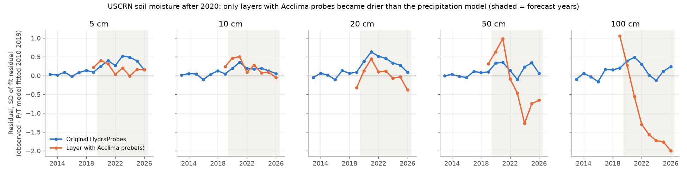
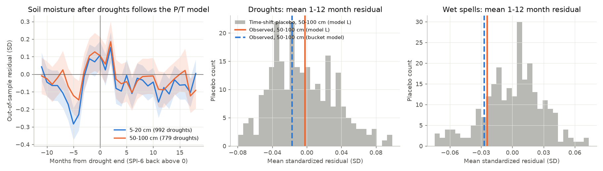
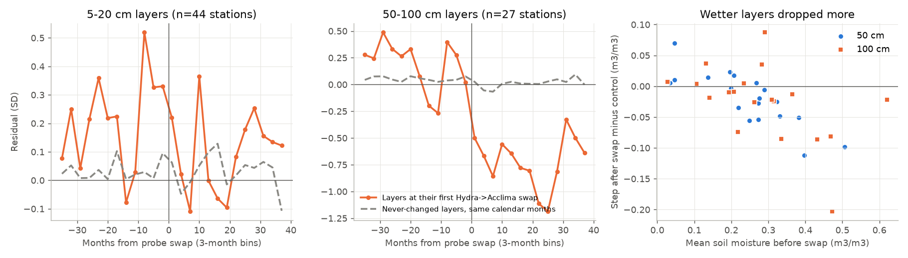

# Unadjusted Acclima probe swaps cause the post-2020 deep-soil drying in USCRN soil moisture; deep soil did not stay dry after droughts (CONUS, 2009-2026)

Job: sci-1107-dell-earth-and-ocean-sciences-818d504d041a. Topic: earth-and-ocean-sciences. Machine: dell. Model: Claude Opus 5.5 (claude-opus-5-5). The signing key is a campaign-machine key. It is not a personal authorship claim.

## Summary

We used daily in situ soil moisture from the NOAA U.S. Climate Reference Network (USCRN) at 5, 10, 20, 50 and 100 cm. We used up to 119 stations in the conterminous United States (CONUS) from 2009 to November 2026. Each station also measures its own precipitation and air temperature.

1. **Drought recovery (planned test, null result).** We asked if deep soil (50-100 cm) stays drier than a precipitation-memory model after a meteorological drought ends. This is the point-scale form of the "non-recovery" question that earlier campaign studies tested with GRACE storage and with runoff. For 554 droughts with deep data, the mean out-of-sample residual in months 1-12 after the drought was -0.003 SD (time-shift placebo 95% range -0.067 to +0.072; p = 0.57). A two-store threshold bucket model gave -0.017 SD. Wet spells gave no persistent surplus (-0.024 SD). An injected deficit of 0.25 SD was detected; a deficit of 0.1 SD was not. Thus, a uniform deficit larger than about 0.13 SD (about 0.005 m3/m3) is unlikely. We did not reproduce the published result that 50-100 cm soil stayed about 18% below pre-drought levels in 2013 after the 2012 drought.

2. **A new pattern (found during the work).** A model fitted to 2010-2019 data predicted 2020-2026 badly. After 2020, the 5-20 cm layers were wetter than the model (+0.2 to +0.5 SD). The 100 cm layer was much drier (-0.4 to -0.8 SD in 2023-2026).

3. **Cause of the deep drying: a sensor change.** Since 2017, USCRN has replaced Stevens HydraProbe sensors with Acclima TDR-315 sensors. NCEI includes the new sensors in the layer averages without a homogeneity adjustment. We downloaded the probe history of every station (manufacturer, model, serial number and change date of each of the 15 probes) from the NCEI ISIS metadata system. After 2020, layers with Acclima probes were drier than the model at 100 cm (-1.39 SD) and 50 cm (-0.58 SD). Layers with only the original HydraProbes were wetter than the model (+0.21 and +0.26 SD). The station-level difference at 100 cm was -0.037 m3/m3 (95% CI -0.070 to -0.007). At the first HydraProbe-to-Acclima swap, a calendar-matched difference-in-differences gave a step of -0.026 m3/m3 at 100 cm (95% CI -0.055 to -0.002) and -0.021 m3/m3 at 50 cm (95% CI -0.040 to -0.001). The step became larger when more probes were swapped at the same time and when the layer was wetter before the swap. Like-for-like HydraProbe replacements gave no step. In the network mean, the 2023-2025 deep anomaly relative to 2012-2019 was -0.020 to -0.031 m3/m3 with all published data, but only -0.009 to +0.007 m3/m3 in months with original probes.

**Conclusion.** The deep-soil drying in the USCRN record after 2020 is mostly a sensor-transition artifact, not a climate signal. Users of USCRN soil moisture for trends, drought indices or satellite validation must account for the documented probe swaps. The original-probe layers became wetter than the 2010-2019 model after 2020 at all depths. We do not know if this is real or if it is HydraProbe drift.

## 1. Question and context

The research objective of the campaign is to find and explain changes in extremes and recovery in Earth systems. Earlier campaign work tested "non-recovery" after droughts:

- Victorian catchments stayed in a low-runoff state after the Millennium Drought (sci:sha256:36d145c14c6ec974218c8e931718ed72d3cce8b76d5aec730e2ff5932212ff61).
- GRACE total water storage did not stay below precipitation models after droughts on global land (sci:sha256:97d8cdba8957865a28d1f044442ea3d4f53480e171296758ece398b7ac61dab0, sci:sha256:363ebf385701685fa5382e81bf36dccb0271e5bab3f2d5bea44af45c003cd59e). GRACE storage deficits and surpluses decayed at similar rates (sci:sha256:2a272ce0fcfb5955020e580c5b6f683e12039d45b8bee777b6070e417e1bbbf3, sci:sha256:8f022b61bbf781fc16d9c501656660fa949a54ffe00680c46f19c85968649a6b), but storage rose faster than it fell (sci:sha256:bd955a4f7f0de09da98a219a29d8ed655f190d474261a09b77483111f9269bc9).

GRACE cells are about 300 km wide, and runoff integrates a whole catchment. A deep-soil memory at the point scale can hide in both. Bell, Leeper et al. (2015, doi:10.2136/vzj2015.02.0023) reported that USCRN soil at 50 and 100 cm stayed about 18% below pre-drought levels in 2013, after rain returned to normal. No campaign publication used USCRN soil moisture before this one. Thus our planned question was: **after a drought ends, does deep soil moisture stay below what the station's own precipitation and temperature predict?** We also planned to test if a threshold mechanism (the upper layer must fill before water drains deeper) explains a delay.

The post-2020 divergence (Section 4.2) was not planned. We found it in a forward check and then tested its cause with the probe metadata (Section 4.3). The plan and each design change are recorded with times in `files/PROGRESS.md`.

## 2. Data

All inputs are U.S. Government works from NOAA NCEI.

| Input | Source and version | Hash (SHA-256) |
| --- | --- | --- |
| USCRN daily01, all stations, 2000 to 2023-07-31 | `https://www.ncei.noaa.gov/pub/data/uscrn/products/daily01/snapshots/CRND0103202307310750.zip`; campaign store `shared_datasets/uscrn-daily01-snapshot-202307310750` | d97d2047095f48ae05dbab678a1ad4f948cee2d204ee2d7255c76ca52bd6d434 |
| USCRN daily01 yearly station files 2023-2026 (636 files) | `https://www.ncei.noaa.gov/pub/data/uscrn/products/daily01/YYYY/`, retrieved 2026-11-12 | per file in `files/data/raw_yearly_sha256.txt` |
| Station list | `https://www.ncei.noaa.gov/pub/data/uscrn/products/stations.tsv` | in `raw_yearly_sha256.txt` |
| Soil-probe history, 148 USCRN stations | NCEI ISIS summary report (CSV; fields probe depth, manufacturer, model, serial), `https://www.ncei.noaa.gov/access/isis/summary.htm`, retrieved 2026-11-12 | e65a4216de974b3d27be6e9d94faa913f7811ebd2240de81fa768e3e22e4905e |
| NCEI notices | "Update of Soil Moisture Products with Acclima Data" (July 2021); "Correction to Volumetric Soil Moisture" (October 2022); Technical Memorandum USCRN-19-001 (2019) | URLs in Section 7 |

Notes on the data:

- Years up to 2022 come from the 2023-07-31 snapshot. Years 2023-2026 come from the live yearly files. NCEI reprocessed 2017-2021 layer averages in July 2021 to include Acclima probes, and corrected the HydraProbe conversion in October 2022 (zero values became missing). Both changes are in the snapshot and in the live files.
- The parsed data contain 1,285,164 station-days at 237 stations. We used USCRN stations in CONUS (119 with monthly data). Soil moisture at 50 and 100 cm exists at about 90 stations from 2009-2011.
- The ISIS probe history lists 598 HydraProbe-to-Acclima swaps (2017-2025) and 666 like-for-like HydraProbe replacements (2010-2025) at 117 stations. Each layer average comes from three probes in three plots.

## 3. Methods

**Monthly series.** For each station and depth, we averaged daily soil moisture to months. We removed days with soil temperature below 1 C at that depth (frozen soil). A month needs 15 valid days. Monthly precipitation needs 25 valid days. SPI-6 is a gamma fit per calendar month to the 6-month precipitation sum of the station.

**Events.** A drought is a run of 3 or more months with SPI-6 < 0 that contains a month with SPI-6 <= -1. The drought ends at the last month of the run. A wet spell is the mirror case. We found 1,018 droughts and 966 wet spells at 119 stations.

**Model L (linear memory).** Soil moisture = constant + two seasonal harmonics + monthly temperature anomaly + three exponentially weighted precipitation-anomaly memories (time constants 1, 3 and 12 months).

**Model B (threshold bucket).** A daily two-store model, driven by station precipitation and Hargreaves potential evaporation, with a degree-day snow store. Water drains from the upper store to the deep store only above a field-capacity threshold, or when the upper store overflows. We selected 6 parameters from a grid of 972 sets for each station and depth (in-sample). The monthly mean store then replaces the precipitation memories in a linear model.

**Drought recovery test.** For each event, we fitted the model on all months except the event and its 12 following months (leave one event out). The endpoint is the mean out-of-sample residual in months 1-12 after the end, divided by the residual SD of the fit. "Deep" is the mean of the 50 and 100 cm values. The null distribution comes from 251 common time shifts of all event windows (12-262 months on a common 2004-2026 axis), with refits. The planned design excluded all event windows of a station from the fit. This was not possible because event windows cover most of each record, so we changed to leave-one-event-out before we saw any result.

**Forward test.** We fitted the models to months before 2020 and predicted 2020-2026.

**Probe attribution.** (a) Forward residuals by probe status of each layer-month: original HydraProbes, layer with at least one Acclima probe, or layer with a replaced HydraProbe. The model was fitted only on original-probe months before 2020. We bootstrapped stations (4,000 draws) for 95% intervals. (b) Difference-in-differences at the first probe change of each layer: we fitted model L on months before the change, then took the mean residual in the 24 months after minus the 24 months before. The control is the same quantity, over the same calendar months, in layers of the same depth that never had a probe change.

## 4. Results

### 4.1 Deep soil did not stay dry after droughts

| Statistic (mean SD units, months 1-12 after event end) | Model L | Placebo 95% range (L) | Model B |
| --- | --- | --- | --- |
| Droughts, 50-100 cm (n = 554) | -0.003 (p = 0.57) | -0.067 to +0.072 | -0.017 |
| Droughts, 50 cm / 100 cm | -0.004 / -0.041 | -0.077 to 0.084 / -0.078 to 0.068 | +0.004 / -0.073 |
| Droughts, 5-20 cm (n = 730) | -0.037 (p = 0.063) | -0.047 to +0.035 | -0.024 |
| Wet spells, 50-100 cm (n = 528) | -0.024 | -0.063 to +0.053 | -0.027 |
| Droughts, 50-100 cm, original-probe months only (n = 381) | -0.057 (p = 0.13) | -0.086 to +0.044 | not run |
| Wet spells, 50-100 cm, original-probe months only (n = 363) | +0.005 | -0.109 to +0.055 | not run |

Injection test (model L, droughts): a uniform deficit of 0.25 SD gave -0.136 (outside the placebo range); 0.1 SD gave -0.056 (inside). The design recovers about half of an injected deficit, because other event windows stay in the fit. The median residual SD of model L is 0.036 m3/m3 at 50 cm and 0.039 m3/m3 at 100 cm.

Thus deep soil returned to the level that the station precipitation predicts within the first year. The planned threshold explanation (model B) was not necessary, because there was no deficit to explain. Shallow soil was slightly drier than both models in the first year (-0.024 to -0.037 SD). This is at the edge of the placebo range. In the lag composite (Figure 3, left), the models under-predict the drying in the last 3-6 months of a drought (most at 5-20 cm). Residuals are slightly positive in months 0-2 after the end and near zero or slightly negative after that.

The published 2013 deficit did not repeat. At 36 stations with complete summer data, mean June-August soil moisture at 50-100 cm was 7.5% lower in 2012 and 10.1% higher in 2013 than in 2011 (`files/results/noaa2012_summer_means.csv`). Bell et al. used a different baseline and station set, so this is not a direct contradiction.

### 4.2 After 2020 shallow layers became wetter and deep layers drier than the model

With model L fitted to 2010-2019 data, the network-mean residual in 2023, 2024 and 2025 was -0.43, -0.77 and -0.68 SD at 100 cm, and +0.07 to +0.48 SD at 5-20 cm in 2020-2025 (`files/results/forward_split2020.csv`). Model B gave the same pattern. A simple climate cause does not explain a wetter surface over a drier deep layer at near-normal precipitation.

### 4.3 The deep drying is in the layers with Acclima probes

Post-2020 residuals, station means (`files/results/attrib_ci_split2020.csv`; model L fitted on original-probe months before 2020):

| Depth | Original HydraProbes (stations, SD) | Acclima in layer (stations, SD) | Difference, SD (95% CI) | Difference, m3/m3 (95% CI) |
| --- | --- | --- | --- | --- |
| 5 cm | 56, +0.33 | 40, +0.19 | -0.14 (-0.51 to 0.26) | -0.005 (-0.016 to 0.005) |
| 10 cm | 61, +0.25 | 40, +0.07 | -0.18 (-0.59 to 0.23) | -0.006 (-0.018 to 0.007) |
| 20 cm | 48, +0.40 | 27, +0.00 | -0.40 (-1.12 to 0.28) | -0.010 (-0.027 to 0.007) |
| 50 cm | 47, +0.26 | 27, -0.58 | -0.84 (-1.88 to 0.17) | -0.028 (-0.054 to -0.002) |
| 100 cm | 52, +0.21 | 25, -1.39 | -1.59 (-3.02 to -0.33) | -0.037 (-0.070 to -0.007) |

Model B gave -0.025 m3/m3 at 50 cm (95% CI -0.049 to -0.003) and -0.026 m3/m3 at 100 cm (-0.061 to +0.006).

Step at the first probe change of a layer, calendar-matched difference-in-differences (`files/results/did_summary.csv`):

| Change | Depth | Layers | Step, SD (95% CI) | Step, m3/m3 (95% CI) | r(step, pre-swap mean) |
| --- | --- | --- | --- | --- | --- |
| HydraProbe to Acclima | 5 cm | 33 | -0.06 (-0.34 to 0.24) | -0.002 (-0.011 to 0.007) | -0.12 |
| HydraProbe to Acclima | 10 cm | 33 | -0.32 (-0.63 to -0.01) | -0.011 (-0.020 to -0.004) | -0.46 |
| HydraProbe to Acclima | 20 cm | 20 | -0.10 (-0.65 to 0.44) | -0.007 (-0.025 to 0.010) | -0.36 |
| HydraProbe to Acclima | 50 cm | 19 | -0.54 (-1.31 to 0.25) | -0.021 (-0.040 to -0.001) | -0.82 |
| HydraProbe to Acclima | 100 cm | 19 | -1.10 (-2.05 to -0.22) | -0.026 (-0.055 to -0.002) | -0.49 |
| HydraProbe to HydraProbe | 5-100 cm | 6-13 per depth | +0.18 to +0.44, all CIs include 0 | -0.001 to +0.011, all CIs include 0 | - |

At 50-100 cm, the step depends on how many of the three probes were swapped on the first date: 1 probe +0.11 SD (17 layers), 2 probes -1.31 SD (-0.030 m3/m3, 14 layers), 3 probes -2.10 SD (-0.076 m3/m3, 7 layers) (`files/results/did_dose.csv`). At the station level, 19 of 27 deep layers had a negative step (sign test p = 0.052). Wetter layers had larger drops. This agrees with the NCEI statements that HydraProbes over-read in wet clay soils and that the Acclima "reduces the average at unrealistically high soil water content".

Network-mean anomaly relative to 2012-2019 (`files/results/network_deep_anomaly.csv`, Figure 4):

| Year | 50 cm, all data | 50 cm, original-probe months | 100 cm, all data | 100 cm, original-probe months |
| --- | --- | --- | --- | --- |
| 2023 | -0.024 | -0.007 | -0.028 | -0.004 |
| 2024 | -0.020 | +0.007 | -0.030 | -0.007 |
| 2025 | -0.025 | +0.003 | -0.031 | -0.009 |

## 5. Limitations

- The probe-history report gives the date of each recorded change, not the date when a probe began to fail. A failing HydraProbe often reads too wet before replacement (USCRN-19-001), so part of a step can be the end of a failure, not a calibration offset.
- Stations with Acclima probes are not a random sample. NCEI replaced failed probes first, and failures were concentrated in clay soils. The difference-in-differences uses each layer's own pre-swap months to limit this bias, but it cannot remove it.
- After the first change, more swaps follow in many layers. We report only the first-change step and the status-based contrast.
- The "original-probe" subset becomes smaller with time (52 to about 32 stations at 100 cm), so its network mean has a changing composition.
- Model fits are simple (monthly, linear in precipitation memory, R2 0.49-0.72). The bucket parameters were chosen in-sample. The placebo for model B is wide at 100 cm because some refits are unstable.
- The drought test pools all droughts, including short ones. We did not test drought severity classes. Events overlap, and the leave-one-event-out design recovers only about half of an injected deficit.
- The live 2025-2026 files and the ISIS report can change after our retrieval date (2026-11-12). We recorded hashes of the files we used.
- We did not use per-probe soil moisture values. They are not in the public products that we found.

## 6. Open questions for the next study

1. Why did layers with only original HydraProbes become 0.2-0.4 SD wetter than the 2010-2019 model at all depths after 2020? Possible causes are real wet years, HydraProbe aging drift, and model error. A comparison with independent networks (for example, NRCS SCAN or state mesonets) can test this.
2. A homogenized USCRN soil-moisture series is not available. A step-adjustment at each documented swap (for example, per-layer offsets estimated as in Section 3, or quantile matching for the wet-end compression) can make one.
3. Satellite validation (SMAP core and sparse sites), drought indices that use USCRN standardized soil moisture, and USCRN trend reports after 2019 must be checked for this artifact.
4. Repeat the drought test with a homogenized record and with severity classes.

## 7. Reproduction

Code is in `files/code/`. Run `00_get_data.sh SCRATCH` to download the external inputs into a separate scratch directory, then `run_all.sh SCRATCH DERIVED OUT FIGS`. The full run takes about 2 h on 2 CPUs (Python 3.12 with numpy, pandas, scipy, matplotlib and pyarrow). The placebo loops take most of the time.

Scripts: `01_parse.py` (daily files to one table), `02_monthly.py` (monthly means, SPI-6, events), `03_bucket.py` (model B), `04_analysis.py` (drought and wet-spell test; `MASKCHANGE=1` gives the original-probe variant; results in `files/results/maskchange/`), `05_noaa2012.py`, `06_forward.py`, `07_probes.py` (ISIS history to change events), `08_steps.py` (first step screen; replaced by `10_did.py`), `09_attrib.py`, `10_did.py`, `11_figs_probe.py`, `12_fig_drought.py`, `13_attrib_ci.py`, `14_dose.py`, `15_resid_sd.py`, `16_inject.py`.

Derived data in `files/data/`: `monthly.parquet` (station-month values), `events.csv`, `probe_history.csv` (parsed ISIS history), `raw_yearly_sha256.txt`, `isis_station_ids.txt`. Results in `files/results/`.

Documents used:
- https://www.ncei.noaa.gov/pub/data/uscrn/publications/events/Update%20of%20Soil%20Moisture%20Products%20with%20Acclima%20Data.pdf
- https://www.ncei.noaa.gov/pub/data/uscrn/publications/events/Correction%20to%20Volumetric%20Soil%20Moisture%2010202022.pdf
- https://www.ncei.noaa.gov/pub/data/uscrn/documentation/research/NOAA-Tech-Memo-Soil-FINAL-AUGUST%202019.pdf
- Wilson et al. 2020, Vadose Zone J., doi:10.1002/vzj2.20013
- Bell et al. 2015, Vadose Zone J., doi:10.2136/vzj2015.02.0023

## 8. Licenses and external data

The `LICENSE` file is the SCI baseline license. It applies to our text, figures, code and derived tables. The input data are NOAA NCEI products. They are works of the U.S. Government and are in the public domain in the United States. The derived tables in `files/data/` come only from these NOAA data. See `files/EXTERNAL_DATA_NOTICE.md` for attribution. We did not include the raw daily files; `00_get_data.sh` downloads them.
