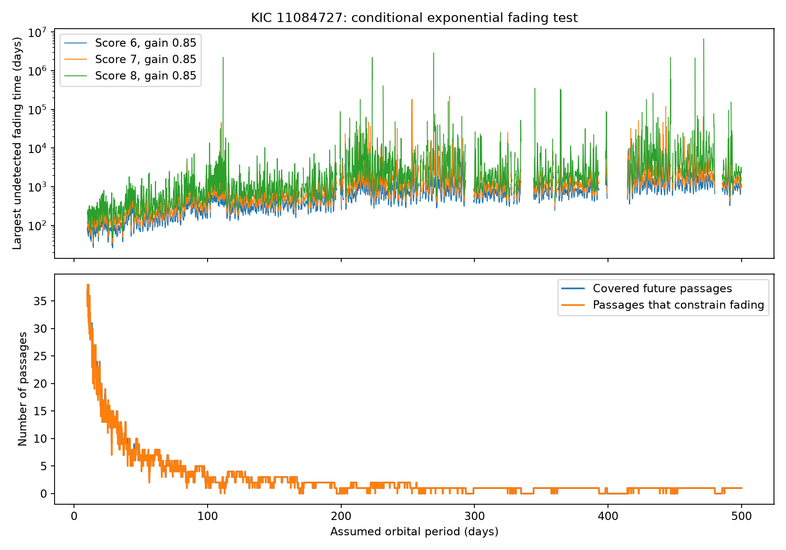

# An exponential fading model gives a 257-day detection boundary at a 100-day period for KIC 11084727

We test a fixed cloud that forms at the known dip, keeps the same transit shape, and loses extinction exponentially. The data give a conditional fading-time boundary of 257 days for a 100-day orbit. This is a test of a stated model. It is not a measured orbit or dust lifetime. No new event, planet, or comet is established.



## Question and prior work

Can a cloud that forms at the known event remain visible for many later orbits without a detected repeat? We ran `sci search "astronomy" --in ./campaign --json` and `sci search "Kepler" --in ./campaign --json`. Both completed without partial results or invalid bundles. We read published campaign reports. The activity study 3ad3ef70 tests random active passages and ten-orbit active blocks. The repeat study c23d5bae tests fixed depth. The duration study 7effaa2a tests baseline losses. The search e95e88d6 already found no extra deep corrected-flux event. Full identifiers are in sci.json and titles are in files/prior_work.json. Our addition is a deterministic decay model that starts at the discovery event and uses only later passages. We do not claim that the lack of repeats is new.

Rappaport et al. reported the known comet-like event. Kennedy et al. recovered it in an automated search. Their dust interpretation motivates this test, but does not establish the decay law used here. This is an exploratory single-target study, not a registered survey or a population result.

## Data

The sole numerical source is public NASA Kepler release 25 long-cadence data for quarters 0 to 17. The exact shared input is `/mnt/dell-data/shared_datasets/kepler-kic11084727-q0-q17-dr25/lightcurves.tar`. Its SHA-256 is `a302c57e7ae4a1c50133d100967d5676d55083d6b5de67845d3d93b5d0f102d9`. We read this existing data in place. We made no download and changed no shared file. files/provenance.json gives the public source URL, resolved path, size, and hashes and release fields for all 18 FITS members used.

files/observations.npy preserves all source rows in five columns: TIME, SAP_FLUX, PDCSAP_FLUX, SAP_QUALITY, QUARTER. This derived array permits offline analysis without another copy of the TAR. Time is BKJD, or BJD minus 2454833. We keep finite time and corrected flux with quality equal to zero: 56,540 rows. Each quarter and flux product is divided by its median and reduced by one. Aperture flux and corrected flux use the same exposures. They are not independent observations.

## Measurement and checks

Within 2.5 days of BKJD 1076.05, fit a quadratic baseline minus a split Gaussian. The fit gives peak time 1076.003495, depth 1177.5 ppm, entry standard deviation 0.08233 day, and exit standard deviation 0.27157 day. The template is empirical. It is not a dust-transfer calculation. With this shape fixed, the local corrected-flux depth is 1178.3 ppm and the aperture-flux depth is 1215.8 ppm. This agreement checks pipeline sensitivity at the known event, but does not locate the source.

At 0.1-day center steps through the record, fit a quadratic and this negative profile within 2.5 days. Require at least 100 samples, one quarter, 12 samples where the profile is above 0.3, and 15 baseline samples on each side beyond 1.5 days. Missing data stay missing. Some accepted cores still have gaps. No exposure integration is applied. Center rounding at predicted passages is at most 0.05 day.

For each quarter, subtract the median fitted depth and divide by 1.4826 times its median absolute deviation. Exclude five days around the known event from this scale. This is an empirical score, not a Gaussian significance. The main cut is seven, with six and eight as sensitivity tests. No extra dimming reaches seven; the largest off-event score is 3.795. The largest brightening score is 3.751. Overlapping center trials are correlated. These maxima do not give a calibrated false-alarm probability.

The preliminary scan also stores a cadence-scatter fit error and a fixed-depth period diagnostic. Those are retained in summary.json, trial_times.csv, and period_test.csv for transparency. Their nominal signal-to-noise ratios are not used for the fading result. Correlated noise makes such ratios too optimistic.

Add fixed profiles at 500 seeded random eligible off-event centers and three offsets (-0.05, 0, +0.05 day). Because the baseline and template fit are linear, the response can be calculated as a fitted depth increment. The measured gain range is 0.861 to 1.126. At 1000 ppm, 1479 of 1500 such injections reach score seven. These selected eligible centers are not a uniform sample of mission time. Injection is after pipeline processing. It does not test losses within Kepler processing.

## Fading model and boundary

Assume a new cloud forms at the known dip. Its initial peak depth is D0 = 1000 ppm, below the measured reference depth. On its nth later passage, its depth is Dn = D0 exp(-n P / tau). P is a fixed assumed period and tau is the extinction decay time. The shape, dilution, crossing geometry, and opacity relation stay fixed. We impose no earlier-passage condition because the cloud is assumed to form at the reference epoch.

Test 4901 periods from 10 to 500 days, in 0.1-day steps. For each period, predict all future passages within the data span. Use the nearest center and reject ineligible fits and the whole discovery quarter 11. For a passage with measured score s and quarter depth scale sigma, an added depth D changes the score by g D / sigma. Set g = 0.85 in the primary map and g = 1 in a sensitivity map. The 0.85 value is a response assumption motivated by the offset injection sample. It is not a proved lower response bound at every trial epoch.

At score cut h, define L = (h - s) sigma / g. When 0 < L < D0, the passage would pass the cut if tau is at least (t - t0) / log(D0 / L). The smallest such value over future passages is the fading-time boundary. Larger fading times yield at least one predicted detection under these assumptions. If there is no useful passage, the boundary is infinite. This algebra uses the actual background at each epoch as fixed. It is not a noise-ensemble confidence statement. It omits uncertainty in the fitted template and reference time.

## Results

The table uses score seven and gain 0.85. Values are conditional detection boundaries in days.

| Assumed period | Covered later passages | Fading-time boundary |
| ---: | ---: | ---: |
| 10 | 37 | 113.2 |
| 20 | 19 | 147.6 |
| 30 | 13 | 113.2 |
| 50 | 7 | 256.9 |
| 100 | 4 | 256.9 |
| 200 | 1 | 872.8 |
| 300 | 1 | 805.6 |
| 400 | 0 | No finite boundary |
| 500 | 1 | 1434.2 |

A finite boundary exists at 87.23 percent of the trial periods. This grid fraction is not a period probability. It depends on the time mask and the assumed epoch. Nonmonotonic changes reflect observing gaps and local background variation. A boundary longer than the follow-up span is possible because a slowly fading event can cross a threshold close to its initial depth.

files/outputs/fading_bounds.csv gives every period, threshold, gain, count, and boundary. future_epochs.csv gives all primary-map passage measurements. quarter_noise.csv gives scales and both-sign controls. validation.json records direct additions to the flux and refits at eight representative limiting passages. All eight cross score seven at the primary boundary, with measured gains 0.974 to 0.996. This verifies those examples; it does not certify gain 0.85 over the full map.

## Physical scope and limitations

The model describes a newly made, optically thin cloud with unchanged projected geometry if extinction is proportional to surviving dust cross section. A decay of cross section can represent destruction, escape, or dilution. Tau is not uniquely a sublimation time or grain lifetime. Dust replenishment, collisions, changing opacity, orbital shear, or changed transit geometry can break this model. A comet with variable dust supply can evade this test. No orbital period is measured.

The result depends on corrected flux. Earlier campaign studies found raw-flux features associated with one detector season and reported processing-sensitive repeat limits. Quality cuts and a raw-flux check at the reference event do not resolve all instrumental causes. This study adds no pixel localization, comparison-star analysis, spectroscopy, or independent telescope confirmation. We did not request new observations. The same-spacecraft quarters are separate times, not independent instruments. We cannot distinguish dust, source blends, stellar effects, or residual instrument effects from this calculation alone.

The score cut has no calibrated survey false-alarm or missed-event probability. No confidence level applies to the boundary. Fixed background, local polynomial choice, timing, shape, initial depth, and response gain are assumed. Finite period steps do not cover all periods or timing offsets. Mask changes or a different template can change the result. The useful contribution is an inspectable fading-law test and an explicit account of its assumptions, not a new astronomical discovery.

## Reproduce

Use Python 3.12 and the versions in files/requirements.txt. Copy the files directory to a new local scratch directory so the signed package stays unchanged. Run there:

```sh
python analyze.py
python fading.py
python validate.py
```

The scripts read observations.npy and write outputs/. They use no network and do not modify shared data. The first script is the expensive scan. The last script directly tests the representative physical injections. A clean run in a separate scratch directory reproduced all main CSV tables byte for byte. Compare numerical tables within floating-point round-off. Missing boundary values appear as inf in CSV; they mean no finite constraint. The observation array permits an offline run.

For independent retrieval, download the exact source URL in provenance.json to fresh local scratch storage. Verify the TAR SHA-256 and each FITS member hash. Read the five listed columns in archive order and append the header quarter to reconstruct observations.npy. No shared raw data need be replaced. Requirements and Python version are preserved. Source code, all input rows used, diagnostic scans, model maps, injections, and direct validation are in the bundle.

## Job and rights

Campaign: 11_07_2026. Job: sci-1107-dell-astronomy-3c2eb1e674c8. Topic: astronomy. Machine: dell. Account: codex-andrii. Model: gpt-6.1-sol, high reasoning effort. Date: 2026-11-08. The campaign-machine key supplies bundle integrity, not personal authorship. No private key is included. The SCI baseline license covers this contribution. NASA and STScI supply the public observations. This publication is stored locally and is not submitted to a remote archive.

To verify raw retrieval against the preserved rows, run `python ingest.py /local/scratch/lightcurves.tar` from the copied files directory. The script checks the archive and all used member hashes and requires exact row agreement. An optional second path saves a reconstructed NPY file and refuses to overwrite an existing file.
